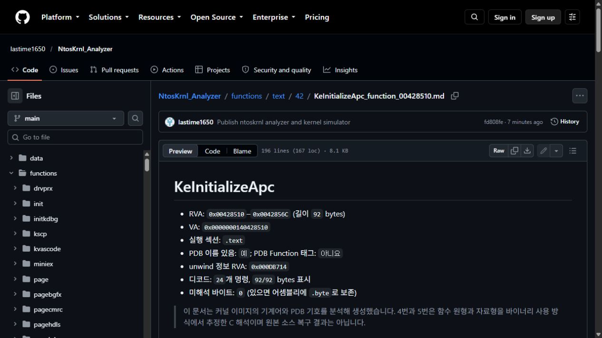
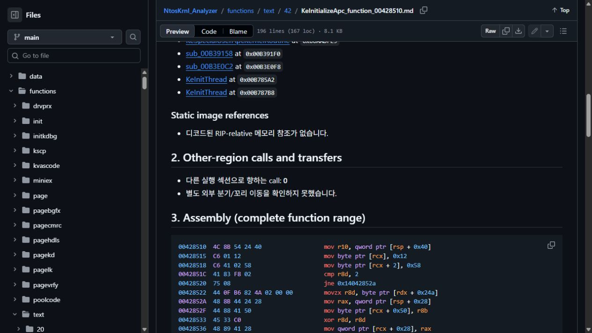
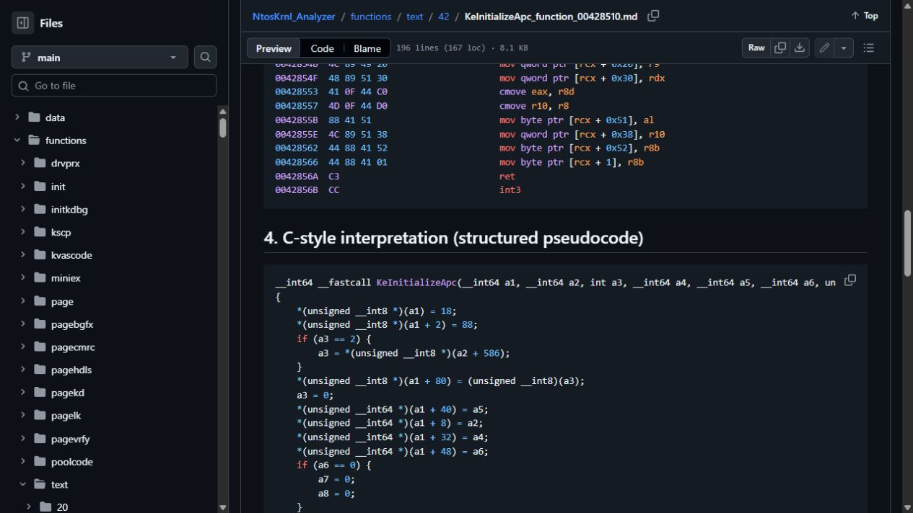
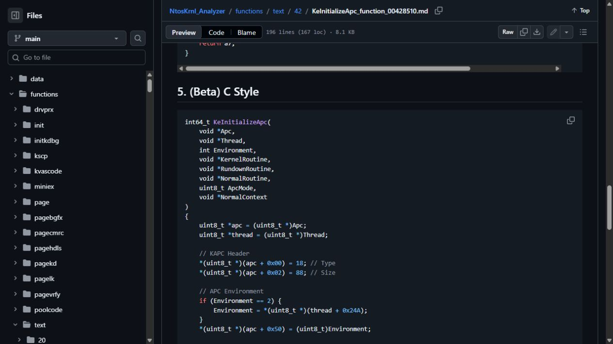
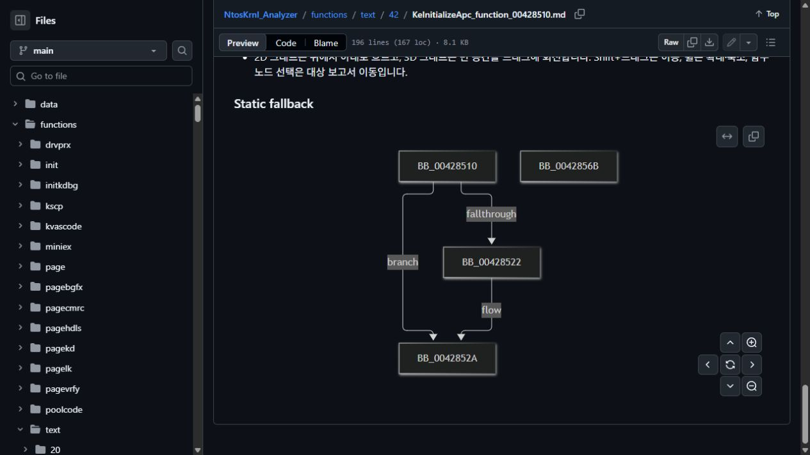
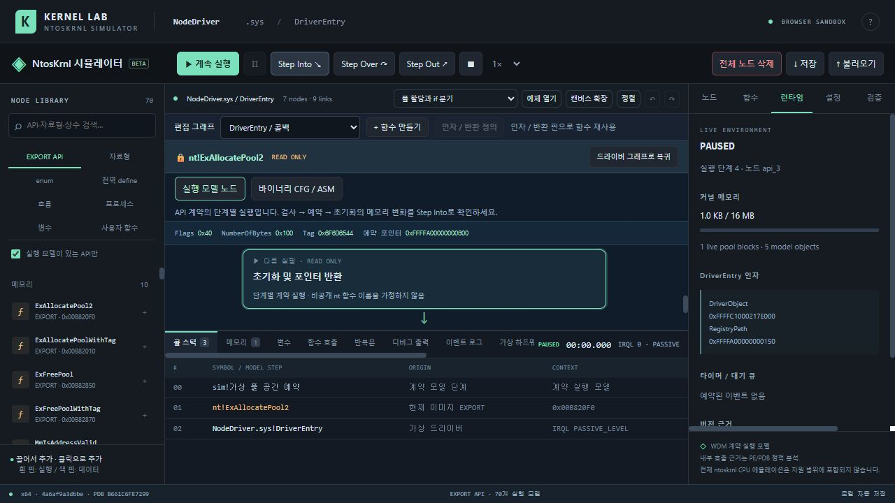

<h1 align="center">NtKrnl Analyzer &amp; Simulator</h1>

<p align="center">
  <strong>ntoskrnl.exe의 함수와 실행 흐름을 읽고, 가상 드라이버를 블록으로 구성해 보는 Windows 커널 분석 도구</strong>
</p>

<p align="center">
  
  
  
  
</p>

<p align="center">
  <a href="functions/text/42/KeInitializeApc_function_00428510.md"><strong>KeInitializeApc 예제 보기</strong></a>
  · <a href="index.md">함수 목록</a>
  · <a href="control-panel.html">분석 컨트롤 패널</a>
  · <a href="simulator/">NtosKrnl 시뮬레이터</a>
</p>

> [!IMPORTANT]
> 이 프로젝트는 커널 바이너리와 PDB 심볼을 분석해 C 스타일 해석을 제공합니다. **Microsoft 원본 소스 코드를 복원하는 도구는 아닙니다.** 브라우저 시뮬레이터도 실제 Windows 커널이나 드라이버를 실행하지 않고, 명시적으로 구현된 모델만 가상 실행합니다.

## 무엇을 할 수 있나요?

| 🔎 **커널 함수 분석** | 🧩 **드라이버 흐름 시뮬레이션** |
| --- | --- |
| 함수의 RVA, 의존성, 어셈블리, 분기, 의사코드, Beta C Style을 보고 호출 관계를 따라갑니다. | 코드 작성과 컴파일 없이 노드를 연결합니다. 실행 중 콜 스택, 값, 레지스터, 메모리와 내부 단계 흐름을 확인합니다. |
| 기준 이미지에서 실행 범위로 식별된 함수 보고서 **37,994개** 제공 | `DriverEntry`, 제어 흐름, 변수, 프로세스 주소 공간, 콜백, 메모리와 모델링된 EXPORT API 지원 |

이 저장소에는 **정적 분석 보고서**와 **가상 커널 시뮬레이터**가 함께 있습니다. 먼저 아래 `KeInitializeApc` 예제를 열어 보고서가 어떻게 구성되는지 확인한 다음, 시뮬레이터에서 블록 기반 실행 화면을 살펴보세요.

## 예제로 빠르게 익히기: `KeInitializeApc`

[`KeInitializeApc` 전체 보고서 열기](functions/text/42/KeInitializeApc_function_00428510.md)에는 의존성부터 CFG까지 여섯 섹션이 있습니다. 각 항목을 차례로 보면 같은 함수가 기계어에서 구조화된 흐름, 읽기 쉬운 C 재구성으로 바뀌는 과정을 비교할 수 있습니다.

### 1. 함수 위치와 분석 범위

RVA, 실행 섹션, 명령 수와 PDB 심볼 상태를 먼저 확인합니다. `KeInitializeApc`는 기준 이미지의 `.text`에 있고, 이 보고서에서 92바이트와 24개 명령을 해석했습니다.



### 2. 원래 명령과 바이트 확인

주소와 기계어 바이트를 함께 표시합니다. 레지스터 이동, 메모리 오프셋 접근, 조건 분기와 반환을 따라가며 해석 근거를 확인할 수 있습니다.



### 3. 제어 흐름을 C 의사코드로 읽기

의사코드는 디스어셈블 결과에서 분기와 메모리 동작을 구조화해 보여줍니다. 함수 인자나 내부 구조의 의미를 확정하기 어려운 부분은 `a1`, `a2`와 오프셋처럼 바이너리에서 확인 가능한 표현을 유지합니다.



### 4. 타입과 인자 이름을 붙인 Beta C Style

Beta C Style은 함수 이름, 인자 이름, 포인터와 정수 타입을 이용해 동작을 더 익숙한 C 문법으로 다시 표현합니다. 아래 예시에서는 `Apc`, `Thread`, `NormalRoutine`과 KAPC 오프셋을 함께 볼 수 있습니다.



> [!NOTE]
> Beta의 타입·인자 이름과 구조체 필드 대응은 PDB 단서 및 메모리 접근 패턴을 바탕으로 한 **분석자의 재구성**입니다. 원본 선언과 일치한다고 보장하지 않으며, 의사코드와 Beta를 나란히 비교해 근거와 추정을 구분해 주세요.

### 5. 분기 그래프에서 실행 경로 보기

CFG는 기본 블록을 위에서 아래로 배치하고 조건 분기와 이어지는 흐름을 보여줍니다. 보고서의 링크를 따라가면 2D/3D 그래프와 함수 탐색 컨트롤 패널에서 함수 간 관계를 더 살펴볼 수 있습니다.



## 블록을 연결해 가상 드라이버 실행하기

`simulator/`에는 브라우저에서 사용하는 **NtosKrnl 시뮬레이터**가 있습니다. `DriverEntry`에서 시작해 API, 변수, 분기와 반복 노드를 연결하고, 시뮬레이션을 실행하거나 중단점에서 한 단계씩 진행할 수 있습니다.



### 디버거에서 확인할 수 있는 것

- **실행 흐름:** 재생·일시 정지, Step Into·Step Over·Step Out, 사용자 함수 호출과 복귀를 콜 스택에서 확인
- **노드와 값:** 현재 실행 노드, 핀 인자, 지역·전역 변수, 배열과 구조체 필드의 값 변화 추적
- **가상 커널 상태:** 설정 가능한 커널 메모리 한도, 풀 할당, 프로세스와 가상 주소 공간, 가상 레지스터 확인
- **시간·콜백:** 타이머 이벤트와 모델링된 프로세스·스레드·이미지·레지스트리 콜백 흐름 확인
- **진단:** DbgPrint 출력, 이벤트 로그, 모델 오류와 예상 NTSTATUS 표시
- **읽기 전용 내부 단계:** 지원하는 API는 Step Into를 통해 대상 이미지의 정적 CFG를 탐색. 내부 노드는 수정할 수 없습니다.

노드 라이브러리에는 API 외에도 자료형, enum, 전역 define, 문자열과 구조체 노드가 있습니다. 현재 카탈로그에는 **70개 API 실행 계약**과 **115개 자료형**이 등록되어 있습니다. 실제로 실행 가능한 API는 실행 계약이 구현된 항목으로 제한됩니다.

## 5분 안에 실행하기

### 1) 저장소와 기준 보고서 가져오기

Windows 10/11 x64, Git LFS, Python 3.10 이상이 필요합니다. 전체 기준 그래프 파일을 받으려면 Git LFS가 활성화되어 있어야 합니다.

```powershell
git lfs install
git clone https://github.com/lastime1650/NtosKrnl_Analyzer.git
cd NtosKrnl_Analyzer
git lfs pull
python -m pip install capstone
```

### 2) 함수 검색 및 보고서 열기

- GitHub에서 [함수 인덱스](index.md) 또는 위의 [`KeInitializeApc` 보고서](functions/text/42/KeInitializeApc_function_00428510.md)를 바로 엽니다.
- 로컬 컨트롤 패널을 쓰려면 최신 브라우저에서 저장소의 `control-panel.html`을 열고 **프로젝트 폴더 연결**을 눌러 저장소 폴더를 선택합니다.
- 함수명 또는 RVA로 검색하고 보고서와 2D/3D 그래프를 전환합니다. 보고서의 의존성 링크를 클릭하면 호출된 함수나 호출자를 따라갈 수 있습니다.

### 3) 시뮬레이터 열기

저장소 루트에서 로컬 서버를 실행하고 브라우저에서 `http://127.0.0.1:8000/simulator/`를 엽니다.

```powershell
python -m http.server 8000
```

`DriverEntry`에서 시작해 노드 라이브러리의 블록을 캔버스로 가져오고 핀을 연결합니다. **시뮬레이션 시작** 후 중단점을 설정하거나 Step Into를 눌러 실행과 값을 추적합니다.

## 다른 Windows 버전 분석하기

새 OS 빌드의 분석 결과를 별도 프로젝트로 만들려면 저장소에서 `start_dynamic_analysis.cmd`를 실행합니다. 컨트롤 패널에서 **동적 ntoskrnl.exe 분석요청**을 선택하고 대상 `ntoskrnl.exe` 경로와 새 결과 폴더명을 지정한 뒤 분석을 시작합니다.

1. 실행 파일의 PE 식별 정보를 읽고 일치하는 Microsoft PDB를 가져옵니다.
2. PDB 식별자를 검증한 뒤 exports/imports, 실행 함수 심볼, 분석 보고서와 그래프를 생성합니다.
3. 실행 파일 해시와 PDB 정보를 manifest에 함께 기록합니다.

기본 커널 경로는 `C:\Windows\System32\ntoskrnl.exe`입니다. 분석 대상과 PDB가 일치하지 않거나 PDB 파일을 검증할 수 없으면 해당 단계에서 실패를 보고합니다. OS 커널을 실행하거나 변경하는 작업은 하지 않습니다.

## 분석 범위와 정확도

> [!WARNING]
> 시뮬레이터는 교육·탐색을 위한 브라우저 샌드박스입니다. 실제 드라이버를 로드하지 않으며, GPU·장치·CPU에서 커널 명령을 실행하지 않습니다. 예상 NTSTATUS와 BSOD 화면도 시뮬레이터 모델의 진단 표현입니다.

- **기준 보고서:** 저장소에 포함된 37,994개 보고서는 하나의 기준 `ntoskrnl.exe` 이미지와 대응 PDB를 대상으로 생성했습니다. 다른 빌드는 동적 분석으로 별도 결과를 만드세요.
- **C 해석:** 어셈블리와 PDB 정보에서 복원한 해석이며 원본 C 코드가 아닙니다. 최적화, 간접 호출, 빠진 타입 정보에 따라 의미가 달라질 수 있습니다.
- **함수 경계:** 집계는 PE 실행 범위와 분석기가 식별한 경계를 기준으로 합니다. 심볼·unwind 정보가 없는 일부 코드 조각은 별도 함수로 정확히 분리되지 않을 수 있습니다.
- **호출 그래프:** 정적 분석에서 확인된 호출·분기 관계입니다. 입력에 따라 실제로 선택되는 런타임 경로를 증명하지는 않습니다.
- **내부 CFG:** 실제 실행 기록이 아니라 대상 바이너리에서 계산한 정적 분기 흐름입니다. 시뮬레이터의 API 계약 모델과 구분해서 확인하세요.

## 저장소 안내

| 위치 | 내용 |
| --- | --- |
| [`index.md`](index.md), [`function-index.json`](function-index.json) | 함수 탐색 인덱스와 RVA·심볼 데이터 |
| [`functions/`](functions/) | 함수별 어셈블리·의사코드·Beta C Style Markdown 보고서 |
| [`graphs/`](graphs/) | 함수 실행 흐름 그래프 데이터 (일부 파일은 Git LFS) |
| [`control-panel.html`](control-panel.html) | 검색, 보고서, 2D/3D 그래프를 제공하는 정적 컨트롤 패널 |
| [`simulator/`](simulator/) | 노드 편집기, 디버거, API 계약 모델과 브라우저 예제 |
| [`tools/`](tools/) | PE/PDB 분석, 버전별 분석 실행과 로컬 서버 |

<details>
<summary>개발자용 자동 테스트 실행 방법</summary>

Node.js가 설치된 환경에서 시뮬레이터 디렉터리에서 실행합니다.

```powershell
cd simulator
node --test tests/*.test.mjs
```

</details>

## 사용한 자료

- [Microsoft Public Symbols 및 Symbol Server](https://learn.microsoft.com/en-us/windows-hardware/drivers/debugger/microsoft-public-symbols)
- [Capstone Disassembly Framework](https://www.capstone-engine.org/)
- [Git Large File Storage](https://docs.github.com/en/repositories/working-with-files/managing-large-files/about-git-large-file-storage)
