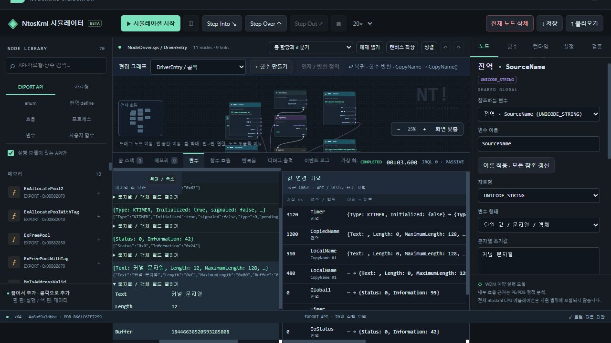

# NtKrnl Analyzer & Simulator

Windows `ntoskrnl.exe` 정적 분석 도구와 블록 그래프 기반 커널 동작 시뮬레이터입니다. PE 구조, 일치하는 Microsoft PDB 심볼, x64 명령을 분석해 함수 보고서를 만들고, 별도 브라우저 샌드박스에서 드라이버 흐름을 구성하고 살펴봅니다.

> **분석 범위:** 함수의 C 스타일은 바이너리와 심볼을 토대로 만든 재구성입니다. Microsoft의 원본 C 소스가 아닙니다. 시뮬레이터는 선택된 API 계약을 모델링합니다. 실제 Windows 커널을 실행하거나 전체 ntoskrnl 명령을 에뮬레이트하지 않습니다.

## 주요 기능

### 실행 파일과 심볼 분석

- PE 헤더·섹션, exports/imports, x64 `RUNTIME_FUNCTION` 범위, unwind 정보, CodeView 식별자를 읽습니다.
- 실행 파일의 GUID/age와 일치하는 PDB를 Microsoft Symbol Server에서 가져옵니다. PDB의 기호를 RVA와 연결하고 보고서에 근거와 분석 한계를 남깁니다.
- 새 Windows 빌드마다 별도 분석 폴더를 만들 수 있습니다. 실행 이미지 해시와 PDB 식별자를 manifest에 기록해 다른 바이너리의 결과를 섞지 않습니다.
- 현재 저장된 기준 보고서는 PE/PDB 식별자 `B661C6FE-7299-1D16-0FE3-7C48B8BC5470`, SHA-256 `4a6af9a3dbbeb440c4a9fbe8a4d6832eae751ac3a85860d860b8313a737a2e3a`에 해당합니다. 실제 분석 대상은 PC마다 달라질 수 있습니다.

### 함수별 Markdown 보고서

현재 기준 이미지의 실행 함수 범위 **37,994개**를 `functions/` 아래 개별 Markdown 파일로 제공합니다. `index.md`에서 PE 섹션별로 찾아가거나 `function-index.json`에서 RVA와 기호를 검색할 수 있습니다.

각 보고서에는 다음 내용이 포함됩니다.

1. 직접 의존성, 호출 대상과 호출자, 이미지 참조
2. 다른 실행 영역으로의 호출과 범위 밖 분기
3. 디스어셈블된 명령과 주소
4. 레지스터·ABI 인자·메모리 접근·분기를 바탕으로 한 C 의사코드
5. (Beta) 타입과 의미 있는 인자 이름을 사용한 C 스타일 재구성 및 확인 가능한 오프셋
6. 조작 가능한 실행 흐름 그래프

### 대화형 분석 컨트롤 패널

`control-panel.html`은 함수 검색, 함수별 보고서 열기, 호출 관계 탐색을 한 화면에서 제공합니다. 그래프를 2D 세로 배치 또는 3D 회전 보기로 전환하고, 노드를 선택해 디스어셈블리와 분기·호출 관계를 살펴볼 수 있습니다. 함수명과 RVA로 필터링하고 원본 Markdown 보고서로 이동할 수 있습니다.

### 블록 그래프 커널 시뮬레이터

`simulator/`에는 브라우저에서 사용하는 NtosKrnl 시뮬레이터가 있습니다. 노드 라이브러리에서 블록을 배치하고 핀을 연결해 `DriverEntry`에서 시작하는 가상 드라이버 흐름을 구성합니다.

- **API와 실행 흐름:** 등록된 EXPORT 노드, 자료형·enum·전역 define, 여러 갈래 `if / else if / else`, `for`·`while`, `break`·`continue`를 연결합니다.
- **사용자 함수:** 함수 그래프를 따로 편집하고 인자와 반환값을 연결합니다. 중첩·재귀 호출의 진입과 복귀를 콜 스택에서 봅니다.
- **디버깅:** 중단점과 Step Into·Step Over·Step Out을 사용하고 현재 노드, 핀 값, 콜 스택, 변수 변경 이력, 레지스터, 이벤트 로그와 DbgPrint 출력을 확인합니다.
- **변수와 자료형:** 현재 115개 등록 자료형을 지역·전역 변수, 배열 요소, 구조체 필드에서 사용할 수 있습니다. ANSI, WCHAR, ANSI_STRING, UNICODE_STRING, 정수 별칭, typed pointer, IO_STATUS_BLOCK, KTIMER 등 모델 객체를 포함합니다. 문자열 버퍼 용량을 설정하고 구조체 필드를 직접 정의할 수도 있습니다.
- **문자열과 메모리:** 문자열 변수는 시뮬레이터가 소유하는 버퍼와 길이를 추적합니다. 문자열 복사, 용량 초과, 함수별 지역 수명, API의 메모리 변경을 디버거에서 살펴봅니다. ANSI는 단일 바이트(0–255), WCHAR 계열은 UTF-16을 사용합니다.
- **프로세스와 주소 공간:** 가상 프로세스, 프로세스 핸들, 사용자 가상 주소, 페이지 권한, attach/detach, 가상 할당·해제를 모델링하고 노드에서 할당 변화를 확인합니다.
- **시간과 콜백:** 가상 타이머와 DPC, 지연 실행 이벤트, 프로세스·스레드·이미지·레지스트리 콜백 등록과 통지 흐름을 확인합니다.
- **장치와 하드웨어 모델:** 장치 생성, 심볼릭 링크, MMIO 매핑, 가상 하드웨어 상태를 확인합니다. 이는 장치의 실제 하드웨어 동작을 재현하지 않습니다.
- **커널 메모리와 오류:** 설정 가능한 메모리 한도 안에서 풀 할당·해제를 추적합니다. 모델의 잘못된 동작은 오류 노드와 예상 NTSTATUS/BSOD 화면으로 표시하고 원인 노드를 강조합니다.
- **읽기 전용 커널 내부 보기:** 지원되는 API의 Step Into에서 이미지와 대응하는 PE/PDB 분석으로 만든 내부 CFG를 탐색합니다. 내부 CFG는 정적 분기 후보이며 실시간 커널 CPU 추적이나 검증된 내부 로직의 원본 C 구현이 아닙니다. 내부 노드는 수정할 수 없습니다.

시뮬레이터의 API 카탈로그에는 기준 이미지의 exports가 있고, 현재 **70개 API에 실행 계약 모델**이 있습니다. 나머지 export가 실제로 실행된다는 의미로 가장하지 않습니다. 그래프에 API가 있더라도 그 API 계약이 모델에 없으면 지원 범위를 확인하세요.



## 시작하기

### 요구 사항

- Windows 10/11 x64. Microsoft DbgHelp를 사용하므로 PE/PDB 분석기는 Windows에서 실행합니다.
- Python 3.10 이상과 Capstone:

  ```powershell
  python -m pip install capstone
  ```

- 동적 버전 분석은 인터넷 연결과 Microsoft Symbol Server 접근이 필요합니다.
- 시뮬레이터 개발 자동 테스트에는 Node.js가 필요합니다. 브라우저 시뮬레이터 자체는 별도 npm 의존성이 없습니다.
- 100 MiB를 넘는 기준 CFG 파일은 Git LFS에 있습니다. 전체 저장소를 가져오려면 Git LFS를 설치하고 활성화하세요.

### 받기 및 실행

```powershell
git lfs install
git clone https://github.com/lastime1650/NtosKrnl_Analyzer.git
cd NtosKrnl_Analyzer
git lfs pull
python -m pip install capstone
```

- 기존 기준 이미지의 모든 보고서와 검색 패널은 `index.md` 및 `control-panel.html`에서 엽니다. 최신 브라우저에서 `control-panel.html`을 열고 안내에 따라 분석 데이터 폴더를 연결하면 보고서와 그래프를 탐색할 수 있습니다.
- 블록 그래프 시뮬레이터를 로컬 HTTP 서버로 열려면 저장소 루트에서 다음을 실행하고 `http://127.0.0.1:8000/simulator/`로 이동합니다.

  ```powershell
  python -m http.server 8000
  ```

### 다른 Windows 버전 분석

`start_dynamic_analysis.cmd`를 실행하면 로컬 분석 컨트롤 패널이 열립니다. **동적 ntoskrnl.exe 분석요청**을 선택하고 대상 `ntoskrnl.exe` 경로와 새 결과 폴더명을 지정합니다. 기본 이미지 경로는 `C:\Windows\System32\ntoskrnl.exe`입니다. 일치하는 PDB를 찾지 못하거나 내려받은 PDB를 검증할 수 없으면 분석을 중단하고 오류를 기록합니다. 이미 존재하는 결과 폴더를 덮어쓰지 않습니다.

분석은 실행 파일의 코드와 심볼을 읽는 정적 분석입니다. OS 커널을 재부팅하거나 대상 바이너리를 실행하지 않습니다. 새 폴더에는 PE/PDB 근거, 함수 인벤토리, Markdown 보고서, 그래프, 검색 패널, simulator용 카탈로그와 manifest가 생성됩니다. PDB 원본은 Microsoft Symbol Server에서 받아 결과 분석 폴더의 `symbols/`에 저장합니다.

## 자동 테스트

브라우저 없이 실행 가능한 시뮬레이터 테스트:

```powershell
cd simulator
node --test tests/*.test.mjs
```

이 버전의 기록은 자동 테스트 **432/432 통과**, 브라우저 내장 회귀 시나리오 **117/117 통과**입니다. 브라우저 회귀 결과는 `simulator/test-results/variable-types-browser-regression.json`에 있습니다. 이 값은 해당 소스 스냅샷의 검사 기록이며 새로운 변경을 자동 인증하지 않습니다.

## 저장소 구성

| 경로 | 용도 |
| --- | --- |
| `tools/ntoskrnl_disassembler.py` | PE/PDB, exports/imports, x64 함수 범위 인벤토리 |
| `tools/analysis_runner.py` | 버전별 분석 작업과 단계 로그 |
| `tools/analysis_server.py` | localhost 동적 분석 API와 컨트롤 패널 서버 |
| `build_reports.py`, `add_beta_style.py` | Markdown 어셈블리·의사코드·C 스타일 생성 |
| `build_control_panel.py`, `control-panel.template.html` | 정적 보고서 컨트롤 패널 빌드 |
| `build_simulator.py`, `build_internal_graphs.py` | 이미지별 simulator 카탈로그와 내부 CFG 빌드 |
| `functions/`, `graphs/`, `function-index.json` | 기준 이미지의 함수 보고서와 그래프 인덱스 |
| `simulator/` | 브라우저 시뮬레이터, 실행 모델, 테스트와 예제 |

버전별 분석 결과, PDB 사본, 중간 작업 파일은 재생성할 수 있고 로컬 경로를 담을 수 있어 저장소에 포함하지 않습니다. 기준 버전의 보고서/그래프와 simulator 실행 자산은 포함합니다.

## 알려진 한계

- PDB는 심볼과 타입 단서를 제공할 뿐 원본 소스 코드를 복구하지 않습니다. C 의사코드와 C 스타일은 기계어 해석 결과이며 복잡한 간접 분기·벡터 연산·최적화된 루프는 원본과 다를 수 있습니다.
- x64 leaf 함수나 스트립된 루틴은 unwind 및 기호 메타데이터가 없어 경계를 모두 분리할 수 없습니다. README의 함수 수는 인식 가능한 실행 범위 집계입니다.
- 정적 CFG는 분기와 호출의 후보를 보여주며 실제 실행 경로를 증명하지 않습니다.
- 브라우저 시뮬레이터는 제한된 API 계약을 대상으로 한 가상 모델입니다. 실제 드라이버를 로드하거나 GPU/장치에 명령을 보내지 않으며 Windows 커널의 보안 테스트 대용이 아닙니다.

## 자료와 참고

- [Microsoft Symbol Server](https://learn.microsoft.com/en-us/windows-hardware/drivers/debugger/microsoft-public-symbols)
- [Capstone disassembly framework](https://www.capstone-engine.org/)
- [GitHub Large File Storage](https://docs.github.com/en/repositories/working-with-files/managing-large-files/about-git-large-file-storage)
