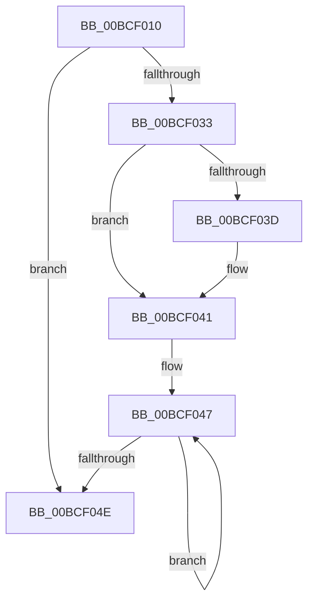

# DpxEndpointWrappedCall

- RVA: `0x00BCF010`–`0x00BCF0B7` (길이 `167` bytes)
- VA: `0x0000000140BCF010`
- 실행 섹션: `DRVPRX`
- PDB 이름 있음: `예`; PDB Function 태그: `아니요`
- unwind 정보 RVA: `0x000BFE60`
- 디코드: `52`개 명령, `167/167` bytes 표시
- 미해석 바이트: `0` (있으면 어셈블리에 `.byte`로 보존)

> 이 문서는 커널 이미지의 기계어와 PDB 기호를 분석해 생성했습니다. 4번과 5번은 함수 원형과 자료형을 바이너리 사용 방식에서 추정한 C 해석이며 원본 소스 복구 결과는 아닙니다.

## 1. Dependencies

- 직접 호출 지점: **3**; 고유 호출 대상: **3**
- 직접 호출자로 확인된 함수: **0**
- RIP 상대 이미지 참조: **0**

### Outgoing calls
- `0x00BCF070` → [DpxAcquireSimpleRundown](../../text/5B/DpxAcquireSimpleRundown_function_005B0470.md) (function, `0x005B0470`)
- `0x00BCF091` → `indirect target` (indirect, 간접 대상)
- `0x00BCF0A4` → [DpxReleaseSimpleRundown](../../text/5B/DpxReleaseSimpleRundown_function_005B04C0.md) (function, `0x005B04C0`)

### Direct callers
- 이 함수 시작 RVA로 연결되는 직접 call은 확인되지 않았습니다. 간접 호출은 완전히 역산할 수 없습니다.

### Static image references
- 디코드된 RIP-relative 메모리 참조가 없습니다.

## 2. Other-region calls and transfers

- 다른 실행 섹션으로 향하는 call: **2**
  - `0x00BCF070` → [DpxAcquireSimpleRundown](../../text/5B/DpxAcquireSimpleRundown_function_005B0470.md) (`DRVPRX` → `.text`)
  - `0x00BCF0A4` → [DpxReleaseSimpleRundown](../../text/5B/DpxReleaseSimpleRundown_function_005B04C0.md) (`DRVPRX` → `.text`)
- 별도 외부 분기/꼬리 이동을 확인하지 못했습니다.

## 3. Assembly (complete function range)

```asm
00BCF010  48 55                           push rbp
00BCF012  53                              push rbx
00BCF013  48 83 EC 18                     sub rsp, 0x18
00BCF017  48 8B EC                        mov rbp, rsp
00BCF01A  48 8B D9                        mov rbx, rcx
00BCF01D  48 89 55 38                     mov qword ptr [rbp + 0x38], rdx
00BCF021  4C 89 45 40                     mov qword ptr [rbp + 0x40], r8
00BCF025  4C 89 4D 48                     mov qword ptr [rbp + 0x48], r9
00BCF029  8B 4B 10                        mov ecx, dword ptr [rbx + 0x10]
00BCF02C  FF C1                           inc ecx
00BCF02E  83 E9 04                        sub ecx, 4
00BCF031  7E 1B                           jle 0x140bcf04e
00BCF033  8B C1                           mov eax, ecx
00BCF035  F7 C1 01 00 00 00               test ecx, 1
00BCF03B  74 04                           je 0x140bcf041
00BCF03D  6A 00                           push 0
00BCF03F  FF C0                           inc eax
00BCF041  C1 E0 03                        shl eax, 3
00BCF044  83 C0 48                        add eax, 0x48
00BCF047  FF 34 04                        push qword ptr [rsp + rax]
00BCF04A  FF C9                           dec ecx
00BCF04C  75 F9                           jne 0x140bcf047
00BCF04E  48 83 EC 20                     sub rsp, 0x20
00BCF052  48 8B CB                        mov rcx, rbx
00BCF055  48 81 E1 00 F0 FF FF            and rcx, 0xfffffffffffff000
00BCF05C  8B 41 14                        mov eax, dword ptr [rcx + 0x14]
00BCF05F  48 C1 E0 0D                     shl rax, 0xd
00BCF063  48 2B C8                        sub rcx, rax
00BCF066  48 89 4D 00                     mov qword ptr [rbp], rcx
00BCF06A  48 8B 09                        mov rcx, qword ptr [rcx]
00BCF06D  48 8D 09                        lea rcx, [rcx]
00BCF070  E8 FB 13 9E FF                  call 0x1405b0470
00BCF075  48 8B 4D 00                     mov rcx, qword ptr [rbp]
00BCF079  48 8B 49 10                     mov rcx, qword ptr [rcx + 0x10]
00BCF07D  48 8B 04 CB                     mov rax, qword ptr [rbx + rcx*8]
00BCF081  4C 8B 4D 48                     mov r9, qword ptr [rbp + 0x48]
00BCF085  4C 8B 45 40                     mov r8, qword ptr [rbp + 0x40]
00BCF089  48 8B 55 38                     mov rdx, qword ptr [rbp + 0x38]
00BCF08D  48 8B 4D 30                     mov rcx, qword ptr [rbp + 0x30]
00BCF091  FF D0                           call rax
00BCF093  0F 1F 00                        nop dword ptr [rax]
00BCF096  48 89 45 08                     mov qword ptr [rbp + 8], rax
00BCF09A  48 8B 4D 00                     mov rcx, qword ptr [rbp]
00BCF09E  48 8B 09                        mov rcx, qword ptr [rcx]
00BCF0A1  48 8D 09                        lea rcx, [rcx]
00BCF0A4  E8 17 14 9E FF                  call 0x1405b04c0
00BCF0A9  48 8B 45 08                     mov rax, qword ptr [rbp + 8]
00BCF0AD  48 8B E5                        mov rsp, rbp
00BCF0B0  48 83 C4 18                     add rsp, 0x18
00BCF0B4  5B                              pop rbx
00BCF0B5  5D                              pop rbp
00BCF0B6  C3                              ret
```

## 4. C-style interpretation (structured pseudocode)

```c
__int64 __fastcall DpxEndpointWrappedCall(__int64 a1, __int64 a2, __int64 a3, __int64 a4)
{
    __int64 result;
    __int64 v_rsp;
    unsigned __int64 v_stack_m20;
    unsigned __int64 v_stack_m28;
    unsigned __int64 v_stack_p10;
    unsigned __int64 v_stack_p18;
    unsigned __int64 v_stack_p20;
    unsigned __int64 v_stack_p8;

    v_rsp = (v_rsp) - (24);
    v_stack_p10 = a2;
    v_stack_p18 = a3;
    v_stack_p20 = a4;
    a1 = (unsigned int)(((unsigned int)(*(unsigned int *)(a1 + 16))) + 1);
    a1 = (unsigned int)((a1) - (4));
    if (condition_is_less_or_equal) goto loc_00BCF04E;
    result = (unsigned int)((unsigned int)(a1));
    if ((((unsigned int)(a1)) & (1)) != 0) {
        result = (unsigned int)(((unsigned int)((unsigned int)(a1))) + 1);
    }
    result = (unsigned int)((result) << (3));
    result = (unsigned int)((result) + (72));
loc_00BCF047:
    a1 = (unsigned int)((a1) - 1);
    if (condition_is_not_equal) goto loc_00BCF047;
loc_00BCF04E:
    v_rsp = (v_rsp) - (32);
    a1 = (a1) & (0xFFFFFFFFFFFFF000ULL);
    result = ((unsigned int)(*(unsigned int *)(a1 + 20))) << (13);
    a1 = (a1) - (result);
    v_stack_m28 = a1;
    result = DpxAcquireSimpleRundown(*(unsigned __int64 *)(a1), a2, a3, a4);
    result = kernel_indirect_call(v_stack_p8, v_stack_p10, v_stack_p18, v_stack_p20);
    v_stack_m20 = result;
    result = DpxReleaseSimpleRundown(*(unsigned __int64 *)(v_stack_m28), v_stack_p10, v_stack_p18, v_stack_p20);
    v_rsp = (v_rsp) + (24);
    return v_stack_m20;
}
```

## 5. (Beta) C Style

```c
int64_t DpxEndpointWrappedCall(void *Arg1, int64_t Arg2, int64_t Arg3, int64_t Arg4)
{
    uint8_t *arg1 = (uint8_t *)Arg1;

    int64_t result;
    int64_t local_rsp;
    uint64_t v_stack_m20;
    uint64_t v_stack_m28;
    uint64_t v_stack_p10;
    uint64_t v_stack_p18;
    uint64_t v_stack_p20;
    uint64_t v_stack_p8;

    local_rsp = (local_rsp) - (24);
    v_stack_p10 = Arg2;
    v_stack_p18 = Arg3;
    v_stack_p20 = Arg4;
    Arg1 = (uint32_t)(((uint32_t)(*(uint32_t *)(arg1 + 0x10))) + 1);
    Arg1 = (uint32_t)((Arg1) - (4));
    if (condition_is_less_or_equal) goto loc_00BCF04E;
    result = (uint32_t)((uint32_t)(Arg1));
    if ((((uint32_t)(Arg1)) & (1)) != 0) {
        result = (uint32_t)(((uint32_t)((uint32_t)(Arg1))) + 1);
    }
    result = (uint32_t)((result) << (3));
    result = (uint32_t)((result) + (72));
loc_00BCF047:
    Arg1 = (uint32_t)((Arg1) - 1);
    if (condition_is_not_equal) goto loc_00BCF047;
loc_00BCF04E:
    local_rsp = (local_rsp) - (32);
    Arg1 = (Arg1) & (0xFFFFFFFFFFFFF000ULL);
    result = ((uint32_t)(*(uint32_t *)(arg1 + 0x14))) << (13);
    Arg1 = (Arg1) - (result);
    v_stack_m28 = Arg1;
    result = DpxAcquireSimpleRundown(*(uint64_t *)(arg1), Arg2, Arg3, Arg4);
    result = kernel_indirect_call(v_stack_p8, v_stack_p10, v_stack_p18, v_stack_p20);
    v_stack_m20 = result;
    result = DpxReleaseSimpleRundown(*(uint64_t *)(v_stack_m28), v_stack_p10, v_stack_p18, v_stack_p20);
    local_rsp = (local_rsp) + (24);
    return v_stack_m20;
}
```

### 관측된 메모리 오프셋

구조체 형식이 확인되지 않은 접근은 인자 기준의 오프셋으로만 기록했습니다.

| 기준 인자 | 오프셋 표현 | 폭 (bit) | 접근 |
|---|---:|---:|---|
| `Arg1` | `+ 0x0` | `64` | `R` |
| `Arg1` | `+ 0x0 + rcx*8` | `64` | `R` |
| `Arg1` | `+ 0x10` | `32` | `R` |
| `Arg1` | `+ 0x14` | `32` | `R` |

## 6. Execution-region graph

[열기: 2D/3D 그래프와 함수 탐색 컨트롤 패널](../../../control-panel.html?section=drvprx&rva=0x00BCF010&view=graph)

- 2D 그래프는 위에서 아래로 흐르고, 3D 그래프는 빈 공간을 드래그해 회전합니다. Shift+드래그는 이동, 휠은 확대·축소, 함수 노드 선택은 대상 보고서 이동입니다.

### Static fallback


