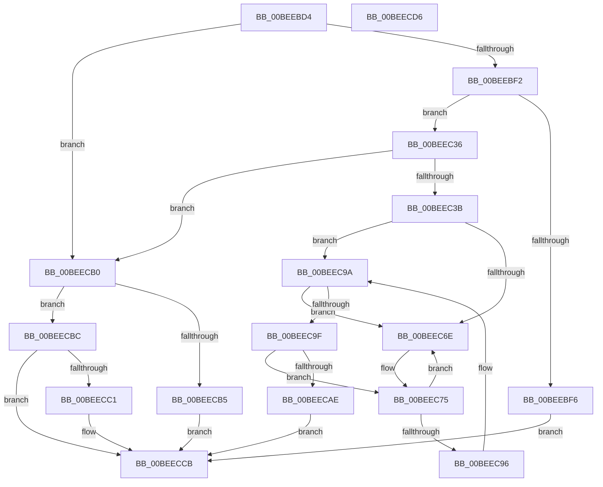

# BootApplicationPersistentDataProcess

- RVA: `0x00BEEBD4`–`0x00BEECD7` (길이 `259` bytes)
- VA: `0x0000000140BEEBD4`
- 실행 섹션: `INIT`
- PDB 이름 있음: `예`; PDB Function 태그: `아니요`
- unwind 정보 RVA: `0x0005CAAC`
- 디코드: `67`개 명령, `259/259` bytes 표시
- 미해석 바이트: `0` (있으면 어셈블리에 `.byte`로 보존)

> 이 문서는 커널 이미지의 기계어와 PDB 기호를 분석해 생성했습니다. 4번과 5번은 함수 원형과 자료형을 바이너리 사용 방식에서 추정한 C 해석이며 원본 소스 복구 결과는 아닙니다.

## 1. Dependencies

- 직접 호출 지점: **21**; 고유 호출 대상: **18**
- 직접 호출자로 확인된 함수: **2**
- RIP 상대 이미지 참조: **3**

### Outgoing calls
- `0x00BEEBF6` → [BapdpProcessWmdResults](../C5/BapdpProcessWmdResults_function_00C5015C.md) (function, `0x00C5015C`)
- `0x00BEEBFB` → [BapdpProcessResumeInformation](../C4/BapdpProcessResumeInformation_function_00C4FC80.md) (function, `0x00C4FC80`)
- `0x00BEEC00` → [BapdpProcessBitlockerStatus](../C4/BapdpProcessBitlockerStatus_function_00C4F7BC.md) (function, `0x00C4F7BC`)
- `0x00BEEC07` → [BapdpRegisterWbclData](../C5/BapdpRegisterWbclData_function_00C50B3C.md) (function, `0x00C50B3C`)
- `0x00BEEC11` → [BapdpRegisterWbclData](../C5/BapdpRegisterWbclData_function_00C50B3C.md) (function, `0x00C50B3C`)
- `0x00BEEC18` → [BapdpProcessVsmKeyBlobs](../C4/BapdpProcessVsmKeyBlobs_function_00C4FD60.md) (function, `0x00C4FD60`)
- `0x00BEEC1D` → [BapdpProcessEDrvHintInfo](../C4/BapdpProcessEDrvHintInfo_function_00C4F9DC.md) (function, `0x00C4F9DC`)
- `0x00BEEC22` → [BapdpProcessFwUpdateResults](../C4/BapdpProcessFwUpdateResults_function_00C4FABC.md) (function, `0x00C4FABC`)
- `0x00BEEC27` → [BapdProcessFwRamdiskInformation](../C4/BapdProcessFwRamdiskInformation_function_00C4F6E8.md) (function, `0x00C4F6E8`)
- `0x00BEEC2C` → [BapdProcessOslRamdiskInformation](../C4/BapdProcessOslRamdiskInformation_function_00C4F744.md) (function, `0x00C4F744`)
- `0x00BEEC3B` → [ExpInitializeMemoryMirroring](../C5/ExpInitializeMemoryMirroring_function_00C50F9C.md) (function, `0x00C50F9C`)
- `0x00BEEC40` → [BapdpProcessBootMetadata](../C4/BapdpProcessBootMetadata_function_00C4F89C.md) (function, `0x00C4F89C`)
- `0x00BEEC45` → [BapdpProcessSpacesBootInformation](../../text/65/BapdpProcessSpacesBootInformation_function_00654DB0.md) (function, `0x00654DB0`)
- `0x00BEEC4A` → [BapdpRecordIumStatus](../C5/BapdpRecordIumStatus_function_00C50424.md) (function, `0x00C50424`)
- `0x00BEEC4F` → [BapdpProcessEtwEvents](../../text/65/BapdpProcessEtwEvents_function_00654C74.md) (function, `0x00654C74`)
- `0x00BEEC54` → [BapdpProcessHSTIResults](../C4/BapdpProcessHSTIResults_function_00C4FB9C.md) (function, `0x00C4FB9C`)
- `0x00BEEC59` → [BapdpMarshallBootDataToRegistry](../../text/65/BapdpMarshallBootDataToRegistry_function_006548A8.md) (function, `0x006548A8`)
- `0x00BEEC7B` → [ExFreePoolWithTag](../../poolcode/B8/ExFreePoolWithTag_function_00B82870.md) (function, `0x00B82870`)
- `0x00BEEC85` → [ExFreePoolWithTag](../../poolcode/B8/ExFreePoolWithTag_function_00B82870.md) (function, `0x00B82870`)
- `0x00BEECB5` → [BapdpInitializePageDatabase](../../text/65/BapdpInitializePageDatabase_function_00654688.md) (function, `0x00654688`)
- `0x00BEECC6` → [BapdpProcessVsmKeyBlobs](../C4/BapdpProcessVsmKeyBlobs_function_00C4FD60.md) (function, `0x00C4FD60`)

### Direct callers
- [Phase1InitializationDiscard](../C1/Phase1InitializationDiscard_function_00C1C728.md) at `0x00C1D9A9`
- [IoInitSystemPreDrivers](../C2/IoInitSystemPreDrivers_function_00C2AC3C.md) at `0x00C2B6F7`
- [IoInitSystemPreDrivers](../C2/IoInitSystemPreDrivers_function_00C2AC3C.md) at `0x00C2B944`

### Static image references
- `0x00BEEBDE` → RVA `0x00E62410` (`.data`; read)
- `0x00BEEC5E` → RVA `0x00E62418` (`.data`; read)
- `0x00BEEC9F` → RVA `0x00E62418` (`.data`; write)

## 2. Other-region calls and transfers

- 다른 실행 섹션으로 향하는 call: **6**
  - `0x00BEEC45` → [BapdpProcessSpacesBootInformation](../../text/65/BapdpProcessSpacesBootInformation_function_00654DB0.md) (`INIT` → `.text`)
  - `0x00BEEC4F` → [BapdpProcessEtwEvents](../../text/65/BapdpProcessEtwEvents_function_00654C74.md) (`INIT` → `.text`)
  - `0x00BEEC59` → [BapdpMarshallBootDataToRegistry](../../text/65/BapdpMarshallBootDataToRegistry_function_006548A8.md) (`INIT` → `.text`)
  - `0x00BEEC7B` → [ExFreePoolWithTag](../../poolcode/B8/ExFreePoolWithTag_function_00B82870.md) (`INIT` → `POOLCODE`)
  - `0x00BEEC85` → [ExFreePoolWithTag](../../poolcode/B8/ExFreePoolWithTag_function_00B82870.md) (`INIT` → `POOLCODE`)
  - `0x00BEECB5` → [BapdpInitializePageDatabase](../../text/65/BapdpInitializePageDatabase_function_00654688.md) (`INIT` → `.text`)
- 별도 외부 분기/꼬리 이동을 확인하지 못했습니다.

## 3. Assembly (complete function range)

```asm
00BEEBD4  48 89 5C 24 08                  mov qword ptr [rsp + 8], rbx
00BEEBD9  57                              push rdi
00BEEBDA  48 83 EC 20                     sub rsp, 0x20
00BEEBDE  48 8D 3D 2B 38 27 00            lea rdi, [rip + 0x27382b]
00BEEBE5  48 39 3D 24 38 27 00            cmp qword ptr [rip + 0x273824], rdi
00BEEBEC  0F 84 BE 00 00 00               je 0x140beecb0
00BEEBF2  85 C9                           test ecx, ecx
00BEEBF4  75 40                           jne 0x140beec36
00BEEBF6  E8 61 15 06 00                  call 0x140c5015c
00BEEBFB  E8 80 10 06 00                  call 0x140c4fc80
00BEEC00  E8 B7 0B 06 00                  call 0x140c4f7bc
00BEEC05  33 C9                           xor ecx, ecx
00BEEC07  E8 30 1F 06 00                  call 0x140c50b3c
00BEEC0C  B9 01 00 00 00                  mov ecx, 1
00BEEC11  E8 26 1F 06 00                  call 0x140c50b3c
00BEEC16  33 C9                           xor ecx, ecx
00BEEC18  E8 43 11 06 00                  call 0x140c4fd60
00BEEC1D  E8 BA 0D 06 00                  call 0x140c4f9dc
00BEEC22  E8 95 0E 06 00                  call 0x140c4fabc
00BEEC27  E8 BC 0A 06 00                  call 0x140c4f6e8
00BEEC2C  E8 13 0B 06 00                  call 0x140c4f744
00BEEC31  E9 95 00 00 00                  jmp 0x140beeccb
00BEEC36  83 F9 01                        cmp ecx, 1
00BEEC39  75 75                           jne 0x140beecb0
00BEEC3B  E8 5C 23 06 00                  call 0x140c50f9c
00BEEC40  E8 57 0C 06 00                  call 0x140c4f89c
00BEEC45  E8 66 61 A6 FF                  call 0x140654db0
00BEEC4A  E8 D5 17 06 00                  call 0x140c50424
00BEEC4F  E8 20 60 A6 FF                  call 0x140654c74
00BEEC54  E8 43 0F 06 00                  call 0x140c4fb9c
00BEEC59  E8 4A 5C A6 FF                  call 0x1406548a8
00BEEC5E  48 8B 1D B3 37 27 00            mov rbx, qword ptr [rip + 0x2737b3]
00BEEC65  48 8B 43 08                     mov rax, qword ptr [rbx + 8]
00BEEC69  48 39 3B                        cmp qword ptr [rbx], rdi
00BEEC6C  74 2C                           je 0x140beec9a
00BEEC6E  B9 03 00 00 00                  mov ecx, 3
00BEEC73  CD 29                           int 0x29
00BEEC75  48 8B 4B 10                     mov rcx, qword ptr [rbx + 0x10]
00BEEC79  33 D2                           xor edx, edx
00BEEC7B  E8 F0 3B F9 FF                  call 0x140b82870
00BEEC80  33 D2                           xor edx, edx
00BEEC82  48 8B CB                        mov rcx, rbx
00BEEC85  E8 E6 3B F9 FF                  call 0x140b82870
00BEEC8A  48 8B 1D 87 37 27 00            mov rbx, qword ptr [rip + 0x273787]
00BEEC91  48 39 3B                        cmp qword ptr [rbx], rdi
00BEEC94  75 D8                           jne 0x140beec6e
00BEEC96  48 8B 43 08                     mov rax, qword ptr [rbx + 8]
00BEEC9A  48 39 18                        cmp qword ptr [rax], rbx
00BEEC9D  75 CF                           jne 0x140beec6e
00BEEC9F  48 89 05 72 37 27 00            mov qword ptr [rip + 0x273772], rax
00BEECA6  48 89 38                        mov qword ptr [rax], rdi
00BEECA9  48 3B DF                        cmp rbx, rdi
00BEECAC  75 C7                           jne 0x140beec75
00BEECAE  EB 1B                           jmp 0x140beeccb
00BEECB0  83 F9 02                        cmp ecx, 2
00BEECB3  75 07                           jne 0x140beecbc
00BEECB5  E8 CE 59 A6 FF                  call 0x140654688
00BEECBA  EB 0F                           jmp 0x140beeccb
00BEECBC  83 F9 03                        cmp ecx, 3
00BEECBF  75 0A                           jne 0x140beeccb
00BEECC1  B9 01 00 00 00                  mov ecx, 1
00BEECC6  E8 95 10 06 00                  call 0x140c4fd60
00BEECCB  48 8B 5C 24 30                  mov rbx, qword ptr [rsp + 0x30]
00BEECD0  48 83 C4 20                     add rsp, 0x20
00BEECD4  5F                              pop rdi
00BEECD5  C3                              ret
00BEECD6  CC                              int3
```

## 4. C-style interpretation (structured pseudocode)

```c
__int64 __fastcall BootApplicationPersistentDataProcess(int a1, int a2)
{
    __int64 result;
    __int64 v_rsp;
    unsigned __int64 v_stack_p8;

    v_stack_p8 = v_rbx;
    v_rsp = (v_rsp) - (32);
    if ((*(unsigned __int64 *)(v_rip + 2570276)) == (v_rip + 2570283)) goto loc_00BEECB0;
    if (a1 != 0) goto loc_00BEEC36;
    result = BapdpProcessWmdResults(a1, a2, a3, a4);
    result = BapdpProcessResumeInformation(a1, a2, a3, a4);
    result = BapdpProcessBitlockerStatus(a1, a2, a3, a4);
    a1 = 0;
    result = BapdpRegisterWbclData(a1, a2, a3, a4);
    result = BapdpRegisterWbclData(1, a2, a3, a4);
    a1 = 0;
    result = BapdpProcessVsmKeyBlobs(a1, a2, a3, a4);
    result = BapdpProcessEDrvHintInfo(a1, a2, a3, a4);
    result = BapdpProcessFwUpdateResults(a1, a2, a3, a4);
    result = BapdProcessFwRamdiskInformation(a1, a2, a3, a4);
    result = BapdProcessOslRamdiskInformation(a1, a2, a3, a4);
    goto loc_00BEECCB;
loc_00BEEC36:
    if (0 != 1) goto loc_00BEECB0;
    result = ExpInitializeMemoryMirroring(a1, a2, a3, a4);
    result = BapdpProcessBootMetadata(a1, a2, a3, a4);
    result = BapdpProcessSpacesBootInformation(a1, a2, a3, a4);
    result = BapdpRecordIumStatus(a1, a2, a3, a4);
    result = BapdpProcessEtwEvents(a1, a2, a3, a4);
    result = BapdpProcessHSTIResults(a1, a2, a3, a4);
    result = BapdpMarshallBootDataToRegistry(a1, a2, a3, a4);
    if ((*(unsigned __int64 *)(*(unsigned __int64 *)(v_rip + 2570163))) == (v_rip + 2570283)) goto loc_00BEEC9A;
loc_00BEEC6E:
loc_00BEEC75:
    a2 = 0;
    result = ExFreePoolWithTag(*(unsigned __int64 *)(*(unsigned __int64 *)(v_rip + 2570163) + 16), a2, a3, a4);
    a2 = 0;
    result = ExFreePoolWithTag(*(unsigned __int64 *)(v_rip + 2570163), a2, a3, a4);
    if ((*(unsigned __int64 *)(*(unsigned __int64 *)(v_rip + 2570119))) != (v_rip + 2570283)) goto loc_00BEEC6E;
loc_00BEEC9A:
    if ((*(unsigned __int64 *)(*(unsigned __int64 *)(*(unsigned __int64 *)(v_rip + 2570119) + 8))) != (*(unsigned __int64 *)(v_rip + 2570119))) goto loc_00BEEC6E;
    *(unsigned __int64 *)(v_rip + 2570098) = *(unsigned __int64 *)(*(unsigned __int64 *)(v_rip + 2570119) + 8);
    *(unsigned __int64 *)(*(unsigned __int64 *)(*(unsigned __int64 *)(v_rip + 2570119) + 8)) = v_rip + 2570283;
    if ((*(unsigned __int64 *)(v_rip + 2570119)) != (v_rip + 2570283)) goto loc_00BEEC75;
    goto loc_00BEECCB;
loc_00BEECB0:
    if (((unsigned int)(*(unsigned __int64 *)(v_rip + 2570163))) != 2) goto loc_00BEECBC;
    result = BapdpInitializePageDatabase(*(unsigned __int64 *)(v_rip + 2570163), a2, a3, a4);
    goto loc_00BEECCB;
loc_00BEECBC:
    if (((unsigned int)(*(unsigned __int64 *)(v_rip + 2570163))) == 3) {
        a1 = 1;
        result = BapdpProcessVsmKeyBlobs(a1, a2, a3, a4);
    }
    v_rsp = (v_rsp) + (32);
    return result;
}
```

## 5. (Beta) C Style

```c
int64_t BootApplicationPersistentDataProcess(int32_t Arg1, int32_t Arg2)
{
    int64_t result;
    int64_t local_rsp;
    uint64_t v_stack_p8;

    v_stack_p8 = local_rbx;
    local_rsp = (local_rsp) - (32);
    if ((*(uint64_t *)(v_rip + 0x273824)) == (v_rip + 2570283)) goto loc_00BEECB0;
    if (Arg1 != 0) goto loc_00BEEC36;
    result = BapdpProcessWmdResults(Arg1, Arg2, a3, a4);
    result = BapdpProcessResumeInformation(Arg1, Arg2, a3, a4);
    result = BapdpProcessBitlockerStatus(Arg1, Arg2, a3, a4);
    Arg1 = 0;
    result = BapdpRegisterWbclData(Arg1, Arg2, a3, a4);
    result = BapdpRegisterWbclData(1, Arg2, a3, a4);
    Arg1 = 0;
    result = BapdpProcessVsmKeyBlobs(Arg1, Arg2, a3, a4);
    result = BapdpProcessEDrvHintInfo(Arg1, Arg2, a3, a4);
    result = BapdpProcessFwUpdateResults(Arg1, Arg2, a3, a4);
    result = BapdProcessFwRamdiskInformation(Arg1, Arg2, a3, a4);
    result = BapdProcessOslRamdiskInformation(Arg1, Arg2, a3, a4);
    goto loc_00BEECCB;
loc_00BEEC36:
    if (0 != 1) goto loc_00BEECB0;
    result = ExpInitializeMemoryMirroring(Arg1, Arg2, a3, a4);
    result = BapdpProcessBootMetadata(Arg1, Arg2, a3, a4);
    result = BapdpProcessSpacesBootInformation(Arg1, Arg2, a3, a4);
    result = BapdpRecordIumStatus(Arg1, Arg2, a3, a4);
    result = BapdpProcessEtwEvents(Arg1, Arg2, a3, a4);
    result = BapdpProcessHSTIResults(Arg1, Arg2, a3, a4);
    result = BapdpMarshallBootDataToRegistry(Arg1, Arg2, a3, a4);
    if ((*(uint64_t *)(*(uint64_t *)(v_rip + 0x2737B3))) == (v_rip + 2570283)) goto loc_00BEEC9A;
loc_00BEEC6E:
loc_00BEEC75:
    Arg2 = 0;
    result = ExFreePoolWithTag(*(uint64_t *)(*(uint64_t *)(v_rip + 0x2737B3) + 0x10), Arg2, a3, a4);
    Arg2 = 0;
    result = ExFreePoolWithTag(*(uint64_t *)(v_rip + 0x2737B3), Arg2, a3, a4);
    if ((*(uint64_t *)(*(uint64_t *)(v_rip + 0x273787))) != (v_rip + 2570283)) goto loc_00BEEC6E;
loc_00BEEC9A:
    if ((*(uint64_t *)(*(uint64_t *)(*(uint64_t *)(v_rip + 0x273787) + 0x8))) != (*(uint64_t *)(v_rip + 0x273787))) goto loc_00BEEC6E;
    *(uint64_t *)(v_rip + 0x273772) = *(uint64_t *)(*(uint64_t *)(v_rip + 0x273787) + 0x8);
    *(uint64_t *)(*(uint64_t *)(*(uint64_t *)(v_rip + 0x273787) + 0x8)) = v_rip + 2570283;
    if ((*(uint64_t *)(v_rip + 0x273787)) != (v_rip + 2570283)) goto loc_00BEEC75;
    goto loc_00BEECCB;
loc_00BEECB0:
    if (((uint32_t)(*(uint64_t *)(v_rip + 0x2737B3))) != 2) goto loc_00BEECBC;
    result = BapdpInitializePageDatabase(*(uint64_t *)(v_rip + 0x2737B3), Arg2, a3, a4);
    goto loc_00BEECCB;
loc_00BEECBC:
    if (((uint32_t)(*(uint64_t *)(v_rip + 0x2737B3))) == 3) {
        Arg1 = 1;
        result = BapdpProcessVsmKeyBlobs(Arg1, Arg2, a3, a4);
    }
    local_rsp = (local_rsp) + (32);
    return result;
}
```

## 6. Execution-region graph

[열기: 2D/3D 그래프와 함수 탐색 컨트롤 패널](../../../control-panel.html?section=init&rva=0x00BEEBD4&view=graph)

- 2D 그래프는 위에서 아래로 흐르고, 3D 그래프는 빈 공간을 드래그해 회전합니다. Shift+드래그는 이동, 휠은 확대·축소, 함수 노드 선택은 대상 보고서 이동입니다.

### Static fallback


