# CcInitializeCacheManager

- RVA: `0x00BEE2E8`–`0x00BEE840` (길이 `1,368` bytes)
- VA: `0x0000000140BEE2E8`
- 실행 섹션: `INIT`
- PDB 이름 있음: `예`; PDB Function 태그: `아니요`
- unwind 정보 RVA: `0x000BEF78`
- 디코드: `301`개 명령, `1,368/1,368` bytes 표시
- 미해석 바이트: `0` (있으면 어셈블리에 `.byte`로 보존)

> 이 문서는 커널 이미지의 기계어와 PDB 기호를 분석해 생성했습니다. 4번과 5번은 함수 원형과 자료형을 바이너리 사용 방식에서 추정한 C 해석이며 원본 소스 복구 결과는 아닙니다.

## 1. Dependencies

- 직접 호출 지점: **22**; 고유 호출 대상: **15**
- 직접 호출자로 확인된 함수: **2**
- RIP 상대 이미지 참조: **79**

### Outgoing calls
- `0x00BEE30C` → [CcInitializeTelemetry](CcInitializeTelemetry_function_00BEE848.md) (function, `0x00BEE848`)
- `0x00BEE36A` → [FsRtlIsMobileOS](../../page/A4/FsRtlIsMobileOS_function_00A48F30.md) (function, `0x00A48F30`)
- `0x00BEE383` → [FsRtlIsMobileOS](../../page/A4/FsRtlIsMobileOS_function_00A48F30.md) (function, `0x00A48F30`)
- `0x00BEE3B5` → [CcInitPerVolumeParameters](../../text/57/CcInitPerVolumeParameters_function_0057EF28.md) (function, `0x0057EF28`)
- `0x00BEE3BA` → [CcInitializeVacbs](../C2/CcInitializeVacbs_function_00C26168.md) (function, `0x00C26168`)
- `0x00BEE3E7` → [CcCreatePartition](../../text/57/CcCreatePartition_function_0057DE10.md) (function, `0x0057DE10`)
- `0x00BEE407` → [KeBugCheckEx](../../text/4F/KeBugCheckEx_function_004FD660.md) (function, `0x004FD660`)
- `0x00BEE43E` → [CcInitializeBcbProfiler](CcInitializeBcbProfiler_function_00BEF294.md) (function, `0x00BEF294`)
- `0x00BEE451` → [ExAllocatePool2](../../poolcode/B8/ExAllocatePool2_function_00B820F0.md) (function, `0x00B820F0`)
- `0x00BEE460` → [ExFreePoolWithTag](../../poolcode/B8/ExFreePoolWithTag_function_00B82870.md) (function, `0x00B82870`)
- `0x00BEE467` → [ExGenRandom](../../text/41/ExGenRandom_function_0041B010.md) (function, `0x0041B010`)
- `0x00BEE5BC` → [ExInitializeSystemLookasideList](../../pagelk/B7/ExInitializeSystemLookasideList_function_00B7E57C.md) (function, `0x00B7E57C`)
- `0x00BEE5F4` → [CcInitializeProcessor](../../page/71/CcInitializeProcessor_function_00710220.md) (function, `0x00710220`)
- `0x00BEE619` → [KeBugCheckEx](../../text/4F/KeBugCheckEx_function_004FD660.md) (function, `0x004FD660`)
- `0x00BEE64E` → [ExInitializeNPagedLookasideListInternal](../../text/46/ExInitializeNPagedLookasideListInternal_function_00468720.md) (function, `0x00468720`)
- `0x00BEE683` → [ExInitializeNPagedLookasideListInternal](../../text/46/ExInitializeNPagedLookasideListInternal_function_00468720.md) (function, `0x00468720`)
- `0x00BEE6AD` → [ExInitializeNPagedLookasideListInternal](../../text/46/ExInitializeNPagedLookasideListInternal_function_00468720.md) (function, `0x00468720`)
- `0x00BEE6DF` → [ExInitializeLookasideListExInternal](../../text/46/ExInitializeLookasideListExInternal_function_00468890.md) (function, `0x00468890`)
- `0x00BEE711` → [ExInitializeLookasideListExInternal](../../text/46/ExInitializeLookasideListExInternal_function_00468890.md) (function, `0x00468890`)
- `0x00BEE7C7` → [CcInitializeTelemetry](CcInitializeTelemetry_function_00BEE848.md) (function, `0x00BEE848`)
- `0x00BEE7F3` → [PoRegisterCoalescingCallback](../../page/75/PoRegisterCoalescingCallback_function_0075BF00.md) (function, `0x0075BF00`)
- `0x00BEE83A` → [KeBugCheckEx](../../text/4F/KeBugCheckEx_function_004FD660.md) (function, `0x004FD660`)

### Direct callers
- [Phase1InitializationDiscard](../C1/Phase1InitializationDiscard_function_00C1C728.md) at `0x00C1D3A2`
- [Phase1InitializationIoReady](../C7/Phase1InitializationIoReady_function_00C70458.md) at `0x00C705BB`

### Static image references
- `0x00BEE332` → RVA `0x00FC521C` (`ALMOSTRO`; read)
- `0x00BEE33B` → RVA `0x00E11CC0` (`.data`; write)
- `0x00BEE342` → RVA `0x00F8F508` (`.data`; write)
- `0x00BEE349` → RVA `0x00F8F520` (`.data`; write)
- `0x00BEE34F` → RVA `0x00F8F51C` (`.data`; write)
- `0x00BEE37D` → RVA `0x00E65B74` (`.data`; write)
- `0x00BEE3A2` → RVA `0x00F8F524` (`.data`; write)
- `0x00BEE3BF` → RVA `0x00FC5000` (`ALMOSTRO`; read)
- `0x00BEE3CB` → RVA `0x00FC6EA0` (`ALMOSTRO`; read)
- `0x00BEE3DA` → RVA `0x00F8F510` (`.data`; write)
- `0x00BEE3E1` → RVA `0x00E0A874` (`.data`; write)
- `0x00BEE414` → RVA `0x00F8F518` (`.data`; write)
- `0x00BEE426` → RVA `0x00E65B80` (`.data`; write)
- `0x00BEE434` → RVA `0x00E65B78` (`.data`; write)
- `0x00BEE477` → RVA `0x00F8F580` (`.data`; write)
- `0x00BEE482` → RVA `0x00F8F588` (`.data`; write)
- `0x00BEE48B` → RVA `0x00F8F590` (`.data`; write)
- `0x00BEE491` → RVA `0x00FC6AA0` (`ALMOSTRO`; read)
- `0x00BEE497` → RVA `0x00F8F598` (`.data`; write)
- `0x00BEE49E` → RVA `0x00F8F570` (`.data`; write)
- `0x00BEE4A4` → RVA `0x00F8F560` (`.data`; read)
- `0x00BEE4AB` → RVA `0x00F8F568` (`.data`; write)
- `0x00BEE4B2` → RVA `0x00F8F560` (`.data`; write)
- `0x00BEE4B9` → RVA `0x00F8F5A0` (`.data`; read)
- `0x00BEE4C0` → RVA `0x00F8F5A8` (`.data`; write)
- `0x00BEE4C7` → RVA `0x00F8F5A0` (`.data`; write)
- `0x00BEE4CE` → RVA `0x00F8F5C0` (`.data`; read)
- `0x00BEE4D5` → RVA `0x00F8F5C8` (`.data`; write)
- `0x00BEE4DC` → RVA `0x00F8F5C0` (`.data`; write)
- `0x00BEE4E7` → RVA `0x00F8F59A` (`.data`; write)
- `0x00BEE4F0` → RVA `0x00F8F59C` (`.data`; write)
- `0x00BEE4F8` → RVA `0x00F8F528` (`.data`; write)
- `0x00BEE50B` → RVA `0x00E0A870` (`.data`; write)
- `0x00BEE51D` → RVA `0x00E65B64` (`.data`; write)
- `0x00BEE523` → RVA `0x00E65B68` (`.data`; read)
- `0x00BEE539` → RVA `0x00E65B70` (`.data`; read)
- `0x00BEE546` → RVA `0x00F8F52C` (`.data`; write)
- `0x00BEE552` → RVA `0x00F8F540` (`.data`; write)
- `0x00BEE55C` → RVA `0x00F8F542` (`.data`; write)
- `0x00BEE563` → RVA `0x00E65B6C` (`.data`; write)
- `0x00BEE569` → RVA `0x00F8F548` (`.data`; read)
- `0x00BEE570` → RVA `0x00F8F550` (`.data`; write)
- `0x00BEE57D` → RVA `0x00F8F548` (`.data`; write)
- `0x00BEE58C` → RVA `0x00F8F544` (`.data`; write)
- `0x00BEE5A4` → RVA `0x00EFAC00` (`.data`; read)
- `0x00BEE5B5` → RVA `0x00E11B00` (`.data`; read)
- `0x00BEE5C3` → RVA `0x00F8F5F0` (`.data`; write)
- `0x00BEE5D7` → RVA `0x00E65B60` (`.data`; write)
- `0x00BEE5DD` → RVA `0x00FC6A80` (`ALMOSTRO`; read)
- `0x00BEE5E7` → RVA `0x00FC8C40` (`ALMOSTRO`; read)
- `0x00BEE623` → RVA `0x00E11A00` (`.data`; read)
- `0x00BEE648` → RVA `0x00F8F5F4` (`.data`; write)
- `0x00BEE657` → RVA `0x00E11A80` (`.data`; read)
- `0x00BEE67D` → RVA `0x00F8F5F8` (`.data`; write)
- `0x00BEE68C` → RVA `0x00E11B80` (`.data`; read)
- `0x00BEE6B6` → RVA `0x00E11C60` (`.data`; read)
- `0x00BEE6E8` → RVA `0x00E11C00` (`.data`; read)
- `0x00BEE716` → RVA `0x00E0A86C` (`.data`; read)
- `0x00BEE71C` → RVA `0x00F8F5E0` (`.data`; read)
- `0x00BEE723` → RVA `0x00F8F5E8` (`.data`; write)
- `0x00BEE72A` → RVA `0x00F8F5E0` (`.data`; write)
- `0x00BEE731` → RVA `0x00F8F5D0` (`.data`; write)
- `0x00BEE74F` → RVA `0x00E30088` (`.data`; read)
- `0x00BEE766` → RVA `0x00E0A86C` (`.data`; write)
- `0x00BEE770` → RVA `0x00E0A868` (`.data`; read)
- `0x00BEE786` → RVA `0x00E0A868` (`.data`; write)
- `0x00BEE78C` → RVA `0x00E65B54` (`.data`; read)
- `0x00BEE7A1` → RVA `0x00E65B5C` (`.data`; read)
- `0x00BEE7A8` → RVA `0x00E65B54` (`.data`; write)
- `0x00BEE7B0` → RVA `0x00E65B5C` (`.data`; write)
- `0x00BEE7B6` → RVA `0x00E65B58` (`.data`; read)
- `0x00BEE7BF` → RVA `0x00E65B58` (`.data`; write)
- `0x00BEE7CF` → RVA `0x00E65AE8` (`.data`; read)
- `0x00BEE7D8` → RVA `0x003CA040` (`CcCoalescingCallBack`; read)
- `0x00BEE7E2` → RVA `0x00F8F490` (`.data`; write)
- `0x00BEE7EC` → RVA `0x00F8F480` (`.data`; read)
- `0x00BEE7FC` → RVA `0x00E0A878` (`.data`; read)
- `0x00BEE80A` → RVA `0x00E0A878` (`.data`; write)
- `0x00BEE814` → RVA `0x00E65B50` (`.data`; write)

## 2. Other-region calls and transfers

- 다른 실행 섹션으로 향하는 call: **18**
  - `0x00BEE36A` → [FsRtlIsMobileOS](../../page/A4/FsRtlIsMobileOS_function_00A48F30.md) (`INIT` → `PAGE`)
  - `0x00BEE383` → [FsRtlIsMobileOS](../../page/A4/FsRtlIsMobileOS_function_00A48F30.md) (`INIT` → `PAGE`)
  - `0x00BEE3B5` → [CcInitPerVolumeParameters](../../text/57/CcInitPerVolumeParameters_function_0057EF28.md) (`INIT` → `.text`)
  - `0x00BEE3E7` → [CcCreatePartition](../../text/57/CcCreatePartition_function_0057DE10.md) (`INIT` → `.text`)
  - `0x00BEE407` → [KeBugCheckEx](../../text/4F/KeBugCheckEx_function_004FD660.md) (`INIT` → `.text`)
  - `0x00BEE451` → [ExAllocatePool2](../../poolcode/B8/ExAllocatePool2_function_00B820F0.md) (`INIT` → `POOLCODE`)
  - `0x00BEE460` → [ExFreePoolWithTag](../../poolcode/B8/ExFreePoolWithTag_function_00B82870.md) (`INIT` → `POOLCODE`)
  - `0x00BEE467` → [ExGenRandom](../../text/41/ExGenRandom_function_0041B010.md) (`INIT` → `.text`)
  - `0x00BEE5BC` → [ExInitializeSystemLookasideList](../../pagelk/B7/ExInitializeSystemLookasideList_function_00B7E57C.md) (`INIT` → `PAGELK`)
  - `0x00BEE5F4` → [CcInitializeProcessor](../../page/71/CcInitializeProcessor_function_00710220.md) (`INIT` → `PAGE`)
  - `0x00BEE619` → [KeBugCheckEx](../../text/4F/KeBugCheckEx_function_004FD660.md) (`INIT` → `.text`)
  - `0x00BEE64E` → [ExInitializeNPagedLookasideListInternal](../../text/46/ExInitializeNPagedLookasideListInternal_function_00468720.md) (`INIT` → `.text`)
  - `0x00BEE683` → [ExInitializeNPagedLookasideListInternal](../../text/46/ExInitializeNPagedLookasideListInternal_function_00468720.md) (`INIT` → `.text`)
  - `0x00BEE6AD` → [ExInitializeNPagedLookasideListInternal](../../text/46/ExInitializeNPagedLookasideListInternal_function_00468720.md) (`INIT` → `.text`)
  - `0x00BEE6DF` → [ExInitializeLookasideListExInternal](../../text/46/ExInitializeLookasideListExInternal_function_00468890.md) (`INIT` → `.text`)
  - `0x00BEE711` → [ExInitializeLookasideListExInternal](../../text/46/ExInitializeLookasideListExInternal_function_00468890.md) (`INIT` → `.text`)
  - `0x00BEE7F3` → [PoRegisterCoalescingCallback](../../page/75/PoRegisterCoalescingCallback_function_0075BF00.md) (`INIT` → `PAGE`)
  - `0x00BEE83A` → [KeBugCheckEx](../../text/4F/KeBugCheckEx_function_004FD660.md) (`INIT` → `.text`)
- 별도 외부 분기/꼬리 이동을 확인하지 못했습니다.

## 3. Assembly (complete function range)

```asm
00BEE2E8  48 8B C4                        mov rax, rsp
00BEE2EB  48 89 58 08                     mov qword ptr [rax + 8], rbx
00BEE2EF  48 89 68 10                     mov qword ptr [rax + 0x10], rbp
00BEE2F3  48 89 70 18                     mov qword ptr [rax + 0x18], rsi
00BEE2F7  48 89 78 20                     mov qword ptr [rax + 0x20], rdi
00BEE2FB  41 57                           push r15
00BEE2FD  48 83 EC 60                     sub rsp, 0x60
00BEE301  B8 02 00 00 00                  mov eax, 2
00BEE306  3B C8                           cmp ecx, eax
00BEE308  75 28                           jne 0x140bee332
00BEE30A  8B C8                           mov ecx, eax
00BEE30C  E8 37 05 00 00                  call 0x140bee848
00BEE311  B8 01 00 00 00                  mov eax, 1
00BEE316  4C 8D 5C 24 60                  lea r11, [rsp + 0x60]
00BEE31B  49 8B 5B 10                     mov rbx, qword ptr [r11 + 0x10]
00BEE31F  49 8B 6B 18                     mov rbp, qword ptr [r11 + 0x18]
00BEE323  49 8B 73 20                     mov rsi, qword ptr [r11 + 0x20]
00BEE327  49 8B 7B 28                     mov rdi, qword ptr [r11 + 0x28]
00BEE32B  49 8B E3                        mov rsp, r11
00BEE32E  41 5F                           pop r15
00BEE330  C3                              ret
00BEE331  CC                              int3
00BEE332  0F B6 35 E3 6E 3D 00            movzx esi, byte ptr [rip + 0x3d6ee3]
00BEE339  33 ED                           xor ebp, ebp
00BEE33B  48 89 2D 7E 39 22 00            mov qword ptr [rip + 0x22397e], rbp
00BEE342  48 89 2D BF 11 3A 00            mov qword ptr [rip + 0x3a11bf], rbp
00BEE349  89 05 D1 11 3A 00               mov dword ptr [rip + 0x3a11d1], eax
00BEE34F  C7 05 C3 11 3A 00 64 00 00 00   mov dword ptr [rip + 0x3a11c3], 0x64
00BEE359  44 8D 7D 04                     lea r15d, [rbp + 4]
00BEE35D  85 F6                           test esi, esi
00BEE35F  75 32                           jne 0x140bee393
00BEE361  8D 5D 32                        lea ebx, [rbp + 0x32]
00BEE364  89 1D B2 11 3A 00               mov dword ptr [rip + 0x3a11b2], ebx
00BEE36A  E8 C1 AB E5 FF                  call 0x140a48f30
00BEE36F  84 C0                           test al, al
00BEE371  74 0A                           je 0x140bee37d
00BEE373  C7 05 9F 11 3A 00 0A 00 00 00   mov dword ptr [rip + 0x3a119f], 0xa
00BEE37D  89 1D F1 77 27 00               mov dword ptr [rip + 0x2777f1], ebx
00BEE383  E8 A8 AB E5 FF                  call 0x140a48f30
00BEE388  84 C0                           test al, al
00BEE38A  74 22                           je 0x140bee3ae
00BEE38C  B8 09 00 00 00                  mov eax, 9
00BEE391  EB 05                           jmp 0x140bee398
00BEE393  B8 F4 01 00 00                  mov eax, 0x1f4
00BEE398  89 05 D6 77 27 00               mov dword ptr [rip + 0x2777d6], eax
00BEE39E  85 F6                           test esi, esi
00BEE3A0  74 0C                           je 0x140bee3ae
00BEE3A2  C7 05 78 11 3A 00 08 00 00 00   mov dword ptr [rip + 0x3a1178], 8
00BEE3AC  EB 07                           jmp 0x140bee3b5
00BEE3AE  44 89 3D 6F 11 3A 00            mov dword ptr [rip + 0x3a116f], r15d
00BEE3B5  E8 6E 0B 99 FF                  call 0x14057ef28
00BEE3BA  E8 A9 7D 03 00                  call 0x140c26168
00BEE3BF  0F B7 05 3A 6C 3D 00            movzx eax, word ptr [rip + 0x3d6c3a]
00BEE3C6  BF 01 00 00 00                  mov edi, 1
00BEE3CB  48 8B 0D CE 8A 3D 00            mov rcx, qword ptr [rip + 0x3d8ace]
00BEE3D2  66 2B C7                        sub ax, di
00BEE3D5  0F B7 C0                        movzx eax, ax
00BEE3D8  03 C7                           add eax, edi
00BEE3DA  48 89 2D 2F 11 3A 00            mov qword ptr [rip + 0x3a112f], rbp
00BEE3E1  89 05 8D C4 21 00               mov dword ptr [rip + 0x21c48d], eax
00BEE3E7  E8 24 FA 98 FF                  call 0x14057de10
00BEE3EC  48 8B C8                        mov rcx, rax
00BEE3EF  48 85 C0                        test rax, rax
00BEE3F2  75 19                           jne 0x140bee40d
00BEE3F4  45 33 C9                        xor r9d, r9d
00BEE3F7  48 89 6C 24 20                  mov qword ptr [rsp + 0x20], rbp
00BEE3FC  45 33 C0                        xor r8d, r8d
00BEE3FF  8D 4F 33                        lea ecx, [rdi + 0x33]
00BEE402  BA BA 02 04 00                  mov edx, 0x402ba
00BEE407  E8 54 F2 90 FF                  call 0x1404fd660
00BEE40C  CC                              int3
00BEE40D  48 8B 05 8C 8A 3D 00            mov rax, qword ptr [rip + 0x3d8a8c]
00BEE414  66 89 3D FD 10 3A 00            mov word ptr [rip + 0x3a10fd], di
00BEE41B  48 89 48 08                     mov qword ptr [rax + 8], rcx
00BEE41F  48 8D 81 20 04 00 00            lea rax, [rcx + 0x420]
00BEE426  48 89 05 53 77 27 00            mov qword ptr [rip + 0x277753], rax
00BEE42D  48 8D 81 38 04 00 00            lea rax, [rcx + 0x438]
00BEE434  48 89 05 3D 77 27 00            mov qword ptr [rip + 0x27773d], rax
00BEE43B  0F AE E8                        lfence
00BEE43E  E8 51 0E 00 00                  call 0x140bef294
00BEE443  BA 08 00 00 00                  mov edx, 8
00BEE448  41 B8 44 70 63 58               mov r8d, 0x58637044
00BEE44E  8D 4A 38                        lea ecx, [rdx + 0x38]
00BEE451  E8 9A 3C F9 FF                  call 0x140b820f0
00BEE456  48 85 C0                        test rax, rax
00BEE459  74 1A                           je 0x140bee475
00BEE45B  33 D2                           xor edx, edx
00BEE45D  48 8B C8                        mov rcx, rax
00BEE460  E8 0B 44 F9 FF                  call 0x140b82870
00BEE465  33 C9                           xor ecx, ecx
00BEE467  E8 A4 CB 82 FF                  call 0x14041b010
00BEE46C  B8 08 00 00 80                  mov eax, 0x80000008
00BEE471  33 C9                           xor ecx, ecx
00BEE473  0F A2                           cpuid
00BEE475  33 D2                           xor edx, edx
00BEE477  89 3D 03 11 3A 00               mov dword ptr [rip + 0x3a1103], edi
00BEE47D  BB 80 96 98 00                  mov ebx, 0x989680
00BEE482  48 89 2D FF 10 3A 00            mov qword ptr [rip + 0x3a10ff], rbp
00BEE489  8B C3                           mov eax, ebx
00BEE48B  89 2D FF 10 3A 00               mov dword ptr [rip + 0x3a10ff], ebp
00BEE491  F7 35 09 86 3D 00               div dword ptr [rip + 0x3d8609]
00BEE497  66 89 3D FA 10 3A 00            mov word ptr [rip + 0x3a10fa], di
00BEE49E  89 05 CC 10 3A 00               mov dword ptr [rip + 0x3a10cc], eax
00BEE4A4  48 8D 05 B5 10 3A 00            lea rax, [rip + 0x3a10b5]
00BEE4AB  48 89 05 B6 10 3A 00            mov qword ptr [rip + 0x3a10b6], rax
00BEE4B2  48 89 05 A7 10 3A 00            mov qword ptr [rip + 0x3a10a7], rax
00BEE4B9  48 8D 05 E0 10 3A 00            lea rax, [rip + 0x3a10e0]
00BEE4C0  48 89 05 E1 10 3A 00            mov qword ptr [rip + 0x3a10e1], rax
00BEE4C7  48 89 05 D2 10 3A 00            mov qword ptr [rip + 0x3a10d2], rax
00BEE4CE  48 8D 05 EB 10 3A 00            lea rax, [rip + 0x3a10eb]
00BEE4D5  48 89 05 EC 10 3A 00            mov qword ptr [rip + 0x3a10ec], rax
00BEE4DC  48 89 05 DD 10 3A 00            mov qword ptr [rip + 0x3a10dd], rax
00BEE4E3  8B C6                           mov eax, esi
00BEE4E5  F7 D8                           neg eax
00BEE4E7  C6 05 AC 10 3A 00 06            mov byte ptr [rip + 0x3a10ac], 6
00BEE4EE  8B C6                           mov eax, esi
00BEE4F0  89 2D A6 10 3A 00               mov dword ptr [rip + 0x3a10a6], ebp
00BEE4F6  1B C9                           sbb ecx, ecx
00BEE4F8  44 89 3D 29 10 3A 00            mov dword ptr [rip + 0x3a1029], r15d
00BEE4FF  81 E1 00 07 00 00               and ecx, 0x700
00BEE505  81 C1 00 01 00 00               add ecx, 0x100
00BEE50B  89 0D 5F C3 21 00               mov dword ptr [rip + 0x21c35f], ecx
00BEE511  F7 D8                           neg eax
00BEE513  1B C9                           sbb ecx, ecx
00BEE515  81 E1 C0 B4 B3 FF               and ecx, 0xffb3b4c0
00BEE51B  03 CB                           add ecx, ebx
00BEE51D  89 0D 41 76 27 00               mov dword ptr [rip + 0x277641], ecx
00BEE523  8B 0D 3F 76 27 00               mov ecx, dword ptr [rip + 0x27763f]
00BEE529  8D 41 FF                        lea eax, [rcx - 1]
00BEE52C  3D FF 7F 00 00                  cmp eax, 0x7fff
00BEE531  77 06                           ja 0x140bee539
00BEE533  89 0D 37 C3 21 00               mov dword ptr [rip + 0x21c337], ecx
00BEE539  8B 05 31 76 27 00               mov eax, dword ptr [rip + 0x277631]
00BEE53F  B9 05 00 00 00                  mov ecx, 5
00BEE544  85 C0                           test eax, eax
00BEE546  89 2D E0 0F 3A 00               mov dword ptr [rip + 0x3a0fe0], ebp
00BEE54C  41 BF 00 02 00 00               mov r15d, 0x200
00BEE552  66 89 3D E7 0F 3A 00            mov word ptr [rip + 0x3a0fe7], di
00BEE559  0F 45 C8                        cmovne ecx, eax
00BEE55C  C6 05 DF 0F 3A 00 06            mov byte ptr [rip + 0x3a0fdf], 6
00BEE563  89 0D 03 76 27 00               mov dword ptr [rip + 0x277603], ecx
00BEE569  48 8D 05 D8 0F 3A 00            lea rax, [rip + 0x3a0fd8]
00BEE570  48 89 05 D9 0F 3A 00            mov qword ptr [rip + 0x3a0fd9], rax
00BEE577  41 B9 43 63 57 6B               mov r9d, 0x6b576343
00BEE57D  48 89 05 C4 0F 3A 00            mov qword ptr [rip + 0x3a0fc4], rax
00BEE584  41 B8 A0 00 00 00               mov r8d, 0xa0
00BEE58A  8B C6                           mov eax, esi
00BEE58C  89 2D B2 0F 3A 00               mov dword ptr [rip + 0x3a0fb2], ebp
00BEE592  F7 D8                           neg eax
00BEE594  41 8B D7                        mov edx, r15d
00BEE597  66 B8 80 00                     mov ax, 0x80
00BEE59B  66 1B C9                        sbb cx, cx
00BEE59E  66 23 C8                        and cx, ax
00BEE5A1  66 03 C8                        add cx, ax
00BEE5A4  48 8D 05 55 C6 30 00            lea rax, [rip + 0x30c655]
00BEE5AB  48 89 44 24 28                  mov qword ptr [rsp + 0x28], rax
00BEE5B0  66 89 4C 24 20                  mov word ptr [rsp + 0x20], cx
00BEE5B5  48 8D 0D 44 35 22 00            lea rcx, [rip + 0x223544]
00BEE5BC  E8 BB FF F8 FF                  call 0x140b7e57c
00BEE5C1  F7 DE                           neg esi
00BEE5C3  89 3D 27 10 3A 00               mov dword ptr [rip + 0x3a1027], edi
00BEE5C9  8B DD                           mov ebx, ebp
00BEE5CB  1B C0                           sbb eax, eax
00BEE5CD  25 00 00 F0 01                  and eax, 0x1f00000
00BEE5D2  05 00 00 10 00                  add eax, 0x100000
00BEE5D7  89 05 83 75 27 00               mov dword ptr [rip + 0x277583], eax
00BEE5DD  8B 05 9D 84 3D 00               mov eax, dword ptr [rip + 0x3d849d]
00BEE5E3  3B D8                           cmp ebx, eax
00BEE5E5  73 38                           jae 0x140bee61f
00BEE5E7  48 8D 05 52 A6 3D 00            lea rax, [rip + 0x3da652]
00BEE5EE  8B CB                           mov ecx, ebx
00BEE5F0  48 8B 0C C8                     mov rcx, qword ptr [rax + rcx*8]
00BEE5F4  E8 27 1C B2 FF                  call 0x140710220
00BEE5F9  85 C0                           test eax, eax
00BEE5FB  78 04                           js 0x140bee601
00BEE5FD  03 DF                           add ebx, edi
00BEE5FF  EB DC                           jmp 0x140bee5dd
00BEE601  45 33 C9                        xor r9d, r9d
00BEE604  48 89 6C 24 20                  mov qword ptr [rsp + 0x20], rbp
00BEE609  BA 50 03 00 00                  mov edx, 0x350
00BEE60E  49 C7 C0 20 04 00 C0            mov r8, 0xffffffffc0000420
00BEE615  41 8D 49 34                     lea ecx, [r9 + 0x34]
00BEE619  E8 42 F0 90 FF                  call 0x1404fd660
00BEE61E  CC                              int3
00BEE61F  89 6C 24 38                     mov dword ptr [rsp + 0x38], ebp
00BEE623  48 8D 0D D6 33 22 00            lea rcx, [rip + 0x2233d6]
00BEE62A  66 89 6C 24 30                  mov word ptr [rsp + 0x30], bp
00BEE62F  45 8B CF                        mov r9d, r15d
00BEE632  C7 44 24 28 43 63 42 6D         mov dword ptr [rsp + 0x28], 0x6d426343
00BEE63A  45 33 C0                        xor r8d, r8d
00BEE63D  33 D2                           xor edx, edx
00BEE63F  48 C7 44 24 20 00 04 00 00      mov qword ptr [rsp + 0x20], 0x400
00BEE648  89 2D A6 0F 3A 00               mov dword ptr [rip + 0x3a0fa6], ebp
00BEE64E  E8 CD A0 87 FF                  call 0x140468720
00BEE653  89 6C 24 38                     mov dword ptr [rsp + 0x38], ebp
00BEE657  48 8D 0D 22 34 22 00            lea rcx, [rip + 0x223422]
00BEE65E  66 89 6C 24 30                  mov word ptr [rsp + 0x30], bp
00BEE663  BB 43 63 56 6C                  mov ebx, 0x6c566343
00BEE668  89 5C 24 28                     mov dword ptr [rsp + 0x28], ebx
00BEE66C  45 8B CF                        mov r9d, r15d
00BEE66F  45 33 C0                        xor r8d, r8d
00BEE672  48 C7 44 24 20 08 04 00 00      mov qword ptr [rsp + 0x20], 0x408
00BEE67B  33 D2                           xor edx, edx
00BEE67D  89 2D 75 0F 3A 00               mov dword ptr [rip + 0x3a0f75], ebp
00BEE683  E8 98 A0 87 FF                  call 0x140468720
00BEE688  89 6C 24 38                     mov dword ptr [rsp + 0x38], ebp
00BEE68C  48 8D 0D ED 34 22 00            lea rcx, [rip + 0x2234ed]
00BEE693  66 89 6C 24 30                  mov word ptr [rsp + 0x30], bp
00BEE698  45 8B CF                        mov r9d, r15d
00BEE69B  89 5C 24 28                     mov dword ptr [rsp + 0x28], ebx
00BEE69F  45 33 C0                        xor r8d, r8d
00BEE6A2  33 D2                           xor edx, edx
00BEE6A4  48 C7 44 24 20 08 08 00 00      mov qword ptr [rsp + 0x20], 0x808
00BEE6AD  E8 6E A0 87 FF                  call 0x140468720
00BEE6B2  89 6C 24 40                     mov dword ptr [rsp + 0x40], ebp
00BEE6B6  48 8D 0D A3 35 22 00            lea rcx, [rip + 0x2235a3]
00BEE6BD  66 89 6C 24 38                  mov word ptr [rsp + 0x38], bp
00BEE6C2  45 8B CF                        mov r9d, r15d
00BEE6C5  C7 44 24 30 43 63 53 63         mov dword ptr [rsp + 0x30], 0x63536343
00BEE6CD  45 33 C0                        xor r8d, r8d
00BEE6D0  48 C7 44 24 28 68 02 00 00      mov qword ptr [rsp + 0x28], 0x268
00BEE6D9  33 D2                           xor edx, edx
00BEE6DB  89 7C 24 20                     mov dword ptr [rsp + 0x20], edi
00BEE6DF  E8 AC A1 87 FF                  call 0x140468890
00BEE6E4  89 6C 24 40                     mov dword ptr [rsp + 0x40], ebp
00BEE6E8  48 8D 0D 11 35 22 00            lea rcx, [rip + 0x223511]
00BEE6EF  66 89 6C 24 38                  mov word ptr [rsp + 0x38], bp
00BEE6F4  45 8B CF                        mov r9d, r15d
00BEE6F7  C7 44 24 30 43 63 50 63         mov dword ptr [rsp + 0x30], 0x63506343
00BEE6FF  45 33 C0                        xor r8d, r8d
00BEE702  48 C7 44 24 28 78 00 00 00      mov qword ptr [rsp + 0x28], 0x78
00BEE70B  33 D2                           xor edx, edx
00BEE70D  89 6C 24 20                     mov dword ptr [rsp + 0x20], ebp
00BEE711  E8 7A A1 87 FF                  call 0x140468890
00BEE716  8B 1D 50 C1 21 00               mov ebx, dword ptr [rip + 0x21c150]
00BEE71C  48 8D 05 BD 0E 3A 00            lea rax, [rip + 0x3a0ebd]
00BEE723  48 89 05 BE 0E 3A 00            mov qword ptr [rip + 0x3a0ebe], rax
00BEE72A  48 89 05 AF 0E 3A 00            mov qword ptr [rip + 0x3a0eaf], rax
00BEE731  48 89 2D 98 0E 3A 00            mov qword ptr [rip + 0x3a0e98], rbp
00BEE738  83 FB FF                        cmp ebx, -1
00BEE73B  74 33                           je 0x140bee770
00BEE73D  81 FB 00 80 00 00               cmp ebx, 0x8000
00BEE743  72 21                           jb 0x140bee766
00BEE745  48 8B 05 54 87 3D 00            mov rax, qword ptr [rip + 0x3d8754]
00BEE74C  48 8B 08                        mov rcx, qword ptr [rax]
00BEE74F  48 8B 05 32 19 24 00            mov rax, qword ptr [rip + 0x241932]
00BEE756  0F B7 11                        movzx edx, word ptr [rcx]
00BEE759  48 8B 0C D0                     mov rcx, qword ptr [rax + rdx*8]
00BEE75D  48 3B 99 50 48 00 00            cmp rbx, qword ptr [rcx + 0x4850]
00BEE764  76 0A                           jbe 0x140bee770
00BEE766  C7 05 FC C0 21 00 00 00 14 00   mov dword ptr [rip + 0x21c0fc], 0x140000
00BEE770  8B 0D F2 C0 21 00               mov ecx, dword ptr [rip + 0x21c0f2]
00BEE776  8D 41 FF                        lea eax, [rcx - 1]
00BEE779  83 F8 7F                        cmp eax, 0x7f
00BEE77C  76 05                           jbe 0x140bee783
00BEE77E  B9 08 00 00 00                  mov ecx, 8
00BEE783  C1 E1 14                        shl ecx, 0x14
00BEE786  89 0D DC C0 21 00               mov dword ptr [rip + 0x21c0dc], ecx
00BEE78C  8B 0D C2 73 27 00               mov ecx, dword ptr [rip + 0x2773c2]
00BEE792  85 C9                           test ecx, ecx
00BEE794  74 09                           je 0x140bee79f
00BEE796  8B C1                           mov eax, ecx
00BEE798  C1 E0 0A                        shl eax, 0xa
00BEE79B  3B C1                           cmp eax, ecx
00BEE79D  77 02                           ja 0x140bee7a1
00BEE79F  8B C5                           mov eax, ebp
00BEE7A1  83 3D B4 73 27 00 65            cmp dword ptr [rip + 0x2773b4], 0x65
00BEE7A8  89 05 A6 73 27 00               mov dword ptr [rip + 0x2773a6], eax
00BEE7AE  72 06                           jb 0x140bee7b6
00BEE7B0  89 2D A6 73 27 00               mov dword ptr [rip + 0x2773a6], ebp
00BEE7B6  83 3D 9B 73 27 00 65            cmp dword ptr [rip + 0x27739b], 0x65
00BEE7BD  72 06                           jb 0x140bee7c5
00BEE7BF  89 2D 93 73 27 00               mov dword ptr [rip + 0x277393], ebp
00BEE7C5  8B CF                           mov ecx, edi
00BEE7C7  E8 7C 00 00 00                  call 0x140bee848
00BEE7CC  0F 57 C0                        xorps xmm0, xmm0
00BEE7CF  4C 8D 05 12 73 27 00            lea r8, [rip + 0x277312]
00BEE7D6  33 C0                           xor eax, eax
00BEE7D8  48 8D 0D 61 B8 7D FF            lea rcx, [rip - 0x82479f]
00BEE7DF  45 33 C9                        xor r9d, r9d
00BEE7E2  48 89 05 A7 0C 3A 00            mov qword ptr [rip + 0x3a0ca7], rax
00BEE7E9  40 8A D7                        mov dl, dil
00BEE7EC  0F 11 05 8D 0C 3A 00            movups xmmword ptr [rip + 0x3a0c8d], xmm0
00BEE7F3  E8 08 D7 B6 FF                  call 0x14075bf00
00BEE7F8  85 C0                           test eax, eax
00BEE7FA  78 26                           js 0x140bee822
00BEE7FC  8B 05 76 C0 21 00               mov eax, dword ptr [rip + 0x21c076]
00BEE802  83 C0 FE                        add eax, -2
00BEE805  83 F8 06                        cmp eax, 6
00BEE808  76 0A                           jbe 0x140bee814
00BEE80A  C7 05 64 C0 21 00 08 00 00 00   mov dword ptr [rip + 0x21c064], 8
00BEE814  89 3D 36 73 27 00               mov dword ptr [rip + 0x277336], edi
00BEE81A  40 8A C7                        mov al, dil
00BEE81D  E9 F4 FA FF FF                  jmp 0x140bee316
00BEE822  45 33 C9                        xor r9d, r9d
00BEE825  48 89 6C 24 20                  mov qword ptr [rsp + 0x20], rbp
00BEE82A  BA FA 03 00 00                  mov edx, 0x3fa
00BEE82F  49 C7 C0 20 04 00 C0            mov r8, 0xffffffffc0000420
00BEE836  41 8D 49 34                     lea ecx, [r9 + 0x34]
00BEE83A  E8 21 EE 90 FF                  call 0x1404fd660
00BEE83F  CC                              int3
```

## 4. C-style interpretation (structured pseudocode)

```c
__int64 __fastcall CcInitializeCacheManager(int a1, __int64 a2, int a3, int a4)
{
    __int64 result;
    __int64 v_rbp;
    __int64 v_rbx;
    __int64 v_rsi;
    __int64 v_rsp;
    unsigned int v_stack_m20;
    unsigned int v_stack_m28;
    unsigned __int16 v_stack_m30;
    unsigned __int64 v_stack_m38;
    unsigned __int64 v_stack_m40;
    unsigned __int64 v_stack_m8;

    *(unsigned __int64 *)(v_rsp + 8) = v_rbx;
    *(unsigned __int64 *)(v_rsp + 16) = v_rbp;
    *(unsigned __int64 *)(v_rsp + 24) = v_rsi;
    *(unsigned __int64 *)(v_rsp + 32) = v_rdi;
    v_rsp = (v_rsp) - (96);
    if (a1 != 2) goto loc_00BEE332;
    result = CcInitializeTelemetry(2, a2, a3, a4);
loc_00BEE316:
    return 1;
loc_00BEE332:
    v_rbp = 0;
    *(unsigned __int64 *)(v_rip + 2242942) = 0;
    *(unsigned __int64 *)(v_rip + 3805631) = 0;
    *(unsigned int *)(v_rip + 3805649) = 1;
    *(unsigned int *)(v_rip + 3805635) = 100;
    if ((unsigned int)(*(unsigned __int8 *)(v_rip + 4026083)) != 0) goto loc_00BEE393;
    *(unsigned int *)(v_rip + 3805618) = (unsigned int)(v_rbp + 50);
    result = FsRtlIsMobileOS(2, a2, a3, a4);
    if ((unsigned __int8)(result) != 0) {
        *(unsigned int *)(v_rip + 3805599) = 10;
    }
    *(unsigned int *)(v_rip + 2586609) = (unsigned int)(v_rbp + 50);
    result = FsRtlIsMobileOS(2, a2, a3, a4);
    if ((unsigned __int8)(result) == 0) goto loc_00BEE3AE;
    goto loc_00BEE398;
loc_00BEE393:
loc_00BEE398:
    *(unsigned int *)(v_rip + 2586582) = 500;
    if ((unsigned int)(*(unsigned __int8 *)(v_rip + 4026083)) == 0) goto loc_00BEE3AE;
    *(unsigned int *)(v_rip + 3805560) = 8;
    goto loc_00BEE3B5;
loc_00BEE3AE:
    *(unsigned int *)(v_rip + 3805551) = (unsigned int)(v_rbp + 4);
loc_00BEE3B5:
    result = CcInitPerVolumeParameters(2, a2, a3, a4);
    result = CcInitializeVacbs(2, a2, a3, a4);
    result = (unsigned __int16)((*(unsigned __int16 *)(v_rip + 4025402)) - (1));
    result = (unsigned int)(((unsigned __int16)(result)) + (1));
    *(unsigned __int64 *)(v_rip + 3805487) = 0;
    *(unsigned int *)(v_rip + 2213005) = (unsigned int)(result);
    result = CcCreatePartition(*(unsigned __int64 *)(v_rip + 4033230), a2, a3, a4);
    if (result == 0) {
        a4 = 0;
        v_stack_m40 = 0;
        a3 = 0;
        a1 = 1 + 51;
        a2 = 0x402BAULL;
        result = KeBugCheckEx(a1, a2, a3, a4);
    }
    *(unsigned __int16 *)(v_rip + 3805437) = 1;
    *(unsigned __int64 *)(*(unsigned __int64 *)(v_rip + 4033164) + 8) = a1;
    *(unsigned __int64 *)(v_rip + 2586451) = a1 + 1056;
    *(unsigned __int64 *)(v_rip + 2586429) = a1 + 1080;
    result = CcInitializeBcbProfiler(a1, a2, a3, a4);
    result = ExAllocatePool2(8 + 56, 8, (unsigned int)(0x58637044ULL), a4);
    if (result != 0) {
        a2 = 0;
        a1 = result;
        result = ExFreePoolWithTag(a1, a2, (unsigned int)(0x58637044ULL), a4);
        a1 = 0;
        result = ExGenRandom(a1, a2, (unsigned int)(0x58637044ULL), a4);
        result = 0x80000008ULL;
        a1 = 0;
    }
    a2 = 0;
    *(unsigned int *)(v_rip + 3805443) = 1;
    *(unsigned __int64 *)(v_rip + 3805439) = 0;
    *(unsigned int *)(v_rip + 3805439) = 0;
    *(unsigned __int16 *)(v_rip + 3805434) = 1;
    *(unsigned int *)(v_rip + 3805388) = (unsigned int)((unsigned int)((unsigned int)((unsigned int)(0x989680ULL))));
    *(unsigned __int64 *)(v_rip + 3805366) = v_rip + 3805365;
    *(unsigned __int64 *)(v_rip + 3805351) = v_rip + 3805365;
    *(unsigned __int64 *)(v_rip + 3805409) = v_rip + 3805408;
    *(unsigned __int64 *)(v_rip + 3805394) = v_rip + 3805408;
    *(unsigned __int64 *)(v_rip + 3805420) = v_rip + 3805419;
    *(unsigned __int64 *)(v_rip + 3805405) = v_rip + 3805419;
    result = (unsigned int)(-((unsigned int)((unsigned int)(*(unsigned __int8 *)(v_rip + 4026083)))));
    *(unsigned __int8 *)(v_rip + 3805356) = 6;
    *(unsigned int *)(v_rip + 3805350) = 0;
    *(unsigned int *)(v_rip + 3805225) = (unsigned int)(v_rbp + 4);
    a1 = (unsigned int)((a1) & (0x700ULL));
    a1 = (unsigned int)((a1) + (256));
    *(unsigned int *)(v_rip + 2212703) = a1;
    result = (unsigned int)(-((unsigned int)((unsigned int)(*(unsigned __int8 *)(v_rip + 4026083)))));
    a1 = (unsigned int)((a1) & (0xFFB3B4C0ULL));
    a1 = (unsigned int)((a1) + ((unsigned int)((unsigned int)(0x989680ULL))));
    *(unsigned int *)(v_rip + 2586177) = a1;
    if (((unsigned int)((unsigned int)(*(unsigned int *)(v_rip + 2586175)) - 1)) <= 0x7FFFULL) {
        *(unsigned int *)(v_rip + 2212663) = (unsigned int)((unsigned int)(*(unsigned int *)(v_rip + 2586175)));
    }
    *(unsigned int *)(v_rip + 3805152) = 0;
    *(unsigned __int16 *)(v_rip + 3805159) = 1;
    a1 = 5;
    if ((unsigned int)((unsigned int)(*(unsigned int *)(v_rip + 2586161))) != 0) { a1 = (unsigned int)((unsigned int)(*(unsigned int *)(v_rip + 2586161))); }
    *(unsigned __int8 *)(v_rip + 3805151) = 6;
    *(unsigned int *)(v_rip + 2586115) = a1;
    *(unsigned __int64 *)(v_rip + 3805145) = v_rip + 3805144;
    *(unsigned __int64 *)(v_rip + 3805124) = v_rip + 3805144;
    *(unsigned int *)(v_rip + 3805106) = 0;
    result = (unsigned int)(-((unsigned int)((unsigned int)(*(unsigned __int8 *)(v_rip + 4026083)))));
    a1 = (unsigned __int16)((a1) & (128));
    a1 = (unsigned __int16)((a1) + (128));
    v_stack_m38 = v_rip + 3196501;
    v_stack_m40 = (unsigned __int16)(a1);
    result = ExInitializeSystemLookasideList(v_rip + 2241860, 512, 160, (unsigned int)(0x6B576343ULL));
    v_rsi = (unsigned int)(-(*(unsigned __int8 *)(v_rip + 4026083)));
    *(unsigned int *)(v_rip + 3805223) = 1;
    result = (unsigned int)((result) & (0x1F00000ULL));
    result = (unsigned int)((result) + (0x100000ULL));
    *(unsigned int *)(v_rip + 2585987) = (unsigned int)(result);
loc_00BEE5DD:
    if (0 >= ((unsigned int)((unsigned int)(*(unsigned int *)(v_rip + 4031645))))) goto loc_00BEE61F;
    result = CcInitializeProcessor(*(unsigned __int64 *)(v_rip + 4040274 + 0 * 8), 512, 160, (unsigned int)(0x6B576343ULL));
    if (sign_flag) goto loc_00BEE601;
    v_rbx = (unsigned int)((0) + (1));
    goto loc_00BEE5DD;
loc_00BEE601:
    a4 = 0;
    v_stack_m40 = 0;
    result = KeBugCheckEx(a4 + 52, 848, 0xFFFFFFFFC0000420ULL, a4);
loc_00BEE61F:
    v_stack_m28 = 0;
    v_stack_m30 = 0;
    v_stack_m38 = 0x6D426343ULL;
    a3 = 0;
    a2 = 0;
    v_stack_m40 = 0x400ULL;
    *(unsigned int *)(v_rip + 3805094) = 0;
    result = ExInitializeNPagedLookasideListInternal(v_rip + 2241494, a2, a3, 512);
    v_stack_m28 = 0;
    v_stack_m30 = 0;
    v_stack_m38 = (unsigned int)((unsigned int)(0x6C566343ULL));
    a3 = 0;
    v_stack_m40 = 0x408ULL;
    a2 = 0;
    *(unsigned int *)(v_rip + 3805045) = 0;
    result = ExInitializeNPagedLookasideListInternal(v_rip + 2241570, a2, a3, 512);
    v_stack_m28 = 0;
    v_stack_m30 = 0;
    v_stack_m38 = (unsigned int)((unsigned int)(0x6C566343ULL));
    a3 = 0;
    a2 = 0;
    v_stack_m40 = 0x808ULL;
    result = ExInitializeNPagedLookasideListInternal(v_rip + 2241773, a2, a3, 512);
    v_stack_m20 = 0;
    v_stack_m28 = 0;
    v_stack_m30 = 0x63536343ULL;
    a3 = 0;
    v_stack_m38 = 616;
    a2 = 0;
    v_stack_m40 = 1;
    result = ExInitializeLookasideListExInternal(v_rip + 2241955, a2, a3, 512);
    v_stack_m20 = 0;
    v_stack_m28 = 0;
    v_stack_m30 = 0x63506343ULL;
    a3 = 0;
    v_stack_m38 = 120;
    a2 = 0;
    v_stack_m40 = 0;
    result = ExInitializeLookasideListExInternal(v_rip + 2241809, a2, a3, 512);
    *(unsigned __int64 *)(v_rip + 3804862) = v_rip + 3804861;
    *(unsigned __int64 *)(v_rip + 3804847) = v_rip + 3804861;
    *(unsigned __int64 *)(v_rip + 3804824) = 0;
    if (((unsigned int)((unsigned int)(*(unsigned int *)(v_rip + 2212176)))) == -1) goto loc_00BEE770;
    if (((unsigned int)((unsigned int)(*(unsigned int *)(v_rip + 2212176)))) < 0x8000ULL) goto loc_00BEE766;
    if (((unsigned int)(*(unsigned int *)(v_rip + 2212176))) >= = (*(unsigned __int64 *)(*(unsigned __int64 *)(*(unsigned __int64 *)(v_rip + 2365746) + *(unsigned __int16 *)(*(unsigned __int64 *)(*(unsigned __int64 *)(v_rip + 4032340))) * 8) + 18512))) {
        *(unsigned int *)(v_rip + 2212092) = 0x140000ULL;
    }
    if (((unsigned int)((unsigned int)(*(unsigned int *)(v_rip + 2212082)) - 1)) >= = 127) {
        a1 = 8;
    }
    a1 = (unsigned int)((a1) << (20));
    *(unsigned int *)(v_rip + 2212060) = a1;
    if ((unsigned int)((unsigned int)(*(unsigned int *)(v_rip + 2585538))) == 0) goto loc_00BEE79F;
    result = (unsigned int)(((unsigned int)((unsigned int)((unsigned int)(*(unsigned int *)(v_rip + 2585538))))) << (10));
    if (((unsigned int)(result)) <= ((unsigned int)((unsigned int)(*(unsigned int *)(v_rip + 2585538))))) {
        result = 0;
    }
    *(unsigned int *)(v_rip + 2585510) = (unsigned int)(result);
    if ((*(unsigned int *)(v_rip + 2585524)) >= 101) {
        *(unsigned int *)(v_rip + 2585510) = 0;
    }
    if ((*(unsigned int *)(v_rip + 2585499)) >= 101) {
        *(unsigned int *)(v_rip + 2585491) = 0;
    }
    result = CcInitializeTelemetry(1, *(unsigned __int16 *)(*(unsigned __int64 *)(*(unsigned __int64 *)(v_rip + 4032340))), a3, 512);
    result = 0;
    a4 = 0;
    *(unsigned __int64 *)(v_rip + 3804327) = 0;
    *(unsigned __int64 *)(v_rip + 3804301) = v_xmm0;
    result = PoRegisterCoalescingCallback(v_rip - 8538015, 1, v_rip + 2585362, a4);
    if (sign_flag) goto loc_00BEE822;
    result = (unsigned int)(((unsigned int)(*(unsigned int *)(v_rip + 2211958))) + (-2));
    if (((unsigned int)(result)) >= = 6) {
        *(unsigned int *)(v_rip + 2211940) = 8;
    }
    *(unsigned int *)(v_rip + 2585398) = 1;
    goto loc_00BEE316;
loc_00BEE822:
    a4 = 0;
    v_stack_m40 = 0;
    result = KeBugCheckEx(a4 + 52, (unsigned int)(0x3FAULL), 0xFFFFFFFFC0000420ULL, a4);
    return result;
}
```

## 5. (Beta) C Style

```c
int64_t CcInitializeCacheManager(int32_t Arg1, int64_t Arg2, int32_t Arg3, int32_t Arg4)
{
    int64_t result;
    int64_t local_rbp;
    int64_t local_rbx;
    int64_t local_rsi;
    int64_t local_rsp;
    uint32_t v_stack_m20;
    uint32_t v_stack_m28;
    uint16_t v_stack_m30;
    uint64_t v_stack_m38;
    uint64_t v_stack_m40;
    uint64_t v_stack_m8;

    *(uint64_t *)(local_rsp + 0x8) = local_rbx;
    *(uint64_t *)(local_rsp + 0x10) = local_rbp;
    *(uint64_t *)(local_rsp + 0x18) = local_rsi;
    *(uint64_t *)(local_rsp + 0x20) = local_rdi;
    local_rsp = (local_rsp) - (96);
    if (Arg1 != 2) goto loc_00BEE332;
    result = CcInitializeTelemetry(2, Arg2, Arg3, Arg4);
loc_00BEE316:
    return 1;
loc_00BEE332:
    local_rbp = 0;
    *(uint64_t *)(v_rip + 0x22397E) = 0;
    *(uint64_t *)(v_rip + 0x3A11BF) = 0;
    *(uint32_t *)(v_rip + 0x3A11D1) = 1;
    *(uint32_t *)(v_rip + 0x3A11C3) = 100;
    if ((uint32_t)(*(uint8_t *)(v_rip + 0x3D6EE3)) != 0) goto loc_00BEE393;
    *(uint32_t *)(v_rip + 0x3A11B2) = (uint32_t)(local_rbp + 50);
    result = FsRtlIsMobileOS(2, Arg2, Arg3, Arg4);
    if ((uint8_t)(result) != 0) {
        *(uint32_t *)(v_rip + 0x3A119F) = 10;
    }
    *(uint32_t *)(v_rip + 0x2777F1) = (uint32_t)(local_rbp + 50);
    result = FsRtlIsMobileOS(2, Arg2, Arg3, Arg4);
    if ((uint8_t)(result) == 0) goto loc_00BEE3AE;
    goto loc_00BEE398;
loc_00BEE393:
loc_00BEE398:
    *(uint32_t *)(v_rip + 0x2777D6) = 500;
    if ((uint32_t)(*(uint8_t *)(v_rip + 0x3D6EE3)) == 0) goto loc_00BEE3AE;
    *(uint32_t *)(v_rip + 0x3A1178) = 8;
    goto loc_00BEE3B5;
loc_00BEE3AE:
    *(uint32_t *)(v_rip + 0x3A116F) = (uint32_t)(local_rbp + 4);
loc_00BEE3B5:
    result = CcInitPerVolumeParameters(2, Arg2, Arg3, Arg4);
    result = CcInitializeVacbs(2, Arg2, Arg3, Arg4);
    result = (uint16_t)((*(uint16_t *)(v_rip + 0x3D6C3A)) - (1));
    result = (uint32_t)(((uint16_t)(result)) + (1));
    *(uint64_t *)(v_rip + 0x3A112F) = 0;
    *(uint32_t *)(v_rip + 0x21C48D) = (uint32_t)(result);
    result = CcCreatePartition(*(uint64_t *)(v_rip + 0x3D8ACE), Arg2, Arg3, Arg4);
    if (result == 0) {
        Arg4 = 0;
        v_stack_m40 = 0;
        Arg3 = 0;
        Arg1 = 1 + 51;
        Arg2 = 0x402BAULL;
        result = KeBugCheckEx(Arg1, Arg2, Arg3, Arg4);
    }
    *(uint16_t *)(v_rip + 0x3A10FD) = 1;
    *(uint64_t *)(*(uint64_t *)(v_rip + 0x3D8A8C) + 0x8) = Arg1;
    *(uint64_t *)(v_rip + 0x277753) = Arg1 + 1056;
    *(uint64_t *)(v_rip + 0x27773D) = Arg1 + 1080;
    result = CcInitializeBcbProfiler(Arg1, Arg2, Arg3, Arg4);
    result = ExAllocatePool2(8 + 56, 8, (uint32_t)(0x58637044ULL), Arg4);
    if (result != 0) {
        Arg2 = 0;
        Arg1 = result;
        result = ExFreePoolWithTag(Arg1, Arg2, (uint32_t)(0x58637044ULL), Arg4);
        Arg1 = 0;
        result = ExGenRandom(Arg1, Arg2, (uint32_t)(0x58637044ULL), Arg4);
        result = 0x80000008ULL;
        Arg1 = 0;
    }
    Arg2 = 0;
    *(uint32_t *)(v_rip + 0x3A1103) = 1;
    *(uint64_t *)(v_rip + 0x3A10FF) = 0;
    *(uint32_t *)(v_rip + 0x3A10FF) = 0;
    *(uint16_t *)(v_rip + 0x3A10FA) = 1;
    *(uint32_t *)(v_rip + 0x3A10CC) = (uint32_t)((uint32_t)((uint32_t)((uint32_t)(0x989680ULL))));
    *(uint64_t *)(v_rip + 0x3A10B6) = v_rip + 3805365;
    *(uint64_t *)(v_rip + 0x3A10A7) = v_rip + 3805365;
    *(uint64_t *)(v_rip + 0x3A10E1) = v_rip + 3805408;
    *(uint64_t *)(v_rip + 0x3A10D2) = v_rip + 3805408;
    *(uint64_t *)(v_rip + 0x3A10EC) = v_rip + 3805419;
    *(uint64_t *)(v_rip + 0x3A10DD) = v_rip + 3805419;
    result = (uint32_t)(-((uint32_t)((uint32_t)(*(uint8_t *)(v_rip + 0x3D6EE3)))));
    *(uint8_t *)(v_rip + 0x3A10AC) = 6;
    *(uint32_t *)(v_rip + 0x3A10A6) = 0;
    *(uint32_t *)(v_rip + 0x3A1029) = (uint32_t)(local_rbp + 4);
    Arg1 = (uint32_t)((Arg1) & (0x700ULL));
    Arg1 = (uint32_t)((Arg1) + (256));
    *(uint32_t *)(v_rip + 0x21C35F) = Arg1;
    result = (uint32_t)(-((uint32_t)((uint32_t)(*(uint8_t *)(v_rip + 0x3D6EE3)))));
    Arg1 = (uint32_t)((Arg1) & (0xFFB3B4C0ULL));
    Arg1 = (uint32_t)((Arg1) + ((uint32_t)((uint32_t)(0x989680ULL))));
    *(uint32_t *)(v_rip + 0x277641) = Arg1;
    if (((uint32_t)((uint32_t)(*(uint32_t *)(v_rip + 0x27763F)) - 1)) <= 0x7FFFULL) {
        *(uint32_t *)(v_rip + 0x21C337) = (uint32_t)((uint32_t)(*(uint32_t *)(v_rip + 0x27763F)));
    }
    *(uint32_t *)(v_rip + 0x3A0FE0) = 0;
    *(uint16_t *)(v_rip + 0x3A0FE7) = 1;
    Arg1 = 5;
    if ((uint32_t)((uint32_t)(*(uint32_t *)(v_rip + 0x277631))) != 0) { Arg1 = (uint32_t)((uint32_t)(*(uint32_t *)(v_rip + 0x277631))); }
    *(uint8_t *)(v_rip + 0x3A0FDF) = 6;
    *(uint32_t *)(v_rip + 0x277603) = Arg1;
    *(uint64_t *)(v_rip + 0x3A0FD9) = v_rip + 3805144;
    *(uint64_t *)(v_rip + 0x3A0FC4) = v_rip + 3805144;
    *(uint32_t *)(v_rip + 0x3A0FB2) = 0;
    result = (uint32_t)(-((uint32_t)((uint32_t)(*(uint8_t *)(v_rip + 0x3D6EE3)))));
    Arg1 = (uint16_t)((Arg1) & (128));
    Arg1 = (uint16_t)((Arg1) + (128));
    v_stack_m38 = v_rip + 3196501;
    v_stack_m40 = (uint16_t)(Arg1);
    result = ExInitializeSystemLookasideList(v_rip + 2241860, 512, 160, (uint32_t)(0x6B576343ULL));
    local_rsi = (uint32_t)(-(*(uint8_t *)(v_rip + 0x3D6EE3)));
    *(uint32_t *)(v_rip + 0x3A1027) = 1;
    result = (uint32_t)((result) & (0x1F00000ULL));
    result = (uint32_t)((result) + (0x100000ULL));
    *(uint32_t *)(v_rip + 0x277583) = (uint32_t)(result);
loc_00BEE5DD:
    if (0 >= ((uint32_t)((uint32_t)(*(uint32_t *)(v_rip + 0x3D849D))))) goto loc_00BEE61F;
    result = CcInitializeProcessor(*(uint64_t *)(v_rip + 0x3DA652 + 0x0 * 8), 512, 160, (uint32_t)(0x6B576343ULL));
    if (sign_flag) goto loc_00BEE601;
    local_rbx = (uint32_t)((0) + (1));
    goto loc_00BEE5DD;
loc_00BEE601:
    Arg4 = 0;
    v_stack_m40 = 0;
    result = KeBugCheckEx(Arg4 + 52, 848, 0xFFFFFFFFC0000420ULL, Arg4);
loc_00BEE61F:
    v_stack_m28 = 0;
    v_stack_m30 = 0;
    v_stack_m38 = 0x6D426343ULL;
    Arg3 = 0;
    Arg2 = 0;
    v_stack_m40 = 0x400ULL;
    *(uint32_t *)(v_rip + 0x3A0FA6) = 0;
    result = ExInitializeNPagedLookasideListInternal(v_rip + 2241494, Arg2, Arg3, 512);
    v_stack_m28 = 0;
    v_stack_m30 = 0;
    v_stack_m38 = (uint32_t)((uint32_t)(0x6C566343ULL));
    Arg3 = 0;
    v_stack_m40 = 0x408ULL;
    Arg2 = 0;
    *(uint32_t *)(v_rip + 0x3A0F75) = 0;
    result = ExInitializeNPagedLookasideListInternal(v_rip + 2241570, Arg2, Arg3, 512);
    v_stack_m28 = 0;
    v_stack_m30 = 0;
    v_stack_m38 = (uint32_t)((uint32_t)(0x6C566343ULL));
    Arg3 = 0;
    Arg2 = 0;
    v_stack_m40 = 0x808ULL;
    result = ExInitializeNPagedLookasideListInternal(v_rip + 2241773, Arg2, Arg3, 512);
    v_stack_m20 = 0;
    v_stack_m28 = 0;
    v_stack_m30 = 0x63536343ULL;
    Arg3 = 0;
    v_stack_m38 = 616;
    Arg2 = 0;
    v_stack_m40 = 1;
    result = ExInitializeLookasideListExInternal(v_rip + 2241955, Arg2, Arg3, 512);
    v_stack_m20 = 0;
    v_stack_m28 = 0;
    v_stack_m30 = 0x63506343ULL;
    Arg3 = 0;
    v_stack_m38 = 120;
    Arg2 = 0;
    v_stack_m40 = 0;
    result = ExInitializeLookasideListExInternal(v_rip + 2241809, Arg2, Arg3, 512);
    *(uint64_t *)(v_rip + 0x3A0EBE) = v_rip + 3804861;
    *(uint64_t *)(v_rip + 0x3A0EAF) = v_rip + 3804861;
    *(uint64_t *)(v_rip + 0x3A0E98) = 0;
    if (((uint32_t)((uint32_t)(*(uint32_t *)(v_rip + 0x21C150)))) == -1) goto loc_00BEE770;
    if (((uint32_t)((uint32_t)(*(uint32_t *)(v_rip + 0x21C150)))) < 0x8000ULL) goto loc_00BEE766;
    if (((uint32_t)(*(uint32_t *)(v_rip + 0x21C150))) >= = (*(uint64_t *)(*(uint64_t *)(*(uint64_t *)(v_rip + 0x241932) + *(uint16_t *)(*(uint64_t *)(*(uint64_t *)(v_rip + 0x3D8754))) * 8) + 0x4850))) {
        *(uint32_t *)(v_rip + 0x21C0FC) = 0x140000ULL;
    }
    if (((uint32_t)((uint32_t)(*(uint32_t *)(v_rip + 0x21C0F2)) - 1)) >= = 127) {
        Arg1 = 8;
    }
    Arg1 = (uint32_t)((Arg1) << (20));
    *(uint32_t *)(v_rip + 0x21C0DC) = Arg1;
    if ((uint32_t)((uint32_t)(*(uint32_t *)(v_rip + 0x2773C2))) == 0) goto loc_00BEE79F;
    result = (uint32_t)(((uint32_t)((uint32_t)((uint32_t)(*(uint32_t *)(v_rip + 0x2773C2))))) << (10));
    if (((uint32_t)(result)) <= ((uint32_t)((uint32_t)(*(uint32_t *)(v_rip + 0x2773C2))))) {
        result = 0;
    }
    *(uint32_t *)(v_rip + 0x2773A6) = (uint32_t)(result);
    if ((*(uint32_t *)(v_rip + 0x2773B4)) >= 101) {
        *(uint32_t *)(v_rip + 0x2773A6) = 0;
    }
    if ((*(uint32_t *)(v_rip + 0x27739B)) >= 101) {
        *(uint32_t *)(v_rip + 0x277393) = 0;
    }
    result = CcInitializeTelemetry(1, *(uint16_t *)(*(uint64_t *)(*(uint64_t *)(v_rip + 0x3D8754))), Arg3, 512);
    result = 0;
    Arg4 = 0;
    *(uint64_t *)(v_rip + 0x3A0CA7) = 0;
    *(uint64_t *)(v_rip + 0x3A0C8D) = v_xmm0;
    result = PoRegisterCoalescingCallback(v_rip - 8538015, 1, v_rip + 2585362, Arg4);
    if (sign_flag) goto loc_00BEE822;
    result = (uint32_t)(((uint32_t)(*(uint32_t *)(v_rip + 0x21C076))) + (-2));
    if (((uint32_t)(result)) >= = 6) {
        *(uint32_t *)(v_rip + 0x21C064) = 8;
    }
    *(uint32_t *)(v_rip + 0x277336) = 1;
    goto loc_00BEE316;
loc_00BEE822:
    Arg4 = 0;
    v_stack_m40 = 0;
    result = KeBugCheckEx(Arg4 + 52, (uint32_t)(0x3FAULL), 0xFFFFFFFFC0000420ULL, Arg4);
    return result;
}
```

## 6. Execution-region graph

[열기: 2D/3D 그래프와 함수 탐색 컨트롤 패널](../../../control-panel.html?section=init&rva=0x00BEE2E8&view=graph)

- 2D 그래프는 위에서 아래로 흐르고, 3D 그래프는 빈 공간을 드래그해 회전합니다. Shift+드래그는 이동, 휠은 확대·축소, 함수 노드 선택은 대상 보고서 이동입니다.

### Static fallback

```mermaid
flowchart TD
  bb_00BEE2E8[BB_00BEE2E8]
  bb_00BEE30A[BB_00BEE30A]
  bb_00BEE316[BB_00BEE316]
  bb_00BEE331[BB_00BEE331]
  bb_00BEE332[BB_00BEE332]
  bb_00BEE361[BB_00BEE361]
  bb_00BEE373[BB_00BEE373]
  bb_00BEE37D[BB_00BEE37D]
  bb_00BEE38C[BB_00BEE38C]
  bb_00BEE393[BB_00BEE393]
  bb_00BEE398[BB_00BEE398]
  bb_00BEE3A2[BB_00BEE3A2]
  bb_00BEE3AE[BB_00BEE3AE]
  bb_00BEE3B5[BB_00BEE3B5]
  bb_00BEE3F4[BB_00BEE3F4]
  bb_00BEE40D[BB_00BEE40D]
  bb_00BEE45B[BB_00BEE45B]
  bb_00BEE475[BB_00BEE475]
  bb_00BEE533[BB_00BEE533]
  bb_00BEE539[BB_00BEE539]
  bb_00BEE5DD[BB_00BEE5DD]
  bb_00BEE5E7[BB_00BEE5E7]
  bb_00BEE5FD[BB_00BEE5FD]
  bb_00BEE601[BB_00BEE601]
  bb_00BEE61F[BB_00BEE61F]
  bb_00BEE73D[BB_00BEE73D]
  bb_00BEE745[BB_00BEE745]
  bb_00BEE766[BB_00BEE766]
  bb_00BEE770[BB_00BEE770]
  bb_00BEE77E[BB_00BEE77E]
  bb_00BEE783[BB_00BEE783]
  bb_00BEE796[BB_00BEE796]
  bb_00BEE79F[BB_00BEE79F]
  bb_00BEE7A1[BB_00BEE7A1]
  bb_00BEE7B0[BB_00BEE7B0]
  bb_00BEE7B6[BB_00BEE7B6]
  bb_00BEE7BF[BB_00BEE7BF]
  bb_00BEE7C5[BB_00BEE7C5]
  bb_00BEE7FC[BB_00BEE7FC]
  bb_00BEE80A[BB_00BEE80A]
  bb_00BEE814[BB_00BEE814]
  bb_00BEE822[BB_00BEE822]
  bb_00BEE2E8 -->|branch| bb_00BEE332
  bb_00BEE2E8 -->|fallthrough| bb_00BEE30A
  bb_00BEE30A -->|flow| bb_00BEE316
  bb_00BEE331 -->|flow| bb_00BEE332
  bb_00BEE332 -->|branch| bb_00BEE393
  bb_00BEE332 -->|fallthrough| bb_00BEE361
  bb_00BEE361 -->|branch| bb_00BEE37D
  bb_00BEE361 -->|fallthrough| bb_00BEE373
  bb_00BEE373 -->|flow| bb_00BEE37D
  bb_00BEE37D -->|branch| bb_00BEE3AE
  bb_00BEE37D -->|fallthrough| bb_00BEE38C
  bb_00BEE38C -->|branch| bb_00BEE398
  bb_00BEE393 -->|flow| bb_00BEE398
  bb_00BEE398 -->|branch| bb_00BEE3AE
  bb_00BEE398 -->|fallthrough| bb_00BEE3A2
  bb_00BEE3A2 -->|branch| bb_00BEE3B5
  bb_00BEE3AE -->|flow| bb_00BEE3B5
  bb_00BEE3B5 -->|branch| bb_00BEE40D
  bb_00BEE3B5 -->|fallthrough| bb_00BEE3F4
  bb_00BEE3F4 -->|flow| bb_00BEE40D
  bb_00BEE40D -->|branch| bb_00BEE475
  bb_00BEE40D -->|fallthrough| bb_00BEE45B
  bb_00BEE45B -->|flow| bb_00BEE475
  bb_00BEE475 -->|branch| bb_00BEE539
  bb_00BEE475 -->|fallthrough| bb_00BEE533
  bb_00BEE533 -->|flow| bb_00BEE539
  bb_00BEE539 -->|flow| bb_00BEE5DD
  bb_00BEE5DD -->|branch| bb_00BEE61F
  bb_00BEE5DD -->|fallthrough| bb_00BEE5E7
  bb_00BEE5E7 -->|branch| bb_00BEE601
  bb_00BEE5E7 -->|fallthrough| bb_00BEE5FD
  bb_00BEE5FD -->|branch| bb_00BEE5DD
  bb_00BEE601 -->|flow| bb_00BEE61F
  bb_00BEE61F -->|branch| bb_00BEE770
  bb_00BEE61F -->|fallthrough| bb_00BEE73D
  bb_00BEE73D -->|branch| bb_00BEE766
  bb_00BEE73D -->|fallthrough| bb_00BEE745
  bb_00BEE745 -->|branch| bb_00BEE770
  bb_00BEE745 -->|fallthrough| bb_00BEE766
  bb_00BEE766 -->|flow| bb_00BEE770
  bb_00BEE770 -->|branch| bb_00BEE783
  bb_00BEE770 -->|fallthrough| bb_00BEE77E
  bb_00BEE77E -->|flow| bb_00BEE783
  bb_00BEE783 -->|branch| bb_00BEE79F
  bb_00BEE783 -->|fallthrough| bb_00BEE796
  bb_00BEE796 -->|branch| bb_00BEE7A1
  bb_00BEE796 -->|fallthrough| bb_00BEE79F
  bb_00BEE79F -->|flow| bb_00BEE7A1
  bb_00BEE7A1 -->|branch| bb_00BEE7B6
  bb_00BEE7A1 -->|fallthrough| bb_00BEE7B0
  bb_00BEE7B0 -->|flow| bb_00BEE7B6
  bb_00BEE7B6 -->|branch| bb_00BEE7C5
  bb_00BEE7B6 -->|fallthrough| bb_00BEE7BF
  bb_00BEE7BF -->|flow| bb_00BEE7C5
  bb_00BEE7C5 -->|branch| bb_00BEE822
  bb_00BEE7C5 -->|fallthrough| bb_00BEE7FC
  bb_00BEE7FC -->|branch| bb_00BEE814
  bb_00BEE7FC -->|fallthrough| bb_00BEE80A
  bb_00BEE80A -->|flow| bb_00BEE814
  bb_00BEE814 -->|branch| bb_00BEE316
```


