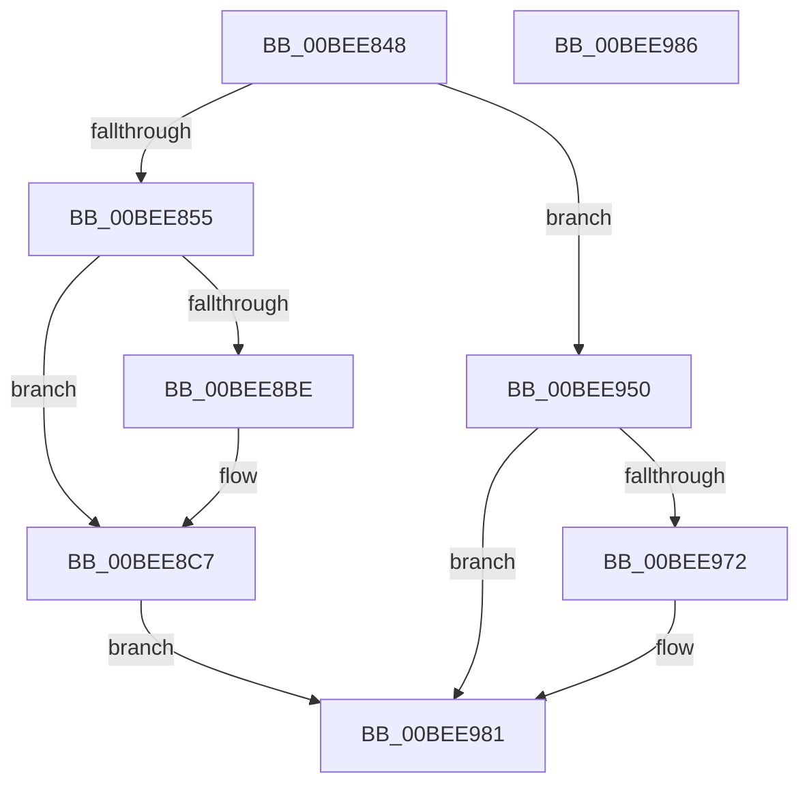

# CcInitializeTelemetry

- RVA: `0x00BEE848`–`0x00BEE987` (길이 `319` bytes)
- VA: `0x0000000140BEE848`
- 실행 섹션: `INIT`
- PDB 이름 있음: `예`; PDB Function 태그: `아니요`
- unwind 정보 RVA: `0x0005C788`
- 디코드: `56`개 명령, `319/319` bytes 표시
- 미해석 바이트: `0` (있으면 어셈블리에 `.byte`로 보존)

> 이 문서는 커널 이미지의 기계어와 PDB 기호를 분석해 생성했습니다. 4번과 5번은 함수 원형과 자료형을 바이너리 사용 방식에서 추정한 C 해석이며 원본 소스 복구 결과는 아닙니다.

## 1. Dependencies

- 직접 호출 지점: **4**; 고유 호출 대상: **4**
- 직접 호출자로 확인된 함수: **1**
- RIP 상대 이미지 참조: **30**

### Outgoing calls
- `0x00BEE864` → [memset](../../text/6C/memset_function_006C6C40.md) (function, `0x006C6C40`)
- `0x00BEE870` → [KeQueryPerformanceCounter](../../text/37/KeQueryPerformanceCounter_function_0037E7E0.md) (function, `0x0037E7E0`)
- `0x00BEE95C` → [TraceLoggingRegisterEx_EtwRegister_EtwSetInformation](../../page/92/TraceLoggingRegisterEx_EtwRegister_EtwSetInformation_function_009208A0.md) (function, `0x009208A0`)
- `0x00BEE97C` → [CcSetTelemetryPeriodicTimer](../../page/AD/CcSetTelemetryPeriodicTimer_function_00ADB788.md) (function, `0x00ADB788`)

### Direct callers
- [CcInitializeCacheManager](CcInitializeCacheManager_function_00BEE2E8.md) at `0x00BEE30C`
- [CcInitializeCacheManager](CcInitializeCacheManager_function_00BEE2E8.md) at `0x00BEE7C7`

### Static image references
- `0x00BEE857` → RVA `0x00F8F260` (`.data`; read)
- `0x00BEE869` → RVA `0x00F8F268` (`.data`; read)
- `0x00BEE875` → RVA `0x00042E90` (`.rdata`; read)
- `0x00BEE88A` → RVA `0x00E0A89C` (`.data`; read)
- `0x00BEE890` → RVA `0x00F8F278` (`.data`; write)
- `0x00BEE897` → RVA `0x00F8F270` (`.data`; write)
- `0x00BEE8A8` → RVA `0x00F8F290` (`.data`; write)
- `0x00BEE8B1` → RVA `0x00F8F280` (`.data`; write)
- `0x00BEE8C0` → RVA `0x00F8F2A1` (`.data`; write)
- `0x00BEE8C7` → RVA `0x00A88370` (`CcTelemetryPeriodicTimerCallback`; read)
- `0x00BEE8CE` → RVA `0x00F8F410` (`.data`; write)
- `0x00BEE8D5` → RVA `0x00F8F460` (`.data`; write)
- `0x00BEE8DC` → RVA `0x00F8F450` (`.data`; read)
- `0x00BEE8E3` → RVA `0x00F8F468` (`.data`; write)
- `0x00BEE8EA` → RVA `0x00F8F418` (`.data`; read)
- `0x00BEE8F1` → RVA `0x00F8F420` (`.data`; write)
- `0x00BEE8F8` → RVA `0x00F8F418` (`.data`; write)
- `0x00BEE8FF` → RVA `0x004CDEB0` (`CcTelemetryPeriodicTimerDpc`; read)
- `0x00BEE906` → RVA `0x00F8F3E8` (`.data`; write)
- `0x00BEE90D` → RVA `0x00F8F450` (`.data`; write)
- `0x00BEE91B` → RVA `0x00F8F428` (`.data`; write)
- `0x00BEE922` → RVA `0x00F8F44C` (`.data`; write)
- `0x00BEE928` → RVA `0x00F8F448` (`.data`; write)
- `0x00BEE92F` → RVA `0x00F8F3D0` (`.data`; write)
- `0x00BEE939` → RVA `0x00F8F3F0` (`.data`; write)
- `0x00BEE940` → RVA `0x00F8F408` (`.data`; write)
- `0x00BEE947` → RVA `0x00F8F3E0` (`.data`; write)
- `0x00BEE953` → RVA `0x00E06C18` (`.data`; read)
- `0x00BEE963` → RVA `0x00F8F260` (`.data`; write)
- `0x00BEE96A` → RVA `0x00F8F2A1` (`.data`; read)

## 2. Other-region calls and transfers

- 다른 실행 섹션으로 향하는 call: **4**
  - `0x00BEE864` → [memset](../../text/6C/memset_function_006C6C40.md) (`INIT` → `.text`)
  - `0x00BEE870` → [KeQueryPerformanceCounter](../../text/37/KeQueryPerformanceCounter_function_0037E7E0.md) (`INIT` → `.text`)
  - `0x00BEE95C` → [TraceLoggingRegisterEx_EtwRegister_EtwSetInformation](../../page/92/TraceLoggingRegisterEx_EtwRegister_EtwSetInformation_function_009208A0.md) (`INIT` → `PAGE`)
  - `0x00BEE97C` → [CcSetTelemetryPeriodicTimer](../../page/AD/CcSetTelemetryPeriodicTimer_function_00ADB788.md) (`INIT` → `PAGE`)
- 별도 외부 분기/꼬리 이동을 확인하지 못했습니다.

## 3. Assembly (complete function range)

```asm
00BEE848  48 83 EC 28                     sub rsp, 0x28
00BEE84C  83 F9 01                        cmp ecx, 1
00BEE84F  0F 85 FB 00 00 00               jne 0x140bee950
00BEE855  33 D2                           xor edx, edx
00BEE857  48 8D 0D 02 0A 3A 00            lea rcx, [rip + 0x3a0a02]
00BEE85E  41 B8 10 02 00 00               mov r8d, 0x210
00BEE864  E8 D7 83 AD FF                  call 0x1406c6c40
00BEE869  48 8D 0D F8 09 3A 00            lea rcx, [rip + 0x3a09f8]
00BEE870  E8 6B FF 78 FF                  call 0x14037e7e0
00BEE875  66 0F 6F 05 13 46 45 FF         movdqa xmm0, xmmword ptr [rip - 0xbab9ed]
00BEE87D  48 B8 14 00 00 00 80 F7 FF FF   movabs rax, 0xfffff78000000014
00BEE887  48 8B 00                        mov rax, qword ptr [rax]
00BEE88A  8B 0D 0C C0 21 00               mov ecx, dword ptr [rip + 0x21c00c]
00BEE890  48 89 05 E1 09 3A 00            mov qword ptr [rip + 0x3a09e1], rax
00BEE897  48 89 05 D2 09 3A 00            mov qword ptr [rip + 0x3a09d2], rax
00BEE89E  48 B8 00 C0 69 2A C9 00 00 00   movabs rax, 0xc92a69c000
00BEE8A8  48 89 05 E1 09 3A 00            mov qword ptr [rip + 0x3a09e1], rax
00BEE8AF  33 C0                           xor eax, eax
00BEE8B1  F3 0F 7F 05 C7 09 3A 00         movdqu xmmword ptr [rip + 0x3a09c7], xmm0
00BEE8B9  83 F9 01                        cmp ecx, 1
00BEE8BC  77 09                           ja 0x140bee8c7
00BEE8BE  85 C9                           test ecx, ecx
00BEE8C0  0F 95 05 DA 09 3A 00            setne byte ptr [rip + 0x3a09da]
00BEE8C7  48 8D 0D A2 9A E9 FF            lea rcx, [rip - 0x16655e]
00BEE8CE  48 89 05 3B 0B 3A 00            mov qword ptr [rip + 0x3a0b3b], rax
00BEE8D5  48 89 0D 84 0B 3A 00            mov qword ptr [rip + 0x3a0b84], rcx
00BEE8DC  48 8D 0D 6D 0B 3A 00            lea rcx, [rip + 0x3a0b6d]
00BEE8E3  48 89 0D 7E 0B 3A 00            mov qword ptr [rip + 0x3a0b7e], rcx
00BEE8EA  48 8D 0D 27 0B 3A 00            lea rcx, [rip + 0x3a0b27]
00BEE8F1  48 89 0D 28 0B 3A 00            mov qword ptr [rip + 0x3a0b28], rcx
00BEE8F8  48 89 0D 19 0B 3A 00            mov qword ptr [rip + 0x3a0b19], rcx
00BEE8FF  48 8D 0D AA F5 8D FF            lea rcx, [rip - 0x720a56]
00BEE906  48 89 0D DB 0A 3A 00            mov qword ptr [rip + 0x3a0adb], rcx
00BEE90D  48 89 05 3C 0B 3A 00            mov qword ptr [rip + 0x3a0b3c], rax
00BEE914  C6 05 F5 0A 3A 00 08            mov byte ptr [rip + 0x3a0af5], 8
00BEE91B  48 89 05 06 0B 3A 00            mov qword ptr [rip + 0x3a0b06], rax
00BEE922  89 05 24 0B 3A 00               mov dword ptr [rip + 0x3a0b24], eax
00BEE928  66 89 05 19 0B 3A 00            mov word ptr [rip + 0x3a0b19], ax
00BEE92F  C7 05 97 0A 3A 00 13 01 00 00   mov dword ptr [rip + 0x3a0a97], 0x113
00BEE939  48 89 05 B0 0A 3A 00            mov qword ptr [rip + 0x3a0ab0], rax
00BEE940  48 89 05 C1 0A 3A 00            mov qword ptr [rip + 0x3a0ac1], rax
00BEE947  48 89 05 92 0A 3A 00            mov qword ptr [rip + 0x3a0a92], rax
00BEE94E  EB 31                           jmp 0x140bee981
00BEE950  45 33 C0                        xor r8d, r8d
00BEE953  48 8D 0D BE 82 21 00            lea rcx, [rip + 0x2182be]
00BEE95A  33 D2                           xor edx, edx
00BEE95C  E8 3F 1F D3 FF                  call 0x1409208a0
00BEE961  33 C0                           xor eax, eax
00BEE963  C6 05 F6 08 3A 00 01            mov byte ptr [rip + 0x3a08f6], 1
00BEE96A  38 05 31 09 3A 00               cmp byte ptr [rip + 0x3a0931], al
00BEE970  75 0F                           jne 0x140bee981
00BEE972  48 B9 00 E6 8E E7 FD FF FF FF   movabs rcx, 0xfffffffde78ee600
00BEE97C  E8 07 CE EE FF                  call 0x140adb788
00BEE981  48 83 C4 28                     add rsp, 0x28
00BEE985  C3                              ret
00BEE986  CC                              int3
```

## 4. C-style interpretation (structured pseudocode)

```c
__int64 __fastcall CcInitializeTelemetry(int a1, int a2)
{
    __int64 result;
    __int64 v_rsp;

    v_rsp = (v_rsp) - (40);
    if (a1 != 1) goto loc_00BEE950;
    a2 = 0;
    result = memset(v_rip + 3803650, a2, 528, a4);
    result = KeQueryPerformanceCounter(v_rip + 3803640, a2, 528, a4);
    *(unsigned __int64 *)(v_rip + 3803617) = *(unsigned __int64 *)(result);
    *(unsigned __int64 *)(v_rip + 3803602) = *(unsigned __int64 *)(result);
    *(unsigned __int64 *)(v_rip + 3803617) = *(unsigned __int64 *)(result);
    result = 0;
    *(unsigned __int64 *)(v_rip + 3803591) = v_xmm0;
    if (((unsigned int)((unsigned int)(*(unsigned int *)(v_rip + 2211852)))) <= 1) {
    }
    *(unsigned __int64 *)(v_rip + 3803963) = 0;
    *(unsigned __int64 *)(v_rip + 3804036) = v_rip - 1467742;
    *(unsigned __int64 *)(v_rip + 3804030) = v_rip + 3804013;
    *(unsigned __int64 *)(v_rip + 3803944) = v_rip + 3803943;
    *(unsigned __int64 *)(v_rip + 3803929) = v_rip + 3803943;
    *(unsigned __int64 *)(v_rip + 3803867) = v_rip - 7473750;
    *(unsigned __int64 *)(v_rip + 3803964) = 0;
    *(unsigned __int8 *)(v_rip + 3803893) = 8;
    *(unsigned __int64 *)(v_rip + 3803910) = 0;
    *(unsigned int *)(v_rip + 3803940) = 0;
    *(unsigned __int16 *)(v_rip + 3803929) = 0;
    *(unsigned int *)(v_rip + 3803799) = 275;
    *(unsigned __int64 *)(v_rip + 3803824) = 0;
    *(unsigned __int64 *)(v_rip + 3803841) = 0;
    *(unsigned __int64 *)(v_rip + 3803794) = 0;
    goto loc_00BEE981;
loc_00BEE950:
    a3 = 0;
    a2 = 0;
    result = TraceLoggingRegisterEx_EtwRegister_EtwSetInformation(v_rip + 2196158, a2, a3, a4);
    result = 0;
    *(unsigned __int8 *)(v_rip + 3803382) = 1;
    if ((*(unsigned __int8 *)(v_rip + 3803441)) == 0) {
        result = CcSetTelemetryPeriodicTimer(v_rip + 2196158, a2, a3, a4);
    }
    v_rsp = (v_rsp) + (40);
    return result;
}
```

## 5. (Beta) C Style

```c
int64_t CcInitializeTelemetry(int32_t Arg1, int32_t Arg2)
{
    int64_t result;
    int64_t local_rsp;

    local_rsp = (local_rsp) - (40);
    if (Arg1 != 1) goto loc_00BEE950;
    Arg2 = 0;
    result = memset(v_rip + 3803650, Arg2, 528, a4);
    result = KeQueryPerformanceCounter(v_rip + 3803640, Arg2, 528, a4);
    *(uint64_t *)(v_rip + 0x3A09E1) = *(uint64_t *)(result);
    *(uint64_t *)(v_rip + 0x3A09D2) = *(uint64_t *)(result);
    *(uint64_t *)(v_rip + 0x3A09E1) = *(uint64_t *)(result);
    result = 0;
    *(uint64_t *)(v_rip + 0x3A09C7) = v_xmm0;
    if (((uint32_t)((uint32_t)(*(uint32_t *)(v_rip + 0x21C00C)))) <= 1) {
    }
    *(uint64_t *)(v_rip + 0x3A0B3B) = 0;
    *(uint64_t *)(v_rip + 0x3A0B84) = v_rip - 1467742;
    *(uint64_t *)(v_rip + 0x3A0B7E) = v_rip + 3804013;
    *(uint64_t *)(v_rip + 0x3A0B28) = v_rip + 3803943;
    *(uint64_t *)(v_rip + 0x3A0B19) = v_rip + 3803943;
    *(uint64_t *)(v_rip + 0x3A0ADB) = v_rip - 7473750;
    *(uint64_t *)(v_rip + 0x3A0B3C) = 0;
    *(uint8_t *)(v_rip + 0x3A0AF5) = 8;
    *(uint64_t *)(v_rip + 0x3A0B06) = 0;
    *(uint32_t *)(v_rip + 0x3A0B24) = 0;
    *(uint16_t *)(v_rip + 0x3A0B19) = 0;
    *(uint32_t *)(v_rip + 0x3A0A97) = 275;
    *(uint64_t *)(v_rip + 0x3A0AB0) = 0;
    *(uint64_t *)(v_rip + 0x3A0AC1) = 0;
    *(uint64_t *)(v_rip + 0x3A0A92) = 0;
    goto loc_00BEE981;
loc_00BEE950:
    a3 = 0;
    Arg2 = 0;
    result = TraceLoggingRegisterEx_EtwRegister_EtwSetInformation(v_rip + 2196158, Arg2, a3, a4);
    result = 0;
    *(uint8_t *)(v_rip + 0x3A08F6) = 1;
    if ((*(uint8_t *)(v_rip + 0x3A0931)) == 0) {
        result = CcSetTelemetryPeriodicTimer(v_rip + 2196158, Arg2, a3, a4);
    }
    local_rsp = (local_rsp) + (40);
    return result;
}
```

## 6. Execution-region graph

[열기: 2D/3D 그래프와 함수 탐색 컨트롤 패널](../../../control-panel.html?section=init&rva=0x00BEE848&view=graph)

- 2D 그래프는 위에서 아래로 흐르고, 3D 그래프는 빈 공간을 드래그해 회전합니다. Shift+드래그는 이동, 휠은 확대·축소, 함수 노드 선택은 대상 보고서 이동입니다.

### Static fallback


