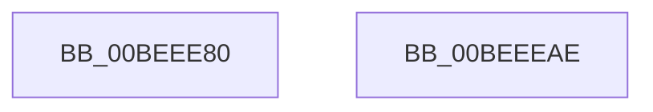

# HalRegisterErrataCallbacks

- RVA: `0x00BEEE80`–`0x00BEEEAF` (길이 `47` bytes)
- VA: `0x0000000140BEEE80`
- 실행 섹션: `INIT`
- PDB 이름 있음: `예`; PDB Function 태그: `아니요`
- unwind 정보 RVA: `0x0005D2F4`
- 디코드: `12`개 명령, `47/47` bytes 표시
- 미해석 바이트: `0` (있으면 어셈블리에 `.byte`로 보존)

> 이 문서는 커널 이미지의 기계어와 PDB 기호를 분석해 생성했습니다. 4번과 5번은 함수 원형과 자료형을 바이너리 사용 방식에서 추정한 C 해석이며 원본 소스 복구 결과는 아닙니다.

## 1. Dependencies

- 직접 호출 지점: **1**; 고유 호출 대상: **1**
- 직접 호출자로 확인된 함수: **0**
- RIP 상대 이미지 참조: **1**

### Outgoing calls
- `0x00BEEEA4` → [EmpProviderRegister](../../page/AC/EmpProviderRegister_function_00ACC5D0.md) (function, `0x00ACC5D0`)

### Direct callers
- 이 함수 시작 RVA로 연결되는 직접 call은 확인되지 않았습니다. 간접 호출은 완전히 역산할 수 없습니다.

### Static image references
- `0x00BEEE91` → RVA `0x000064A0` (`.rdata`; read)

## 2. Other-region calls and transfers

- 다른 실행 섹션으로 향하는 call: **1**
  - `0x00BEEEA4` → [EmpProviderRegister](../../page/AC/EmpProviderRegister_function_00ACC5D0.md) (`INIT` → `PAGE`)
- 별도 외부 분기/꼬리 이동을 확인하지 못했습니다.

## 3. Assembly (complete function range)

```asm
00BEEE80  48 83 EC 38                     sub rsp, 0x38
00BEEE84  48 8D 44 24 40                  lea rax, [rsp + 0x40]
00BEEE89  45 33 C0                        xor r8d, r8d
00BEEE8C  48 89 44 24 28                  mov qword ptr [rsp + 0x28], rax
00BEEE91  4C 8D 0D 08 76 41 FF            lea r9, [rip - 0xbe89f8]
00BEEE98  33 D2                           xor edx, edx
00BEEE9A  C7 44 24 20 06 00 00 00         mov dword ptr [rsp + 0x20], 6
00BEEEA2  33 C9                           xor ecx, ecx
00BEEEA4  E8 27 D7 ED FF                  call 0x140acc5d0
00BEEEA9  48 83 C4 38                     add rsp, 0x38
00BEEEAD  C3                              ret
00BEEEAE  CC                              int3
```

## 4. C-style interpretation (structured pseudocode)

```c
__int64 __fastcall HalRegisterErrataCallbacks(int a1, int a2, int a3)
{
    __int64 result;
    __int64 v_rsp;
    unsigned __int64 v_stack_m10;
    unsigned int v_stack_m18;
    unsigned __int64 v_stack_p8;

    v_rsp = (v_rsp) - (56);
    a3 = 0;
    v_stack_m10 = v_stack_p8;
    a2 = 0;
    v_stack_m18 = 6;
    a1 = 0;
    result = EmpProviderRegister(a1, a2, a3, v_rip - 12487160);
    v_rsp = (v_rsp) + (56);
    return result;
}
```

## 5. (Beta) C Style

```c
int64_t HalRegisterErrataCallbacks(int32_t Arg1, int32_t Arg2, int32_t Arg3)
{
    int64_t result;
    int64_t local_rsp;
    uint64_t v_stack_m10;
    uint32_t v_stack_m18;
    uint64_t v_stack_p8;

    local_rsp = (local_rsp) - (56);
    Arg3 = 0;
    v_stack_m10 = v_stack_p8;
    Arg2 = 0;
    v_stack_m18 = 6;
    Arg1 = 0;
    result = EmpProviderRegister(Arg1, Arg2, Arg3, v_rip - 12487160);
    local_rsp = (local_rsp) + (56);
    return result;
}
```

## 6. Execution-region graph

[열기: 2D/3D 그래프와 함수 탐색 컨트롤 패널](../../../control-panel.html?section=init&rva=0x00BEEE80&view=graph)

- 2D 그래프는 위에서 아래로 흐르고, 3D 그래프는 빈 공간을 드래그해 회전합니다. Shift+드래그는 이동, 휠은 확대·축소, 함수 노드 선택은 대상 보고서 이동입니다.

### Static fallback


