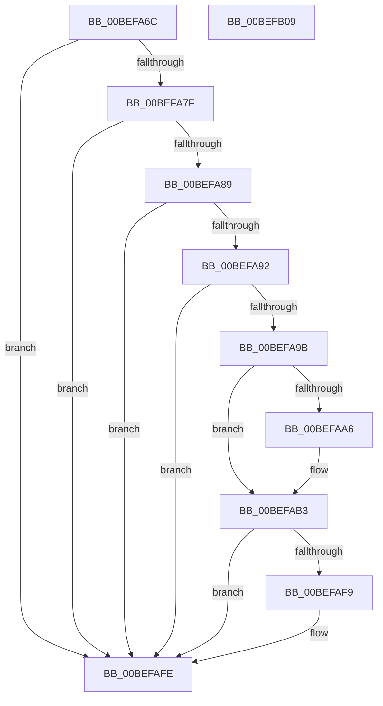

# KeCheckedKernelInitialize

- RVA: `0x00BEFA6C`–`0x00BEFB0A` (길이 `158` bytes)
- VA: `0x0000000140BEFA6C`
- 실행 섹션: `INIT`
- PDB 이름 있음: `예`; PDB Function 태그: `아니요`
- unwind 정보 RVA: `0x00065960`
- 디코드: `40`개 명령, `158/158` bytes 표시
- 미해석 바이트: `0` (있으면 어셈블리에 `.byte`로 보존)

> 이 문서는 커널 이미지의 기계어와 PDB 기호를 분석해 생성했습니다. 4번과 5번은 함수 원형과 자료형을 바이너리 사용 방식에서 추정한 C 해석이며 원본 소스 복구 결과는 아닙니다.

## 1. Dependencies

- 직접 호출 지점: **6**; 고유 호출 대상: **6**
- 직접 호출자로 확인된 함수: **1**
- RIP 상대 이미지 참조: **4**

### Outgoing calls
- `0x00BEFA76` → [KiSwInterruptPresent](KiSwInterruptPresent_function_00BEF1F4.md) (function, `0x00BEF1F4`)
- `0x00BEFA89` → [KiAreCodePatchesAllowed](../C3/KiAreCodePatchesAllowed_function_00C36DF0.md) (function, `0x00C36DF0`)
- `0x00BEFA92` → [sub_00C1943C](../C1/Unknown_function_00C1943C.md) (function, `0x00C1943C`)
- `0x00BEFAB3` → [KdDisableDebugger](../../text/5B/KdDisableDebugger_function_005B0900.md) (function, `0x005B0900`)
- `0x00BEFAF0` → [KeExpandKernelStackAndCallout](../../text/46/KeExpandKernelStackAndCallout_function_004675F0.md) (function, `0x004675F0`)
- `0x00BEFAF9` → [KdEnableDebugger](../../text/5B/KdEnableDebugger_function_005B0A40.md) (function, `0x005B0A40`)

### Direct callers
- [PipInitializeCoreDriversAndElam](../C7/PipInitializeCoreDriversAndElam_function_00C73F84.md) at `0x00C74033`

### Static image references
- `0x00BEFA7F` → RVA `0x00FC6A48` (`ALMOSTRO`; read)
- `0x00BEFA9D` → RVA `0x00E0AA1C` (`.data`; read)
- `0x00BEFAA6` → RVA `0x00F475DC` (`.data`; read)
- `0x00BEFAC8` → RVA `0x00C18CA0` (`INIT`; read)

## 2. Other-region calls and transfers

- 다른 실행 섹션으로 향하는 call: **3**
  - `0x00BEFAB3` → [KdDisableDebugger](../../text/5B/KdDisableDebugger_function_005B0900.md) (`INIT` → `.text`)
  - `0x00BEFAF0` → [KeExpandKernelStackAndCallout](../../text/46/KeExpandKernelStackAndCallout_function_004675F0.md) (`INIT` → `.text`)
  - `0x00BEFAF9` → [KdEnableDebugger](../../text/5B/KdEnableDebugger_function_005B0A40.md) (`INIT` → `.text`)
- 별도 외부 분기/꼬리 이동을 확인하지 못했습니다.

## 3. Assembly (complete function range)

```asm
00BEFA6C  48 89 5C 24 08                  mov qword ptr [rsp + 8], rbx
00BEFA71  57                              push rdi
00BEFA72  48 83 EC 40                     sub rsp, 0x40
00BEFA76  E8 79 F7 FF FF                  call 0x140bef1f4
00BEFA7B  85 C0                           test eax, eax
00BEFA7D  78 7F                           js 0x140befafe
00BEFA7F  48 83 3D C1 6F 3D 00 00         cmp qword ptr [rip + 0x3d6fc1], 0
00BEFA87  75 75                           jne 0x140befafe
00BEFA89  E8 62 73 04 00                  call 0x140c36df0
00BEFA8E  85 C0                           test eax, eax
00BEFA90  74 6C                           je 0x140befafe
00BEFA92  E8 A5 99 02 00                  call 0x140c1943c
00BEFA97  85 C0                           test eax, eax
00BEFA99  74 63                           je 0x140befafe
00BEFA9B  33 FF                           xor edi, edi
00BEFA9D  40 38 3D 78 AF 21 00            cmp byte ptr [rip + 0x21af78], dil
00BEFAA4  75 0D                           jne 0x140befab3
00BEFAA6  40 38 3D 2F 7B 35 00            cmp byte ptr [rip + 0x357b2f], dil
00BEFAAD  8D 47 10                        lea eax, [rdi + 0x10]
00BEFAB0  0F 44 F8                        cmove edi, eax
00BEFAB3  E8 48 0E 9C FF                  call 0x1405b0900
00BEFAB8  83 64 24 20 00                  and dword ptr [rsp + 0x20], 0
00BEFABD  48 8D 54 24 20                  lea rdx, [rsp + 0x20]
00BEFAC2  48 83 64 24 30 00               and qword ptr [rsp + 0x30], 0
00BEFAC8  48 8D 0D D1 91 02 00            lea rcx, [rip + 0x291d1]
00BEFACF  41 B8 00 C0 00 00               mov r8d, 0xc000
00BEFAD5  C7 44 24 24 07 00 00 00         mov dword ptr [rsp + 0x24], 7
00BEFADD  8B D8                           mov ebx, eax
00BEFADF  C7 44 24 28 01 00 00 00         mov dword ptr [rsp + 0x28], 1
00BEFAE7  89 7C 24 38                     mov dword ptr [rsp + 0x38], edi
00BEFAEB  C6 44 24 3C 00                  mov byte ptr [rsp + 0x3c], 0
00BEFAF0  E8 FB 7A 87 FF                  call 0x1404675f0
00BEFAF5  85 DB                           test ebx, ebx
00BEFAF7  78 05                           js 0x140befafe
00BEFAF9  E8 42 0F 9C FF                  call 0x1405b0a40
00BEFAFE  48 8B 5C 24 50                  mov rbx, qword ptr [rsp + 0x50]
00BEFB03  48 83 C4 40                     add rsp, 0x40
00BEFB07  5F                              pop rdi
00BEFB08  C3                              ret
00BEFB09  CC                              int3
```

## 4. C-style interpretation (structured pseudocode)

```c
__int64 __fastcall KeCheckedKernelInitialize(void)
{
    __int64 result;
    __int64 v_rdi;
    __int64 v_rsp;
    unsigned int v_stack_m10;
    unsigned __int64 v_stack_m18;
    unsigned int v_stack_m20;
    unsigned int v_stack_m24;
    unsigned int v_stack_m28;
    unsigned __int8 v_stack_mC;
    unsigned __int64 v_stack_p8;

    v_stack_p8 = v_rbx;
    v_rsp = (v_rsp) - (64);
    result = KiSwInterruptPresent(a1, a2, a3, a4);
    if (sign_flag) goto loc_00BEFAFE;
    if ((*(unsigned __int64 *)(v_rip + 4026305)) != 0) goto loc_00BEFAFE;
    result = KiAreCodePatchesAllowed(a1, a2, a3, a4);
    if ((unsigned int)(result) == 0) goto loc_00BEFAFE;
    result = sub_00C1943C(a1, a2, a3, a4);
    if ((unsigned int)(result) == 0) goto loc_00BEFAFE;
    v_rdi = 0;
    if ((*(unsigned __int8 *)(v_rip + 2207608)) == 0) {
        result = v_rdi + 16;
        if ((*(unsigned __int8 *)(v_rip + 3504943)) == 0) { v_rdi = (unsigned int)(result); }
    }
    result = KdDisableDebugger(a1, a2, a3, a4);
    v_stack_m24 = 7;
    v_stack_m20 = 1;
    v_stack_m10 = (unsigned int)(v_rdi);
    v_stack_mC = 0;
    result = KeExpandKernelStackAndCallout(v_rip + 168401, v_stack_m28, (unsigned int)(0xC000ULL), a4);
    if (!(sign_flag)) {
        result = KdEnableDebugger(v_rip + 168401, v_stack_m28, (unsigned int)(0xC000ULL), a4);
    }
    v_rsp = (v_rsp) + (64);
    return result;
}
```

## 5. (Beta) C Style

```c
void KeCheckedKernelInitialize(void)
{
    int64_t result;
    int64_t local_rdi;
    int64_t local_rsp;
    uint32_t v_stack_m10;
    uint64_t v_stack_m18;
    uint32_t v_stack_m20;
    uint32_t v_stack_m24;
    uint32_t v_stack_m28;
    uint8_t v_stack_mC;
    uint64_t v_stack_p8;

    v_stack_p8 = local_rbx;
    local_rsp = (local_rsp) - (64);
    result = KiSwInterruptPresent(a1, a2, a3, a4);
    if (sign_flag) goto loc_00BEFAFE;
    if ((*(uint64_t *)(v_rip + 0x3D6FC1)) != 0) goto loc_00BEFAFE;
    result = KiAreCodePatchesAllowed(a1, a2, a3, a4);
    if ((uint32_t)(result) == 0) goto loc_00BEFAFE;
    result = sub_00C1943C(a1, a2, a3, a4);
    if ((uint32_t)(result) == 0) goto loc_00BEFAFE;
    local_rdi = 0;
    if ((*(uint8_t *)(v_rip + 0x21AF78)) == 0) {
        result = local_rdi + 16;
        if ((*(uint8_t *)(v_rip + 0x357B2F)) == 0) { local_rdi = (uint32_t)(result); }
    }
    result = KdDisableDebugger(a1, a2, a3, a4);
    v_stack_m24 = 7;
    v_stack_m20 = 1;
    v_stack_m10 = (uint32_t)(local_rdi);
    v_stack_mC = 0;
    result = KeExpandKernelStackAndCallout(v_rip + 168401, v_stack_m28, (uint32_t)(0xC000ULL), a4);
    if (!(sign_flag)) {
        result = KdEnableDebugger(v_rip + 168401, v_stack_m28, (uint32_t)(0xC000ULL), a4);
    }
    local_rsp = (local_rsp) + (64);
    return result;
}
```

## 6. Execution-region graph

[열기: 2D/3D 그래프와 함수 탐색 컨트롤 패널](../../../control-panel.html?section=init&rva=0x00BEFA6C&view=graph)

- 2D 그래프는 위에서 아래로 흐르고, 3D 그래프는 빈 공간을 드래그해 회전합니다. Shift+드래그는 이동, 휠은 확대·축소, 함수 노드 선택은 대상 보고서 이동입니다.

### Static fallback


