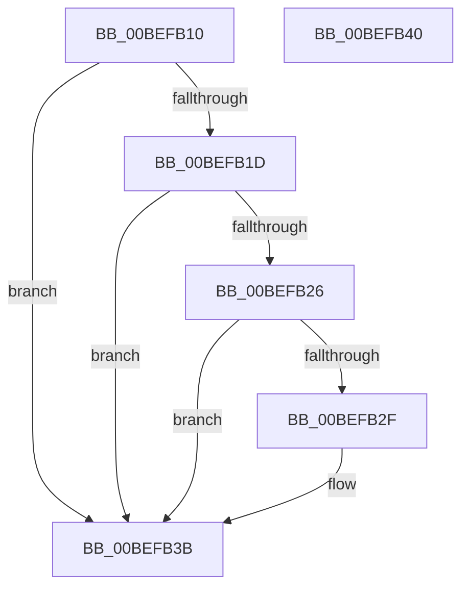

# KeFreeInitializationCode

- RVA: `0x00BEFB10`–`0x00BEFB41` (길이 `49` bytes)
- VA: `0x0000000140BEFB10`
- 실행 섹션: `INIT`
- PDB 이름 있음: `예`; PDB Function 태그: `아니요`
- unwind 정보 RVA: `0x0005C788`
- 디코드: `14`개 명령, `49/49` bytes 표시
- 미해석 바이트: `0` (있으면 어셈블리에 `.byte`로 보존)

> 이 문서는 커널 이미지의 기계어와 PDB 기호를 분석해 생성했습니다. 4번과 5번은 함수 원형과 자료형을 바이너리 사용 방식에서 추정한 C 해석이며 원본 소스 복구 결과는 아닙니다.

## 1. Dependencies

- 직접 호출 지점: **3**; 고유 호출 대상: **3**
- 직접 호출자로 확인된 함수: **1**
- RIP 상대 이미지 참조: **2**

### Outgoing calls
- `0x00BEFB14` → [MmStrongCodeGuaranteesEnforced](../C6/MmStrongCodeGuaranteesEnforced_function_00C6C980.md) (function, `0x00C6C980`)
- `0x00BEFB1D` → [KiSwInterruptPresent](KiSwInterruptPresent_function_00BEF1F4.md) (function, `0x00BEF1F4`)
- `0x00BEFB36` → [MmDiscardDriverSection](../C6/MmDiscardDriverSection_function_00C6C8D0.md) (function, `0x00C6C8D0`)

### Direct callers
- [KeInitSystem](../C7/KeInitSystem_function_00C71660.md) at `0x00C71C2E`

### Static image references
- `0x00BEFB26` → RVA `0x00FC6A40` (`ALMOSTRO`; read)
- `0x00BEFB2F` → RVA `0x00BE8DF0` (`INITKDBG`; read)

## 2. Other-region calls and transfers

- 다른 실행 섹션으로 향하는 call: **0**
- 별도 외부 분기/꼬리 이동을 확인하지 못했습니다.

## 3. Assembly (complete function range)

```asm
00BEFB10  48 83 EC 28                     sub rsp, 0x28
00BEFB14  E8 67 CE 07 00                  call 0x140c6c980
00BEFB19  85 C0                           test eax, eax
00BEFB1B  75 1E                           jne 0x140befb3b
00BEFB1D  E8 D2 F6 FF FF                  call 0x140bef1f4
00BEFB22  85 C0                           test eax, eax
00BEFB24  79 15                           jns 0x140befb3b
00BEFB26  83 3D 13 6F 3D 00 00            cmp dword ptr [rip + 0x3d6f13], 0
00BEFB2D  75 0C                           jne 0x140befb3b
00BEFB2F  48 8D 0D BA 92 FF FF            lea rcx, [rip - 0x6d46]
00BEFB36  E8 95 CD 07 00                  call 0x140c6c8d0
00BEFB3B  48 83 C4 28                     add rsp, 0x28
00BEFB3F  C3                              ret
00BEFB40  CC                              int3
```

## 4. C-style interpretation (structured pseudocode)

```c
__int64 __fastcall KeFreeInitializationCode(void)
{
    __int64 result;
    __int64 v_rsp;

    v_rsp = (v_rsp) - (40);
    result = MmStrongCodeGuaranteesEnforced(a1, a2, a3, a4);
    if ((unsigned int)(result) != 0) goto loc_00BEFB3B;
    result = KiSwInterruptPresent(a1, a2, a3, a4);
    if (!sign_flag) goto loc_00BEFB3B;
    if ((*(unsigned int *)(v_rip + 4026131)) == 0) {
        a1 = v_rip - 27974;
        result = MmDiscardDriverSection(a1, a2, a3, a4);
    }
    v_rsp = (v_rsp) + (40);
    return result;
}
```

## 5. (Beta) C Style

```c
void KeFreeInitializationCode(void)
{
    int64_t result;
    int64_t local_rsp;

    local_rsp = (local_rsp) - (40);
    result = MmStrongCodeGuaranteesEnforced(a1, a2, a3, a4);
    if ((uint32_t)(result) != 0) goto loc_00BEFB3B;
    result = KiSwInterruptPresent(a1, a2, a3, a4);
    if (!sign_flag) goto loc_00BEFB3B;
    if ((*(uint32_t *)(v_rip + 0x3D6F13)) == 0) {
        a1 = v_rip - 27974;
        result = MmDiscardDriverSection(a1, a2, a3, a4);
    }
    local_rsp = (local_rsp) + (40);
    return result;
}
```

## 6. Execution-region graph

[열기: 2D/3D 그래프와 함수 탐색 컨트롤 패널](../../../control-panel.html?section=init&rva=0x00BEFB10&view=graph)

- 2D 그래프는 위에서 아래로 흐르고, 3D 그래프는 빈 공간을 드래그해 회전합니다. Shift+드래그는 이동, 휠은 확대·축소, 함수 노드 선택은 대상 보고서 이동입니다.

### Static fallback


