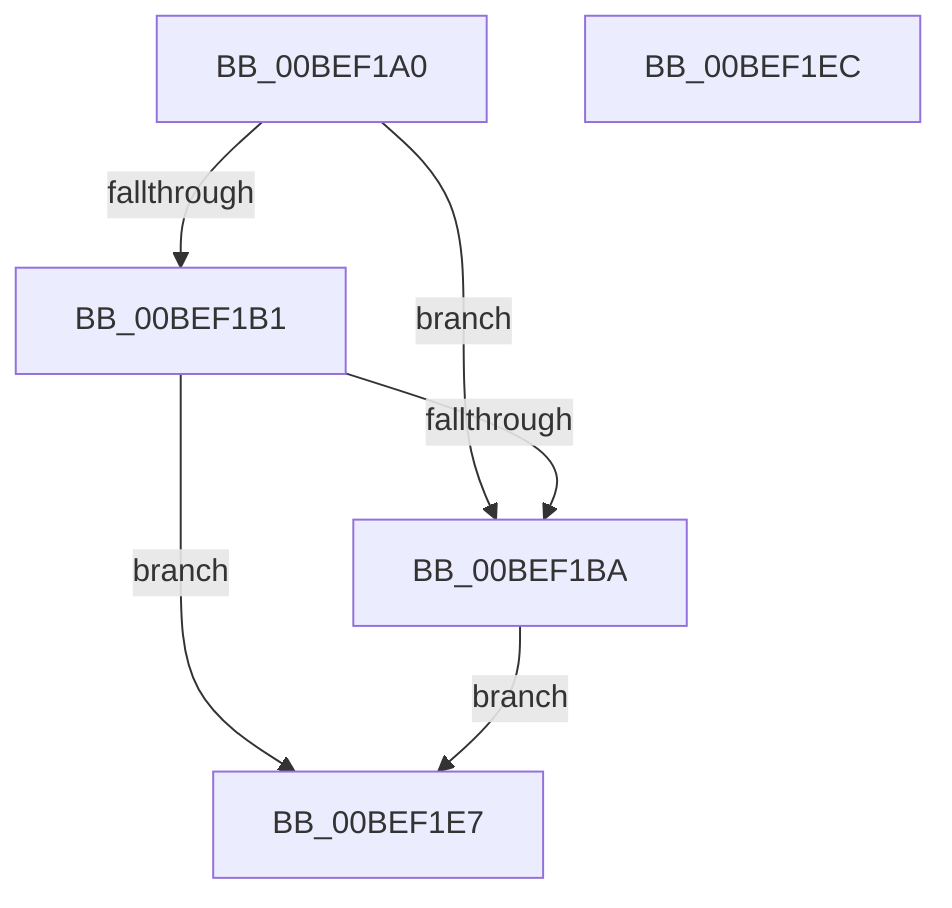

# KeInitAmd64SpecificState

- RVA: `0x00BEF1A0`–`0x00BEF1ED` (길이 `77` bytes)
- VA: `0x0000000140BEF1A0`
- 실행 섹션: `INIT`
- PDB 이름 있음: `예`; PDB Function 태그: `아니요`
- unwind 정보 RVA: `0x000BF9EC`
- 디코드: `23`개 명령, `77/77` bytes 표시
- 미해석 바이트: `0` (있으면 어셈블리에 `.byte`로 보존)

> 이 문서는 커널 이미지의 기계어와 PDB 기호를 분석해 생성했습니다. 4번과 5번은 함수 원형과 자료형을 바이너리 사용 방식에서 추정한 C 해석이며 원본 소스 복구 결과는 아닙니다.

## 1. Dependencies

- 직접 호출 지점: **0**; 고유 호출 대상: **0**
- 직접 호출자로 확인된 함수: **1**
- RIP 상대 이미지 참조: **4**

### Outgoing calls
- 직접 디코드된 call 명령이 없습니다.

### Direct callers
- [PipInitializeCoreDriversAndElam](../C7/PipInitializeCoreDriversAndElam_function_00C73F84.md) at `0x00C74025`

### Static image references
- `0x00BEF1A7` → RVA `0x01201860` (`CFGRO`; read)
- `0x00BEF1B1` → RVA `0x00FC41C4` (`.data`; read)
- `0x00BEF1BA` → RVA `0x00F475DC` (`.data`; read)
- `0x00BEF1C1` → RVA `0x00E0AA1C` (`.data`; read)

## 2. Other-region calls and transfers

- 다른 실행 섹션으로 향하는 call: **0**
- 별도 외부 분기/꼬리 이동을 확인하지 못했습니다.

## 3. Assembly (complete function range)

```asm
00BEF1A0  48 83 EC 28                     sub rsp, 0x28
00BEF1A4  0F AE E8                        lfence
00BEF1A7  48 83 3D B1 26 61 00 00         cmp qword ptr [rip + 0x6126b1], 0
00BEF1AF  75 09                           jne 0x140bef1ba
00BEF1B1  83 3D 0C 50 3D 00 00            cmp dword ptr [rip + 0x3d500c], 0
00BEF1B8  75 2D                           jne 0x140bef1e7
00BEF1BA  0F B6 15 1B 84 35 00            movzx edx, byte ptr [rip + 0x35841b]
00BEF1C1  0F B6 05 54 B8 21 00            movzx eax, byte ptr [rip + 0x21b854]
00BEF1C8  0B D0                           or edx, eax
00BEF1CA  8B CA                           mov ecx, edx
00BEF1CC  F7 D9                           neg ecx
00BEF1CE  45 1B C0                        sbb r8d, r8d
00BEF1D1  41 83 E0 EE                     and r8d, 0xffffffee
00BEF1D5  41 83 C0 11                     add r8d, 0x11
00BEF1D9  D1 CA                           ror edx, 1
00BEF1DB  8B C2                           mov eax, edx
00BEF1DD  99                              cdq
00BEF1DE  41 F7 F8                        idiv r8d
00BEF1E1  89 44 24 30                     mov dword ptr [rsp + 0x30], eax
00BEF1E5  EB 00                           jmp 0x140bef1e7
00BEF1E7  48 83 C4 28                     add rsp, 0x28
00BEF1EB  C3                              ret
00BEF1EC  CC                              int3
```

## 4. C-style interpretation (structured pseudocode)

```c
__int64 __fastcall KeInitAmd64SpecificState(__int64 a1, __int64 a2, int a3)
{
    __int64 v_rsp;
    unsigned int v_stack_p8;

    v_rsp = (v_rsp) - (40);
    if ((*(unsigned __int64 *)(v_rip + 6366897)) != 0) goto loc_00BEF1BA;
    if ((*(unsigned int *)(v_rip + 4018188)) != 0) goto loc_00BEF1E7;
loc_00BEF1BA:
    a2 = (unsigned int)((*(unsigned __int8 *)(v_rip + 3507227)) | ((unsigned int)(*(unsigned __int8 *)(v_rip + 2209876))));
    a1 = (unsigned int)(-((unsigned int)((unsigned int)(a2))));
    a3 = (unsigned int)((a3) & (0xFFFFFFEEULL));
    a3 = (unsigned int)((a3) + (17));
    v_stack_p8 = (unsigned int)((unsigned int)((unsigned int)(a2)));
    goto loc_00BEF1E7;
loc_00BEF1E7:
    v_rsp = (v_rsp) + (40);
    return (unsigned int)((unsigned int)(a2));
}
```

## 5. (Beta) C Style

```c
int64_t KeInitAmd64SpecificState(int64_t Arg1, int64_t Arg2, int32_t Arg3)
{
    int64_t local_rsp;
    uint32_t v_stack_p8;

    local_rsp = (local_rsp) - (40);
    if ((*(uint64_t *)(v_rip + 0x6126B1)) != 0) goto loc_00BEF1BA;
    if ((*(uint32_t *)(v_rip + 0x3D500C)) != 0) goto loc_00BEF1E7;
loc_00BEF1BA:
    Arg2 = (uint32_t)((*(uint8_t *)(v_rip + 0x35841B)) | ((uint32_t)(*(uint8_t *)(v_rip + 0x21B854))));
    Arg1 = (uint32_t)(-((uint32_t)((uint32_t)(Arg2))));
    Arg3 = (uint32_t)((Arg3) & (0xFFFFFFEEULL));
    Arg3 = (uint32_t)((Arg3) + (17));
    v_stack_p8 = (uint32_t)((uint32_t)((uint32_t)(Arg2)));
    goto loc_00BEF1E7;
loc_00BEF1E7:
    local_rsp = (local_rsp) + (40);
    return (uint32_t)((uint32_t)(Arg2));
}
```

## 6. Execution-region graph

[열기: 2D/3D 그래프와 함수 탐색 컨트롤 패널](../../../control-panel.html?section=init&rva=0x00BEF1A0&view=graph)

- 2D 그래프는 위에서 아래로 흐르고, 3D 그래프는 빈 공간을 드래그해 회전합니다. Shift+드래그는 이동, 휠은 확대·축소, 함수 노드 선택은 대상 보고서 이동입니다.

### Static fallback


