# KiFilterFiberContext

- RVA: `0x00BEFB50`–`0x00BEFF86` (길이 `1,078` bytes)
- VA: `0x0000000140BEFB50`
- 실행 섹션: `INIT`
- PDB 이름 있음: `예`; PDB Function 태그: `아니요`
- unwind 정보 RVA: `0x000C2C18`
- 디코드: `277`개 명령, `1,078/1,078` bytes 표시
- 미해석 바이트: `0` (있으면 어셈블리에 `.byte`로 보존)

> 이 문서는 커널 이미지의 기계어와 PDB 기호를 분석해 생성했습니다. 4번과 5번은 함수 원형과 자료형을 바이너리 사용 방식에서 추정한 C 해석이며 원본 소스 복구 결과는 아닙니다.

## 1. Dependencies

- 직접 호출 지점: **13**; 고유 호출 대상: **10**
- 직접 호출자로 확인된 함수: **1**
- RIP 상대 이미지 참조: **18**

### Outgoing calls
- `0x00BEFB6C` → [KdDisableDebugger](../../text/5B/KdDisableDebugger_function_005B0900.md) (function, `0x005B0900`)
- `0x00BEFB7B` → [KeKeepData](../../text/48/KeKeepData_function_0048AE68.md) (function, `0x0048AE68`)
- `0x00BEFC4B` → [ExCreateCallback](../../page/A7/ExCreateCallback_function_00A7B9D0.md) (function, `0x00A7B9D0`)
- `0x00BEFC66` → [ExNotifyCallback](../../text/39/ExNotifyCallback_function_003926B0.md) (function, `0x003926B0`)
- `0x00BEFC6F` → [ObfDereferenceObject](../../text/2F/ObfDereferenceObject_function_002F9350.md) (function, `0x002F9350`)
- `0x00BEFCB0` → [ExInitializeNPagedLookasideList](../../text/46/ExInitializeNPagedLookasideList_function_004686E0.md) (function, `0x004686E0`)
- `0x00BEFD67` → [KeExpandKernelStackAndCallout](../../text/46/KeExpandKernelStackAndCallout_function_004675F0.md) (function, `0x004675F0`)
- `0x00BEFE4B` → [KeExpandKernelStackAndCallout](../../text/46/KeExpandKernelStackAndCallout_function_004675F0.md) (function, `0x004675F0`)
- `0x00BEFE76` → [KiSwInterruptPresent](KiSwInterruptPresent_function_00BEF1F4.md) (function, `0x00BEF1F4`)
- `0x00BEFE9E` → [KiSwInterruptPresent](KiSwInterruptPresent_function_00BEF1F4.md) (function, `0x00BEF1F4`)
- `0x00BEFEC1` → [KeExpandKernelStackAndCallout](../../text/46/KeExpandKernelStackAndCallout_function_004675F0.md) (function, `0x004675F0`)
- `0x00BEFEEC` → [ExFreePool](../../poolcode/B8/ExFreePool_function_00B82850.md) (function, `0x00B82850`)
- `0x00BEFF6A` → [KdEnableDebugger](../../text/5B/KdEnableDebugger_function_005B0A40.md) (function, `0x005B0A40`)

### Direct callers
- [KeInitAmd64SpecificState$filt$0](../C7/KeInitAmd64SpecificState_filt_0_function_00C7EAF6.md) at `0x00C7EB01`

### Static image references
- `0x00BEFB71` → RVA `0x00BEFB50` (`KiFilterFiberContext`; read)
- `0x00BEFB84` → RVA `0x00F475DC` (`.data`; read)
- `0x00BEFBE8` → RVA `0x00FC6A48` (`ALMOSTRO`; read)
- `0x00BEFBFE` → RVA `0x00FC6A40` (`ALMOSTRO`; read)
- `0x00BEFC0B` → RVA `0x01008198` (`INITDATA`; read)
- `0x00BEFC18` → RVA `0x000066A8` (`.rdata`; read)
- `0x00BEFC58` → RVA `0x01008640` (`INITDATA`; read)
- `0x00BEFC5F` → RVA `0x0050C0E0` (`.text`; read)
- `0x00BEFC7D` → RVA `0x00FC6A40` (`ALMOSTRO`; write)
- `0x00BEFC8D` → RVA `0x00E0F300` (`.data`; read)
- `0x00BEFD14` → RVA `0x00C18CA0` (`INIT`; read)
- `0x00BEFEE0` → RVA `0x01008660` (`INITDATA`; read)
- `0x00BEFEF6` → RVA `0x01008658` (`INITDATA`; read)
- `0x00BEFF1F` → RVA `0x0100864C` (`INITDATA`; write)
- `0x00BEFF26` → RVA `0x01008648` (`INITDATA`; write)
- `0x00BEFF2D` → RVA `0x01008650` (`INITDATA`; write)
- `0x00BEFF34` → RVA `0x00E0F240` (`.data`; write)
- `0x00BEFF3B` → RVA `0x01008080` (`INITDATA`; write)

## 2. Other-region calls and transfers

- 다른 실행 섹션으로 향하는 call: **11**
  - `0x00BEFB6C` → [KdDisableDebugger](../../text/5B/KdDisableDebugger_function_005B0900.md) (`INIT` → `.text`)
  - `0x00BEFB7B` → [KeKeepData](../../text/48/KeKeepData_function_0048AE68.md) (`INIT` → `.text`)
  - `0x00BEFC4B` → [ExCreateCallback](../../page/A7/ExCreateCallback_function_00A7B9D0.md) (`INIT` → `PAGE`)
  - `0x00BEFC66` → [ExNotifyCallback](../../text/39/ExNotifyCallback_function_003926B0.md) (`INIT` → `.text`)
  - `0x00BEFC6F` → [ObfDereferenceObject](../../text/2F/ObfDereferenceObject_function_002F9350.md) (`INIT` → `.text`)
  - `0x00BEFCB0` → [ExInitializeNPagedLookasideList](../../text/46/ExInitializeNPagedLookasideList_function_004686E0.md) (`INIT` → `.text`)
  - `0x00BEFD67` → [KeExpandKernelStackAndCallout](../../text/46/KeExpandKernelStackAndCallout_function_004675F0.md) (`INIT` → `.text`)
  - `0x00BEFE4B` → [KeExpandKernelStackAndCallout](../../text/46/KeExpandKernelStackAndCallout_function_004675F0.md) (`INIT` → `.text`)
  - `0x00BEFEC1` → [KeExpandKernelStackAndCallout](../../text/46/KeExpandKernelStackAndCallout_function_004675F0.md) (`INIT` → `.text`)
  - `0x00BEFEEC` → [ExFreePool](../../poolcode/B8/ExFreePool_function_00B82850.md) (`INIT` → `POOLCODE`)
  - `0x00BEFF6A` → [KdEnableDebugger](../../text/5B/KdEnableDebugger_function_005B0A40.md) (`INIT` → `.text`)
- 별도 외부 분기/꼬리 이동을 확인하지 못했습니다.

## 3. Assembly (complete function range)

```asm
00BEFB50  40 55                           push rbp
00BEFB52  53                              push rbx
00BEFB53  56                              push rsi
00BEFB54  57                              push rdi
00BEFB55  41 54                           push r12
00BEFB57  41 55                           push r13
00BEFB59  41 56                           push r14
00BEFB5B  41 57                           push r15
00BEFB5D  48 8D 6C 24 E1                  lea rbp, [rsp - 0x1f]
00BEFB62  48 81 EC E8 00 00 00            sub rsp, 0xe8
00BEFB69  48 8B F1                        mov rsi, rcx
00BEFB6C  E8 8F 0D 9C FF                  call 0x1405b0900
00BEFB71  48 8D 0D D8 FF FF FF            lea rcx, [rip - 0x28]
00BEFB78  44 8B E0                        mov r12d, eax
00BEFB7B  E8 E8 B2 89 FF                  call 0x14048ae68
00BEFB80  FA                              cli
00BEFB81  45 33 ED                        xor r13d, r13d
00BEFB84  44 38 2D 51 7A 35 00            cmp byte ptr [rip + 0x357a51], r13b
00BEFB8B  75 02                           jne 0x140befb8f
00BEFB8D  EB FE                           jmp 0x140befb8d
00BEFB8F  FB                              sti
00BEFB90  0F 31                           rdtsc
00BEFB92  48 C1 E2 20                     shl rdx, 0x20
00BEFB96  48 BF 01 20 00 04 80 00 10 70   movabs rdi, 0x7010008004002001
00BEFBA0  48 0B C2                        or rax, rdx
00BEFBA3  48 8B C8                        mov rcx, rax
00BEFBA6  48 8B D0                        mov rdx, rax
00BEFBA9  48 C1 C9 03                     ror rcx, 3
00BEFBAD  48 8B C7                        mov rax, rdi
00BEFBB0  48 33 D1                        xor rdx, rcx
00BEFBB3  48 F7 E2                        mul rdx
00BEFBB6  48 8B DA                        mov rbx, rdx
00BEFBB9  48 89 55 6F                     mov qword ptr [rbp + 0x6f], rdx
00BEFBBD  48 33 D8                        xor rbx, rax
00BEFBC0  48 B8 CD CC CC CC CC CC CC CC   movabs rax, 0xcccccccccccccccd
00BEFBCA  48 F7 E3                        mul rbx
00BEFBCD  48 C1 EA 03                     shr rdx, 3
00BEFBD1  48 8D 04 92                     lea rax, [rdx + rdx*4]
00BEFBD5  48 03 C0                        add rax, rax
00BEFBD8  48 2B D8                        sub rbx, rax
00BEFBDB  48 83 FB 06                     cmp rbx, 6
00BEFBDF  45 1B F6                        sbb r14d, r14d
00BEFBE2  41 F7 DE                        neg r14d
00BEFBE5  41 FF C6                        inc r14d
00BEFBE8  4C 39 2D 59 6E 3D 00            cmp qword ptr [rip + 0x3d6e59], r13
00BEFBEF  0F 85 C0 00 00 00               jne 0x140befcb5
00BEFBF5  48 85 F6                        test rsi, rsi
00BEFBF8  0F 85 B7 00 00 00               jne 0x140befcb5
00BEFBFE  44 39 2D 3B 6E 3D 00            cmp dword ptr [rip + 0x3d6e3b], r13d
00BEFC05  0F 85 AA 00 00 00               jne 0x140befcb5
00BEFC0B  44 39 2D 86 85 41 00            cmp dword ptr [rip + 0x418586], r13d
00BEFC12  0F 84 9D 00 00 00               je 0x140befcb5
00BEFC18  48 8D 05 89 6A 41 FF            lea rax, [rip - 0xbe9577]
00BEFC1F  C7 45 E7 30 00 00 00            mov dword ptr [rbp - 0x19], 0x30
00BEFC26  0F 57 C0                        xorps xmm0, xmm0
00BEFC29  48 89 45 F7                     mov qword ptr [rbp - 9], rax
00BEFC2D  45 33 C9                        xor r9d, r9d
00BEFC30  4C 89 6D EF                     mov qword ptr [rbp - 0x11], r13
00BEFC34  45 33 C0                        xor r8d, r8d
00BEFC37  C7 45 FF 40 00 00 00            mov dword ptr [rbp - 1], 0x40
00BEFC3E  48 8D 55 E7                     lea rdx, [rbp - 0x19]
00BEFC42  48 8D 4D 67                     lea rcx, [rbp + 0x67]
00BEFC46  F3 0F 7F 45 07                  movdqu xmmword ptr [rbp + 7], xmm0
00BEFC4B  E8 80 BD E8 FF                  call 0x140a7b9d0
00BEFC50  85 C0                           test eax, eax
00BEFC52  78 61                           js 0x140befcb5
00BEFC54  48 8B 4D 67                     mov rcx, qword ptr [rbp + 0x67]
00BEFC58  4C 8D 05 E1 89 41 00            lea r8, [rip + 0x4189e1]
00BEFC5F  48 8D 15 7A C4 91 FF            lea rdx, [rip - 0x6e3b86]
00BEFC66  E8 45 2A 7A FF                  call 0x1403926b0
00BEFC6B  48 8B 4D 67                     mov rcx, qword ptr [rbp + 0x67]
00BEFC6F  E8 DC 96 70 FF                  call 0x1402f9350
00BEFC74  4C 39 2D C5 89 41 00            cmp qword ptr [rip + 0x4189c5], r13
00BEFC7B  74 0A                           je 0x140befc87
00BEFC7D  C7 05 B9 6D 3D 00 01 00 00 00   mov dword ptr [rip + 0x3d6db9], 1
00BEFC87  66 44 89 6C 24 30               mov word ptr [rsp + 0x30], r13w
00BEFC8D  48 8D 0D 6C F6 21 00            lea rcx, [rip + 0x21f66c]
00BEFC94  C7 44 24 28 4B 49 6E 74         mov dword ptr [rsp + 0x28], 0x746e494b
00BEFC9C  41 B9 00 02 00 00               mov r9d, 0x200
00BEFCA2  45 33 C0                        xor r8d, r8d
00BEFCA5  48 C7 44 24 20 38 0B 00 00      mov qword ptr [rsp + 0x20], 0xb38
00BEFCAE  33 D2                           xor edx, edx
00BEFCB0  E8 2B 8A 87 FF                  call 0x1404686e0
00BEFCB5  0F 31                           rdtsc
00BEFCB7  48 C1 E2 20                     shl rdx, 0x20
00BEFCBB  48 0B C2                        or rax, rdx
00BEFCBE  48 8B C8                        mov rcx, rax
00BEFCC1  48 8B D0                        mov rdx, rax
00BEFCC4  48 C1 C9 03                     ror rcx, 3
00BEFCC8  48 8B C7                        mov rax, rdi
00BEFCCB  48 33 D1                        xor rdx, rcx
00BEFCCE  48 F7 E2                        mul rdx
00BEFCD1  4C 8B D2                        mov r10, rdx
00BEFCD4  48 89 55 77                     mov qword ptr [rbp + 0x77], rdx
00BEFCD8  4C 8B C8                        mov r9, rax
00BEFCDB  0F 31                           rdtsc
00BEFCDD  48 C1 E2 20                     shl rdx, 0x20
00BEFCE1  4D 33 D1                        xor r10, r9
00BEFCE4  48 0B C2                        or rax, rdx
00BEFCE7  44 89 74 24 48                  mov dword ptr [rsp + 0x48], r14d
00BEFCEC  48 8B C8                        mov rcx, rax
00BEFCEF  48 89 75 87                     mov qword ptr [rbp - 0x79], rsi
00BEFCF3  4C 8B C0                        mov r8, rax
00BEFCF6  48 C1 C9 03                     ror rcx, 3
00BEFCFA  4C 33 C1                        xor r8, rcx
00BEFCFD  C7 45 8F 01 00 00 00            mov dword ptr [rbp - 0x71], 1
00BEFD04  48 8B C7                        mov rax, rdi
00BEFD07  44 88 6D 93                     mov byte ptr [rbp - 0x6d], r13b
00BEFD0B  49 F7 E0                        mul r8
00BEFD0E  41 B8 00 C0 00 00               mov r8d, 0xc000
00BEFD14  48 8D 0D 85 8F 02 00            lea rcx, [rip + 0x28f85]
00BEFD1B  4C 8B FA                        mov r15, rdx
00BEFD1E  48 89 55 7F                     mov qword ptr [rbp + 0x7f], rdx
00BEFD22  4C 33 F8                        xor r15, rax
00BEFD25  48 B8 AB AA AA AA AA AA AA AA   movabs rax, 0xaaaaaaaaaaaaaaab
00BEFD2F  49 F7 E7                        mul r15
00BEFD32  48 C1 EA 02                     shr rdx, 2
00BEFD36  48 8D 04 52                     lea rax, [rdx + rdx*2]
00BEFD3A  48 03 C0                        add rax, rax
00BEFD3D  4C 2B F8                        sub r15, rax
00BEFD40  48 B8 C5 4E EC C4 4E EC C4 4E   movabs rax, 0x4ec4ec4ec4ec4ec5
00BEFD4A  49 F7 E2                        mul r10
00BEFD4D  44 89 7C 24 44                  mov dword ptr [rsp + 0x44], r15d
00BEFD52  48 C1 EA 02                     shr rdx, 2
00BEFD56  48 6B C2 0D                     imul rax, rdx, 0xd
00BEFD5A  48 8D 54 24 40                  lea rdx, [rsp + 0x40]
00BEFD5F  4C 2B D0                        sub r10, rax
00BEFD62  44 89 54 24 40                  mov dword ptr [rsp + 0x40], r10d
00BEFD67  E8 84 78 87 FF                  call 0x1404675f0
00BEFD6C  0F B6 7D 93                     movzx edi, byte ptr [rbp - 0x6d]
00BEFD70  85 C0                           test eax, eax
00BEFD72  41 0F 48 FD                     cmovs edi, r13d
00BEFD76  40 88 7D 93                     mov byte ptr [rbp - 0x6d], dil
00BEFD7A  40 84 FF                        test dil, dil
00BEFD7D  0F 84 BF 01 00 00               je 0x140beff42
00BEFD83  48 83 FB 06                     cmp rbx, 6
00BEFD87  0F 83 D7 00 00 00               jae 0x140befe64
00BEFD8D  0F 31                           rdtsc
00BEFD8F  48 C1 E2 20                     shl rdx, 0x20
00BEFD93  49 B9 01 20 00 04 80 00 10 70   movabs r9, 0x7010008004002001
00BEFD9D  48 0B C2                        or rax, rdx
00BEFDA0  49 BA AB AA AA AA AA AA AA AA   movabs r10, 0xaaaaaaaaaaaaaaab
00BEFDAA  48 8B C8                        mov rcx, rax
00BEFDAD  48 8B D0                        mov rdx, rax
00BEFDB0  48 C1 C9 03                     ror rcx, 3
00BEFDB4  49 8B C1                        mov rax, r9
00BEFDB7  48 33 D1                        xor rdx, rcx
00BEFDBA  48 F7 E2                        mul rdx
00BEFDBD  4C 8B C2                        mov r8, rdx
00BEFDC0  48 89 55 D7                     mov qword ptr [rbp - 0x29], rdx
00BEFDC4  4C 33 C0                        xor r8, rax
00BEFDC7  48 B8 C5 4E EC C4 4E EC C4 4E   movabs rax, 0x4ec4ec4ec4ec4ec5
00BEFDD1  49 F7 E0                        mul r8
00BEFDD4  48 C1 EA 02                     shr rdx, 2
00BEFDD8  48 6B C2 0D                     imul rax, rdx, 0xd
00BEFDDC  4C 2B C0                        sub r8, rax
00BEFDDF  0F 31                           rdtsc
00BEFDE1  48 C1 E2 20                     shl rdx, 0x20
00BEFDE5  48 0B C2                        or rax, rdx
00BEFDE8  48 8B C8                        mov rcx, rax
00BEFDEB  48 8B D0                        mov rdx, rax
00BEFDEE  48 C1 C9 03                     ror rcx, 3
00BEFDF2  49 8B C1                        mov rax, r9
00BEFDF5  48 33 D1                        xor rdx, rcx
00BEFDF8  48 F7 E2                        mul rdx
00BEFDFB  48 8B CA                        mov rcx, rdx
00BEFDFE  48 89 55 DF                     mov qword ptr [rbp - 0x21], rdx
00BEFE02  48 33 C8                        xor rcx, rax
00BEFE05  49 8B C2                        mov rax, r10
00BEFE08  48 F7 E1                        mul rcx
00BEFE0B  48 C1 EA 02                     shr rdx, 2
00BEFE0F  48 8D 04 52                     lea rax, [rdx + rdx*2]
00BEFE13  48 03 C0                        add rax, rax
00BEFE16  48 2B C8                        sub rcx, rax
00BEFE19  45 85 FF                        test r15d, r15d
00BEFE1C  74 05                           je 0x140befe23
00BEFE1E  41 3B CF                        cmp ecx, r15d
00BEFE21  74 BC                           je 0x140befddf
00BEFE23  44 89 45 97                     mov dword ptr [rbp - 0x69], r8d
00BEFE27  48 8D 55 97                     lea rdx, [rbp - 0x69]
00BEFE2B  89 4D 9B                        mov dword ptr [rbp - 0x65], ecx
00BEFE2E  41 B8 00 C0 00 00               mov r8d, 0xc000
00BEFE34  48 8D 0D 65 8E 02 00            lea rcx, [rip + 0x28e65]
00BEFE3B  44 89 75 9F                     mov dword ptr [rbp - 0x61], r14d
00BEFE3F  48 89 75 A7                     mov qword ptr [rbp - 0x59], rsi
00BEFE43  44 89 6D AF                     mov dword ptr [rbp - 0x51], r13d
00BEFE47  44 88 6D B3                     mov byte ptr [rbp - 0x4d], r13b
00BEFE4B  E8 A0 77 87 FF                  call 0x1404675f0
00BEFE50  0F B6 4D B3                     movzx ecx, byte ptr [rbp - 0x4d]
00BEFE54  85 C0                           test eax, eax
00BEFE56  41 0F 48 CD                     cmovs ecx, r13d
00BEFE5A  88 4D B3                        mov byte ptr [rbp - 0x4d], cl
00BEFE5D  40 8A F9                        mov dil, cl
00BEFE60  84 C9                           test cl, cl
00BEFE62  74 72                           je 0x140befed6
00BEFE64  4C 39 2D DD 6B 3D 00            cmp qword ptr [rip + 0x3d6bdd], r13
00BEFE6B  75 6E                           jne 0x140befedb
00BEFE6D  48 85 F6                        test rsi, rsi
00BEFE70  0F 85 CC 00 00 00               jne 0x140beff42
00BEFE76  E8 79 F3 FF FF                  call 0x140bef1f4
00BEFE7B  85 C0                           test eax, eax
00BEFE7D  79 09                           jns 0x140befe88
00BEFE7F  44 39 2D BA 6B 3D 00            cmp dword ptr [rip + 0x3d6bba], r13d
00BEFE86  74 58                           je 0x140befee0
00BEFE88  44 89 6D B7                     mov dword ptr [rbp - 0x49], r13d
00BEFE8C  C7 45 BB 07 00 00 00            mov dword ptr [rbp - 0x45], 7
00BEFE93  C7 45 BF 01 00 00 00            mov dword ptr [rbp - 0x41], 1
00BEFE9A  4C 89 6D C7                     mov qword ptr [rbp - 0x39], r13
00BEFE9E  E8 51 F3 FF FF                  call 0x140bef1f4
00BEFEA3  C1 F8 1F                        sar eax, 0x1f
00BEFEA6  48 8D 55 B7                     lea rdx, [rbp - 0x49]
00BEFEAA  83 E0 08                        and eax, 8
00BEFEAD  44 88 6D D3                     mov byte ptr [rbp - 0x2d], r13b
00BEFEB1  41 B8 00 C0 00 00               mov r8d, 0xc000
00BEFEB7  89 45 CF                        mov dword ptr [rbp - 0x31], eax
00BEFEBA  48 8D 0D DF 8D 02 00            lea rcx, [rip + 0x28ddf]
00BEFEC1  E8 2A 77 87 FF                  call 0x1404675f0
00BEFEC6  0F B6 4D D3                     movzx ecx, byte ptr [rbp - 0x2d]
00BEFECA  85 C0                           test eax, eax
00BEFECC  41 0F 48 CD                     cmovs ecx, r13d
00BEFED0  88 4D D3                        mov byte ptr [rbp - 0x2d], cl
00BEFED3  40 8A F9                        mov dil, cl
00BEFED6  40 84 FF                        test dil, dil
00BEFED9  74 67                           je 0x140beff42
00BEFEDB  48 85 F6                        test rsi, rsi
00BEFEDE  75 62                           jne 0x140beff42
00BEFEE0  48 8B 0D 79 87 41 00            mov rcx, qword ptr [rip + 0x418779]
00BEFEE7  48 85 C9                        test rcx, rcx
00BEFEEA  74 05                           je 0x140befef1
00BEFEEC  E8 5F 29 F9 FF                  call 0x140b82850
00BEFEF1  B9 18 00 00 00                  mov ecx, 0x18
00BEFEF6  48 8D 05 5B 87 41 00            lea rax, [rip + 0x41875b]
00BEFEFD  8D 51 EB                        lea edx, [rcx - 0x15]
00BEFF00  4C 89 28                        mov qword ptr [rax], r13
00BEFF03  83 C1 F8                        add ecx, -8
00BEFF06  48 83 C0 08                     add rax, 8
00BEFF0A  48 83 EA 01                     sub rdx, 1
00BEFF0E  75 F0                           jne 0x140beff00
00BEFF10  85 C9                           test ecx, ecx
00BEFF12  74 0B                           je 0x140beff1f
00BEFF14  44 88 28                        mov byte ptr [rax], r13b
00BEFF17  48 FF C0                        inc rax
00BEFF1A  83 C1 FF                        add ecx, -1
00BEFF1D  75 F5                           jne 0x140beff14
00BEFF1F  44 89 2D 26 87 41 00            mov dword ptr [rip + 0x418726], r13d
00BEFF26  44 89 2D 1B 87 41 00            mov dword ptr [rip + 0x41871b], r13d
00BEFF2D  4C 89 2D 1C 87 41 00            mov qword ptr [rip + 0x41871c], r13
00BEFF34  44 89 2D 05 F3 21 00            mov dword ptr [rip + 0x21f305], r13d
00BEFF3B  4C 89 2D 3E 81 41 00            mov qword ptr [rip + 0x41813e], r13
00BEFF42  40 84 FF                        test dil, dil
00BEFF45  41 8B DD                        mov ebx, r13d
00BEFF48  0F 95 C3                        setne bl
00BEFF4B  FA                              cli
00BEFF4C  44 38 2D 89 76 35 00            cmp byte ptr [rip + 0x357689], r13b
00BEFF53  75 02                           jne 0x140beff57
00BEFF55  EB FE                           jmp 0x140beff55
00BEFF57  FB                              sti
00BEFF58  FA                              cli
00BEFF59  44 38 2D 7C 76 35 00            cmp byte ptr [rip + 0x35767c], r13b
00BEFF60  75 02                           jne 0x140beff64
00BEFF62  EB FE                           jmp 0x140beff62
00BEFF64  FB                              sti
00BEFF65  45 85 E4                        test r12d, r12d
00BEFF68  78 05                           js 0x140beff6f
00BEFF6A  E8 D1 0A 9C FF                  call 0x1405b0a40
00BEFF6F  8B C3                           mov eax, ebx
00BEFF71  48 81 C4 E8 00 00 00            add rsp, 0xe8
00BEFF78  41 5F                           pop r15
00BEFF7A  41 5E                           pop r14
00BEFF7C  41 5D                           pop r13
00BEFF7E  41 5C                           pop r12
00BEFF80  5F                              pop rdi
00BEFF81  5E                              pop rsi
00BEFF82  5B                              pop rbx
00BEFF83  5D                              pop rbp
00BEFF84  C3                              ret
00BEFF85  CC                              int3
```

## 4. C-style interpretation (structured pseudocode)

```c
__int64 __fastcall KiFilterFiberContext(__int64 a1, __int64 a2, int a3, int a4)
{
    __int64 result;
    __int64 v_r10;
    __int64 v_r13;
    __int64 v_r14;
    __int64 v_r15;
    __int64 v_rbx;
    __int64 v_rdi;
    __int64 v_rsp;
    unsigned int v_stack_m100;
    unsigned __int64 v_stack_m108;
    unsigned __int64 v_stack_m58;
    unsigned __int64 v_stack_m5F;
    unsigned int v_stack_m60;
    unsigned __int64 v_stack_m68;
    unsigned __int64 v_stack_m70;
    unsigned int v_stack_m78;
    unsigned __int64 v_stack_m80;
    unsigned __int64 v_stack_m88;
    unsigned __int8 v_stack_m8C;
    unsigned int v_stack_m90;
    unsigned __int64 v_stack_m98;
    unsigned int v_stack_mA0;
    unsigned int v_stack_mA4;
    unsigned int v_stack_mA8;
    unsigned __int8 v_stack_mAC;
    unsigned int v_stack_mB0;
    unsigned __int64 v_stack_mB8;
    unsigned int v_stack_mC0;
    unsigned int v_stack_mC4;
    unsigned int v_stack_mC8;
    unsigned __int8 v_stack_mCC;
    unsigned int v_stack_mD0;
    unsigned __int64 v_stack_mD8;
    unsigned int v_stack_mE0;
    unsigned int v_stack_mE4;
    unsigned __int64 v_stack_mE8;
    unsigned __int16 v_stack_mF8;
    unsigned __int64 v_stack_p10;
    unsigned __int64 v_stack_p18;
    unsigned __int64 v_stack_p20;
    unsigned __int64 v_stack_p8;

    v_rsp = (v_rsp) - (232);
    result = KdDisableDebugger(a1, a2, a3, a4);
    result = KeKeepData(v_rip - 40, a2, a3, a4);
    v_r13 = 0;
    if ((*(unsigned __int8 *)(v_rip + 3504721)) != 0) goto loc_00BEFB8F;
loc_00BEFB8D:
    goto loc_00BEFB8D;
loc_00BEFB8F:
    a2 = (a2) << (32);
    result = (result) | (a2);
    a2 = (result) ^ (result);
    v_stack_p10 = a2;
    v_rbx = (a2) ^ (v_rdi);
    a2 = (a2) >> (3);
    result = (a2 + a2 * 4) + (a2 + a2 * 4);
    v_rbx = (v_rbx) - (result);
    v_r14 = (unsigned int)(-(v_r14));
    v_r14 = (unsigned int)((v_r14) + 1);
    if ((*(unsigned __int64 *)(v_rip + 4025945)) != 0) goto loc_00BEFCB5;
    if (a1 != 0) goto loc_00BEFCB5;
    if ((*(unsigned int *)(v_rip + 4025915)) != 0) goto loc_00BEFCB5;
    if ((*(unsigned int *)(v_rip + 4294022)) == 0) goto loc_00BEFCB5;
    v_stack_m78 = 48;
    v_stack_m68 = v_rip - 12490103;
    a4 = 0;
    v_stack_m70 = 0;
    a3 = 0;
    v_stack_m60 = 64;
    v_stack_m58 = v_xmm0;
    result = ExCreateCallback(v_stack_p8, v_stack_m78, a3, a4);
    if (sign_flag) goto loc_00BEFCB5;
    result = ExNotifyCallback(v_stack_p8, v_rip - 7224198, v_rip + 4295137, a4);
    result = ObfDereferenceObject(v_stack_p8, v_rip - 7224198, v_rip + 4295137, a4);
    if ((*(unsigned __int64 *)(v_rip + 4295109)) != 0) {
        *(unsigned int *)(v_rip + 4025785) = 1;
    }
    v_stack_mF8 = 0;
    v_stack_m100 = 0x746E494BULL;
    a3 = 0;
    v_stack_m108 = 0xB38ULL;
    a2 = 0;
    result = ExInitializeNPagedLookasideList(v_rip + 2225772, a2, a3, 512);
loc_00BEFCB5:
    a2 = (a2) << (32);
    result = (result) | (a2);
    a2 = (result) ^ (result);
    v_stack_p18 = a2;
    a2 = (a2) << (32);
    v_r10 = (a2) ^ (v_rdi);
    result = (v_rdi) | (a2);
    v_stack_mE0 = (unsigned int)(v_r14);
    v_stack_mD8 = a1;
    a3 = (result) ^ (result);
    v_stack_mD0 = 1;
    v_stack_mCC = 0;
    v_stack_p20 = a2;
    v_r15 = (a2) ^ (v_rdi);
    a2 = (a2) >> (2);
    result = (a2 + a2 * 2) + (a2 + a2 * 2);
    v_r15 = (v_r15) - (result);
    v_stack_mE4 = (unsigned int)(v_r15);
    a2 = (a2) >> (2);
    result = (result) * (a2);
    v_r10 = (v_r10) - (result);
    v_stack_mE8 = (unsigned int)(v_r10);
    result = KeExpandKernelStackAndCallout(v_rip + 167813, v_stack_mE8, (unsigned int)(0xC000ULL), v_rdi);
    v_rdi = v_stack_mCC;
    if (sign_flag) { v_rdi = 0; }
    v_stack_mCC = (unsigned __int8)(v_rdi);
    if ((unsigned __int8)(v_rdi) == 0) goto loc_00BEFF42;
    if (v_rbx >= 6) goto loc_00BEFE64;
    a2 = (v_stack_mE8) << (32);
    result = (result) | (a2);
    a2 = (result) ^ (result);
    v_stack_m88 = a2;
    a3 = (a2) ^ (v_rdi);
    a2 = (a2) >> (2);
    result = (v_rdi) * (a2);
    a3 = (a3) - (result);
loc_00BEFDDF:
    a2 = (a2) << (32);
    result = (result) | (a2);
    a2 = (result) ^ (result);
    v_stack_m80 = a2;
    a1 = (a2) ^ (v_rdi);
    a2 = (a2) >> (2);
    result = (a2 + a2 * 2) + (a2 + a2 * 2);
    a1 = (a1) - (result);
    if ((unsigned int)(v_r15) == 0) goto loc_00BEFE23;
    if (((unsigned int)(a1)) == ((unsigned int)(v_r15))) goto loc_00BEFDDF;
loc_00BEFE23:
    v_stack_mC8 = a3;
    v_stack_mC4 = (unsigned int)(a1);
    v_stack_mC0 = (unsigned int)(v_r14);
    v_stack_mB8 = a1;
    v_stack_mB0 = 0;
    v_stack_mAC = 0;
    result = KeExpandKernelStackAndCallout(v_rip + 167525, v_stack_mC8, (unsigned int)(0xC000ULL), v_rdi);
    a1 = v_stack_mAC;
    if (sign_flag) { a1 = 0; }
    v_stack_mAC = (unsigned __int8)(a1);
    if ((unsigned __int8)(a1) == 0) goto loc_00BEFED6;
loc_00BEFE64:
    if ((*(unsigned __int64 *)(v_rip + 4025309)) != 0) goto loc_00BEFEDB;
    if (a1 != 0) goto loc_00BEFF42;
    result = KiSwInterruptPresent(a1, v_stack_mC8, (unsigned int)(0xC000ULL), v_rdi);
    if (!sign_flag) goto loc_00BEFE88;
    if ((*(unsigned int *)(v_rip + 4025274)) == 0) goto loc_00BEFEE0;
loc_00BEFE88:
    v_stack_mA8 = 0;
    v_stack_mA4 = 7;
    v_stack_mA0 = 1;
    v_stack_m98 = 0;
    result = KiSwInterruptPresent(a1, v_stack_mC8, (unsigned int)(0xC000ULL), v_rdi);
    result = (unsigned int)((result) >> (31));
    result = (unsigned int)((result) & (8));
    v_stack_m8C = 0;
    v_stack_m90 = (unsigned int)(result);
    result = KeExpandKernelStackAndCallout(v_rip + 167391, v_stack_mA8, (unsigned int)(0xC000ULL), v_rdi);
    a1 = v_stack_m8C;
    if (sign_flag) { a1 = 0; }
    v_stack_m8C = (unsigned __int8)(a1);
loc_00BEFED6:
    if ((unsigned __int8)((unsigned __int8)(a1)) == 0) goto loc_00BEFF42;
loc_00BEFEDB:
    if (a1 != 0) goto loc_00BEFF42;
loc_00BEFEE0:
    if (*(unsigned __int64 *)(v_rip + 4294521) != 0) {
        result = ExFreePool(*(unsigned __int64 *)(v_rip + 4294521), v_stack_mA8, (unsigned int)(0xC000ULL), v_rdi);
    }
loc_00BEFF00:
    *(unsigned __int64 *)(v_rip + 4294491) = 0;
    a1 = (unsigned int)((24) + (-8));
    result = (v_rip + 4294491) + (8);
    a2 = (24 - 21) - (1);
    if (condition_is_not_equal) goto loc_00BEFF00;
    if ((unsigned int)(a1) == 0) goto loc_00BEFF1F;
loc_00BEFF14:
    *(unsigned __int8 *)(result) = 0;
    result = (result) + 1;
    a1 = (unsigned int)((a1) + (-1));
    if (condition_is_not_equal) goto loc_00BEFF14;
loc_00BEFF1F:
    *(unsigned int *)(v_rip + 4294438) = 0;
    *(unsigned int *)(v_rip + 4294427) = 0;
    *(unsigned __int64 *)(v_rip + 4294428) = 0;
    *(unsigned int *)(v_rip + 2224901) = 0;
    *(unsigned __int64 *)(v_rip + 4292926) = 0;
loc_00BEFF42:
    v_rbx = ((unsigned __int8)((unsigned __int8)(a1)) != 0) ? 1 : 0;
    if ((*(unsigned __int8 *)(v_rip + 3503753)) != 0) goto loc_00BEFF57;
loc_00BEFF55:
    goto loc_00BEFF55;
loc_00BEFF57:
    if ((*(unsigned __int8 *)(v_rip + 3503740)) != 0) goto loc_00BEFF64;
loc_00BEFF62:
    goto loc_00BEFF62;
loc_00BEFF64:
    if (!(sign_flag)) {
        result = KdEnableDebugger(a1, a2, (unsigned int)(0xC000ULL), v_rdi);
    }
    v_rsp = (v_rsp) + (232);
    return (unsigned int)((unsigned int)(v_rbx));
}
```

## 5. (Beta) C Style

```c
int64_t KiFilterFiberContext(int64_t Arg1, int64_t Arg2, int32_t Arg3, int32_t Arg4)
{
    int64_t result;
    int64_t local_r10;
    int64_t local_r13;
    int64_t local_r14;
    int64_t local_r15;
    int64_t local_rbx;
    int64_t local_rdi;
    int64_t local_rsp;
    uint32_t v_stack_m100;
    uint64_t v_stack_m108;
    uint64_t v_stack_m58;
    uint64_t v_stack_m5F;
    uint32_t v_stack_m60;
    uint64_t v_stack_m68;
    uint64_t v_stack_m70;
    uint32_t v_stack_m78;
    uint64_t v_stack_m80;
    uint64_t v_stack_m88;
    uint8_t v_stack_m8C;
    uint32_t v_stack_m90;
    uint64_t v_stack_m98;
    uint32_t v_stack_mA0;
    uint32_t v_stack_mA4;
    uint32_t v_stack_mA8;
    uint8_t v_stack_mAC;
    uint32_t v_stack_mB0;
    uint64_t v_stack_mB8;
    uint32_t v_stack_mC0;
    uint32_t v_stack_mC4;
    uint32_t v_stack_mC8;
    uint8_t v_stack_mCC;
    uint32_t v_stack_mD0;
    uint64_t v_stack_mD8;
    uint32_t v_stack_mE0;
    uint32_t v_stack_mE4;
    uint64_t v_stack_mE8;
    uint16_t v_stack_mF8;
    uint64_t v_stack_p10;
    uint64_t v_stack_p18;
    uint64_t v_stack_p20;
    uint64_t v_stack_p8;

    local_rsp = (local_rsp) - (232);
    result = KdDisableDebugger(Arg1, Arg2, Arg3, Arg4);
    result = KeKeepData(v_rip - 40, Arg2, Arg3, Arg4);
    local_r13 = 0;
    if ((*(uint8_t *)(v_rip + 0x357A51)) != 0) goto loc_00BEFB8F;
loc_00BEFB8D:
    goto loc_00BEFB8D;
loc_00BEFB8F:
    Arg2 = (Arg2) << (32);
    result = (result) | (Arg2);
    Arg2 = (result) ^ (result);
    v_stack_p10 = Arg2;
    local_rbx = (Arg2) ^ (local_rdi);
    Arg2 = (Arg2) >> (3);
    result = (Arg2 + Arg2 * 4) + (Arg2 + Arg2 * 4);
    local_rbx = (local_rbx) - (result);
    local_r14 = (uint32_t)(-(local_r14));
    local_r14 = (uint32_t)((local_r14) + 1);
    if ((*(uint64_t *)(v_rip + 0x3D6E59)) != 0) goto loc_00BEFCB5;
    if (Arg1 != 0) goto loc_00BEFCB5;
    if ((*(uint32_t *)(v_rip + 0x3D6E3B)) != 0) goto loc_00BEFCB5;
    if ((*(uint32_t *)(v_rip + 0x418586)) == 0) goto loc_00BEFCB5;
    v_stack_m78 = 48;
    v_stack_m68 = v_rip - 12490103;
    Arg4 = 0;
    v_stack_m70 = 0;
    Arg3 = 0;
    v_stack_m60 = 64;
    v_stack_m58 = v_xmm0;
    result = ExCreateCallback(v_stack_p8, v_stack_m78, Arg3, Arg4);
    if (sign_flag) goto loc_00BEFCB5;
    result = ExNotifyCallback(v_stack_p8, v_rip - 7224198, v_rip + 4295137, Arg4);
    result = ObfDereferenceObject(v_stack_p8, v_rip - 7224198, v_rip + 4295137, Arg4);
    if ((*(uint64_t *)(v_rip + 0x4189C5)) != 0) {
        *(uint32_t *)(v_rip + 0x3D6DB9) = 1;
    }
    v_stack_mF8 = 0;
    v_stack_m100 = 0x746E494BULL;
    Arg3 = 0;
    v_stack_m108 = 0xB38ULL;
    Arg2 = 0;
    result = ExInitializeNPagedLookasideList(v_rip + 2225772, Arg2, Arg3, 512);
loc_00BEFCB5:
    Arg2 = (Arg2) << (32);
    result = (result) | (Arg2);
    Arg2 = (result) ^ (result);
    v_stack_p18 = Arg2;
    Arg2 = (Arg2) << (32);
    local_r10 = (Arg2) ^ (local_rdi);
    result = (local_rdi) | (Arg2);
    v_stack_mE0 = (uint32_t)(local_r14);
    v_stack_mD8 = Arg1;
    Arg3 = (result) ^ (result);
    v_stack_mD0 = 1;
    v_stack_mCC = 0;
    v_stack_p20 = Arg2;
    local_r15 = (Arg2) ^ (local_rdi);
    Arg2 = (Arg2) >> (2);
    result = (Arg2 + Arg2 * 2) + (Arg2 + Arg2 * 2);
    local_r15 = (local_r15) - (result);
    v_stack_mE4 = (uint32_t)(local_r15);
    Arg2 = (Arg2) >> (2);
    result = (result) * (Arg2);
    local_r10 = (local_r10) - (result);
    v_stack_mE8 = (uint32_t)(local_r10);
    result = KeExpandKernelStackAndCallout(v_rip + 167813, v_stack_mE8, (uint32_t)(0xC000ULL), local_rdi);
    local_rdi = v_stack_mCC;
    if (sign_flag) { local_rdi = 0; }
    v_stack_mCC = (uint8_t)(local_rdi);
    if ((uint8_t)(local_rdi) == 0) goto loc_00BEFF42;
    if (local_rbx >= 6) goto loc_00BEFE64;
    Arg2 = (v_stack_mE8) << (32);
    result = (result) | (Arg2);
    Arg2 = (result) ^ (result);
    v_stack_m88 = Arg2;
    Arg3 = (Arg2) ^ (local_rdi);
    Arg2 = (Arg2) >> (2);
    result = (local_rdi) * (Arg2);
    Arg3 = (Arg3) - (result);
loc_00BEFDDF:
    Arg2 = (Arg2) << (32);
    result = (result) | (Arg2);
    Arg2 = (result) ^ (result);
    v_stack_m80 = Arg2;
    Arg1 = (Arg2) ^ (local_rdi);
    Arg2 = (Arg2) >> (2);
    result = (Arg2 + Arg2 * 2) + (Arg2 + Arg2 * 2);
    Arg1 = (Arg1) - (result);
    if ((uint32_t)(local_r15) == 0) goto loc_00BEFE23;
    if (((uint32_t)(Arg1)) == ((uint32_t)(local_r15))) goto loc_00BEFDDF;
loc_00BEFE23:
    v_stack_mC8 = Arg3;
    v_stack_mC4 = (uint32_t)(Arg1);
    v_stack_mC0 = (uint32_t)(local_r14);
    v_stack_mB8 = Arg1;
    v_stack_mB0 = 0;
    v_stack_mAC = 0;
    result = KeExpandKernelStackAndCallout(v_rip + 167525, v_stack_mC8, (uint32_t)(0xC000ULL), local_rdi);
    Arg1 = v_stack_mAC;
    if (sign_flag) { Arg1 = 0; }
    v_stack_mAC = (uint8_t)(Arg1);
    if ((uint8_t)(Arg1) == 0) goto loc_00BEFED6;
loc_00BEFE64:
    if ((*(uint64_t *)(v_rip + 0x3D6BDD)) != 0) goto loc_00BEFEDB;
    if (Arg1 != 0) goto loc_00BEFF42;
    result = KiSwInterruptPresent(Arg1, v_stack_mC8, (uint32_t)(0xC000ULL), local_rdi);
    if (!sign_flag) goto loc_00BEFE88;
    if ((*(uint32_t *)(v_rip + 0x3D6BBA)) == 0) goto loc_00BEFEE0;
loc_00BEFE88:
    v_stack_mA8 = 0;
    v_stack_mA4 = 7;
    v_stack_mA0 = 1;
    v_stack_m98 = 0;
    result = KiSwInterruptPresent(Arg1, v_stack_mC8, (uint32_t)(0xC000ULL), local_rdi);
    result = (uint32_t)((result) >> (31));
    result = (uint32_t)((result) & (8));
    v_stack_m8C = 0;
    v_stack_m90 = (uint32_t)(result);
    result = KeExpandKernelStackAndCallout(v_rip + 167391, v_stack_mA8, (uint32_t)(0xC000ULL), local_rdi);
    Arg1 = v_stack_m8C;
    if (sign_flag) { Arg1 = 0; }
    v_stack_m8C = (uint8_t)(Arg1);
loc_00BEFED6:
    if ((uint8_t)((uint8_t)(Arg1)) == 0) goto loc_00BEFF42;
loc_00BEFEDB:
    if (Arg1 != 0) goto loc_00BEFF42;
loc_00BEFEE0:
    if (*(uint64_t *)(v_rip + 0x418779) != 0) {
        result = ExFreePool(*(uint64_t *)(v_rip + 0x418779), v_stack_mA8, (uint32_t)(0xC000ULL), local_rdi);
    }
loc_00BEFF00:
    *(uint64_t *)(v_rip + 0x41875B) = 0;
    Arg1 = (uint32_t)((24) + (-8));
    result = (v_rip + 4294491) + (8);
    Arg2 = (24 - 21) - (1);
    if (condition_is_not_equal) goto loc_00BEFF00;
    if ((uint32_t)(Arg1) == 0) goto loc_00BEFF1F;
loc_00BEFF14:
    *(uint8_t *)(result) = 0;
    result = (result) + 1;
    Arg1 = (uint32_t)((Arg1) + (-1));
    if (condition_is_not_equal) goto loc_00BEFF14;
loc_00BEFF1F:
    *(uint32_t *)(v_rip + 0x418726) = 0;
    *(uint32_t *)(v_rip + 0x41871B) = 0;
    *(uint64_t *)(v_rip + 0x41871C) = 0;
    *(uint32_t *)(v_rip + 0x21F305) = 0;
    *(uint64_t *)(v_rip + 0x41813E) = 0;
loc_00BEFF42:
    local_rbx = ((uint8_t)((uint8_t)(Arg1)) != 0) ? 1 : 0;
    if ((*(uint8_t *)(v_rip + 0x357689)) != 0) goto loc_00BEFF57;
loc_00BEFF55:
    goto loc_00BEFF55;
loc_00BEFF57:
    if ((*(uint8_t *)(v_rip + 0x35767C)) != 0) goto loc_00BEFF64;
loc_00BEFF62:
    goto loc_00BEFF62;
loc_00BEFF64:
    if (!(sign_flag)) {
        result = KdEnableDebugger(Arg1, Arg2, (uint32_t)(0xC000ULL), local_rdi);
    }
    local_rsp = (local_rsp) + (232);
    return (uint32_t)((uint32_t)(local_rbx));
}
```

## 6. Execution-region graph

[열기: 2D/3D 그래프와 함수 탐색 컨트롤 패널](../../../control-panel.html?section=init&rva=0x00BEFB50&view=graph)

- 2D 그래프는 위에서 아래로 흐르고, 3D 그래프는 빈 공간을 드래그해 회전합니다. Shift+드래그는 이동, 휠은 확대·축소, 함수 노드 선택은 대상 보고서 이동입니다.

### Static fallback

```mermaid
flowchart TD
  bb_00BEFB50[BB_00BEFB50]
  bb_00BEFB8D[BB_00BEFB8D]
  bb_00BEFB8F[BB_00BEFB8F]
  bb_00BEFBF5[BB_00BEFBF5]
  bb_00BEFBFE[BB_00BEFBFE]
  bb_00BEFC0B[BB_00BEFC0B]
  bb_00BEFC18[BB_00BEFC18]
  bb_00BEFC54[BB_00BEFC54]
  bb_00BEFC7D[BB_00BEFC7D]
  bb_00BEFC87[BB_00BEFC87]
  bb_00BEFCB5[BB_00BEFCB5]
  bb_00BEFD83[BB_00BEFD83]
  bb_00BEFD8D[BB_00BEFD8D]
  bb_00BEFDDF[BB_00BEFDDF]
  bb_00BEFE1E[BB_00BEFE1E]
  bb_00BEFE23[BB_00BEFE23]
  bb_00BEFE64[BB_00BEFE64]
  bb_00BEFE6D[BB_00BEFE6D]
  bb_00BEFE76[BB_00BEFE76]
  bb_00BEFE7F[BB_00BEFE7F]
  bb_00BEFE88[BB_00BEFE88]
  bb_00BEFED6[BB_00BEFED6]
  bb_00BEFEDB[BB_00BEFEDB]
  bb_00BEFEE0[BB_00BEFEE0]
  bb_00BEFEEC[BB_00BEFEEC]
  bb_00BEFEF1[BB_00BEFEF1]
  bb_00BEFF00[BB_00BEFF00]
  bb_00BEFF10[BB_00BEFF10]
  bb_00BEFF14[BB_00BEFF14]
  bb_00BEFF1F[BB_00BEFF1F]
  bb_00BEFF42[BB_00BEFF42]
  bb_00BEFF55[BB_00BEFF55]
  bb_00BEFF57[BB_00BEFF57]
  bb_00BEFF62[BB_00BEFF62]
  bb_00BEFF64[BB_00BEFF64]
  bb_00BEFF6A[BB_00BEFF6A]
  bb_00BEFF6F[BB_00BEFF6F]
  bb_00BEFF85[BB_00BEFF85]
  bb_00BEFB50 -->|branch| bb_00BEFB8F
  bb_00BEFB50 -->|fallthrough| bb_00BEFB8D
  bb_00BEFB8D -->|branch| bb_00BEFB8D
  bb_00BEFB8F -->|branch| bb_00BEFCB5
  bb_00BEFB8F -->|fallthrough| bb_00BEFBF5
  bb_00BEFBF5 -->|branch| bb_00BEFCB5
  bb_00BEFBF5 -->|fallthrough| bb_00BEFBFE
  bb_00BEFBFE -->|branch| bb_00BEFCB5
  bb_00BEFBFE -->|fallthrough| bb_00BEFC0B
  bb_00BEFC0B -->|branch| bb_00BEFCB5
  bb_00BEFC0B -->|fallthrough| bb_00BEFC18
  bb_00BEFC18 -->|branch| bb_00BEFCB5
  bb_00BEFC18 -->|fallthrough| bb_00BEFC54
  bb_00BEFC54 -->|branch| bb_00BEFC87
  bb_00BEFC54 -->|fallthrough| bb_00BEFC7D
  bb_00BEFC7D -->|flow| bb_00BEFC87
  bb_00BEFC87 -->|flow| bb_00BEFCB5
  bb_00BEFCB5 -->|branch| bb_00BEFF42
  bb_00BEFCB5 -->|fallthrough| bb_00BEFD83
  bb_00BEFD83 -->|branch| bb_00BEFE64
  bb_00BEFD83 -->|fallthrough| bb_00BEFD8D
  bb_00BEFD8D -->|flow| bb_00BEFDDF
  bb_00BEFDDF -->|branch| bb_00BEFE23
  bb_00BEFDDF -->|fallthrough| bb_00BEFE1E
  bb_00BEFE1E -->|branch| bb_00BEFDDF
  bb_00BEFE1E -->|fallthrough| bb_00BEFE23
  bb_00BEFE23 -->|branch| bb_00BEFED6
  bb_00BEFE23 -->|fallthrough| bb_00BEFE64
  bb_00BEFE64 -->|branch| bb_00BEFEDB
  bb_00BEFE64 -->|fallthrough| bb_00BEFE6D
  bb_00BEFE6D -->|branch| bb_00BEFF42
  bb_00BEFE6D -->|fallthrough| bb_00BEFE76
  bb_00BEFE76 -->|branch| bb_00BEFE88
  bb_00BEFE76 -->|fallthrough| bb_00BEFE7F
  bb_00BEFE7F -->|branch| bb_00BEFEE0
  bb_00BEFE7F -->|fallthrough| bb_00BEFE88
  bb_00BEFE88 -->|flow| bb_00BEFED6
  bb_00BEFED6 -->|branch| bb_00BEFF42
  bb_00BEFED6 -->|fallthrough| bb_00BEFEDB
  bb_00BEFEDB -->|branch| bb_00BEFF42
  bb_00BEFEDB -->|fallthrough| bb_00BEFEE0
  bb_00BEFEE0 -->|branch| bb_00BEFEF1
  bb_00BEFEE0 -->|fallthrough| bb_00BEFEEC
  bb_00BEFEEC -->|flow| bb_00BEFEF1
  bb_00BEFEF1 -->|flow| bb_00BEFF00
  bb_00BEFF00 -->|branch| bb_00BEFF00
  bb_00BEFF00 -->|fallthrough| bb_00BEFF10
  bb_00BEFF10 -->|branch| bb_00BEFF1F
  bb_00BEFF10 -->|fallthrough| bb_00BEFF14
  bb_00BEFF14 -->|branch| bb_00BEFF14
  bb_00BEFF14 -->|fallthrough| bb_00BEFF1F
  bb_00BEFF1F -->|flow| bb_00BEFF42
  bb_00BEFF42 -->|branch| bb_00BEFF57
  bb_00BEFF42 -->|fallthrough| bb_00BEFF55
  bb_00BEFF55 -->|branch| bb_00BEFF55
  bb_00BEFF57 -->|branch| bb_00BEFF64
  bb_00BEFF57 -->|fallthrough| bb_00BEFF62
  bb_00BEFF62 -->|branch| bb_00BEFF62
  bb_00BEFF64 -->|branch| bb_00BEFF6F
  bb_00BEFF64 -->|fallthrough| bb_00BEFF6A
  bb_00BEFF6A -->|flow| bb_00BEFF6F
```


