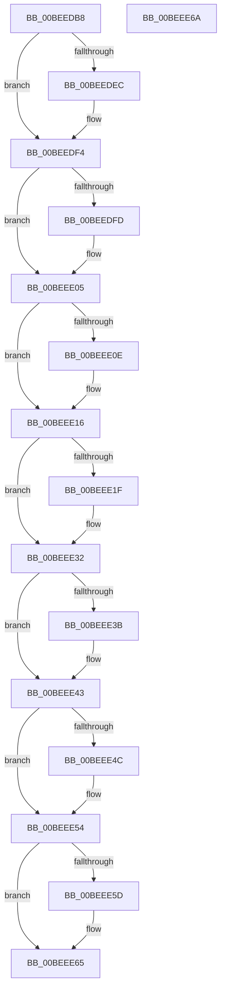

# KiInitializeVelocity

- RVA: `0x00BEEDB8`–`0x00BEEE6B` (길이 `179` bytes)
- VA: `0x0000000140BEEDB8`
- 실행 섹션: `INIT`
- PDB 이름 있음: `예`; PDB Function 태그: `아니요`
- unwind 정보 RVA: `0x0005C788`
- 디코드: `40`개 명령, `179/179` bytes 표시
- 미해석 바이트: `0` (있으면 어셈블리에 `.byte`로 보존)

> 이 문서는 커널 이미지의 기계어와 PDB 기호를 분석해 생성했습니다. 4번과 5번은 함수 원형과 자료형을 바이너리 사용 방식에서 추정한 C 해석이며 원본 소스 복구 결과는 아닙니다.

## 1. Dependencies

- 직접 호출 지점: **11**; 고유 호출 대상: **11**
- 직접 호출자로 확인된 함수: **1**
- RIP 상대 이미지 참조: **2**

### Outgoing calls
- `0x00BEEDBC` → [Feature_HaltOnAddress_QueuedSpinLock__private_ReportDeviceUsage](../../text/4F/Feature_HaltOnAddress_QueuedSpinLock__private_ReportDeviceUsage_function_004F7228.md) (function, `0x004F7228`)
- `0x00BEEDC9` → [Feature_HaltOnAddress_Barrier__private_ReportDeviceUsage](../../text/4F/Feature_HaltOnAddress_Barrier__private_ReportDeviceUsage_function_004F7290.md) (function, `0x004F7290`)
- `0x00BEEDD6` → [Feature_ShortThreadQuantum__private_ReportDeviceUsage](../../text/4F/Feature_ShortThreadQuantum__private_ReportDeviceUsage_function_004F72F8.md) (function, `0x004F72F8`)
- `0x00BEEDE3` → [Feature_Servicing_SharedReadyQueueLock__private_IsEnabledDeviceUsageNoInline](../../text/4F/Feature_Servicing_SharedReadyQueueLock__private_IsEnabledDeviceUsageNoInline_function_004F7B3C.md) (function, `0x004F7B3C`)
- `0x00BEEDF4` → [Feature_Servicing_AvoidSmtGroupings__private_IsEnabledDeviceUsageNoInline](../../text/4F/Feature_Servicing_AvoidSmtGroupings__private_IsEnabledDeviceUsageNoInline_function_004F7A94.md) (function, `0x004F7A94`)
- `0x00BEEE05` → [Feature_IldeLatencyAwareStandbyStealing__private_IsEnabledDeviceUsageNoInline](../../text/4F/Feature_IldeLatencyAwareStandbyStealing__private_IsEnabledDeviceUsageNoInline_function_004F7A40.md) (function, `0x004F7A40`)
- `0x00BEEE16` → [Feature_EffectivePriorityNotAlwaysRankBiased__private_IsEnabledDeviceUsageNoInline](../../text/4F/Feature_EffectivePriorityNotAlwaysRankBiased__private_IsEnabledDeviceUsageNoInline_function_004F7998.md) (function, `0x004F7998`)
- `0x00BEEE27` → [Feature_EffectivePriorityNotAlwaysRankBiased__private_GetVariant](../../text/5B/Feature_EffectivePriorityNotAlwaysRankBiased__private_GetVariant_function_005B60FC.md) (function, `0x005B60FC`)
- `0x00BEEE32` → [Feature_AntiStarvationThreadScanCountVariable__private_IsEnabledDeviceUsageNoInline](../../text/4F/Feature_AntiStarvationThreadScanCountVariable__private_IsEnabledDeviceUsageNoInline_function_004F5CA4.md) (function, `0x004F5CA4`)
- `0x00BEEE43` → [Feature_AntiStarvationThreadBoostCountVariable__private_IsEnabledDeviceUsageNoInline](../../text/4F/Feature_AntiStarvationThreadBoostCountVariable__private_IsEnabledDeviceUsageNoInline_function_004F5BFC.md) (function, `0x004F5BFC`)
- `0x00BEEE54` → [Feature_Servicing_PassiveInterrupt_ForceIdle__private_IsEnabledDeviceUsageNoInline](../../text/4F/Feature_Servicing_PassiveInterrupt_ForceIdle__private_IsEnabledDeviceUsageNoInline_function_004F7848.md) (function, `0x004F7848`)

### Direct callers
- [KeInitSystem](../C7/KeInitSystem_function_00C71660.md) at `0x00C71778`

### Static image references
- `0x00BEEDC1` → RVA `0x00FC6B38` (`ALMOSTRO`; read/write)
- `0x00BEEE2C` → RVA `0x00F22B68` (`.data`; write)

## 2. Other-region calls and transfers

- 다른 실행 섹션으로 향하는 call: **11**
  - `0x00BEEDBC` → [Feature_HaltOnAddress_QueuedSpinLock__private_ReportDeviceUsage](../../text/4F/Feature_HaltOnAddress_QueuedSpinLock__private_ReportDeviceUsage_function_004F7228.md) (`INIT` → `.text`)
  - `0x00BEEDC9` → [Feature_HaltOnAddress_Barrier__private_ReportDeviceUsage](../../text/4F/Feature_HaltOnAddress_Barrier__private_ReportDeviceUsage_function_004F7290.md) (`INIT` → `.text`)
  - `0x00BEEDD6` → [Feature_ShortThreadQuantum__private_ReportDeviceUsage](../../text/4F/Feature_ShortThreadQuantum__private_ReportDeviceUsage_function_004F72F8.md) (`INIT` → `.text`)
  - `0x00BEEDE3` → [Feature_Servicing_SharedReadyQueueLock__private_IsEnabledDeviceUsageNoInline](../../text/4F/Feature_Servicing_SharedReadyQueueLock__private_IsEnabledDeviceUsageNoInline_function_004F7B3C.md) (`INIT` → `.text`)
  - `0x00BEEDF4` → [Feature_Servicing_AvoidSmtGroupings__private_IsEnabledDeviceUsageNoInline](../../text/4F/Feature_Servicing_AvoidSmtGroupings__private_IsEnabledDeviceUsageNoInline_function_004F7A94.md) (`INIT` → `.text`)
  - `0x00BEEE05` → [Feature_IldeLatencyAwareStandbyStealing__private_IsEnabledDeviceUsageNoInline](../../text/4F/Feature_IldeLatencyAwareStandbyStealing__private_IsEnabledDeviceUsageNoInline_function_004F7A40.md) (`INIT` → `.text`)
  - `0x00BEEE16` → [Feature_EffectivePriorityNotAlwaysRankBiased__private_IsEnabledDeviceUsageNoInline](../../text/4F/Feature_EffectivePriorityNotAlwaysRankBiased__private_IsEnabledDeviceUsageNoInline_function_004F7998.md) (`INIT` → `.text`)
  - `0x00BEEE27` → [Feature_EffectivePriorityNotAlwaysRankBiased__private_GetVariant](../../text/5B/Feature_EffectivePriorityNotAlwaysRankBiased__private_GetVariant_function_005B60FC.md) (`INIT` → `.text`)
  - `0x00BEEE32` → [Feature_AntiStarvationThreadScanCountVariable__private_IsEnabledDeviceUsageNoInline](../../text/4F/Feature_AntiStarvationThreadScanCountVariable__private_IsEnabledDeviceUsageNoInline_function_004F5CA4.md) (`INIT` → `.text`)
  - `0x00BEEE43` → [Feature_AntiStarvationThreadBoostCountVariable__private_IsEnabledDeviceUsageNoInline](../../text/4F/Feature_AntiStarvationThreadBoostCountVariable__private_IsEnabledDeviceUsageNoInline_function_004F5BFC.md) (`INIT` → `.text`)
  - `0x00BEEE54` → [Feature_Servicing_PassiveInterrupt_ForceIdle__private_IsEnabledDeviceUsageNoInline](../../text/4F/Feature_Servicing_PassiveInterrupt_ForceIdle__private_IsEnabledDeviceUsageNoInline_function_004F7848.md) (`INIT` → `.text`)
- 별도 외부 분기/꼬리 이동을 확인하지 못했습니다.

## 3. Assembly (complete function range)

```asm
00BEEDB8  48 83 EC 28                     sub rsp, 0x28
00BEEDBC  E8 67 84 90 FF                  call 0x1404f7228
00BEEDC1  0F BA 2D 6F 7D 3D 00 10         bts dword ptr [rip + 0x3d7d6f], 0x10
00BEEDC9  E8 C2 84 90 FF                  call 0x1404f7290
00BEEDCE  0F BA 2D 62 7D 3D 00 11         bts dword ptr [rip + 0x3d7d62], 0x11
00BEEDD6  E8 1D 85 90 FF                  call 0x1404f72f8
00BEEDDB  0F BA 2D 55 7D 3D 00 12         bts dword ptr [rip + 0x3d7d55], 0x12
00BEEDE3  E8 54 8D 90 FF                  call 0x1404f7b3c
00BEEDE8  85 C0                           test eax, eax
00BEEDEA  74 08                           je 0x140beedf4
00BEEDEC  0F BA 2D 44 7D 3D 00 15         bts dword ptr [rip + 0x3d7d44], 0x15
00BEEDF4  E8 9B 8C 90 FF                  call 0x1404f7a94
00BEEDF9  85 C0                           test eax, eax
00BEEDFB  74 08                           je 0x140beee05
00BEEDFD  0F BA 2D 33 7D 3D 00 17         bts dword ptr [rip + 0x3d7d33], 0x17
00BEEE05  E8 36 8C 90 FF                  call 0x1404f7a40
00BEEE0A  85 C0                           test eax, eax
00BEEE0C  74 08                           je 0x140beee16
00BEEE0E  0F BA 2D 22 7D 3D 00 18         bts dword ptr [rip + 0x3d7d22], 0x18
00BEEE16  E8 7D 8B 90 FF                  call 0x1404f7998
00BEEE1B  85 C0                           test eax, eax
00BEEE1D  74 13                           je 0x140beee32
00BEEE1F  0F BA 2D 11 7D 3D 00 19         bts dword ptr [rip + 0x3d7d11], 0x19
00BEEE27  E8 D0 72 9C FF                  call 0x1405b60fc
00BEEE2C  89 05 36 3D 33 00               mov dword ptr [rip + 0x333d36], eax
00BEEE32  E8 6D 6E 90 FF                  call 0x1404f5ca4
00BEEE37  85 C0                           test eax, eax
00BEEE39  74 08                           je 0x140beee43
00BEEE3B  0F BA 2D F5 7C 3D 00 1A         bts dword ptr [rip + 0x3d7cf5], 0x1a
00BEEE43  E8 B4 6D 90 FF                  call 0x1404f5bfc
00BEEE48  85 C0                           test eax, eax
00BEEE4A  74 08                           je 0x140beee54
00BEEE4C  0F BA 2D E4 7C 3D 00 1B         bts dword ptr [rip + 0x3d7ce4], 0x1b
00BEEE54  E8 EF 89 90 FF                  call 0x1404f7848
00BEEE59  85 C0                           test eax, eax
00BEEE5B  74 08                           je 0x140beee65
00BEEE5D  0F BA 2D D3 7C 3D 00 1C         bts dword ptr [rip + 0x3d7cd3], 0x1c
00BEEE65  48 83 C4 28                     add rsp, 0x28
00BEEE69  C3                              ret
00BEEE6A  CC                              int3
```

## 4. C-style interpretation (structured pseudocode)

```c
__int64 __fastcall KiInitializeVelocity(void)
{
    __int64 result;
    __int64 v_rsp;

    v_rsp = (v_rsp) - (40);
    result = Feature_HaltOnAddress_QueuedSpinLock__private_ReportDeviceUsage(a1, a2, a3, a4);
    result = Feature_HaltOnAddress_Barrier__private_ReportDeviceUsage(a1, a2, a3, a4);
    result = Feature_ShortThreadQuantum__private_ReportDeviceUsage(a1, a2, a3, a4);
    result = Feature_Servicing_SharedReadyQueueLock__private_IsEnabledDeviceUsageNoInline(a1, a2, a3, a4);
    if ((unsigned int)(result) != 0) {
    }
    result = Feature_Servicing_AvoidSmtGroupings__private_IsEnabledDeviceUsageNoInline(a1, a2, a3, a4);
    if ((unsigned int)(result) != 0) {
    }
    result = Feature_IldeLatencyAwareStandbyStealing__private_IsEnabledDeviceUsageNoInline(a1, a2, a3, a4);
    if ((unsigned int)(result) != 0) {
    }
    result = Feature_EffectivePriorityNotAlwaysRankBiased__private_IsEnabledDeviceUsageNoInline(a1, a2, a3, a4);
    if ((unsigned int)(result) != 0) {
        result = Feature_EffectivePriorityNotAlwaysRankBiased__private_GetVariant(a1, a2, a3, a4);
        *(unsigned int *)(v_rip + 3358006) = (unsigned int)(result);
    }
    result = Feature_AntiStarvationThreadScanCountVariable__private_IsEnabledDeviceUsageNoInline(a1, a2, a3, a4);
    if ((unsigned int)(result) != 0) {
    }
    result = Feature_AntiStarvationThreadBoostCountVariable__private_IsEnabledDeviceUsageNoInline(a1, a2, a3, a4);
    if ((unsigned int)(result) != 0) {
    }
    result = Feature_Servicing_PassiveInterrupt_ForceIdle__private_IsEnabledDeviceUsageNoInline(a1, a2, a3, a4);
    if ((unsigned int)(result) != 0) {
    }
    v_rsp = (v_rsp) + (40);
    return result;
}
```

## 5. (Beta) C Style

```c
void KiInitializeVelocity(void)
{
    int64_t result;
    int64_t local_rsp;

    local_rsp = (local_rsp) - (40);
    result = Feature_HaltOnAddress_QueuedSpinLock__private_ReportDeviceUsage(a1, a2, a3, a4);
    result = Feature_HaltOnAddress_Barrier__private_ReportDeviceUsage(a1, a2, a3, a4);
    result = Feature_ShortThreadQuantum__private_ReportDeviceUsage(a1, a2, a3, a4);
    result = Feature_Servicing_SharedReadyQueueLock__private_IsEnabledDeviceUsageNoInline(a1, a2, a3, a4);
    if ((uint32_t)(result) != 0) {
    }
    result = Feature_Servicing_AvoidSmtGroupings__private_IsEnabledDeviceUsageNoInline(a1, a2, a3, a4);
    if ((uint32_t)(result) != 0) {
    }
    result = Feature_IldeLatencyAwareStandbyStealing__private_IsEnabledDeviceUsageNoInline(a1, a2, a3, a4);
    if ((uint32_t)(result) != 0) {
    }
    result = Feature_EffectivePriorityNotAlwaysRankBiased__private_IsEnabledDeviceUsageNoInline(a1, a2, a3, a4);
    if ((uint32_t)(result) != 0) {
        result = Feature_EffectivePriorityNotAlwaysRankBiased__private_GetVariant(a1, a2, a3, a4);
        *(uint32_t *)(v_rip + 0x333D36) = (uint32_t)(result);
    }
    result = Feature_AntiStarvationThreadScanCountVariable__private_IsEnabledDeviceUsageNoInline(a1, a2, a3, a4);
    if ((uint32_t)(result) != 0) {
    }
    result = Feature_AntiStarvationThreadBoostCountVariable__private_IsEnabledDeviceUsageNoInline(a1, a2, a3, a4);
    if ((uint32_t)(result) != 0) {
    }
    result = Feature_Servicing_PassiveInterrupt_ForceIdle__private_IsEnabledDeviceUsageNoInline(a1, a2, a3, a4);
    if ((uint32_t)(result) != 0) {
    }
    local_rsp = (local_rsp) + (40);
    return result;
}
```

## 6. Execution-region graph

[열기: 2D/3D 그래프와 함수 탐색 컨트롤 패널](../../../control-panel.html?section=init&rva=0x00BEEDB8&view=graph)

- 2D 그래프는 위에서 아래로 흐르고, 3D 그래프는 빈 공간을 드래그해 회전합니다. Shift+드래그는 이동, 휠은 확대·축소, 함수 노드 선택은 대상 보고서 이동입니다.

### Static fallback


