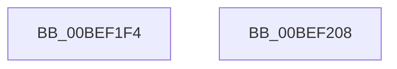

# KiSwInterruptPresent

- RVA: `0x00BEF1F4`–`0x00BEF209` (길이 `21` bytes)
- VA: `0x0000000140BEF1F4`
- 실행 섹션: `INIT`
- PDB 이름 있음: `예`; PDB Function 태그: `아니요`
- unwind 정보 RVA: `0x000DB714`
- 디코드: `7`개 명령, `21/21` bytes 표시
- 미해석 바이트: `0` (있으면 어셈블리에 `.byte`로 보존)

> 이 문서는 커널 이미지의 기계어와 PDB 기호를 분석해 생성했습니다. 4번과 5번은 함수 원형과 자료형을 바이너리 사용 방식에서 추정한 C 해석이며 원본 소스 복구 결과는 아닙니다.

## 1. Dependencies

- 직접 호출 지점: **0**; 고유 호출 대상: **0**
- 직접 호출자로 확인된 함수: **6**
- RIP 상대 이미지 참조: **1**

### Outgoing calls
- 직접 디코드된 call 명령이 없습니다.

### Direct callers
- [KiLockExtendedServiceTable](../../text/50/KiLockExtendedServiceTable_function_00509F48.md) at `0x00509FB5`
- [KeCheckedKernelInitialize](KeCheckedKernelInitialize_function_00BEFA6C.md) at `0x00BEFA76`
- [KeFreeInitializationCode](KeFreeInitializationCode_function_00BEFB10.md) at `0x00BEFB1D`
- [KiFilterFiberContext](KiFilterFiberContext_function_00BEFB50.md) at `0x00BEFE76`
- [KiFilterFiberContext](KiFilterFiberContext_function_00BEFB50.md) at `0x00BEFE9E`
- [sub_00BF16D0](../BF/Unknown_function_00BF16D0.md) at `0x00BF1768`
- [sub_00BF16D0](../BF/Unknown_function_00BF16D0.md) at `0x00BF5A14`
- [sub_00BF16D0](../BF/Unknown_function_00BF16D0.md) at `0x00BF60A9`
- [sub_00C7EB3D](../C7/Unknown_function_00C7EB3D.md) at `0x00C7EBF0`

### Static image references
- `0x00BEF1F4` → RVA `0x01201860` (`CFGRO`; read)

## 2. Other-region calls and transfers

- 다른 실행 섹션으로 향하는 call: **0**
- 별도 외부 분기/꼬리 이동을 확인하지 못했습니다.

## 3. Assembly (complete function range)

```asm
00BEF1F4  48 8B 05 65 26 61 00            mov rax, qword ptr [rip + 0x612665]
00BEF1FB  48 F7 D8                        neg rax
00BEF1FE  1B C0                           sbb eax, eax
00BEF200  F7 D0                           not eax
00BEF202  25 01 00 00 C0                  and eax, 0xc0000001
00BEF207  C3                              ret
00BEF208  CC                              int3
```

## 4. C-style interpretation (structured pseudocode)

```c
__int64 __fastcall KiSwInterruptPresent(void)
{
    __int64 result;

    result = -(*(unsigned __int64 *)(v_rip + 6366821));
    result = (unsigned int)(~(result));
    result = (unsigned int)((result) & (0xC0000001ULL));
    return result;
}
```

## 5. (Beta) C Style

```c
void KiSwInterruptPresent(void)
{
    int64_t result;

    result = -(*(uint64_t *)(v_rip + 0x612665));
    result = (uint32_t)(~(result));
    result = (uint32_t)((result) & (0xC0000001ULL));
    return result;
}
```

## 6. Execution-region graph

[열기: 2D/3D 그래프와 함수 탐색 컨트롤 패널](../../../control-panel.html?section=init&rva=0x00BEF1F4&view=graph)

- 2D 그래프는 위에서 아래로 흐르고, 3D 그래프는 빈 공간을 드래그해 회전합니다. Shift+드래그는 이동, 휠은 확대·축소, 함수 노드 선택은 대상 보고서 이동입니다.

### Static fallback


