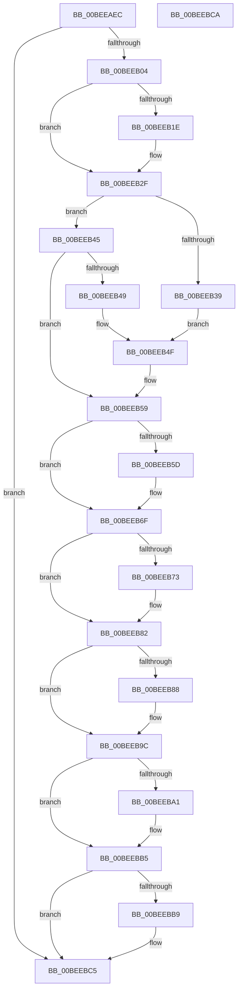

# MiInitializeStrongCode

- RVA: `0x00BEEAEC`–`0x00BEEBCB` (길이 `223` bytes)
- VA: `0x0000000140BEEAEC`
- 실행 섹션: `INIT`
- PDB 이름 있음: `예`; PDB Function 태그: `아니요`
- unwind 정보 RVA: `0x0005C788`
- 디코드: `54`개 명령, `223/223` bytes 표시
- 미해석 바이트: `0` (있으면 어셈블리에 `.byte`로 보존)

> 이 문서는 커널 이미지의 기계어와 PDB 기호를 분석해 생성했습니다. 4번과 5번은 함수 원형과 자료형을 바이너리 사용 방식에서 추정한 C 해석이며 원본 소스 복구 결과는 아닙니다.

## 1. Dependencies

- 직접 호출 지점: **1**; 고유 호출 대상: **1**
- 직접 호출자로 확인된 함수: **1**
- RIP 상대 이미지 참조: **3**

### Outgoing calls
- `0x00BEEAF7` → [VslGetNestedPageProtectionFlags](../../text/2F/VslGetNestedPageProtectionFlags_function_002F2164.md) (function, `0x002F2164`)

### Direct callers
- [MmInitSystem](MmInitSystem_function_00BEE990.md) at `0x00BEEA0D`

### Static image references
- `0x00BEEAF0` → RVA `0x00E38CC8` (`.data`; read)
- `0x00BEEB04` → RVA `0x00FC6A88` (`ALMOSTRO`; read)
- `0x00BEEB10` → RVA `0x00FC6A88` (`ALMOSTRO`; write)

## 2. Other-region calls and transfers

- 다른 실행 섹션으로 향하는 call: **1**
  - `0x00BEEAF7` → [VslGetNestedPageProtectionFlags](../../text/2F/VslGetNestedPageProtectionFlags_function_002F2164.md) (`INIT` → `.text`)
- 별도 외부 분기/꼬리 이동을 확인하지 못했습니다.

## 3. Assembly (complete function range)

```asm
00BEEAEC  48 83 EC 28                     sub rsp, 0x28
00BEEAF0  48 8D 0D D1 A1 24 00            lea rcx, [rip + 0x24a1d1]
00BEEAF7  E8 68 36 70 FF                  call 0x1402f2164
00BEEAFC  85 C0                           test eax, eax
00BEEAFE  0F 84 C1 00 00 00               je 0x140beebc5
00BEEB04  48 8B 0D 7D 7F 3D 00            mov rcx, qword ptr [rip + 0x3d7f7d]
00BEEB0B  48 0F BA E9 0C                  bts rcx, 0xc
00BEEB10  48 89 0D 71 7F 3D 00            mov qword ptr [rip + 0x3d7f71], rcx
00BEEB17  48 8B D1                        mov rdx, rcx
00BEEB1A  A8 04                           test al, 4
00BEEB1C  74 11                           je 0x140beeb2f
00BEEB1E  48 81 C9 00 60 00 00            or rcx, 0x6000
00BEEB25  48 89 0D 5C 7F 3D 00            mov qword ptr [rip + 0x3d7f5c], rcx
00BEEB2C  48 8B D1                        mov rdx, rcx
00BEEB2F  41 B8 00 80 00 00               mov r8d, 0x8000
00BEEB35  A8 01                           test al, 1
00BEEB37  74 0C                           je 0x140beeb45
00BEEB39  48 8B CA                        mov rcx, rdx
00BEEB3C  48 81 C9 00 80 02 00            or rcx, 0x28000
00BEEB43  EB 0A                           jmp 0x140beeb4f
00BEEB45  A8 02                           test al, 2
00BEEB47  74 10                           je 0x140beeb59
00BEEB49  48 8B CA                        mov rcx, rdx
00BEEB4C  49 0B C8                        or rcx, r8
00BEEB4F  48 8B D1                        mov rdx, rcx
00BEEB52  48 89 0D 2F 7F 3D 00            mov qword ptr [rip + 0x3d7f2f], rcx
00BEEB59  A8 10                           test al, 0x10
00BEEB5B  75 12                           jne 0x140beeb6f
00BEEB5D  48 8B CA                        mov rcx, rdx
00BEEB60  48 0F BA E9 10                  bts rcx, 0x10
00BEEB65  48 89 0D 1C 7F 3D 00            mov qword ptr [rip + 0x3d7f1c], rcx
00BEEB6C  48 8B D1                        mov rdx, rcx
00BEEB6F  A8 40                           test al, 0x40
00BEEB71  74 0F                           je 0x140beeb82
00BEEB73  48 8B CA                        mov rcx, rdx
00BEEB76  48 0F BA E9 13                  bts rcx, 0x13
00BEEB7B  48 89 0D 06 7F 3D 00            mov qword ptr [rip + 0x3d7f06], rcx
00BEEB82  0F BA E0 0E                     bt eax, 0xe
00BEEB86  73 14                           jae 0x140beeb9c
00BEEB88  48 BA 00 00 00 00 10 00 00 00   movabs rdx, 0x1000000000
00BEEB92  48 0B CA                        or rcx, rdx
00BEEB95  48 89 0D EC 7E 3D 00            mov qword ptr [rip + 0x3d7eec], rcx
00BEEB9C  41 85 C0                        test r8d, eax
00BEEB9F  74 14                           je 0x140beebb5
00BEEBA1  48 BA 00 00 00 00 20 00 00 00   movabs rdx, 0x2000000000
00BEEBAB  48 0B CA                        or rcx, rdx
00BEEBAE  48 89 0D D3 7E 3D 00            mov qword ptr [rip + 0x3d7ed3], rcx
00BEEBB5  84 C0                           test al, al
00BEEBB7  79 0C                           jns 0x140beebc5
00BEEBB9  48 0F BA E9 12                  bts rcx, 0x12
00BEEBBE  48 89 0D C3 7E 3D 00            mov qword ptr [rip + 0x3d7ec3], rcx
00BEEBC5  48 83 C4 28                     add rsp, 0x28
00BEEBC9  C3                              ret
00BEEBCA  CC                              int3
```

## 4. C-style interpretation (structured pseudocode)

```c
__int64 __fastcall MiInitializeStrongCode(void)
{
    __int64 result;
    __int64 v_rsp;

    v_rsp = (v_rsp) - (40);
    result = VslGetNestedPageProtectionFlags(v_rip + 2400721, a2, a3, a4);
    if ((unsigned int)(result) == 0) goto loc_00BEEBC5;
    *(unsigned __int64 *)(v_rip + 4030321) = *(unsigned __int64 *)(v_rip + 4030333);
    if ((((unsigned __int8)(result)) & (4)) != 0) {
        a1 = (*(unsigned __int64 *)(v_rip + 4030333)) | (0x6000ULL);
        *(unsigned __int64 *)(v_rip + 4030300) = a1;
        a2 = a1;
    }
    if ((((unsigned __int8)(result)) & (1)) == 0) goto loc_00BEEB45;
    a1 = (a2) | (0x28000ULL);
    goto loc_00BEEB4F;
loc_00BEEB45:
    if ((((unsigned __int8)(result)) & (2)) == 0) goto loc_00BEEB59;
    a1 = (a2) | ((unsigned int)(0x8000ULL));
loc_00BEEB4F:
    *(unsigned __int64 *)(v_rip + 4030255) = a1;
loc_00BEEB59:
    if ((((unsigned __int8)(result)) & (16)) == 0) {
        a1 = a1;
        *(unsigned __int64 *)(v_rip + 4030236) = a1;
        a2 = a1;
    }
    if ((((unsigned __int8)(result)) & (64)) != 0) {
        a1 = a2;
        *(unsigned __int64 *)(v_rip + 4030214) = a1;
    }
    if (!(condition_is_above_or_equal)) {
        a1 = (a1) | (a2);
        *(unsigned __int64 *)(v_rip + 4030188) = a1;
    }
    if ((((unsigned int)((unsigned int)(0x8000ULL))) & ((unsigned int)(result))) != 0) {
        a1 = (a1) | (a2);
        *(unsigned __int64 *)(v_rip + 4030163) = a1;
    }
    if (sign_flag) {
        *(unsigned __int64 *)(v_rip + 4030147) = a1;
    }
    v_rsp = (v_rsp) + (40);
    return result;
}
```

## 5. (Beta) C Style

```c
void MiInitializeStrongCode(void)
{
    int64_t result;
    int64_t local_rsp;

    local_rsp = (local_rsp) - (40);
    result = VslGetNestedPageProtectionFlags(v_rip + 2400721, a2, a3, a4);
    if ((uint32_t)(result) == 0) goto loc_00BEEBC5;
    *(uint64_t *)(v_rip + 0x3D7F71) = *(uint64_t *)(v_rip + 0x3D7F7D);
    if ((((uint8_t)(result)) & (4)) != 0) {
        a1 = (*(uint64_t *)(v_rip + 0x3D7F7D)) | (0x6000ULL);
        *(uint64_t *)(v_rip + 0x3D7F5C) = a1;
        a2 = a1;
    }
    if ((((uint8_t)(result)) & (1)) == 0) goto loc_00BEEB45;
    a1 = (a2) | (0x28000ULL);
    goto loc_00BEEB4F;
loc_00BEEB45:
    if ((((uint8_t)(result)) & (2)) == 0) goto loc_00BEEB59;
    a1 = (a2) | ((uint32_t)(0x8000ULL));
loc_00BEEB4F:
    *(uint64_t *)(v_rip + 0x3D7F2F) = a1;
loc_00BEEB59:
    if ((((uint8_t)(result)) & (16)) == 0) {
        a1 = a1;
        *(uint64_t *)(v_rip + 0x3D7F1C) = a1;
        a2 = a1;
    }
    if ((((uint8_t)(result)) & (64)) != 0) {
        a1 = a2;
        *(uint64_t *)(v_rip + 0x3D7F06) = a1;
    }
    if (!(condition_is_above_or_equal)) {
        a1 = (a1) | (a2);
        *(uint64_t *)(v_rip + 0x3D7EEC) = a1;
    }
    if ((((uint32_t)((uint32_t)(0x8000ULL))) & ((uint32_t)(result))) != 0) {
        a1 = (a1) | (a2);
        *(uint64_t *)(v_rip + 0x3D7ED3) = a1;
    }
    if (sign_flag) {
        *(uint64_t *)(v_rip + 0x3D7EC3) = a1;
    }
    local_rsp = (local_rsp) + (40);
    return result;
}
```

## 6. Execution-region graph

[열기: 2D/3D 그래프와 함수 탐색 컨트롤 패널](../../../control-panel.html?section=init&rva=0x00BEEAEC&view=graph)

- 2D 그래프는 위에서 아래로 흐르고, 3D 그래프는 빈 공간을 드래그해 회전합니다. Shift+드래그는 이동, 휠은 확대·축소, 함수 노드 선택은 대상 보고서 이동입니다.

### Static fallback


