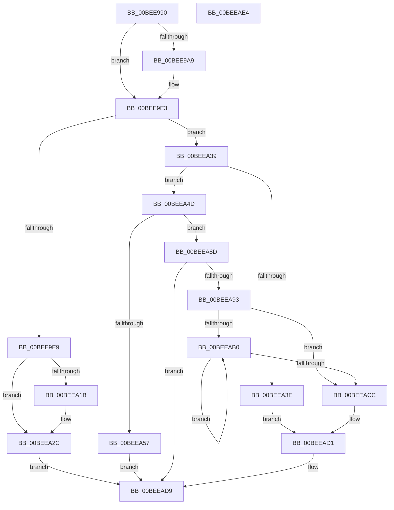

# MmInitSystem

- RVA: `0x00BEE990`–`0x00BEEAE5` (길이 `341` bytes)
- VA: `0x0000000140BEE990`
- 실행 섹션: `INIT`
- PDB 이름 있음: `예`; PDB Function 태그: `아니요`
- unwind 정보 RVA: `0x0005CAAC`
- 디코드: `79`개 명령, `341/341` bytes 표시
- 미해석 바이트: `0` (있으면 어셈블리에 `.byte`로 보존)

> 이 문서는 커널 이미지의 기계어와 PDB 기호를 분석해 생성했습니다. 4번과 5번은 함수 원형과 자료형을 바이너리 사용 방식에서 추정한 C 해석이며 원본 소스 복구 결과는 아닙니다.

## 1. Dependencies

- 직접 호출 지점: **7**; 고유 호출 대상: **6**
- 직접 호출자로 확인된 함수: **4**
- RIP 상대 이미지 참조: **12**

### Outgoing calls
- `0x00BEE9A9` → [KeSupportedPhysicalAddressBits](../C3/KeSupportedPhysicalAddressBits_function_00C36D90.md) (function, `0x00C36D90`)
- `0x00BEEA0D` → [MiInitializeStrongCode](MiInitializeStrongCode_function_00BEEAEC.md) (function, `0x00BEEAEC`)
- `0x00BEEA2F` → [MiInitializeSystemVa](../C7/MiInitializeSystemVa_function_00C77020.md) (function, `0x00C77020`)
- `0x00BEEA41` → [MiInitNucleus](../C5/MiInitNucleus_function_00C5FD38.md) (function, `0x00C5FD38`)
- `0x00BEEA57` → [MiComputeNumaCosts](../C5/MiComputeNumaCosts_function_00C5E258.md) (function, `0x00C5E258`)
- `0x00BEEA80` → [MiInitSystem](../C5/MiInitSystem_function_00C5E6C0.md) (function, `0x00C5E6C0`)
- `0x00BEEAD4` → [MiInitSystem](../C5/MiInitSystem_function_00C5E6C0.md) (function, `0x00C5E6C0`)

### Direct callers
- [KiInitializeBootStructures](../../pagelk/B6/KiInitializeBootStructures_function_00B68530.md) at `0x00B687DD`
- [InitBootProcessor](../C1/InitBootProcessor_function_00C1B1C8.md) at `0x00C1B75D`
- [Phase1InitializationDiscard](../C1/Phase1InitializationDiscard_function_00C1C728.md) at `0x00C1D38D`
- [Phase1InitializationIoReady](../C7/Phase1InitializationIoReady_function_00C70458.md) at `0x00C705B3`

### Static image references
- `0x00BEE99A` → RVA `0x00E2DC38` (`.data`; read)
- `0x00BEE9CA` → RVA `0x00E2DC38` (`.data`; write)
- `0x00BEE9DD` → RVA `0x00E2DC3C` (`.data`; write)
- `0x00BEE9E9` → RVA `0x00EF4E70` (`.data`; read)
- `0x00BEE9F0` → RVA `0x00EF4E60` (`.data`; write)
- `0x00BEE9FF` → RVA `0x00EF4E68` (`.data`; write)
- `0x00BEEA06` → RVA `0x00EF4FD2` (`.data`; read/write)
- `0x00BEEA12` → RVA `0x00FCEC68` (`ALMOSTRO`; read)
- `0x00BEEA25` → RVA `0x00FC6A88` (`ALMOSTRO`; read/write)
- `0x00BEEA65` → RVA `0x00FC6A88` (`ALMOSTRO`; read)
- `0x00BEEA79` → RVA `0x00FC6A88` (`ALMOSTRO`; write)
- `0x00BEEA85` → RVA `0x00E37614` (`.data`; write)

## 2. Other-region calls and transfers

- 다른 실행 섹션으로 향하는 call: **0**
- 별도 외부 분기/꼬리 이동을 확인하지 못했습니다.

## 3. Assembly (complete function range)

```asm
00BEE990  48 89 5C 24 08                  mov qword ptr [rsp + 8], rbx
00BEE995  57                              push rdi
00BEE996  48 83 EC 20                     sub rsp, 0x20
00BEE99A  83 3D 97 F2 23 00 00            cmp dword ptr [rip + 0x23f297], 0
00BEE9A1  48 8B FA                        mov rdi, rdx
00BEE9A4  44 8B C9                        mov r9d, ecx
00BEE9A7  75 3A                           jne 0x140bee9e3
00BEE9A9  E8 E2 83 04 00                  call 0x140c36d90
00BEE9AE  44 0F B6 C0                     movzx r8d, al
00BEE9B2  B9 34 00 00 00                  mov ecx, 0x34
00BEE9B7  3A C1                           cmp al, cl
00BEE9B9  44 0F 47 C1                     cmova r8d, ecx
00BEE9BD  B9 26 00 00 00                  mov ecx, 0x26
00BEE9C2  41 0F B6 C0                     movzx eax, r8b
00BEE9C6  41 80 C0 F4                     add r8b, 0xf4
00BEE9CA  89 05 68 F2 23 00               mov dword ptr [rip + 0x23f268], eax
00BEE9D0  44 3A C1                        cmp r8b, cl
00BEE9D3  41 0F B6 C0                     movzx eax, r8b
00BEE9D7  0F 47 C1                        cmova eax, ecx
00BEE9DA  0F B6 C0                        movzx eax, al
00BEE9DD  89 05 59 F2 23 00               mov dword ptr [rip + 0x23f259], eax
00BEE9E3  41 83 F9 FF                     cmp r9d, -1
00BEE9E7  75 50                           jne 0x140beea39
00BEE9E9  48 8D 05 80 64 30 00            lea rax, [rip + 0x306480]
00BEE9F0  C7 05 66 64 30 00 00 08 00 00   mov dword ptr [rip + 0x306466], 0x800
00BEE9FA  BB 01 00 00 00                  mov ebx, 1
00BEE9FF  48 89 05 62 64 30 00            mov qword ptr [rip + 0x306462], rax
00BEEA06  66 09 1D C5 65 30 00            or word ptr [rip + 0x3065c5], bx
00BEEA0D  E8 DA 00 00 00                  call 0x140beeaec
00BEEA12  80 3D 4F 02 3E 00 00            cmp byte ptr [rip + 0x3e024f], 0
00BEEA19  74 11                           je 0x140beea2c
00BEEA1B  48 B8 00 00 00 00 08 00 00 00   movabs rax, 0x800000000
00BEEA25  48 09 05 5C 80 3D 00            or qword ptr [rip + 0x3d805c], rax
00BEEA2C  48 8B CF                        mov rcx, rdi
00BEEA2F  E8 EC 85 08 00                  call 0x140c77020
00BEEA34  E9 A0 00 00 00                  jmp 0x140beead9
00BEEA39  45 85 C9                        test r9d, r9d
00BEEA3C  75 0F                           jne 0x140beea4d
00BEEA3E  48 8B CF                        mov rcx, rdi
00BEEA41  E8 F2 12 07 00                  call 0x140c5fd38
00BEEA46  33 C9                           xor ecx, ecx
00BEEA48  E9 84 00 00 00                  jmp 0x140beead1
00BEEA4D  BB 01 00 00 00                  mov ebx, 1
00BEEA52  44 3B CB                        cmp r9d, ebx
00BEEA55  75 36                           jne 0x140beea8d
00BEEA57  E8 FC F7 06 00                  call 0x140c5e258
00BEEA5C  F0 48 83 0D 23 80 3D 00 10      lock or qword ptr [rip + 0x3d8023], 0x10
00BEEA65  48 8B 05 1C 80 3D 00            mov rax, qword ptr [rip + 0x3d801c]
00BEEA6C  48 8B D7                        mov rdx, rdi
00BEEA6F  48 83 E0 DF                     and rax, 0xffffffffffffffdf
00BEEA73  8B CB                           mov ecx, ebx
00BEEA75  48 83 C8 10                     or rax, 0x10
00BEEA79  48 89 05 08 80 3D 00            mov qword ptr [rip + 0x3d8008], rax
00BEEA80  E8 3B FC 06 00                  call 0x140c5e6c0
00BEEA85  88 1D 89 8B 24 00               mov byte ptr [rip + 0x248b89], bl
00BEEA8B  EB 4C                           jmp 0x140beead9
00BEEA8D  41 83 F9 02                     cmp r9d, 2
00BEEA91  75 46                           jne 0x140beead9
00BEEA93  48 8B 05 EE 7F 3D 00            mov rax, qword ptr [rip + 0x3d7fee]
00BEEA9A  48 8B C8                        mov rcx, rax
00BEEA9D  48 83 E1 EF                     and rcx, 0xffffffffffffffef
00BEEAA1  48 83 C9 20                     or rcx, 0x20
00BEEAA5  F0 48 0F B1 0D DA 7F 3D 00      lock cmpxchg qword ptr [rip + 0x3d7fda], rcx
00BEEAAE  74 1C                           je 0x140beeacc
00BEEAB0  48 8B D0                        mov rdx, rax
00BEEAB3  4C 8B C0                        mov r8, rax
00BEEAB6  48 83 E2 EF                     and rdx, 0xffffffffffffffef
00BEEABA  48 83 CA 20                     or rdx, 0x20
00BEEABE  F0 48 0F B1 15 C1 7F 3D 00      lock cmpxchg qword ptr [rip + 0x3d7fc1], rdx
00BEEAC7  49 3B C0                        cmp rax, r8
00BEEACA  75 E4                           jne 0x140beeab0
00BEEACC  B9 02 00 00 00                  mov ecx, 2
00BEEAD1  48 8B D7                        mov rdx, rdi
00BEEAD4  E8 E7 FB 06 00                  call 0x140c5e6c0
00BEEAD9  48 8B 5C 24 30                  mov rbx, qword ptr [rsp + 0x30]
00BEEADE  48 83 C4 20                     add rsp, 0x20
00BEEAE2  5F                              pop rdi
00BEEAE3  C3                              ret
00BEEAE4  CC                              int3
```

## 4. C-style interpretation (structured pseudocode)

```c
__int64 __fastcall MmInitSystem(int a1, __int64 a2)
{
    __int64 result;
    __int64 v_rsp;
    unsigned __int64 v_stack_p8;

    v_stack_p8 = v_rbx;
    v_rsp = (v_rsp) - (32);
    if ((*(unsigned int *)(v_rip + 2355863)) == 0) {
        result = KeSupportedPhysicalAddressBits(a1, a2, a3, (unsigned int)(a1));
        a3 = (unsigned __int8)(result);
        a1 = 52;
        if (((unsigned __int8)(result)) > ((unsigned __int8)(a1))) { a3 = a1; }
        a1 = 38;
        result = (unsigned __int8)(a3);
        a3 = (unsigned __int8)((a3) + (244));
        *(unsigned int *)(v_rip + 2355816) = (unsigned int)(result);
        result = (unsigned __int8)(a3);
        if (((unsigned __int8)(a3)) > ((unsigned __int8)(a1))) { result = a1; }
        result = (unsigned __int8)(result);
        *(unsigned int *)(v_rip + 2355801) = (unsigned int)(result);
    }
    if (((unsigned int)((unsigned int)(a1))) != -1) goto loc_00BEEA39;
    *(unsigned int *)(v_rip + 3171430) = 0x800ULL;
    *(unsigned __int64 *)(v_rip + 3171426) = v_rip + 3171456;
    result = MiInitializeStrongCode(a1, a2, a3, (unsigned int)(a1));
    if ((*(unsigned __int8 *)(v_rip + 4063823)) != 0) {
    }
    result = MiInitializeSystemVa(a2, a2, a3, (unsigned int)(a1));
    goto loc_00BEEAD9;
loc_00BEEA39:
    if ((unsigned int)((unsigned int)(a1)) != 0) goto loc_00BEEA4D;
    result = MiInitNucleus(a2, a2, a3, (unsigned int)(a1));
    a1 = 0;
    goto loc_00BEEAD1;
loc_00BEEA4D:
    if (((unsigned int)((unsigned int)(a1))) != 1) goto loc_00BEEA8D;
    result = MiComputeNumaCosts(a1, a2, a3, (unsigned int)(a1));
    result = (*(unsigned __int64 *)(v_rip + 4030492)) & (-33);
    result = (result) | (16);
    *(unsigned __int64 *)(v_rip + 4030472) = result;
    result = MiInitSystem(1, a2, a3, (unsigned int)(a1));
    *(unsigned __int8 *)(v_rip + 2395017) = 1;
    goto loc_00BEEAD9;
loc_00BEEA8D:
    if (((unsigned int)((unsigned int)(a1))) != 2) goto loc_00BEEAD9;
    a1 = (*(unsigned __int64 *)(v_rip + 4030446)) & (-17);
    a1 = (a1) | (32);
    if (condition_is_equal) goto loc_00BEEACC;
loc_00BEEAB0:
    a2 = (*(unsigned __int64 *)(v_rip + 4030446)) & (-17);
    a2 = (a2) | (32);
    if ((*(unsigned __int64 *)(v_rip + 4030446)) != (*(unsigned __int64 *)(v_rip + 4030446))) goto loc_00BEEAB0;
loc_00BEEACC:
loc_00BEEAD1:
    result = MiInitSystem(2, a2, *(unsigned __int64 *)(v_rip + 4030446), (unsigned int)(a1));
loc_00BEEAD9:
    v_rsp = (v_rsp) + (32);
    return result;
}
```

## 5. (Beta) C Style

```c
int64_t MmInitSystem(int32_t Arg1, int64_t Arg2)
{
    int64_t result;
    int64_t local_rsp;
    uint64_t v_stack_p8;

    v_stack_p8 = local_rbx;
    local_rsp = (local_rsp) - (32);
    if ((*(uint32_t *)(v_rip + 0x23F297)) == 0) {
        result = KeSupportedPhysicalAddressBits(Arg1, Arg2, a3, (uint32_t)(Arg1));
        a3 = (uint8_t)(result);
        Arg1 = 52;
        if (((uint8_t)(result)) > ((uint8_t)(Arg1))) { a3 = Arg1; }
        Arg1 = 38;
        result = (uint8_t)(a3);
        a3 = (uint8_t)((a3) + (244));
        *(uint32_t *)(v_rip + 0x23F268) = (uint32_t)(result);
        result = (uint8_t)(a3);
        if (((uint8_t)(a3)) > ((uint8_t)(Arg1))) { result = Arg1; }
        result = (uint8_t)(result);
        *(uint32_t *)(v_rip + 0x23F259) = (uint32_t)(result);
    }
    if (((uint32_t)((uint32_t)(Arg1))) != -1) goto loc_00BEEA39;
    *(uint32_t *)(v_rip + 0x306466) = 0x800ULL;
    *(uint64_t *)(v_rip + 0x306462) = v_rip + 3171456;
    result = MiInitializeStrongCode(Arg1, Arg2, a3, (uint32_t)(Arg1));
    if ((*(uint8_t *)(v_rip + 0x3E024F)) != 0) {
    }
    result = MiInitializeSystemVa(Arg2, Arg2, a3, (uint32_t)(Arg1));
    goto loc_00BEEAD9;
loc_00BEEA39:
    if ((uint32_t)((uint32_t)(Arg1)) != 0) goto loc_00BEEA4D;
    result = MiInitNucleus(Arg2, Arg2, a3, (uint32_t)(Arg1));
    Arg1 = 0;
    goto loc_00BEEAD1;
loc_00BEEA4D:
    if (((uint32_t)((uint32_t)(Arg1))) != 1) goto loc_00BEEA8D;
    result = MiComputeNumaCosts(Arg1, Arg2, a3, (uint32_t)(Arg1));
    result = (*(uint64_t *)(v_rip + 0x3D801C)) & (-33);
    result = (result) | (16);
    *(uint64_t *)(v_rip + 0x3D8008) = result;
    result = MiInitSystem(1, Arg2, a3, (uint32_t)(Arg1));
    *(uint8_t *)(v_rip + 0x248B89) = 1;
    goto loc_00BEEAD9;
loc_00BEEA8D:
    if (((uint32_t)((uint32_t)(Arg1))) != 2) goto loc_00BEEAD9;
    Arg1 = (*(uint64_t *)(v_rip + 0x3D7FEE)) & (-17);
    Arg1 = (Arg1) | (32);
    if (condition_is_equal) goto loc_00BEEACC;
loc_00BEEAB0:
    Arg2 = (*(uint64_t *)(v_rip + 0x3D7FEE)) & (-17);
    Arg2 = (Arg2) | (32);
    if ((*(uint64_t *)(v_rip + 0x3D7FEE)) != (*(uint64_t *)(v_rip + 0x3D7FEE))) goto loc_00BEEAB0;
loc_00BEEACC:
loc_00BEEAD1:
    result = MiInitSystem(2, Arg2, *(uint64_t *)(v_rip + 0x3D7FEE), (uint32_t)(Arg1));
loc_00BEEAD9:
    local_rsp = (local_rsp) + (32);
    return result;
}
```

## 6. Execution-region graph

[열기: 2D/3D 그래프와 함수 탐색 컨트롤 패널](../../../control-panel.html?section=init&rva=0x00BEE990&view=graph)

- 2D 그래프는 위에서 아래로 흐르고, 3D 그래프는 빈 공간을 드래그해 회전합니다. Shift+드래그는 이동, 휠은 확대·축소, 함수 노드 선택은 대상 보고서 이동입니다.

### Static fallback


