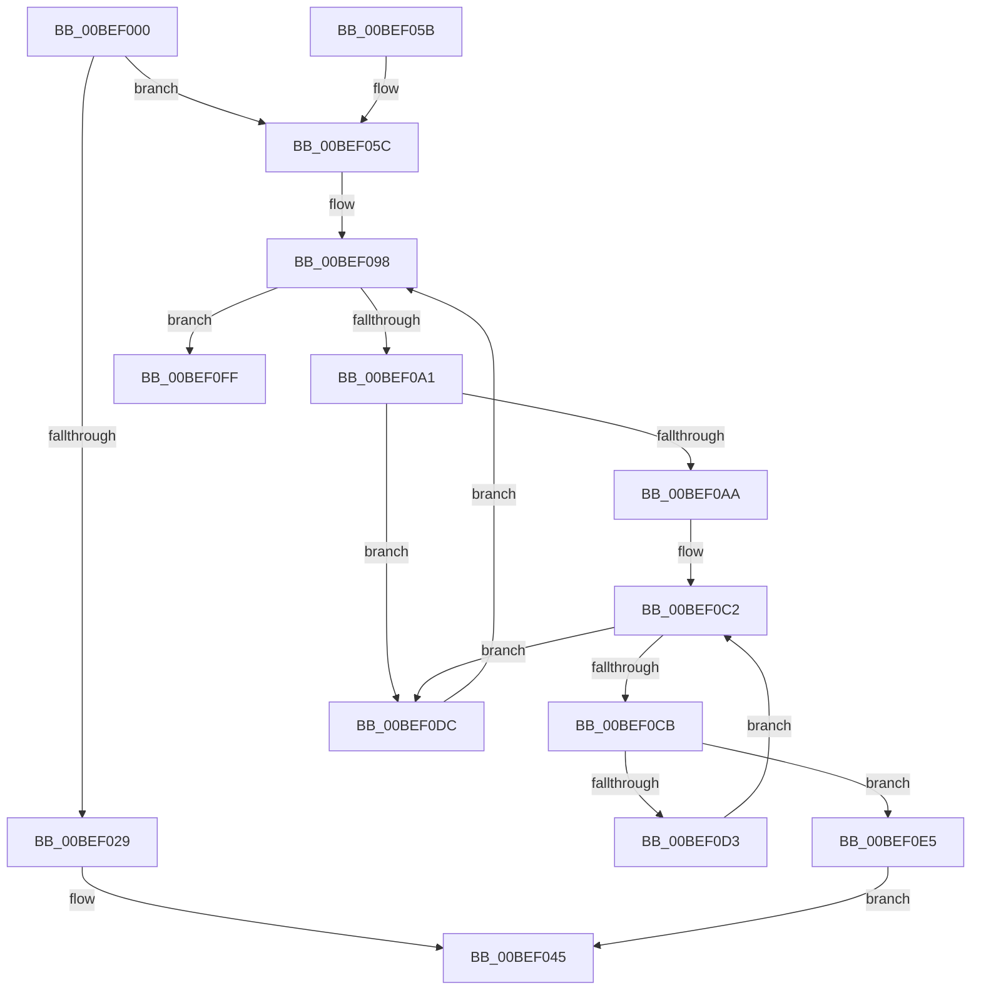

# MxGetPhase0Mapping

- RVA: `0x00BEF000`–`0x00BEF11A` (길이 `282` bytes)
- VA: `0x0000000140BEF000`
- 실행 섹션: `INIT`
- PDB 이름 있음: `예`; PDB Function 태그: `아니요`
- unwind 정보 RVA: `0x000BF9D0`
- 디코드: `73`개 명령, `282/282` bytes 표시
- 미해석 바이트: `0` (있으면 어셈블리에 `.byte`로 보존)

> 이 문서는 커널 이미지의 기계어와 PDB 기호를 분석해 생성했습니다. 4번과 5번은 함수 원형과 자료형을 바이너리 사용 방식에서 추정한 C 해석이며 원본 소스 복구 결과는 아닙니다.

## 1. Dependencies

- 직접 호출 지점: **2**; 고유 호출 대상: **2**
- 직접 호출자로 확인된 함수: **3**
- RIP 상대 이미지 참조: **3**

### Outgoing calls
- `0x00BEF04C` → [_security_check_cookie](../../text/6A/_security_check_cookie_function_006AC640.md) (function, `0x006AC640`)
- `0x00BEF114` → [KeBugCheckEx](../../text/4F/KeBugCheckEx_function_004FD660.md) (function, `0x004FD660`)

### Direct callers
- [sub_0033284A](../../text/33/Unknown_function_0033284A.md) at `0x0033284A`
- [sub_00332A20](../../text/33/Unknown_function_00332A20.md) at `0x00332A74`
- [MxCopyPage](../C6/MxCopyPage_function_00C631F4.md) at `0x00C6320C`

### Static image references
- `0x00BEF00F` → RVA `0x00E0A740` (`.data`; read)
- `0x00BEF01D` → RVA `0x010086C8` (`INITDATA`; read)
- `0x00BEF0E5` → RVA `0x010086C8` (`INITDATA`; write)

## 2. Other-region calls and transfers

- 다른 실행 섹션으로 향하는 call: **2**
  - `0x00BEF04C` → [_security_check_cookie](../../text/6A/_security_check_cookie_function_006AC640.md) (`INIT` → `.text`)
  - `0x00BEF114` → [KeBugCheckEx](../../text/4F/KeBugCheckEx_function_004FD660.md) (`INIT` → `.text`)
- 별도 외부 분기/꼬리 이동을 확인하지 못했습니다.

## 3. Assembly (complete function range)

```asm
00BEF000  40 55                           push rbp
00BEF002  48 83 EC 40                     sub rsp, 0x40
00BEF006  48 8D 6C 24 30                  lea rbp, [rsp + 0x30]
00BEF00B  48 89 5D 20                     mov qword ptr [rbp + 0x20], rbx
00BEF00F  48 8B 05 2A B7 21 00            mov rax, qword ptr [rip + 0x21b72a]
00BEF016  48 33 C5                        xor rax, rbp
00BEF019  48 89 45 00                     mov qword ptr [rbp], rax
00BEF01D  48 8B 05 A4 96 41 00            mov rax, qword ptr [rip + 0x4196a4]
00BEF024  48 85 C0                        test rax, rax
00BEF027  74 33                           je 0x140bef05c
00BEF029  48 C1 E0 19                     shl rax, 0x19
00BEF02D  49 BB 00 00 00 00 80 F6 FF FF   movabs r11, 0xfffff68000000000
00BEF037  49 8B CB                        mov rcx, r11
00BEF03A  48 C1 E1 19                     shl rcx, 0x19
00BEF03E  48 2B C1                        sub rax, rcx
00BEF041  48 C1 F8 10                     sar rax, 0x10
00BEF045  48 8B 4D 00                     mov rcx, qword ptr [rbp]
00BEF049  48 33 CD                        xor rcx, rbp
00BEF04C  E8 EF D5 AB FF                  call 0x1406ac640
00BEF051  48 8B 5D 20                     mov rbx, qword ptr [rbp + 0x20]
00BEF055  48 8D 65 10                     lea rsp, [rbp + 0x10]
00BEF059  5D                              pop rbp
00BEF05A  C3                              ret
00BEF05B  CC                              int3
00BEF05C  8B 04 24                        mov eax, dword ptr [rsp]
00BEF05F  48 83 EC 10                     sub rsp, 0x10
00BEF063  48 8D 5C 24 30                  lea rbx, [rsp + 0x30]
00BEF068  8B 03                           mov eax, dword ptr [rbx]
00BEF06A  48 8B D3                        mov rdx, rbx
00BEF06D  48 C1 EA 12                     shr rdx, 0x12
00BEF071  81 E2 F8 FF FF 3F               and edx, 0x3ffffff8
00BEF077  48 B8 00 00 00 40 FB F6 FF FF   movabs rax, 0xfffff6fb40000000
00BEF081  48 03 D0                        add rdx, rax
00BEF084  49 BB 00 00 00 00 80 F6 FF FF   movabs r11, 0xfffff68000000000
00BEF08E  48 81 E2 00 F0 FF FF            and rdx, 0xfffffffffffff000
00BEF095  45 33 C9                        xor r9d, r9d
00BEF098  41 81 F9 00 02 00 00            cmp r9d, 0x200
00BEF09F  73 5E                           jae 0x140bef0ff
00BEF0A1  48 8B 02                        mov rax, qword ptr [rdx]
00BEF0A4  24 81                           and al, 0x81
00BEF0A6  3C 01                           cmp al, 1
00BEF0A8  75 32                           jne 0x140bef0dc
00BEF0AA  4D 8B C3                        mov r8, r11
00BEF0AD  49 C1 E0 19                     shl r8, 0x19
00BEF0B1  48 8B CA                        mov rcx, rdx
00BEF0B4  48 C1 E1 19                     shl rcx, 0x19
00BEF0B8  49 2B C8                        sub rcx, r8
00BEF0BB  48 C1 F9 10                     sar rcx, 0x10
00BEF0BF  45 33 D2                        xor r10d, r10d
00BEF0C2  41 81 FA 00 02 00 00            cmp r10d, 0x200
00BEF0C9  73 11                           jae 0x140bef0dc
00BEF0CB  48 8B 01                        mov rax, qword ptr [rcx]
00BEF0CE  48 85 C0                        test rax, rax
00BEF0D1  74 12                           je 0x140bef0e5
00BEF0D3  48 83 C1 08                     add rcx, 8
00BEF0D7  41 FF C2                        inc r10d
00BEF0DA  EB E6                           jmp 0x140bef0c2
00BEF0DC  48 83 C2 08                     add rdx, 8
00BEF0E0  41 FF C1                        inc r9d
00BEF0E3  EB B3                           jmp 0x140bef098
00BEF0E5  48 89 0D DC 95 41 00            mov qword ptr [rip + 0x4195dc], rcx
00BEF0EC  48 C1 E1 19                     shl rcx, 0x19
00BEF0F0  49 2B C8                        sub rcx, r8
00BEF0F3  48 C1 F9 10                     sar rcx, 0x10
00BEF0F7  48 8B C1                        mov rax, rcx
00BEF0FA  E9 46 FF FF FF                  jmp 0x140bef045
00BEF0FF  48 83 64 24 20 00               and qword ptr [rsp + 0x20], 0
00BEF105  45 33 C9                        xor r9d, r9d
00BEF108  4C 8B C3                        mov r8, rbx
00BEF10B  BA 1B 03 03 03                  mov edx, 0x303031b
00BEF110  41 8D 49 1A                     lea ecx, [r9 + 0x1a]
00BEF114  E8 47 E5 90 FF                  call 0x1404fd660
00BEF119  CC                              int3
```

## 4. C-style interpretation (structured pseudocode)

```c
__int64 __fastcall MxGetPhase0Mapping(__int64 a1, __int64 a2, __int64 a3, int a4)
{
    __int64 result;
    __int64 v_r10;
    __int64 v_rsp;
    unsigned __int64 v_stack_m18;
    unsigned __int64 v_stack_m8;
    unsigned int v_stack_p0;
    unsigned __int64 v_stack_p10;
    unsigned __int64 v_stack_p20;
    unsigned __int64 v_stack_p8;

    v_rsp = (v_rsp) - (64);
    v_stack_p8 = v_rbx;
    result = (*(unsigned __int64 *)(v_rip + 2209578)) ^ (v_stack_m18);
    v_stack_m18 = result;
    if (*(unsigned __int64 *)(v_rip + 4298404) == 0) goto loc_00BEF05C;
    result = (*(unsigned __int64 *)(v_rip + 4298404)) << (25);
    a1 = (v_r11) << (25);
    result = (result) - (a1);
    result = (result) >> (16);
loc_00BEF045:
    a1 = (v_stack_m18) ^ (v_stack_m18);
    result = _security_check_cookie(a1, a2, a3, a4);
    return result;
loc_00BEF05C:
    v_rsp = (v_stack_m8) - (16);
    a2 = (v_stack_p20) >> (18);
    a2 = (unsigned int)((a2) & (0x3FFFFFF8ULL));
    a2 = (a2) + ((unsigned int)(*(unsigned int *)(v_stack_p20)));
    a2 = (a2) & (0xFFFFFFFFFFFFF000ULL);
    a4 = 0;
loc_00BEF098:
    if (0 >= 512) goto loc_00BEF0FF;
    result = (unsigned __int8)((*(unsigned __int64 *)(a2)) & (129));
    if (((unsigned __int8)(result)) != 1) goto loc_00BEF0DC;
    a3 = (v_r11) << (25);
    a1 = (a2) << (25);
    a1 = (a1) - (a3);
    a1 = (a1) >> (16);
    v_r10 = 0;
loc_00BEF0C2:
    if (0 >= 512) goto loc_00BEF0DC;
    if (*(unsigned __int64 *)(a1) == 0) goto loc_00BEF0E5;
    a1 = (a1) + (8);
    v_r10 = (unsigned int)((v_r10) + 1);
    goto loc_00BEF0C2;
loc_00BEF0DC:
    a2 = (a2) + (8);
    a4 = (unsigned int)((a4) + 1);
    goto loc_00BEF098;
loc_00BEF0E5:
    *(unsigned __int64 *)(v_rip + 4298204) = a1;
    a1 = (a1) << (25);
    a1 = (a1) - (a3);
    a1 = (a1) >> (16);
    goto loc_00BEF045;
loc_00BEF0FF:
    a4 = 0;
    result = KeBugCheckEx(a4 + 26, (unsigned int)(0x303031BULL), v_stack_p20, a4);
    return result;
}
```

## 5. (Beta) C Style

```c
int64_t MxGetPhase0Mapping(int64_t Arg1, int64_t Arg2, int64_t Arg3, int32_t Arg4)
{
    int64_t result;
    int64_t local_r10;
    int64_t local_rsp;
    uint64_t v_stack_m18;
    uint64_t v_stack_m8;
    uint32_t v_stack_p0;
    uint64_t v_stack_p10;
    uint64_t v_stack_p20;
    uint64_t v_stack_p8;

    local_rsp = (local_rsp) - (64);
    v_stack_p8 = local_rbx;
    result = (*(uint64_t *)(v_rip + 0x21B72A)) ^ (v_stack_m18);
    v_stack_m18 = result;
    if (*(uint64_t *)(v_rip + 0x4196A4) == 0) goto loc_00BEF05C;
    result = (*(uint64_t *)(v_rip + 0x4196A4)) << (25);
    Arg1 = (local_r11) << (25);
    result = (result) - (Arg1);
    result = (result) >> (16);
loc_00BEF045:
    Arg1 = (v_stack_m18) ^ (v_stack_m18);
    result = _security_check_cookie(Arg1, Arg2, Arg3, Arg4);
    return result;
loc_00BEF05C:
    local_rsp = (v_stack_m8) - (16);
    Arg2 = (v_stack_p20) >> (18);
    Arg2 = (uint32_t)((Arg2) & (0x3FFFFFF8ULL));
    Arg2 = (Arg2) + ((uint32_t)(*(uint32_t *)(v_stack_p20)));
    Arg2 = (Arg2) & (0xFFFFFFFFFFFFF000ULL);
    Arg4 = 0;
loc_00BEF098:
    if (0 >= 512) goto loc_00BEF0FF;
    result = (uint8_t)((*(uint64_t *)(Arg2)) & (129));
    if (((uint8_t)(result)) != 1) goto loc_00BEF0DC;
    Arg3 = (local_r11) << (25);
    Arg1 = (Arg2) << (25);
    Arg1 = (Arg1) - (Arg3);
    Arg1 = (Arg1) >> (16);
    local_r10 = 0;
loc_00BEF0C2:
    if (0 >= 512) goto loc_00BEF0DC;
    if (*(uint64_t *)(Arg1) == 0) goto loc_00BEF0E5;
    Arg1 = (Arg1) + (8);
    local_r10 = (uint32_t)((local_r10) + 1);
    goto loc_00BEF0C2;
loc_00BEF0DC:
    Arg2 = (Arg2) + (8);
    Arg4 = (uint32_t)((Arg4) + 1);
    goto loc_00BEF098;
loc_00BEF0E5:
    *(uint64_t *)(v_rip + 0x4195DC) = Arg1;
    Arg1 = (Arg1) << (25);
    Arg1 = (Arg1) - (Arg3);
    Arg1 = (Arg1) >> (16);
    goto loc_00BEF045;
loc_00BEF0FF:
    Arg4 = 0;
    result = KeBugCheckEx(Arg4 + 26, (uint32_t)(0x303031BULL), v_stack_p20, Arg4);
    return result;
}
```

## 6. Execution-region graph

[열기: 2D/3D 그래프와 함수 탐색 컨트롤 패널](../../../control-panel.html?section=init&rva=0x00BEF000&view=graph)

- 2D 그래프는 위에서 아래로 흐르고, 3D 그래프는 빈 공간을 드래그해 회전합니다. Shift+드래그는 이동, 휠은 확대·축소, 함수 노드 선택은 대상 보고서 이동입니다.

### Static fallback


