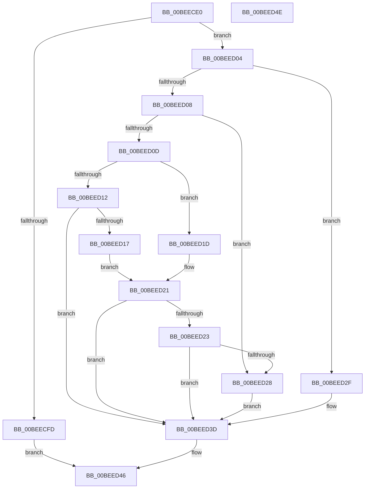

# PnpDoPolicyCheck

- RVA: `0x00BEECE0`–`0x00BEED4F` (길이 `111` bytes)
- VA: `0x0000000140BEECE0`
- 실행 섹션: `INIT`
- PDB 이름 있음: `예`; PDB Function 태그: `아니요`
- unwind 정보 RVA: `0x0005CF00`
- 디코드: `37`개 명령, `111/111` bytes 표시
- 미해석 바이트: `0` (있으면 어셈블리에 `.byte`로 보존)

> 이 문서는 커널 이미지의 기계어와 PDB 기호를 분석해 생성했습니다. 4번과 5번은 함수 원형과 자료형을 바이너리 사용 방식에서 추정한 C 해석이며 원본 소스 복구 결과는 아닙니다.

## 1. Dependencies

- 직접 호출 지점: **1**; 고유 호출 대상: **1**
- 직접 호출자로 확인된 함수: **2**
- RIP 상대 이미지 참조: **2**

### Outgoing calls
- `0x00BEED41` → [PnpDiagnosticTraceElamDecision](../../text/4D/PnpDiagnosticTraceElamDecision_function_004D2258.md) (function, `0x004D2258`)

### Direct callers
- [PipInitializeDriverDependentDLLs](../C7/PipInitializeDriverDependentDLLs_function_00C74398.md) at `0x00C744E2`
- [PnpInitializeBootStartDriver](../C7/PnpInitializeBootStartDriver_function_00C760F0.md) at `0x00C761CB`

### Static image references
- `0x00BEECE6` → RVA `0x01008684` (`INITDATA`; read)
- `0x00BEECEF` → RVA `0x010086C0` (`INITDATA`; read)

## 2. Other-region calls and transfers

- 다른 실행 섹션으로 향하는 call: **1**
  - `0x00BEED41` → [PnpDiagnosticTraceElamDecision](../../text/4D/PnpDiagnosticTraceElamDecision_function_004D2258.md) (`INIT` → `.text`)
- 별도 외부 분기/꼬리 이동을 확인하지 못했습니다.

## 3. Assembly (complete function range)

```asm
00BEECE0  40 53                           push rbx
00BEECE2  48 83 EC 20                     sub rsp, 0x20
00BEECE6  44 8B 05 97 99 41 00            mov r8d, dword ptr [rip + 0x419997]
00BEECED  33 DB                           xor ebx, ebx
00BEECEF  48 39 1D CA 99 41 00            cmp qword ptr [rip + 0x4199ca], rbx
00BEECF6  44 8A CA                        mov r9b, dl
00BEECF9  8B D1                           mov edx, ecx
00BEECFB  75 07                           jne 0x140beed04
00BEECFD  BB 01 00 00 00                  mov ebx, 1
00BEED02  EB 42                           jmp 0x140beed46
00BEED04  85 D2                           test edx, edx
00BEED06  74 27                           je 0x140beed2f
00BEED08  83 E9 01                        sub ecx, 1
00BEED0B  74 1B                           je 0x140beed28
00BEED0D  83 E9 01                        sub ecx, 1
00BEED10  74 0B                           je 0x140beed1d
00BEED12  83 F9 01                        cmp ecx, 1
00BEED15  75 26                           jne 0x140beed3d
00BEED17  41 F6 C0 02                     test r8b, 2
00BEED1B  EB 04                           jmp 0x140beed21
00BEED1D  41 F6 C0 04                     test r8b, 4
00BEED21  74 1A                           je 0x140beed3d
00BEED23  45 84 C9                        test r9b, r9b
00BEED26  74 15                           je 0x140beed3d
00BEED28  BB 01 00 00 00                  mov ebx, 1
00BEED2D  EB 0E                           jmp 0x140beed3d
00BEED2F  B9 01 00 00 00                  mov ecx, 1
00BEED34  0F B6 DB                        movzx ebx, bl
00BEED37  44 84 C1                        test cl, r8b
00BEED3A  0F 45 D9                        cmovne ebx, ecx
00BEED3D  44 0F B6 CB                     movzx r9d, bl
00BEED41  E8 12 35 8E FF                  call 0x1404d2258
00BEED46  8A C3                           mov al, bl
00BEED48  48 83 C4 20                     add rsp, 0x20
00BEED4C  5B                              pop rbx
00BEED4D  C3                              ret
00BEED4E  CC                              int3
```

## 4. C-style interpretation (structured pseudocode)

```c
__int64 __fastcall PnpDoPolicyCheck(int a1, unsigned __int8 a2)
{
    __int64 result;
    __int64 v_rbx;
    __int64 v_rsp;

    v_rsp = (v_rsp) - (32);
    v_rbx = 0;
    if ((*(unsigned __int64 *)(v_rip + 4299210)) != 0) goto loc_00BEED04;
    goto loc_00BEED46;
loc_00BEED04:
    if ((unsigned int)((unsigned int)(a1)) == 0) goto loc_00BEED2F;
    a1 = (unsigned int)((a1) - (1));
    if (condition_is_equal) goto loc_00BEED28;
    a1 = (unsigned int)((a1) - (1));
    if (condition_is_equal) goto loc_00BEED1D;
    if (a1 != 1) goto loc_00BEED3D;
    goto loc_00BEED21;
loc_00BEED1D:
loc_00BEED21:
    if ((((unsigned __int8)((unsigned int)(*(unsigned int *)(v_rip + 4299159)))) & (4)) == 0) goto loc_00BEED3D;
    if (a2 == 0) goto loc_00BEED3D;
loc_00BEED28:
    goto loc_00BEED3D;
loc_00BEED2F:
    v_rbx = 1;
    if (((1) & ((unsigned __int8)((unsigned int)(*(unsigned int *)(v_rip + 4299159))))) != 0) { v_rbx = 1; }
loc_00BEED3D:
    result = PnpDiagnosticTraceElamDecision(1, (unsigned int)(a1), (unsigned int)(*(unsigned int *)(v_rip + 4299159)), (unsigned __int8)(v_rbx));
loc_00BEED46:
    v_rsp = (v_rsp) + (32);
    return (unsigned __int8)(v_rbx);
}
```

## 5. (Beta) C Style

```c
int64_t PnpDoPolicyCheck(int32_t Arg1, uint8_t Arg2)
{
    int64_t result;
    int64_t local_rbx;
    int64_t local_rsp;

    local_rsp = (local_rsp) - (32);
    local_rbx = 0;
    if ((*(uint64_t *)(v_rip + 0x4199CA)) != 0) goto loc_00BEED04;
    goto loc_00BEED46;
loc_00BEED04:
    if ((uint32_t)((uint32_t)(Arg1)) == 0) goto loc_00BEED2F;
    Arg1 = (uint32_t)((Arg1) - (1));
    if (condition_is_equal) goto loc_00BEED28;
    Arg1 = (uint32_t)((Arg1) - (1));
    if (condition_is_equal) goto loc_00BEED1D;
    if (Arg1 != 1) goto loc_00BEED3D;
    goto loc_00BEED21;
loc_00BEED1D:
loc_00BEED21:
    if ((((uint8_t)((uint32_t)(*(uint32_t *)(v_rip + 0x419997)))) & (4)) == 0) goto loc_00BEED3D;
    if (Arg2 == 0) goto loc_00BEED3D;
loc_00BEED28:
    goto loc_00BEED3D;
loc_00BEED2F:
    local_rbx = 1;
    if (((1) & ((uint8_t)((uint32_t)(*(uint32_t *)(v_rip + 0x419997))))) != 0) { local_rbx = 1; }
loc_00BEED3D:
    result = PnpDiagnosticTraceElamDecision(1, (uint32_t)(Arg1), (uint32_t)(*(uint32_t *)(v_rip + 0x419997)), (uint8_t)(local_rbx));
loc_00BEED46:
    local_rsp = (local_rsp) + (32);
    return (uint8_t)(local_rbx);
}
```

## 6. Execution-region graph

[열기: 2D/3D 그래프와 함수 탐색 컨트롤 패널](../../../control-panel.html?section=init&rva=0x00BEECE0&view=graph)

- 2D 그래프는 위에서 아래로 흐르고, 3D 그래프는 빈 공간을 드래그해 회전합니다. Shift+드래그는 이동, 휠은 확대·축소, 함수 노드 선택은 대상 보고서 이동입니다.

### Static fallback


