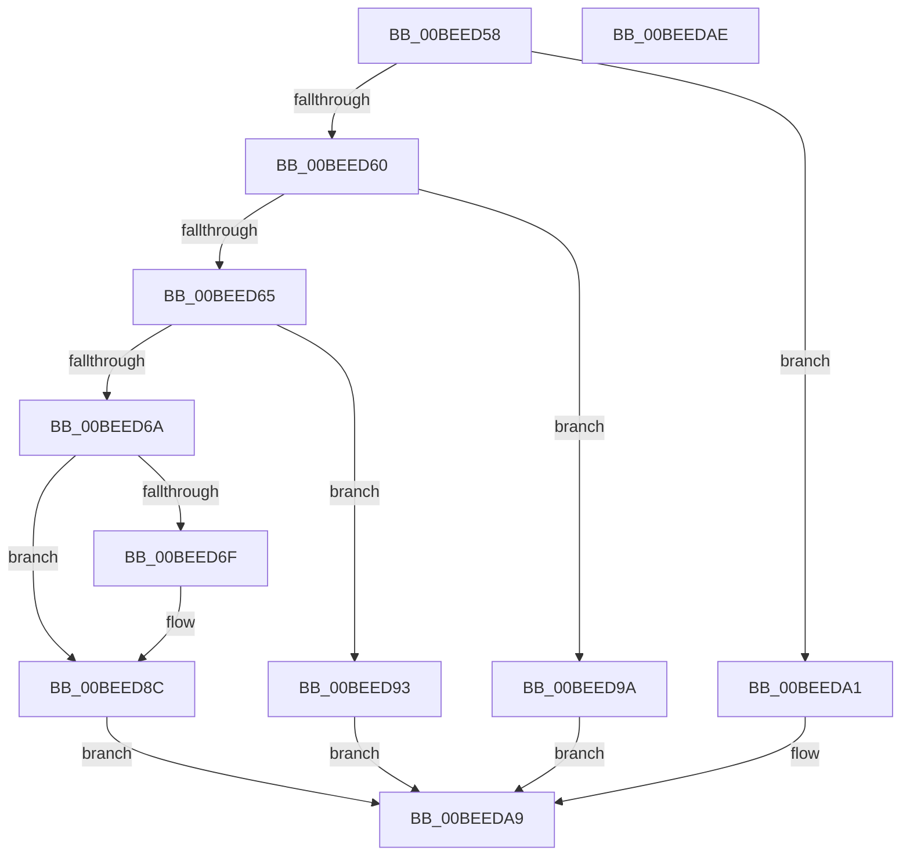

# PsInitSystem

- RVA: `0x00BEED58`–`0x00BEEDAF` (길이 `87` bytes)
- VA: `0x0000000140BEED58`
- 실행 섹션: `INIT`
- PDB 이름 있음: `예`; PDB Function 태그: `아니요`
- unwind 정보 RVA: `0x0005D2F4`
- 디코드: `27`개 명령, `87/87` bytes 표시
- 미해석 바이트: `0` (있으면 어셈블리에 `.byte`로 보존)

> 이 문서는 커널 이미지의 기계어와 PDB 기호를 분석해 생성했습니다. 4번과 5번은 함수 원형과 자료형을 바이너리 사용 방식에서 추정한 C 해석이며 원본 소스 복구 결과는 아닙니다.

## 1. Dependencies

- 직접 호출 지점: **5**; 고유 호출 대상: **5**
- 직접 호출자로 확인된 함수: **3**
- RIP 상대 이미지 참조: **1**

### Outgoing calls
- `0x00BEED86` → [KeBugCheckEx](../../text/4F/KeBugCheckEx_function_004FD660.md) (function, `0x004FD660`)
- `0x00BEED8C` → [PspInitPhase3](../C4/PspInitPhase3_function_00C455F8.md) (function, `0x00C455F8`)
- `0x00BEED93` → [PspInitPhase2](../C4/PspInitPhase2_function_00C45460.md) (function, `0x00C45460`)
- `0x00BEED9A` → [PspInitPhase1](../C4/PspInitPhase1_function_00C453B8.md) (function, `0x00C453B8`)
- `0x00BEEDA4` → [PspInitPhase0](../C7/PspInitPhase0_function_00C77E2C.md) (function, `0x00C77E2C`)

### Direct callers
- [InitBootProcessor](../C1/InitBootProcessor_function_00C1B1C8.md) at `0x00C1BD75`
- [Phase1InitializationDiscard](../C1/Phase1InitializationDiscard_function_00C1C728.md) at `0x00C1D34C`
- [Phase1InitializationIoReady](../C7/Phase1InitializationIoReady_function_00C70458.md) at `0x00C7062D`
- [Phase1InitializationIoReady](../C7/Phase1InitializationIoReady_function_00C70458.md) at `0x00C70662`

### Static image references
- `0x00BEED6F` → RVA `0x00FC41A0` (`.data`; read)

## 2. Other-region calls and transfers

- 다른 실행 섹션으로 향하는 call: **1**
  - `0x00BEED86` → [KeBugCheckEx](../../text/4F/KeBugCheckEx_function_004FD660.md) (`INIT` → `.text`)
- 별도 외부 분기/꼬리 이동을 확인하지 못했습니다.

## 3. Assembly (complete function range)

```asm
00BEED58  48 83 EC 38                     sub rsp, 0x38
00BEED5C  85 C9                           test ecx, ecx
00BEED5E  74 41                           je 0x140beeda1
00BEED60  83 E9 01                        sub ecx, 1
00BEED63  74 35                           je 0x140beed9a
00BEED65  83 E9 01                        sub ecx, 1
00BEED68  74 29                           je 0x140beed93
00BEED6A  83 F9 01                        cmp ecx, 1
00BEED6D  74 1D                           je 0x140beed8c
00BEED6F  44 8B 05 2A 54 3D 00            mov r8d, dword ptr [rip + 0x3d542a]
00BEED76  45 33 C9                        xor r9d, r9d
00BEED79  48 83 64 24 20 00               and qword ptr [rsp + 0x20], 0
00BEED7F  41 8D 51 01                     lea edx, [r9 + 1]
00BEED83  8D 4A 32                        lea ecx, [rdx + 0x32]
00BEED86  E8 D5 E8 90 FF                  call 0x1404fd660
00BEED8B  CC                              int3
00BEED8C  E8 67 68 05 00                  call 0x140c455f8
00BEED91  EB 16                           jmp 0x140beeda9
00BEED93  E8 C8 66 05 00                  call 0x140c45460
00BEED98  EB 0F                           jmp 0x140beeda9
00BEED9A  E8 19 66 05 00                  call 0x140c453b8
00BEED9F  EB 08                           jmp 0x140beeda9
00BEEDA1  48 8B CA                        mov rcx, rdx
00BEEDA4  E8 83 90 08 00                  call 0x140c77e2c
00BEEDA9  48 83 C4 38                     add rsp, 0x38
00BEEDAD  C3                              ret
00BEEDAE  CC                              int3
```

## 4. C-style interpretation (structured pseudocode)

```c
__int64 __fastcall PsInitSystem(int a1, __int64 a2, __int64 a3, int a4)
{
    __int64 result;
    __int64 v_rsp;
    unsigned __int64 v_stack_m18;

    v_rsp = (v_rsp) - (56);
    if (a1 == 0) goto loc_00BEEDA1;
    a1 = (unsigned int)((a1) - (1));
    if (condition_is_equal) goto loc_00BEED9A;
    a1 = (unsigned int)((a1) - (1));
    if (condition_is_equal) goto loc_00BEED93;
    if (a1 != 1) {
        a3 = *(unsigned int *)(v_rip + 4019242);
        a4 = 0;
        a2 = a4 + 1;
        a1 = a2 + 50;
        result = KeBugCheckEx(a1, a2, a3, a4);
    }
    result = PspInitPhase3(a1, a2, a3, a4);
    goto loc_00BEEDA9;
loc_00BEED93:
    result = PspInitPhase2(a1, a2, a3, a4);
    goto loc_00BEEDA9;
loc_00BEED9A:
    result = PspInitPhase1(a1, a2, a3, a4);
    goto loc_00BEEDA9;
loc_00BEEDA1:
    result = PspInitPhase0(a2, a2, a3, a4);
loc_00BEEDA9:
    v_rsp = (v_rsp) + (56);
    return result;
}
```

## 5. (Beta) C Style

```c
int64_t PsInitSystem(int32_t Arg1, int64_t Arg2, int64_t Arg3, int32_t Arg4)
{
    int64_t result;
    int64_t local_rsp;
    uint64_t v_stack_m18;

    local_rsp = (local_rsp) - (56);
    if (Arg1 == 0) goto loc_00BEEDA1;
    Arg1 = (uint32_t)((Arg1) - (1));
    if (condition_is_equal) goto loc_00BEED9A;
    Arg1 = (uint32_t)((Arg1) - (1));
    if (condition_is_equal) goto loc_00BEED93;
    if (Arg1 != 1) {
        Arg3 = *(uint32_t *)(v_rip + 0x3D542A);
        Arg4 = 0;
        Arg2 = Arg4 + 1;
        Arg1 = Arg2 + 50;
        result = KeBugCheckEx(Arg1, Arg2, Arg3, Arg4);
    }
    result = PspInitPhase3(Arg1, Arg2, Arg3, Arg4);
    goto loc_00BEEDA9;
loc_00BEED93:
    result = PspInitPhase2(Arg1, Arg2, Arg3, Arg4);
    goto loc_00BEEDA9;
loc_00BEED9A:
    result = PspInitPhase1(Arg1, Arg2, Arg3, Arg4);
    goto loc_00BEEDA9;
loc_00BEEDA1:
    result = PspInitPhase0(Arg2, Arg2, Arg3, Arg4);
loc_00BEEDA9:
    local_rsp = (local_rsp) + (56);
    return result;
}
```

## 6. Execution-region graph

[열기: 2D/3D 그래프와 함수 탐색 컨트롤 패널](../../../control-panel.html?section=init&rva=0x00BEED58&view=graph)

- 2D 그래프는 위에서 아래로 흐르고, 3D 그래프는 빈 공간을 드래그해 회전합니다. Shift+드래그는 이동, 휠은 확대·축소, 함수 노드 선택은 대상 보고서 이동입니다.

### Static fallback


