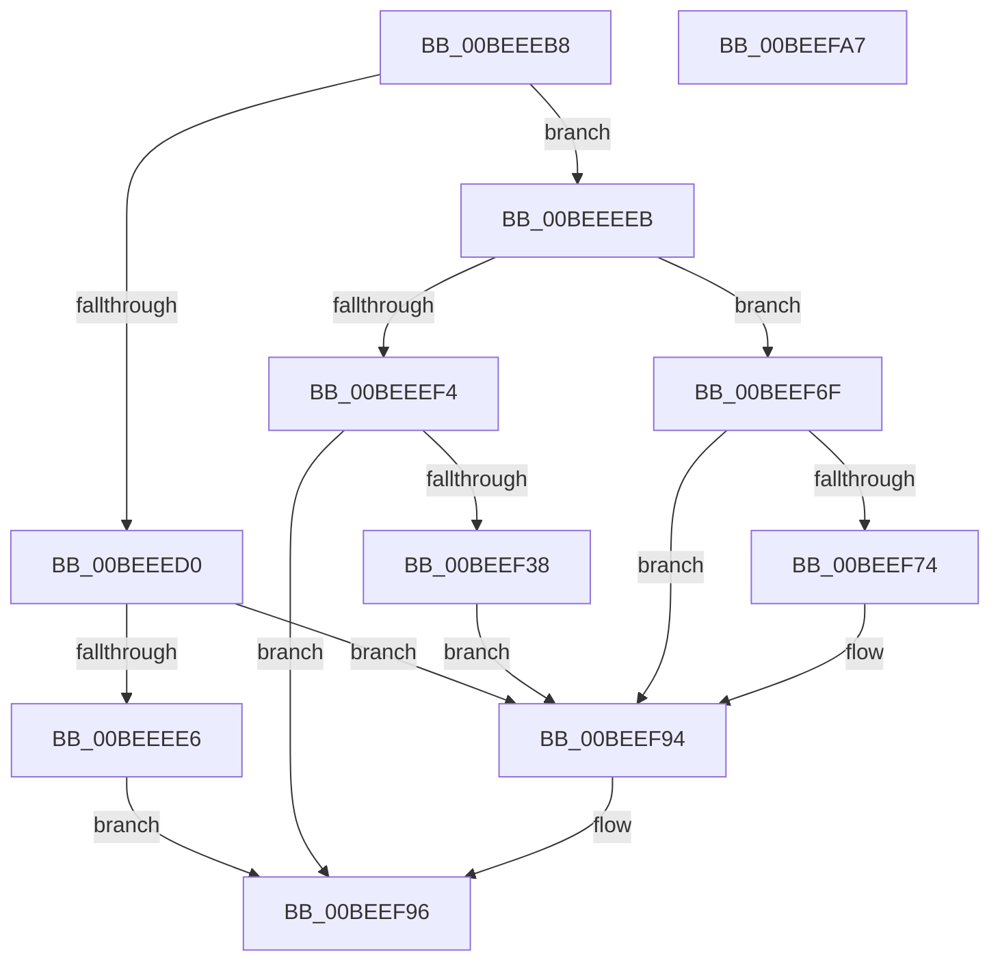

# VmInitSystem

- RVA: `0x00BEEEB8`–`0x00BEEFA8` (길이 `240` bytes)
- VA: `0x0000000140BEEEB8`
- 실행 섹션: `INIT`
- PDB 이름 있음: `예`; PDB Function 태그: `아니요`
- unwind 정보 RVA: `0x000B6310`
- 디코드: `55`개 명령, `240/240` bytes 표시
- 미해석 바이트: `0` (있으면 어셈블리에 `.byte`로 보존)

> 이 문서는 커널 이미지의 기계어와 PDB 기호를 분석해 생성했습니다. 4번과 5번은 함수 원형과 자료형을 바이너리 사용 방식에서 추정한 C 해석이며 원본 소스 복구 결과는 아닙니다.

## 1. Dependencies

- 직접 호출 지점: **4**; 고유 호출 대상: **4**
- 직접 호출자로 확인된 함수: **2**
- RIP 상대 이미지 참조: **6**

### Outgoing calls
- `0x00BEEED9` → [VmInitializeProcessor](../../pagelk/B7/VmInitializeProcessor_function_00B7E858.md) (function, `0x00B7E858`)
- `0x00BEEF2F` → [ExRegisterHost](../../page/7D/ExRegisterHost_function_007D06CC.md) (function, `0x007D06CC`)
- `0x00BEEF68` → [ExInitializeLookasideListExInternal](../../text/46/ExInitializeLookasideListExInternal_function_00468890.md) (function, `0x00468890`)
- `0x00BEEF88` → [TraceLoggingRegisterEx_EtwRegister_EtwSetInformation](../../page/92/TraceLoggingRegisterEx_EtwRegister_EtwSetInformation_function_009208A0.md) (function, `0x009208A0`)

### Direct callers
- [InitBootProcessor](../C1/InitBootProcessor_function_00C1B1C8.md) at `0x00C1B7CB`
- [Phase1InitializationDiscard](../C1/Phase1InitializationDiscard_function_00C1C728.md) at `0x00C1D5FD`

### Static image references
- `0x00BEEEF4` → RVA `0x00009450` (`.rdata`; read)
- `0x00BEEF19` → RVA `0x00F02460` (`.data`; read)
- `0x00BEEF3C` → RVA `0x00E28C00` (`.data`; read)
- `0x00BEEF74` → RVA `0x00E09100` (`.data`; read)
- `0x00BEEF81` → RVA `0x00A9BB90` (`VmpTracingEnabledCallback`; read)
- `0x00BEEF8D` → RVA `0x00F02458` (`.data`; write)

## 2. Other-region calls and transfers

- 다른 실행 섹션으로 향하는 call: **4**
  - `0x00BEEED9` → [VmInitializeProcessor](../../pagelk/B7/VmInitializeProcessor_function_00B7E858.md) (`INIT` → `PAGELK`)
  - `0x00BEEF2F` → [ExRegisterHost](../../page/7D/ExRegisterHost_function_007D06CC.md) (`INIT` → `PAGE`)
  - `0x00BEEF68` → [ExInitializeLookasideListExInternal](../../text/46/ExInitializeLookasideListExInternal_function_00468890.md) (`INIT` → `.text`)
  - `0x00BEEF88` → [TraceLoggingRegisterEx_EtwRegister_EtwSetInformation](../../page/92/TraceLoggingRegisterEx_EtwRegister_EtwSetInformation_function_009208A0.md) (`INIT` → `PAGE`)
- 별도 외부 분기/꼬리 이동을 확인하지 못했습니다.

## 3. Assembly (complete function range)

```asm
00BEEEB8  48 89 5C 24 08                  mov qword ptr [rsp + 8], rbx
00BEEEBD  55                              push rbp
00BEEEBE  48 8D 6C 24 A9                  lea rbp, [rsp - 0x57]
00BEEEC3  48 81 EC 90 00 00 00            sub rsp, 0x90
00BEEECA  33 DB                           xor ebx, ebx
00BEEECC  85 C9                           test ecx, ecx
00BEEECE  75 1B                           jne 0x140beeeeb
00BEEED0  65 48 8B 0C 25 20 00 00 00      mov rcx, qword ptr gs:[0x20]
00BEEED9  E8 7A F9 F8 FF                  call 0x140b7e858
00BEEEDE  85 C0                           test eax, eax
00BEEEE0  0F 89 AE 00 00 00               jns 0x140beef94
00BEEEE6  E9 AB 00 00 00                  jmp 0x140beef96
00BEEEEB  BA 01 00 00 00                  mov edx, 1
00BEEEF0  3B CA                           cmp ecx, edx
00BEEEF2  75 7B                           jne 0x140beef6f
00BEEEF4  48 8D 05 55 A5 41 FF            lea rax, [rip - 0xbe5aab]
00BEEEFB  89 55 17                        mov dword ptr [rbp + 0x17], edx
00BEEEFE  48 89 45 1F                     mov qword ptr [rbp + 0x1f], rax
00BEEF02  4C 8D 45 27                     lea r8, [rbp + 0x27]
00BEEF06  48 8D 45 17                     lea rax, [rbp + 0x17]
00BEEF0A  48 C7 45 27 08 00 01 00         mov qword ptr [rbp + 0x27], 0x10008
00BEEF12  0F 57 C0                        xorps xmm0, xmm0
00BEEF15  48 89 45 2F                     mov qword ptr [rbp + 0x2f], rax
00BEEF19  48 8D 0D 40 35 31 00            lea rcx, [rip + 0x313540]
00BEEF20  89 5D 4B                        mov dword ptr [rbp + 0x4b], ebx
00BEEF23  F3 0F 7F 45 3B                  movdqu xmmword ptr [rbp + 0x3b], xmm0
00BEEF28  C7 45 37 00 02 00 00            mov dword ptr [rbp + 0x37], 0x200
00BEEF2F  E8 98 17 BE FF                  call 0x1407d06cc
00BEEF34  85 C0                           test eax, eax
00BEEF36  78 5E                           js 0x140beef96
00BEEF38  89 5C 24 40                     mov dword ptr [rsp + 0x40], ebx
00BEEF3C  48 8D 0D BD 9C 23 00            lea rcx, [rip + 0x239cbd]
00BEEF43  66 89 5C 24 38                  mov word ptr [rsp + 0x38], bx
00BEEF48  41 B9 00 02 00 00               mov r9d, 0x200
00BEEF4E  C7 44 24 30 56 6D 4C 62         mov dword ptr [rsp + 0x30], 0x624c6d56
00BEEF56  45 33 C0                        xor r8d, r8d
00BEEF59  48 C7 44 24 28 20 80 00 00      mov qword ptr [rsp + 0x28], 0x8020
00BEEF62  33 D2                           xor edx, edx
00BEEF64  89 5C 24 20                     mov dword ptr [rsp + 0x20], ebx
00BEEF68  E8 23 99 87 FF                  call 0x140468890
00BEEF6D  EB 25                           jmp 0x140beef94
00BEEF6F  83 F9 02                        cmp ecx, 2
00BEEF72  75 20                           jne 0x140beef94
00BEEF74  48 8D 1D 85 A1 21 00            lea rbx, [rip + 0x21a185]
00BEEF7B  45 33 C0                        xor r8d, r8d
00BEEF7E  48 8B CB                        mov rcx, rbx
00BEEF81  48 8D 15 08 CC EA FF            lea rdx, [rip - 0x1533f8]
00BEEF88  E8 13 19 D3 FF                  call 0x1409208a0
00BEEF8D  48 89 1D C4 34 31 00            mov qword ptr [rip + 0x3134c4], rbx
00BEEF94  33 C0                           xor eax, eax
00BEEF96  48 8B 9C 24 A0 00 00 00         mov rbx, qword ptr [rsp + 0xa0]
00BEEF9E  48 81 C4 90 00 00 00            add rsp, 0x90
00BEEFA5  5D                              pop rbp
00BEEFA6  C3                              ret
00BEEFA7  CC                              int3
```

## 4. C-style interpretation (structured pseudocode)

```c
__int64 __fastcall VmInitSystem(int a1)
{
    __int64 result;
    __int64 v_rbx;
    __int64 v_rsp;
    unsigned int v_stack_m14;
    unsigned __int64 v_stack_m24;
    unsigned int v_stack_m28;
    unsigned __int64 v_stack_m30;
    unsigned __int64 v_stack_m38;
    unsigned __int64 v_stack_m40;
    unsigned int v_stack_m48;
    unsigned int v_stack_m58;
    unsigned __int64 v_stack_m5F;
    unsigned __int16 v_stack_m60;
    unsigned int v_stack_m68;
    unsigned __int64 v_stack_m70;
    unsigned int v_stack_m78;
    unsigned __int64 v_stack_p8;

    v_stack_p8 = v_rbx;
    v_rsp = (v_rsp) - (144);
    v_rbx = 0;
    if (a1 != 0) goto loc_00BEEEEB;
    result = VmInitializeProcessor(*(unsigned __int64 *)(gs_base + (0 + 32)), a2, a3, a4);
    if (!sign_flag) goto loc_00BEEF94;
    goto loc_00BEEF96;
loc_00BEEEEB:
    if (((unsigned int)(*(unsigned __int64 *)(gs_base + (0 + 32)))) != 1) goto loc_00BEEF6F;
    v_stack_m48 = 1;
    v_stack_m40 = v_rip - 12475051;
    v_stack_m38 = 0x10008ULL;
    v_stack_m30 = v_stack_m48;
    v_stack_m14 = 0;
    v_stack_m24 = v_xmm0;
    v_stack_m28 = 512;
    result = ExRegisterHost(v_rip + 3224896, 1, v_stack_m38, a4);
    if (sign_flag) goto loc_00BEEF96;
    v_stack_m58 = 0;
    v_stack_m60 = 0;
    v_stack_m68 = 0x624C6D56ULL;
    a3 = 0;
    v_stack_m70 = 0x8020ULL;
    a2 = 0;
    v_stack_m78 = 0;
    result = ExInitializeLookasideListExInternal(v_rip + 2333885, a2, a3, 512);
    goto loc_00BEEF94;
loc_00BEEF6F:
    if (((unsigned int)(v_rip + 2333885)) == 2) {
        v_rbx = v_rip + 2204037;
        a3 = 0;
        a1 = v_rbx;
        a2 = v_rip - 1389560;
        result = TraceLoggingRegisterEx_EtwRegister_EtwSetInformation(a1, a2, a3, 512);
        *(unsigned __int64 *)(v_rip + 3224772) = v_rbx;
    }
    result = 0;
loc_00BEEF96:
    v_rsp = (v_rsp) + (144);
    return result;
}
```

## 5. (Beta) C Style

```c
int64_t VmInitSystem(int32_t Arg1)
{
    int64_t result;
    int64_t local_rbx;
    int64_t local_rsp;
    uint32_t v_stack_m14;
    uint64_t v_stack_m24;
    uint32_t v_stack_m28;
    uint64_t v_stack_m30;
    uint64_t v_stack_m38;
    uint64_t v_stack_m40;
    uint32_t v_stack_m48;
    uint32_t v_stack_m58;
    uint64_t v_stack_m5F;
    uint16_t v_stack_m60;
    uint32_t v_stack_m68;
    uint64_t v_stack_m70;
    uint32_t v_stack_m78;
    uint64_t v_stack_p8;

    v_stack_p8 = local_rbx;
    local_rsp = (local_rsp) - (144);
    local_rbx = 0;
    if (Arg1 != 0) goto loc_00BEEEEB;
    result = VmInitializeProcessor(*(uint64_t *)(gs_base + (0 + 0x20)), a2, a3, a4);
    if (!sign_flag) goto loc_00BEEF94;
    goto loc_00BEEF96;
loc_00BEEEEB:
    if (((uint32_t)(*(uint64_t *)(gs_base + (0 + 0x20)))) != 1) goto loc_00BEEF6F;
    v_stack_m48 = 1;
    v_stack_m40 = v_rip - 12475051;
    v_stack_m38 = 0x10008ULL;
    v_stack_m30 = v_stack_m48;
    v_stack_m14 = 0;
    v_stack_m24 = v_xmm0;
    v_stack_m28 = 512;
    result = ExRegisterHost(v_rip + 3224896, 1, v_stack_m38, a4);
    if (sign_flag) goto loc_00BEEF96;
    v_stack_m58 = 0;
    v_stack_m60 = 0;
    v_stack_m68 = 0x624C6D56ULL;
    a3 = 0;
    v_stack_m70 = 0x8020ULL;
    a2 = 0;
    v_stack_m78 = 0;
    result = ExInitializeLookasideListExInternal(v_rip + 2333885, a2, a3, 512);
    goto loc_00BEEF94;
loc_00BEEF6F:
    if (((uint32_t)(v_rip + 2333885)) == 2) {
        local_rbx = v_rip + 2204037;
        a3 = 0;
        Arg1 = local_rbx;
        a2 = v_rip - 1389560;
        result = TraceLoggingRegisterEx_EtwRegister_EtwSetInformation(Arg1, a2, a3, 512);
        *(uint64_t *)(v_rip + 0x3134C4) = local_rbx;
    }
    result = 0;
loc_00BEEF96:
    local_rsp = (local_rsp) + (144);
    return result;
}
```

## 6. Execution-region graph

[열기: 2D/3D 그래프와 함수 탐색 컨트롤 패널](../../../control-panel.html?section=init&rva=0x00BEEEB8&view=graph)

- 2D 그래프는 위에서 아래로 흐르고, 3D 그래프는 빈 공간을 드래그해 회전합니다. Shift+드래그는 이동, 휠은 확대·축소, 함수 노드 선택은 대상 보고서 이동입니다.

### Static fallback


