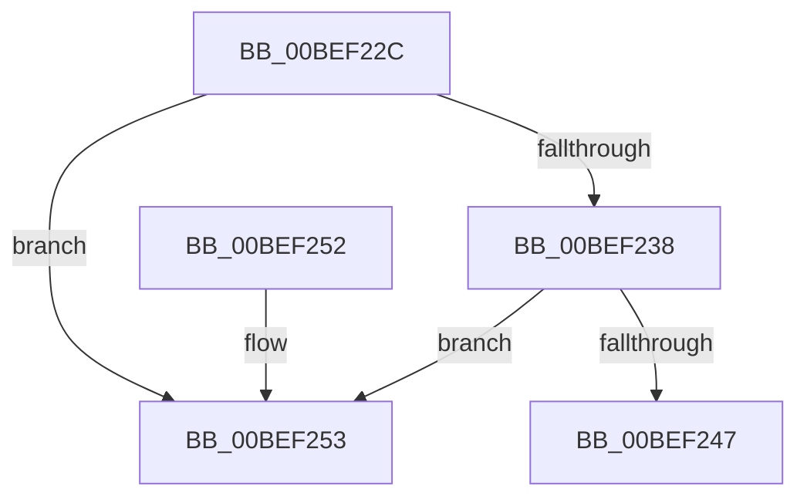

# _security_init_cookie

- RVA: `0x00BEF22C`–`0x00BEF25A` (길이 `46` bytes)
- VA: `0x0000000140BEF22C`
- 실행 섹션: `INIT`
- PDB 이름 있음: `예`; PDB Function 태그: `아니요`
- unwind 정보 RVA: `0x000DB714`
- 디코드: `12`개 명령, `46/46` bytes 표시
- 미해석 바이트: `0` (있으면 어셈블리에 `.byte`로 보존)

> 이 문서는 커널 이미지의 기계어와 PDB 기호를 분석해 생성했습니다. 4번과 5번은 함수 원형과 자료형을 바이너리 사용 방식에서 추정한 C 해석이며 원본 소스 복구 결과는 아닙니다.

## 1. Dependencies

- 직접 호출 지점: **0**; 고유 호출 대상: **0**
- 직접 호출자로 확인된 함수: **1**
- RIP 상대 이미지 참조: **2**

### Outgoing calls
- 직접 디코드된 call 명령이 없습니다.

### Direct callers
- [HalInitSystem](../../pagelk/B5/HalInitSystem_function_00B5B6E0.md) at `0x00B5B6ED`

### Static image references
- `0x00BEF22C` → RVA `0x00E0A740` (`.data`; read)
- `0x00BEF24A` → RVA `0x00E0A750` (`.data`; write)

## 2. Other-region calls and transfers

- 다른 실행 섹션으로 향하는 call: **0**
- 별도 외부 분기/꼬리 이동을 확인하지 못했습니다.

## 3. Assembly (complete function range)

```asm
00BEF22C  48 8B 05 0D B5 21 00            mov rax, qword ptr [rip + 0x21b50d]
00BEF233  48 85 C0                        test rax, rax
00BEF236  74 1B                           je 0x140bef253
00BEF238  48 B9 32 A2 DF 2D 99 2B 00 00   movabs rcx, 0x2b992ddfa232
00BEF242  48 3B C1                        cmp rax, rcx
00BEF245  74 0C                           je 0x140bef253
00BEF247  48 F7 D0                        not rax
00BEF24A  48 89 05 FF B4 21 00            mov qword ptr [rip + 0x21b4ff], rax
00BEF251  C3                              ret
00BEF252  CC                              int3
00BEF253  B9 06 00 00 00                  mov ecx, 6
00BEF258  CD 29                           int 0x29
```

## 4. C-style interpretation (structured pseudocode)

```c
__int64 __fastcall _security_init_cookie(void)
{
    __int64 result;

    if (*(unsigned __int64 *)(v_rip + 2209037) == 0) goto loc_00BEF253;
    if ((*(unsigned __int64 *)(v_rip + 2209037)) == a1) goto loc_00BEF253;
    result = ~(*(unsigned __int64 *)(v_rip + 2209037));
    *(unsigned __int64 *)(v_rip + 2209023) = result;
    return result;
loc_00BEF253:
    return result;
}
```

## 5. (Beta) C Style

```c
void _security_init_cookie(void)
{
    int64_t result;

    if (*(uint64_t *)(v_rip + 0x21B50D) == 0) goto loc_00BEF253;
    if ((*(uint64_t *)(v_rip + 0x21B50D)) == a1) goto loc_00BEF253;
    result = ~(*(uint64_t *)(v_rip + 0x21B50D));
    *(uint64_t *)(v_rip + 0x21B4FF) = result;
    return result;
loc_00BEF253:
    return result;
}
```

## 6. Execution-region graph

[열기: 2D/3D 그래프와 함수 탐색 컨트롤 패널](../../../control-panel.html?section=init&rva=0x00BEF22C&view=graph)

- 2D 그래프는 위에서 아래로 흐르고, 3D 그래프는 빈 공간을 드래그해 회전합니다. Shift+드래그는 이동, 휠은 확대·축소, 함수 노드 선택은 대상 보고서 이동입니다.

### Static fallback


