# sub_00BF1290

- RVA: `0x00BF1290`–`0x00BF16C9` (길이 `1,081` bytes)
- VA: `0x0000000140BF1290`
- 실행 섹션: `INIT`
- PDB 이름 있음: `아니요`; PDB Function 태그: `아니요`
- unwind 정보 RVA: `0x000D90A8`
- 디코드: `295`개 명령, `1,081/1,081` bytes 표시
- 미해석 바이트: `0` (있으면 어셈블리에 `.byte`로 보존)

> 이 문서는 커널 이미지의 기계어와 PDB 기호를 분석해 생성했습니다. 4번과 5번은 함수 원형과 자료형을 바이너리 사용 방식에서 추정한 C 해석이며 원본 소스 복구 결과는 아닙니다.

## 1. Dependencies

- 직접 호출 지점: **4**; 고유 호출 대상: **3**
- 직접 호출자로 확인된 함수: **0**
- RIP 상대 이미지 참조: **1**

### Outgoing calls
- `0x00BF144B` → [sub_0051AFB0](../../text/51/Unknown_function_0051AFB0.md) (function, `0x0051AFB0`)
- `0x00BF1521` → [ExFreePool](../../poolcode/B8/ExFreePool_function_00B82850.md) (function, `0x00B82850`)
- `0x00BF16A5` → [KeSignalGate](../../text/2C/KeSignalGate_function_002C748C.md) (function, `0x002C748C`)
- `0x00BF16B2` → [ExFreePool](../../poolcode/B8/ExFreePool_function_00B82850.md) (function, `0x00B82850`)

### Direct callers
- 이 함수 시작 RVA로 연결되는 직접 call은 확인되지 않았습니다. 간접 호출은 완전히 역산할 수 없습니다.

### Static image references
- `0x00BF1652` → RVA `0x0001F8A0` (`.rdata`; read)

## 2. Other-region calls and transfers

- 다른 실행 섹션으로 향하는 call: **4**
  - `0x00BF144B` → [sub_0051AFB0](../../text/51/Unknown_function_0051AFB0.md) (`INIT` → `.text`)
  - `0x00BF1521` → [ExFreePool](../../poolcode/B8/ExFreePool_function_00B82850.md) (`INIT` → `POOLCODE`)
  - `0x00BF16A5` → [KeSignalGate](../../text/2C/KeSignalGate_function_002C748C.md) (`INIT` → `.text`)
  - `0x00BF16B2` → [ExFreePool](../../poolcode/B8/ExFreePool_function_00B82850.md) (`INIT` → `POOLCODE`)
- 별도 외부 분기/꼬리 이동을 확인하지 못했습니다.

## 3. Assembly (complete function range)

```asm
00BF1290  48 89 4C 24 08                  mov qword ptr [rsp + 8], rcx
00BF1295  53                              push rbx
00BF1296  55                              push rbp
00BF1297  56                              push rsi
00BF1298  57                              push rdi
00BF1299  41 54                           push r12
00BF129B  41 55                           push r13
00BF129D  41 56                           push r14
00BF129F  41 57                           push r15
00BF12A1  48 83 EC 68                     sub rsp, 0x68
00BF12A5  48 8B 01                        mov rax, qword ptr [rcx]
00BF12A8  33 D2                           xor edx, edx
00BF12AA  48 8B F1                        mov rsi, rcx
00BF12AD  48 8B D9                        mov rbx, rcx
00BF12B0  48 8B 28                        mov rbp, qword ptr [rax]
00BF12B3  48 83 C0 28                     add rax, 0x28
00BF12B7  48 3B C8                        cmp rcx, rax
00BF12BA  8B 49 28                        mov ecx, dword ptr [rcx + 0x28]
00BF12BD  48 0F 44 F2                     cmove rsi, rdx
00BF12C1  48 89 74 24 20                  mov qword ptr [rsp + 0x20], rsi
00BF12C6  85 C9                           test ecx, ecx
00BF12C8  0F 84 62 02 00 00               je 0x140bf1530
00BF12CE  83 F9 01                        cmp ecx, 1
00BF12D1  0F 85 B5 03 00 00               jne 0x140bf168c
00BF12D7  4C 8B 73 08                     mov r14, qword ptr [rbx + 8]
00BF12DB  4C 8B 7B 18                     mov r15, qword ptr [rbx + 0x18]
00BF12DF  48 8B 43 10                     mov rax, qword ptr [rbx + 0x10]
00BF12E3  8B 73 20                        mov esi, dword ptr [rbx + 0x20]
00BF12E6  4C 89 74 24 28                  mov qword ptr [rsp + 0x28], r14
00BF12EB  4C 89 BC 24 C8 00 00 00         mov qword ptr [rsp + 0xc8], r15
00BF12F3  48 89 84 24 C0 00 00 00         mov qword ptr [rsp + 0xc0], rax
00BF12FB  4D 85 F6                        test r14, r14
00BF12FE  75 0C                           jne 0x140bf130c
00BF1300  4C 8B B5 D0 0A 00 00            mov r14, qword ptr [rbp + 0xad0]
00BF1307  4C 89 74 24 28                  mov qword ptr [rsp + 0x28], r14
00BF130C  85 F6                           test esi, esi
00BF130E  0F 84 00 02 00 00               je 0x140bf1514
00BF1314  BF 08 00 00 00                  mov edi, 8
00BF1319  44 8B DA                        mov r11d, edx
00BF131C  3B F7                           cmp esi, edi
00BF131E  0F 42 FE                        cmovb edi, esi
00BF1321  85 FF                           test edi, edi
00BF1323  0F 84 19 01 00 00               je 0x140bf1442
00BF1329  4D 8B FE                        mov r15, r14
00BF132C  4C 8D 6C 24 38                  lea r13, [rsp + 0x38]
00BF1331  4C 8B B4 24 C0 00 00 00         mov r14, qword ptr [rsp + 0xc0]
00BF1339  49 C7 47 08 00 10 00 00         mov qword ptr [r15 + 8], 0x1000
00BF1341  45 8B CB                        mov r9d, r11d
00BF1344  41 C1 E1 0C                     shl r9d, 0xc
00BF1348  4D 03 CE                        add r9, r14
00BF134B  4D 89 0F                        mov qword ptr [r15], r9
00BF134E  4D 8B D1                        mov r10, r9
00BF1351  81 85 48 08 00 00 00 10 00 00   add dword ptr [rbp + 0x848], 0x1000
00BF135B  49 8B C1                        mov rax, r9
00BF135E  44 8B A5 34 08 00 00            mov r12d, dword ptr [rbp + 0x834]
00BF1365  48 8B 9D 38 08 00 00            mov rbx, qword ptr [rbp + 0x838]
00BF136C  49 8D 89 00 10 00 00            lea rcx, [r9 + 0x1000]
00BF1373  4C 3B C9                        cmp r9, rcx
00BF1376  73 0C                           jae 0x140bf1384
00BF1378  0F 18 00                        prefetchnta byte ptr [rax]
00BF137B  48 83 C0 40                     add rax, 0x40
00BF137F  48 3B C1                        cmp rax, rcx
00BF1382  72 F4                           jb 0x140bf1378
00BF1384  4C 8B C3                        mov r8, rbx
00BF1387  C7 84 24 B8 00 00 00 20 00 00 00  mov dword ptr [rsp + 0xb8], 0x20
00BF1392  49 BE 01 20 00 04 80 00 10 70   movabs r14, 0x7010008004002001
00BF139C  B8 08 00 00 00                  mov eax, 8
00BF13A1  4D 33 02                        xor r8, qword ptr [r10]
00BF13A4  41 8B CC                        mov ecx, r12d
00BF13A7  49 D3 C0                        rol r8, cl
00BF13AA  4D 33 42 08                     xor r8, qword ptr [r10 + 8]
00BF13AE  49 83 C2 10                     add r10, 0x10
00BF13B2  49 D3 C0                        rol r8, cl
00BF13B5  48 83 E8 01                     sub rax, 1
00BF13B9  75 E6                           jne 0x140bf13a1
00BF13BB  49 8B CA                        mov rcx, r10
00BF13BE  49 2B C9                        sub rcx, r9
00BF13C1  48 33 CB                        xor rcx, rbx
00BF13C4  48 8B C1                        mov rax, rcx
00BF13C7  48 C1 C0 11                     rol rax, 0x11
00BF13CB  48 33 C8                        xor rcx, rax
00BF13CE  49 8B C6                        mov rax, r14
00BF13D1  48 F7 E1                        mul rcx
00BF13D4  8B 8C 24 B8 00 00 00            mov ecx, dword ptr [rsp + 0xb8]
00BF13DB  41 33 C4                        xor eax, r12d
00BF13DE  48 89 54 24 30                  mov qword ptr [rsp + 0x30], rdx
00BF13E3  FF C9                           dec ecx
00BF13E5  33 C2                           xor eax, edx
00BF13E7  83 E0 3F                        and eax, 0x3f
00BF13EA  89 8C 24 B8 00 00 00            mov dword ptr [rsp + 0xb8], ecx
00BF13F1  41 BC 01 00 00 00               mov r12d, 1
00BF13F7  44 0F 45 E0                     cmovne r12d, eax
00BF13FB  85 C9                           test ecx, ecx
00BF13FD  75 9D                           jne 0x140bf139c
00BF13FF  4C 8B B4 24 C0 00 00 00         mov r14, qword ptr [rsp + 0xc0]
00BF1407  49 8B C0                        mov rax, r8
00BF140A  EB 03                           jmp 0x140bf140f
00BF140C  44 33 C0                        xor r8d, eax
00BF140F  48 C1 E8 1F                     shr rax, 0x1f
00BF1413  48 85 C0                        test rax, rax
00BF1416  75 F4                           jne 0x140bf140c
00BF1418  41 0F BA F0 1F                  btr r8d, 0x1f
00BF141D  41 FF C3                        inc r11d
00BF1420  45 89 45 00                     mov dword ptr [r13], r8d
00BF1424  49 83 C7 30                     add r15, 0x30
00BF1428  49 83 C5 04                     add r13, 4
00BF142C  44 3B DF                        cmp r11d, edi
00BF142F  0F 82 04 FF FF FF               jb 0x140bf1339
00BF1435  4C 8B 74 24 28                  mov r14, qword ptr [rsp + 0x28]
00BF143A  4C 8B BC 24 C8 00 00 00         mov r15, qword ptr [rsp + 0xc8]
00BF1442  44 8B C7                        mov r8d, edi
00BF1445  49 8B D6                        mov rdx, r14
00BF1448  48 8B CD                        mov rcx, rbp
00BF144B  E8 60 9B 92 FF                  call 0x14051afb0
00BF1450  33 D2                           xor edx, edx
00BF1452  85 FF                           test edi, edi
00BF1454  0F 84 82 00 00 00               je 0x140bf14dc
00BF145A  4C 8D 64 24 38                  lea r12, [rsp + 0x38]
00BF145F  44 8B EF                        mov r13d, edi
00BF1462  4D 8D 4F 10                     lea r9, [r15 + 0x10]
00BF1466  4D 8B D7                        mov r10, r15
00BF1469  4D 8D 5E 10                     lea r11, [r14 + 0x10]
00BF146D  41 B8 10 00 00 00               mov r8d, 0x10
00BF1473  49 8B CB                        mov rcx, r11
00BF1476  49 8B D2                        mov rdx, r10
00BF1479  45 8D 78 F2                     lea r15d, [r8 - 0xe]
00BF147D  48 8B 01                        mov rax, qword ptr [rcx]
00BF1480  41 83 C0 F8                     add r8d, -8
00BF1484  48 89 02                        mov qword ptr [rdx], rax
00BF1487  48 83 C1 08                     add rcx, 8
00BF148B  48 83 C2 08                     add rdx, 8
00BF148F  49 83 EF 01                     sub r15, 1
00BF1493  75 E8                           jne 0x140bf147d
00BF1495  45 85 C0                        test r8d, r8d
00BF1498  74 10                           je 0x140bf14aa
00BF149A  8A 01                           mov al, byte ptr [rcx]
00BF149C  48 FF C1                        inc rcx
00BF149F  88 02                           mov byte ptr [rdx], al
00BF14A1  48 FF C2                        inc rdx
00BF14A4  41 83 C0 FF                     add r8d, -1
00BF14A8  75 F0                           jne 0x140bf149a
00BF14AA  41 8B 01                        mov eax, dword ptr [r9]
00BF14AD  49 83 C3 30                     add r11, 0x30
00BF14B1  8B C8                           mov ecx, eax
00BF14B3  49 83 C2 14                     add r10, 0x14
00BF14B7  41 33 0C 24                     xor ecx, dword ptr [r12]
00BF14BB  49 83 C4 04                     add r12, 4
00BF14BF  0F BA F1 1F                     btr ecx, 0x1f
00BF14C3  33 C8                           xor ecx, eax
00BF14C5  41 89 09                        mov dword ptr [r9], ecx
00BF14C8  49 83 C1 14                     add r9, 0x14
00BF14CC  49 83 ED 01                     sub r13, 1
00BF14D0  75 9B                           jne 0x140bf146d
00BF14D2  4C 8B BC 24 C8 00 00 00         mov r15, qword ptr [rsp + 0xc8]
00BF14DA  33 D2                           xor edx, edx
00BF14DC  8B C7                           mov eax, edi
00BF14DE  48 8D 0C BF                     lea rcx, [rdi + rdi*4]
00BF14E2  2B F7                           sub esi, edi
00BF14E4  C1 E0 0C                        shl eax, 0xc
00BF14E7  48 01 84 24 C0 00 00 00         add qword ptr [rsp + 0xc0], rax
00BF14EF  4D 8D 3C 8F                     lea r15, [r15 + rcx*4]
00BF14F3  C1 E7 0F                        shl edi, 0xf
00BF14F6  01 BD 48 08 00 00               add dword ptr [rbp + 0x848], edi
00BF14FC  4C 89 BC 24 C8 00 00 00         mov qword ptr [rsp + 0xc8], r15
00BF1504  85 F6                           test esi, esi
00BF1506  0F 85 08 FE FF FF               jne 0x140bf1314
00BF150C  48 8B 9C 24 B0 00 00 00         mov rbx, qword ptr [rsp + 0xb0]
00BF1514  48 8B 4B 08                     mov rcx, qword ptr [rbx + 8]
00BF1518  48 85 C9                        test rcx, rcx
00BF151B  0F 84 66 01 00 00               je 0x140bf1687
00BF1521  E8 2A 13 F9 FF                  call 0x140b82850
00BF1526  48 83 63 08 00                  and qword ptr [rbx + 8], 0
00BF152B  E9 57 01 00 00                  jmp 0x140bf1687
00BF1530  39 53 20                        cmp dword ptr [rbx + 0x20], edx
00BF1533  0F 84 53 01 00 00               je 0x140bf168c
00BF1539  41 83 CF FF                     or r15d, 0xffffffff
00BF153D  41 BC FF FF FF 7F               mov r12d, 0x7fffffff
00BF1543  48 8B 43 10                     mov rax, qword ptr [rbx + 0x10]
00BF1547  44 8B 9D 34 08 00 00            mov r11d, dword ptr [rbp + 0x834]
00BF154E  4C 8B B5 38 08 00 00            mov r14, qword ptr [rbp + 0x838]
00BF1555  8B 08                           mov ecx, dword ptr [rax]
00BF1557  44 8B 48 04                     mov r9d, dword ptr [rax + 4]
00BF155B  8B F9                           mov edi, ecx
00BF155D  48 03 7B 08                     add rdi, qword ptr [rbx + 8]
00BF1561  44 2B C9                        sub r9d, ecx
00BF1564  44 01 8D 48 08 00 00            add dword ptr [rbp + 0x848], r9d
00BF156B  4C 8B D7                        mov r10, rdi
00BF156E  41 8B C9                        mov ecx, r9d
00BF1571  48 8B C7                        mov rax, rdi
00BF1574  48 03 CF                        add rcx, rdi
00BF1577  48 3B F9                        cmp rdi, rcx
00BF157A  73 0C                           jae 0x140bf1588
00BF157C  0F 18 00                        prefetchnta byte ptr [rax]
00BF157F  48 83 C0 40                     add rax, 0x40
00BF1583  48 3B C1                        cmp rax, rcx
00BF1586  72 F4                           jb 0x140bf157c
00BF1588  41 8B F1                        mov esi, r9d
00BF158B  4D 8B C6                        mov r8, r14
00BF158E  C1 EE 07                        shr esi, 7
00BF1591  85 F6                           test esi, esi
00BF1593  74 66                           je 0x140bf15fb
00BF1595  48 BB 01 20 00 04 80 00 10 70   movabs rbx, 0x7010008004002001
00BF159F  B8 08 00 00 00                  mov eax, 8
00BF15A4  4D 33 02                        xor r8, qword ptr [r10]
00BF15A7  41 8B CB                        mov ecx, r11d
00BF15AA  49 D3 C0                        rol r8, cl
00BF15AD  4D 33 42 08                     xor r8, qword ptr [r10 + 8]
00BF15B1  49 83 C2 10                     add r10, 0x10
00BF15B5  49 D3 C0                        rol r8, cl
00BF15B8  48 83 E8 01                     sub rax, 1
00BF15BC  75 E6                           jne 0x140bf15a4
00BF15BE  49 8B CA                        mov rcx, r10
00BF15C1  48 2B CF                        sub rcx, rdi
00BF15C4  49 33 CE                        xor rcx, r14
00BF15C7  48 8B C1                        mov rax, rcx
00BF15CA  48 C1 C0 11                     rol rax, 0x11
00BF15CE  48 33 C8                        xor rcx, rax
00BF15D1  48 8B C3                        mov rax, rbx
00BF15D4  48 F7 E1                        mul rcx
00BF15D7  48 89 54 24 28                  mov qword ptr [rsp + 0x28], rdx
00BF15DC  41 33 D3                        xor edx, r11d
00BF15DF  33 D0                           xor edx, eax
00BF15E1  41 BB 01 00 00 00               mov r11d, 1
00BF15E7  83 E2 3F                        and edx, 0x3f
00BF15EA  44 0F 45 DA                     cmovne r11d, edx
00BF15EE  41 03 F7                        add esi, r15d
00BF15F1  75 AC                           jne 0x140bf159f
00BF15F3  48 8B 9C 24 B0 00 00 00         mov rbx, qword ptr [rsp + 0xb0]
00BF15FB  41 83 E1 7F                     and r9d, 0x7f
00BF15FF  41 83 F9 08                     cmp r9d, 8
00BF1603  72 1E                           jb 0x140bf1623
00BF1605  41 8B C1                        mov eax, r9d
00BF1608  48 C1 E8 03                     shr rax, 3
00BF160C  4D 33 02                        xor r8, qword ptr [r10]
00BF160F  41 8B CB                        mov ecx, r11d
00BF1612  49 D3 C0                        rol r8, cl
00BF1615  49 83 C2 08                     add r10, 8
00BF1619  41 83 C1 F8                     add r9d, -8
00BF161D  48 83 E8 01                     sub rax, 1
00BF1621  75 E9                           jne 0x140bf160c
00BF1623  45 85 C9                        test r9d, r9d
00BF1626  74 15                           je 0x140bf163d
00BF1628  41 0F B6 02                     movzx eax, byte ptr [r10]
00BF162C  41 8B CB                        mov ecx, r11d
00BF162F  4C 33 C0                        xor r8, rax
00BF1632  49 FF C2                        inc r10
00BF1635  49 D3 C0                        rol r8, cl
00BF1638  45 03 CF                        add r9d, r15d
00BF163B  75 EB                           jne 0x140bf1628
00BF163D  49 8B C0                        mov rax, r8
00BF1640  EB 03                           jmp 0x140bf1645
00BF1642  44 33 C0                        xor r8d, eax
00BF1645  48 C1 E8 1F                     shr rax, 0x1f
00BF1649  48 85 C0                        test rax, rax
00BF164C  75 F4                           jne 0x140bf1642
00BF164E  48 8B 53 18                     mov rdx, qword ptr [rbx + 0x18]
00BF1652  66 0F 6F 0D 46 E2 42 FF         movdqa xmm1, xmmword ptr [rip - 0xbd1dba]
00BF165A  8B 02                           mov eax, dword ptr [rdx]
00BF165C  8B C8                           mov ecx, eax
00BF165E  41 33 C8                        xor ecx, r8d
00BF1661  41 23 CC                        and ecx, r12d
00BF1664  33 C8                           xor ecx, eax
00BF1666  89 0A                           mov dword ptr [rdx], ecx
00BF1668  48 8B 43 18                     mov rax, qword ptr [rbx + 0x18]
00BF166C  44 21 20                        and dword ptr [rax], r12d
00BF166F  44 01 7B 20                     add dword ptr [rbx + 0x20], r15d
00BF1673  F3 0F 6F 43 10                  movdqu xmm0, xmmword ptr [rbx + 0x10]
00BF1678  66 0F D4 C8                     paddq xmm1, xmm0
00BF167C  F3 0F 7F 4B 10                  movdqu xmmword ptr [rbx + 0x10], xmm1
00BF1681  0F 85 BC FE FF FF               jne 0x140bf1543
00BF1687  48 8B 74 24 20                  mov rsi, qword ptr [rsp + 0x20]
00BF168C  48 8B 0B                        mov rcx, qword ptr [rbx]
00BF168F  83 C8 FF                        or eax, 0xffffffff
00BF1692  F0 0F C1 41 20                  lock xadd dword ptr [rcx + 0x20], eax
00BF1697  83 F8 01                        cmp eax, 1
00BF169A  75 0E                           jne 0x140bf16aa
00BF169C  48 8B 0B                        mov rcx, qword ptr [rbx]
00BF169F  8B D0                           mov edx, eax
00BF16A1  48 83 C1 08                     add rcx, 8
00BF16A5  E8 E2 5D 6D FF                  call 0x1402c748c
00BF16AA  48 85 F6                        test rsi, rsi
00BF16AD  74 08                           je 0x140bf16b7
00BF16AF  48 8B CE                        mov rcx, rsi
00BF16B2  E8 99 11 F9 FF                  call 0x140b82850
00BF16B7  48 83 C4 68                     add rsp, 0x68
00BF16BB  41 5F                           pop r15
00BF16BD  41 5E                           pop r14
00BF16BF  41 5D                           pop r13
00BF16C1  41 5C                           pop r12
00BF16C3  5F                              pop rdi
00BF16C4  5E                              pop rsi
00BF16C5  5D                              pop rbp
00BF16C6  5B                              pop rbx
00BF16C7  C3                              ret
00BF16C8  CC                              int3
```

## 4. C-style interpretation (structured pseudocode)

```c
__int64 __fastcall sub_00BF1290(__int64 a1, int a2)
{
    __int64 result;
    __int64 v_r10;
    __int64 v_r11;
    __int64 v_r12;
    __int64 v_r13;
    __int64 v_r14;
    __int64 v_r15;
    __int64 v_rdi;
    __int64 v_rsi;
    __int64 v_rsp;
    unsigned __int64 v_stack_m70;
    unsigned __int64 v_stack_m78;
    unsigned __int64 v_stack_m80;
    unsigned __int64 v_stack_m88;
    unsigned int v_stack_p10;
    unsigned __int64 v_stack_p18;
    unsigned __int64 v_stack_p20;
    unsigned __int64 v_stack_p8;

    v_stack_p8 = a1;
    v_rsp = (v_rsp) - (104);
    a2 = 0;
    result = (*(unsigned __int64 *)(a1)) + (40);
    if (a1 == result) { a1 = 0; }
    v_stack_m88 = a1;
    if ((unsigned int)((unsigned int)(*(unsigned int *)(a1 + 40))) == 0) goto loc_00BF1530;
    if (((unsigned int)((unsigned int)(*(unsigned int *)(a1 + 40)))) != 1) goto loc_00BF168C;
    v_stack_m80 = *(unsigned __int64 *)(a1 + 8);
    v_stack_p20 = *(unsigned __int64 *)(a1 + 24);
    v_stack_p18 = *(unsigned __int64 *)(a1 + 16);
    v_r14 = *(unsigned __int64 *)(a1 + 8);
    if (*(unsigned __int64 *)(a1 + 8) == 0) {
        v_r14 = *(unsigned __int64 *)(*(unsigned __int64 *)(*(unsigned __int64 *)(a1)) + 2768);
        v_stack_m80 = v_r14;
    }
    if ((unsigned int)((unsigned int)(*(unsigned int *)(a1 + 32))) == 0) goto loc_00BF1514;
loc_00BF1314:
    v_rdi = 8;
    if (((unsigned int)((unsigned int)(*(unsigned int *)(a1 + 32)))) < 8) { v_rdi = (unsigned int)((unsigned int)(*(unsigned int *)(a1 + 32))); }
    if ((unsigned int)(v_rdi) == 0) goto loc_00BF1442;
loc_00BF1339:
    *(unsigned __int64 *)(v_r14 + 8) = 0x1000ULL;
    a4 = (unsigned int)((0) << (12));
    a4 = (a4) + (v_stack_p18);
    *(unsigned __int64 *)(v_r14) = a4;
    if (a4 >= (a4 + 4096)) goto loc_00BF1384;
loc_00BF1378:
    result = (a4) + (64);
    if (result < (a4 + 4096)) goto loc_00BF1378;
loc_00BF1384:
    v_stack_p10 = 32;
loc_00BF139C:
loc_00BF13A1:
    a3 = (*(unsigned __int64 *)(*(unsigned __int64 *)(*(unsigned __int64 *)(a1)) + 2104)) ^ (*(unsigned __int64 *)(a4));
    a3 = (a3) ^ (*(unsigned __int64 *)(a4 + 8));
    v_r10 = (a4) + (16);
    result = (8) - (1);
    if (condition_is_not_equal) goto loc_00BF13A1;
    a1 = (v_r10) - (a4);
    a1 = (a1) ^ (*(unsigned __int64 *)(*(unsigned __int64 *)(*(unsigned __int64 *)(a1)) + 2104));
    a1 = (a1) ^ (a1);
    result = (unsigned int)((v_stack_p18) ^ ((unsigned int)((unsigned int)(*(unsigned int *)(*(unsigned __int64 *)(*(unsigned __int64 *)(a1)) + 2100)))));
    v_stack_m78 = 0;
    a1 = (unsigned int)(((unsigned int)(v_stack_p10)) - 1);
    result = (unsigned int)((result) ^ (0));
    result = (unsigned int)((result) & (63));
    v_stack_p10 = (unsigned int)(a1);
    v_r12 = 1;
    if (condition_is_not_equal) { v_r12 = (unsigned int)(result); }
    if ((unsigned int)(a1) != 0) goto loc_00BF139C;
    goto loc_00BF140F;
loc_00BF140C:
    a3 = (unsigned int)((a3) ^ ((unsigned int)(a3)));
loc_00BF140F:
    result = (a3) >> (31);
    if (result != 0) goto loc_00BF140C;
    v_r11 = (unsigned int)((0) + 1);
    *(unsigned int *)(v_stack_m70) = (unsigned int)(a3);
    v_r15 = (v_r14) + (48);
    v_r13 = (v_stack_m70) + (4);
    if (((unsigned int)(v_r11)) < ((unsigned int)(v_rdi))) goto loc_00BF1339;
loc_00BF1442:
    result = sub_0051AFB0(*(unsigned __int64 *)(*(unsigned __int64 *)(a1)), v_stack_m80, (unsigned int)((unsigned int)(v_rdi)), a4);
    a2 = 0;
    if ((unsigned int)(v_rdi) == 0) goto loc_00BF14DC;
loc_00BF146D:
loc_00BF147D:
    a3 = (unsigned int)((16) + (-8));
    *(unsigned __int64 *)(v_stack_p20) = *(unsigned __int64 *)(v_stack_m80 + 16);
    a1 = (v_stack_m80 + 16) + (8);
    a2 = (v_stack_p20) + (8);
    v_r15 = (16 - 14) - (1);
    if (condition_is_not_equal) goto loc_00BF147D;
    if ((unsigned int)(a3) == 0) goto loc_00BF14AA;
loc_00BF149A:
    a1 = (a1) + 1;
    *(unsigned __int8 *)(a2) = (unsigned __int8)(*(unsigned __int8 *)(a1));
    a2 = (a2) + 1;
    a3 = (unsigned int)((a3) + (-1));
    if (condition_is_not_equal) goto loc_00BF149A;
loc_00BF14AA:
    v_r11 = (v_stack_m80 + 16) + (48);
    v_r10 = (v_stack_p20) + (20);
    a1 = (unsigned int)(((unsigned int)((unsigned int)((unsigned int)(*(unsigned int *)(v_stack_p20 + 16))))) ^ (*(unsigned int *)(v_stack_m70)));
    v_r12 = (v_stack_m70) + (4);
    a1 = (unsigned int)((a1) ^ ((unsigned int)((unsigned int)(*(unsigned int *)(v_stack_p20 + 16)))));
    *(unsigned int *)(v_stack_p20 + 16) = (unsigned int)(a1);
    a4 = (v_stack_p20 + 16) + (20);
    v_r13 = ((unsigned int)((unsigned int)(v_rdi))) - (1);
    if (condition_is_not_equal) goto loc_00BF146D;
    a2 = 0;
loc_00BF14DC:
    v_rsi = (unsigned int)(((unsigned int)(*(unsigned int *)(a1 + 32))) - ((unsigned int)(v_rdi)));
    result = (unsigned int)(((unsigned int)((unsigned int)(v_rdi))) << (12));
    v_rdi = (unsigned int)((v_rdi) << (15));
    v_stack_p20 = v_stack_p20 + v_rdi + v_rdi * 4 * 4;
    if ((unsigned int)(v_rsi) != 0) goto loc_00BF1314;
loc_00BF1514:
    if (*(unsigned __int64 *)(v_stack_p8 + 8) == 0) goto loc_00BF1687;
    result = ExFreePool(*(unsigned __int64 *)(v_stack_p8 + 8), a2, a3, a4);
    goto loc_00BF1687;
loc_00BF1530:
    if ((*(unsigned int *)(v_stack_p8 + 32)) == 0) goto loc_00BF168C;
    v_r15 = (unsigned int)((v_stack_p20 + v_rdi + v_rdi * 4 * 4) | (0xFFFFFFFFULL));
loc_00BF1543:
    v_rdi = ((unsigned int)((unsigned int)((unsigned int)(*(unsigned int *)(*(unsigned __int64 *)(v_stack_p8 + 16)))))) + (*(unsigned __int64 *)(v_stack_p8 + 8));
    a4 = (unsigned int)(((unsigned int)(*(unsigned int *)(*(unsigned __int64 *)(v_stack_p8 + 16) + 4))) - ((unsigned int)((unsigned int)(*(unsigned int *)(*(unsigned __int64 *)(v_stack_p8 + 16))))));
    a1 = ((unsigned int)((unsigned int)(a4))) + (v_rdi);
    if (v_rdi >= a1) goto loc_00BF1588;
loc_00BF157C:
    result = (v_rdi) + (64);
    if (result < a1) goto loc_00BF157C;
loc_00BF1588:
    v_rsi = (unsigned int)(((unsigned int)((unsigned int)(a4))) >> (7));
    if ((unsigned int)(v_rsi) == 0) goto loc_00BF15FB;
loc_00BF159F:
loc_00BF15A4:
    a3 = (*(unsigned __int64 *)(*(unsigned __int64 *)(*(unsigned __int64 *)(a1)) + 2104)) ^ (*(unsigned __int64 *)(v_rdi));
    a3 = (a3) ^ (*(unsigned __int64 *)(v_rdi + 8));
    v_r10 = (v_rdi) + (16);
    result = (8) - (1);
    if (condition_is_not_equal) goto loc_00BF15A4;
    a1 = (v_r10) - (v_rdi);
    a1 = (a1) ^ (*(unsigned __int64 *)(*(unsigned __int64 *)(*(unsigned __int64 *)(a1)) + 2104));
    a1 = (a1) ^ (a1);
    v_stack_m80 = 0;
    a2 = (unsigned int)((a2) ^ ((unsigned int)((unsigned int)(*(unsigned int *)(*(unsigned __int64 *)(*(unsigned __int64 *)(a1)) + 2100)))));
    a2 = (unsigned int)((a2) ^ ((unsigned int)(v_stack_p8)));
    a2 = (unsigned int)((a2) & (63));
    v_r11 = 1;
    if (condition_is_not_equal) { v_r11 = a2; }
    v_rsi = (unsigned int)((v_rsi) + ((unsigned int)(v_r15)));
    if (condition_is_not_equal) goto loc_00BF159F;
loc_00BF15FB:
    a4 = (unsigned int)((a4) & (127));
    if (((unsigned int)(a4)) < 8) goto loc_00BF1623;
    result = ((unsigned int)((unsigned int)(a4))) >> (3);
loc_00BF160C:
    a3 = (a3) ^ (*(unsigned __int64 *)(v_r10));
    v_r10 = (v_r10) + (8);
    a4 = (unsigned int)((a4) + (-8));
    result = (result) - (1);
    if (condition_is_not_equal) goto loc_00BF160C;
loc_00BF1623:
    if ((unsigned int)(a4) == 0) goto loc_00BF163D;
loc_00BF1628:
    a3 = (a3) ^ (*(unsigned __int8 *)(v_r10));
    v_r10 = (v_r10) + 1;
    a4 = (unsigned int)((a4) + ((unsigned int)(v_r15)));
    if (condition_is_not_equal) goto loc_00BF1628;
loc_00BF163D:
    goto loc_00BF1645;
loc_00BF1642:
    a3 = (unsigned int)((a3) ^ ((unsigned int)(a3)));
loc_00BF1645:
    result = (a3) >> (31);
    if (result != 0) goto loc_00BF1642;
    a1 = (unsigned int)(((unsigned int)((unsigned int)((unsigned int)(*(unsigned int *)(*(unsigned __int64 *)(v_stack_p8 + 24)))))) ^ ((unsigned int)(a3)));
    a1 = (unsigned int)((a1) & ((unsigned int)((unsigned int)(0x7FFFFFFFULL))));
    a1 = (unsigned int)((a1) ^ ((unsigned int)((unsigned int)(*(unsigned int *)(*(unsigned __int64 *)(v_stack_p8 + 24))))));
    *(unsigned int *)(*(unsigned __int64 *)(v_stack_p8 + 24)) = (unsigned int)(a1);
    *(unsigned __int64 *)(v_stack_p8 + 16) = v_xmm1;
    if (condition_is_not_equal) goto loc_00BF1543;
loc_00BF1687:
loc_00BF168C:
    result = (unsigned int)((*(unsigned __int64 *)(v_stack_p8 + 24)) | (0xFFFFFFFFULL));
    if (((unsigned int)(result)) == 1) {
        a1 = *(unsigned __int64 *)(v_stack_p8);
        a2 = (unsigned int)(result);
        a1 = (a1) + (8);
        result = KeSignalGate(a1, a2, a3, a4);
    }
    if (v_stack_m88 != 0) {
        a1 = v_stack_m88;
        result = ExFreePool(a1, a2, a3, a4);
    }
    v_rsp = (v_rsp) + (104);
    return result;
}
```

## 5. (Beta) C Style

```c
int64_t sub_00BF1290(void *Arg1, int32_t Arg2)
{
    uint8_t *arg1 = (uint8_t *)Arg1;

    int64_t result;
    int64_t local_r10;
    int64_t local_r11;
    int64_t local_r12;
    int64_t local_r13;
    int64_t local_r14;
    int64_t local_r15;
    int64_t local_rdi;
    int64_t local_rsi;
    int64_t local_rsp;
    uint64_t v_stack_m70;
    uint64_t v_stack_m78;
    uint64_t v_stack_m80;
    uint64_t v_stack_m88;
    uint32_t v_stack_p10;
    uint64_t v_stack_p18;
    uint64_t v_stack_p20;
    uint64_t v_stack_p8;

    v_stack_p8 = Arg1;
    local_rsp = (local_rsp) - (104);
    Arg2 = 0;
    result = (*(uint64_t *)(arg1)) + (40);
    if (Arg1 == result) { Arg1 = 0; }
    v_stack_m88 = Arg1;
    if ((uint32_t)((uint32_t)(*(uint32_t *)(arg1 + 0x28))) == 0) goto loc_00BF1530;
    if (((uint32_t)((uint32_t)(*(uint32_t *)(arg1 + 0x28)))) != 1) goto loc_00BF168C;
    v_stack_m80 = *(uint64_t *)(arg1 + 0x8);
    v_stack_p20 = *(uint64_t *)(arg1 + 0x18);
    v_stack_p18 = *(uint64_t *)(arg1 + 0x10);
    local_r14 = *(uint64_t *)(arg1 + 0x8);
    if (*(uint64_t *)(arg1 + 0x8) == 0) {
        local_r14 = *(uint64_t *)(*(uint64_t *)(*(uint64_t *)(arg1)) + 0xAD0);
        v_stack_m80 = local_r14;
    }
    if ((uint32_t)((uint32_t)(*(uint32_t *)(arg1 + 0x20))) == 0) goto loc_00BF1514;
loc_00BF1314:
    local_rdi = 8;
    if (((uint32_t)((uint32_t)(*(uint32_t *)(arg1 + 0x20)))) < 8) { local_rdi = (uint32_t)((uint32_t)(*(uint32_t *)(arg1 + 0x20))); }
    if ((uint32_t)(local_rdi) == 0) goto loc_00BF1442;
loc_00BF1339:
    *(uint64_t *)(local_r14 + 0x8) = 0x1000ULL;
    a4 = (uint32_t)((0) << (12));
    a4 = (a4) + (v_stack_p18);
    *(uint64_t *)(local_r14) = a4;
    if (a4 >= (a4 + 4096)) goto loc_00BF1384;
loc_00BF1378:
    result = (a4) + (64);
    if (result < (a4 + 4096)) goto loc_00BF1378;
loc_00BF1384:
    v_stack_p10 = 32;
loc_00BF139C:
loc_00BF13A1:
    a3 = (*(uint64_t *)(*(uint64_t *)(*(uint64_t *)(arg1)) + 0x838)) ^ (*(uint64_t *)(a4));
    a3 = (a3) ^ (*(uint64_t *)(a4 + 0x8));
    local_r10 = (a4) + (16);
    result = (8) - (1);
    if (condition_is_not_equal) goto loc_00BF13A1;
    Arg1 = (local_r10) - (a4);
    Arg1 = (Arg1) ^ (*(uint64_t *)(*(uint64_t *)(*(uint64_t *)(arg1)) + 0x838));
    Arg1 = (Arg1) ^ (Arg1);
    result = (uint32_t)((v_stack_p18) ^ ((uint32_t)((uint32_t)(*(uint32_t *)(*(uint64_t *)(*(uint64_t *)(arg1)) + 0x834)))));
    v_stack_m78 = 0;
    Arg1 = (uint32_t)(((uint32_t)(v_stack_p10)) - 1);
    result = (uint32_t)((result) ^ (0));
    result = (uint32_t)((result) & (63));
    v_stack_p10 = (uint32_t)(Arg1);
    local_r12 = 1;
    if (condition_is_not_equal) { local_r12 = (uint32_t)(result); }
    if ((uint32_t)(Arg1) != 0) goto loc_00BF139C;
    goto loc_00BF140F;
loc_00BF140C:
    a3 = (uint32_t)((a3) ^ ((uint32_t)(a3)));
loc_00BF140F:
    result = (a3) >> (31);
    if (result != 0) goto loc_00BF140C;
    local_r11 = (uint32_t)((0) + 1);
    *(uint32_t *)(v_stack_m70) = (uint32_t)(a3);
    local_r15 = (local_r14) + (48);
    local_r13 = (v_stack_m70) + (4);
    if (((uint32_t)(local_r11)) < ((uint32_t)(local_rdi))) goto loc_00BF1339;
loc_00BF1442:
    result = sub_0051AFB0(*(uint64_t *)(*(uint64_t *)(arg1)), v_stack_m80, (uint32_t)((uint32_t)(local_rdi)), a4);
    Arg2 = 0;
    if ((uint32_t)(local_rdi) == 0) goto loc_00BF14DC;
loc_00BF146D:
loc_00BF147D:
    a3 = (uint32_t)((16) + (-8));
    *(uint64_t *)(v_stack_p20) = *(uint64_t *)(v_stack_m80 + 0x10);
    Arg1 = (v_stack_m80 + 16) + (8);
    Arg2 = (v_stack_p20) + (8);
    local_r15 = (16 - 14) - (1);
    if (condition_is_not_equal) goto loc_00BF147D;
    if ((uint32_t)(a3) == 0) goto loc_00BF14AA;
loc_00BF149A:
    Arg1 = (Arg1) + 1;
    *(uint8_t *)(Arg2) = (uint8_t)(*(uint8_t *)(arg1));
    Arg2 = (Arg2) + 1;
    a3 = (uint32_t)((a3) + (-1));
    if (condition_is_not_equal) goto loc_00BF149A;
loc_00BF14AA:
    local_r11 = (v_stack_m80 + 16) + (48);
    local_r10 = (v_stack_p20) + (20);
    Arg1 = (uint32_t)(((uint32_t)((uint32_t)((uint32_t)(*(uint32_t *)(v_stack_p20 + 0x10))))) ^ (*(uint32_t *)(v_stack_m70)));
    local_r12 = (v_stack_m70) + (4);
    Arg1 = (uint32_t)((Arg1) ^ ((uint32_t)((uint32_t)(*(uint32_t *)(v_stack_p20 + 0x10)))));
    *(uint32_t *)(v_stack_p20 + 0x10) = (uint32_t)(Arg1);
    a4 = (v_stack_p20 + 16) + (20);
    local_r13 = ((uint32_t)((uint32_t)(local_rdi))) - (1);
    if (condition_is_not_equal) goto loc_00BF146D;
    Arg2 = 0;
loc_00BF14DC:
    local_rsi = (uint32_t)(((uint32_t)(*(uint32_t *)(arg1 + 0x20))) - ((uint32_t)(local_rdi)));
    result = (uint32_t)(((uint32_t)((uint32_t)(local_rdi))) << (12));
    local_rdi = (uint32_t)((local_rdi) << (15));
    v_stack_p20 = v_stack_p20 + local_rdi + local_rdi * 4 * 4;
    if ((uint32_t)(local_rsi) != 0) goto loc_00BF1314;
loc_00BF1514:
    if (*(uint64_t *)(v_stack_p8 + 0x8) == 0) goto loc_00BF1687;
    result = ExFreePool(*(uint64_t *)(v_stack_p8 + 0x8), Arg2, a3, a4);
    goto loc_00BF1687;
loc_00BF1530:
    if ((*(uint32_t *)(v_stack_p8 + 0x20)) == 0) goto loc_00BF168C;
    local_r15 = (uint32_t)((v_stack_p20 + local_rdi + local_rdi * 4 * 4) | (0xFFFFFFFFULL));
loc_00BF1543:
    local_rdi = ((uint32_t)((uint32_t)((uint32_t)(*(uint32_t *)(*(uint64_t *)(v_stack_p8 + 0x10)))))) + (*(uint64_t *)(v_stack_p8 + 0x8));
    a4 = (uint32_t)(((uint32_t)(*(uint32_t *)(*(uint64_t *)(v_stack_p8 + 0x10) + 0x4))) - ((uint32_t)((uint32_t)(*(uint32_t *)(*(uint64_t *)(v_stack_p8 + 0x10))))));
    Arg1 = ((uint32_t)((uint32_t)(a4))) + (local_rdi);
    if (local_rdi >= Arg1) goto loc_00BF1588;
loc_00BF157C:
    result = (local_rdi) + (64);
    if (result < Arg1) goto loc_00BF157C;
loc_00BF1588:
    local_rsi = (uint32_t)(((uint32_t)((uint32_t)(a4))) >> (7));
    if ((uint32_t)(local_rsi) == 0) goto loc_00BF15FB;
loc_00BF159F:
loc_00BF15A4:
    a3 = (*(uint64_t *)(*(uint64_t *)(*(uint64_t *)(arg1)) + 0x838)) ^ (*(uint64_t *)(local_rdi));
    a3 = (a3) ^ (*(uint64_t *)(local_rdi + 0x8));
    local_r10 = (local_rdi) + (16);
    result = (8) - (1);
    if (condition_is_not_equal) goto loc_00BF15A4;
    Arg1 = (local_r10) - (local_rdi);
    Arg1 = (Arg1) ^ (*(uint64_t *)(*(uint64_t *)(*(uint64_t *)(arg1)) + 0x838));
    Arg1 = (Arg1) ^ (Arg1);
    v_stack_m80 = 0;
    Arg2 = (uint32_t)((Arg2) ^ ((uint32_t)((uint32_t)(*(uint32_t *)(*(uint64_t *)(*(uint64_t *)(arg1)) + 0x834)))));
    Arg2 = (uint32_t)((Arg2) ^ ((uint32_t)(v_stack_p8)));
    Arg2 = (uint32_t)((Arg2) & (63));
    local_r11 = 1;
    if (condition_is_not_equal) { local_r11 = Arg2; }
    local_rsi = (uint32_t)((local_rsi) + ((uint32_t)(local_r15)));
    if (condition_is_not_equal) goto loc_00BF159F;
loc_00BF15FB:
    a4 = (uint32_t)((a4) & (127));
    if (((uint32_t)(a4)) < 8) goto loc_00BF1623;
    result = ((uint32_t)((uint32_t)(a4))) >> (3);
loc_00BF160C:
    a3 = (a3) ^ (*(uint64_t *)(local_r10));
    local_r10 = (local_r10) + (8);
    a4 = (uint32_t)((a4) + (-8));
    result = (result) - (1);
    if (condition_is_not_equal) goto loc_00BF160C;
loc_00BF1623:
    if ((uint32_t)(a4) == 0) goto loc_00BF163D;
loc_00BF1628:
    a3 = (a3) ^ (*(uint8_t *)(local_r10));
    local_r10 = (local_r10) + 1;
    a4 = (uint32_t)((a4) + ((uint32_t)(local_r15)));
    if (condition_is_not_equal) goto loc_00BF1628;
loc_00BF163D:
    goto loc_00BF1645;
loc_00BF1642:
    a3 = (uint32_t)((a3) ^ ((uint32_t)(a3)));
loc_00BF1645:
    result = (a3) >> (31);
    if (result != 0) goto loc_00BF1642;
    Arg1 = (uint32_t)(((uint32_t)((uint32_t)((uint32_t)(*(uint32_t *)(*(uint64_t *)(v_stack_p8 + 0x18)))))) ^ ((uint32_t)(a3)));
    Arg1 = (uint32_t)((Arg1) & ((uint32_t)((uint32_t)(0x7FFFFFFFULL))));
    Arg1 = (uint32_t)((Arg1) ^ ((uint32_t)((uint32_t)(*(uint32_t *)(*(uint64_t *)(v_stack_p8 + 0x18))))));
    *(uint32_t *)(*(uint64_t *)(v_stack_p8 + 0x18)) = (uint32_t)(Arg1);
    *(uint64_t *)(v_stack_p8 + 0x10) = v_xmm1;
    if (condition_is_not_equal) goto loc_00BF1543;
loc_00BF1687:
loc_00BF168C:
    result = (uint32_t)((*(uint64_t *)(v_stack_p8 + 0x18)) | (0xFFFFFFFFULL));
    if (((uint32_t)(result)) == 1) {
        Arg1 = *(uint64_t *)(v_stack_p8);
        Arg2 = (uint32_t)(result);
        Arg1 = (Arg1) + (8);
        result = KeSignalGate(Arg1, Arg2, a3, a4);
    }
    if (v_stack_m88 != 0) {
        Arg1 = v_stack_m88;
        result = ExFreePool(Arg1, Arg2, a3, a4);
    }
    local_rsp = (local_rsp) + (104);
    return result;
}
```

### 관측된 메모리 오프셋

구조체 형식이 확인되지 않은 접근은 인자 기준의 오프셋으로만 기록했습니다.

| 기준 인자 | 오프셋 표현 | 폭 (bit) | 접근 |
|---|---:|---:|---|
| `Arg1` | `+ 0x0` | `64` | `R` |
| `Arg1` | `+ 0x8` | `64` | `R` |
| `Arg1` | `+ 0x10` | `64` | `R` |
| `Arg1` | `+ 0x18` | `64` | `R` |
| `Arg1` | `+ 0x20` | `32` | `R` |

## 6. Execution-region graph

[열기: 2D/3D 그래프와 함수 탐색 컨트롤 패널](../../../control-panel.html?section=init&rva=0x00BF1290&view=graph)

- 2D 그래프는 위에서 아래로 흐르고, 3D 그래프는 빈 공간을 드래그해 회전합니다. Shift+드래그는 이동, 휠은 확대·축소, 함수 노드 선택은 대상 보고서 이동입니다.

### Static fallback

```mermaid
flowchart TD
  bb_00BF1290[BB_00BF1290]
  bb_00BF12CE[BB_00BF12CE]
  bb_00BF12D7[BB_00BF12D7]
  bb_00BF1300[BB_00BF1300]
  bb_00BF130C[BB_00BF130C]
  bb_00BF1314[BB_00BF1314]
  bb_00BF1329[BB_00BF1329]
  bb_00BF1339[BB_00BF1339]
  bb_00BF1378[BB_00BF1378]
  bb_00BF1384[BB_00BF1384]
  bb_00BF139C[BB_00BF139C]
  bb_00BF13A1[BB_00BF13A1]
  bb_00BF13BB[BB_00BF13BB]
  bb_00BF13FF[BB_00BF13FF]
  bb_00BF140C[BB_00BF140C]
  bb_00BF140F[BB_00BF140F]
  bb_00BF1418[BB_00BF1418]
  bb_00BF1435[BB_00BF1435]
  bb_00BF1442[BB_00BF1442]
  bb_00BF145A[BB_00BF145A]
  bb_00BF146D[BB_00BF146D]
  bb_00BF147D[BB_00BF147D]
  bb_00BF1495[BB_00BF1495]
  bb_00BF149A[BB_00BF149A]
  bb_00BF14AA[BB_00BF14AA]
  bb_00BF14D2[BB_00BF14D2]
  bb_00BF14DC[BB_00BF14DC]
  bb_00BF150C[BB_00BF150C]
  bb_00BF1514[BB_00BF1514]
  bb_00BF1521[BB_00BF1521]
  bb_00BF1530[BB_00BF1530]
  bb_00BF1539[BB_00BF1539]
  bb_00BF1543[BB_00BF1543]
  bb_00BF157C[BB_00BF157C]
  bb_00BF1588[BB_00BF1588]
  bb_00BF1595[BB_00BF1595]
  bb_00BF159F[BB_00BF159F]
  bb_00BF15A4[BB_00BF15A4]
  bb_00BF15BE[BB_00BF15BE]
  bb_00BF15F3[BB_00BF15F3]
  bb_00BF15FB[BB_00BF15FB]
  bb_00BF1605[BB_00BF1605]
  bb_00BF160C[BB_00BF160C]
  bb_00BF1623[BB_00BF1623]
  bb_00BF1628[BB_00BF1628]
  bb_00BF163D[BB_00BF163D]
  bb_00BF1642[BB_00BF1642]
  bb_00BF1645[BB_00BF1645]
  bb_00BF164E[BB_00BF164E]
  bb_00BF1687[BB_00BF1687]
  bb_00BF168C[BB_00BF168C]
  bb_00BF169C[BB_00BF169C]
  bb_00BF16AA[BB_00BF16AA]
  bb_00BF16AF[BB_00BF16AF]
  bb_00BF16B7[BB_00BF16B7]
  bb_00BF16C8[BB_00BF16C8]
  bb_00BF1290 -->|branch| bb_00BF1530
  bb_00BF1290 -->|fallthrough| bb_00BF12CE
  bb_00BF12CE -->|branch| bb_00BF168C
  bb_00BF12CE -->|fallthrough| bb_00BF12D7
  bb_00BF12D7 -->|branch| bb_00BF130C
  bb_00BF12D7 -->|fallthrough| bb_00BF1300
  bb_00BF1300 -->|flow| bb_00BF130C
  bb_00BF130C -->|branch| bb_00BF1514
  bb_00BF130C -->|fallthrough| bb_00BF1314
  bb_00BF1314 -->|branch| bb_00BF1442
  bb_00BF1314 -->|fallthrough| bb_00BF1329
  bb_00BF1329 -->|flow| bb_00BF1339
  bb_00BF1339 -->|branch| bb_00BF1384
  bb_00BF1339 -->|fallthrough| bb_00BF1378
  bb_00BF1378 -->|branch| bb_00BF1378
  bb_00BF1378 -->|fallthrough| bb_00BF1384
  bb_00BF1384 -->|flow| bb_00BF139C
  bb_00BF139C -->|flow| bb_00BF13A1
  bb_00BF13A1 -->|branch| bb_00BF13A1
  bb_00BF13A1 -->|fallthrough| bb_00BF13BB
  bb_00BF13BB -->|branch| bb_00BF139C
  bb_00BF13BB -->|fallthrough| bb_00BF13FF
  bb_00BF13FF -->|branch| bb_00BF140F
  bb_00BF140C -->|flow| bb_00BF140F
  bb_00BF140F -->|branch| bb_00BF140C
  bb_00BF140F -->|fallthrough| bb_00BF1418
  bb_00BF1418 -->|branch| bb_00BF1339
  bb_00BF1418 -->|fallthrough| bb_00BF1435
  bb_00BF1435 -->|flow| bb_00BF1442
  bb_00BF1442 -->|branch| bb_00BF14DC
  bb_00BF1442 -->|fallthrough| bb_00BF145A
  bb_00BF145A -->|flow| bb_00BF146D
  bb_00BF146D -->|flow| bb_00BF147D
  bb_00BF147D -->|branch| bb_00BF147D
  bb_00BF147D -->|fallthrough| bb_00BF1495
  bb_00BF1495 -->|branch| bb_00BF14AA
  bb_00BF1495 -->|fallthrough| bb_00BF149A
  bb_00BF149A -->|branch| bb_00BF149A
  bb_00BF149A -->|fallthrough| bb_00BF14AA
  bb_00BF14AA -->|branch| bb_00BF146D
  bb_00BF14AA -->|fallthrough| bb_00BF14D2
  bb_00BF14D2 -->|flow| bb_00BF14DC
  bb_00BF14DC -->|branch| bb_00BF1314
  bb_00BF14DC -->|fallthrough| bb_00BF150C
  bb_00BF150C -->|flow| bb_00BF1514
  bb_00BF1514 -->|branch| bb_00BF1687
  bb_00BF1514 -->|fallthrough| bb_00BF1521
  bb_00BF1521 -->|branch| bb_00BF1687
  bb_00BF1530 -->|branch| bb_00BF168C
  bb_00BF1530 -->|fallthrough| bb_00BF1539
  bb_00BF1539 -->|flow| bb_00BF1543
  bb_00BF1543 -->|branch| bb_00BF1588
  bb_00BF1543 -->|fallthrough| bb_00BF157C
  bb_00BF157C -->|branch| bb_00BF157C
  bb_00BF157C -->|fallthrough| bb_00BF1588
  bb_00BF1588 -->|branch| bb_00BF15FB
  bb_00BF1588 -->|fallthrough| bb_00BF1595
  bb_00BF1595 -->|flow| bb_00BF159F
  bb_00BF159F -->|flow| bb_00BF15A4
  bb_00BF15A4 -->|branch| bb_00BF15A4
  bb_00BF15A4 -->|fallthrough| bb_00BF15BE
  bb_00BF15BE -->|branch| bb_00BF159F
  bb_00BF15BE -->|fallthrough| bb_00BF15F3
  bb_00BF15F3 -->|flow| bb_00BF15FB
  bb_00BF15FB -->|branch| bb_00BF1623
  bb_00BF15FB -->|fallthrough| bb_00BF1605
  bb_00BF1605 -->|flow| bb_00BF160C
  bb_00BF160C -->|branch| bb_00BF160C
  bb_00BF160C -->|fallthrough| bb_00BF1623
  bb_00BF1623 -->|branch| bb_00BF163D
  bb_00BF1623 -->|fallthrough| bb_00BF1628
  bb_00BF1628 -->|branch| bb_00BF1628
  bb_00BF1628 -->|fallthrough| bb_00BF163D
  bb_00BF163D -->|branch| bb_00BF1645
  bb_00BF1642 -->|flow| bb_00BF1645
  bb_00BF1645 -->|branch| bb_00BF1642
  bb_00BF1645 -->|fallthrough| bb_00BF164E
  bb_00BF164E -->|branch| bb_00BF1543
  bb_00BF164E -->|fallthrough| bb_00BF1687
  bb_00BF1687 -->|flow| bb_00BF168C
  bb_00BF168C -->|branch| bb_00BF16AA
  bb_00BF168C -->|fallthrough| bb_00BF169C
  bb_00BF169C -->|flow| bb_00BF16AA
  bb_00BF16AA -->|branch| bb_00BF16B7
  bb_00BF16AA -->|fallthrough| bb_00BF16AF
  bb_00BF16AF -->|flow| bb_00BF16B7
```


