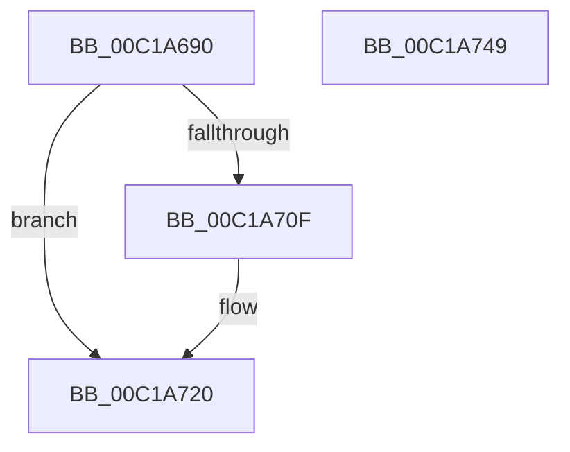

# CmpAppendDllSection

- RVA: `0x00C1A690`–`0x00C1A758` (길이 `200` bytes)
- VA: `0x0000000140C1A690`
- 실행 섹션: `INIT`
- PDB 이름 있음: `예`; PDB Function 태그: `아니요`
- unwind 정보 RVA: `0x000C2F20`
- 디코드: `61`개 명령, `200/200` bytes 표시
- 미해석 바이트: `0` (있으면 어셈블리에 `.byte`로 보존)

> 이 문서는 커널 이미지의 기계어와 PDB 기호를 분석해 생성했습니다. 4번과 5번은 함수 원형과 자료형을 바이너리 사용 방식에서 추정한 C 해석이며 원본 소스 복구 결과는 아닙니다.

## 1. Dependencies

- 직접 호출 지점: **1**; 고유 호출 대상: **1**
- 직접 호출자로 확인된 함수: **0**
- RIP 상대 이미지 참조: **0**

### Outgoing calls
- `0x00C1A72D` → `indirect target` (indirect, 간접 대상)

### Direct callers
- 이 함수 시작 RVA로 연결되는 직접 call은 확인되지 않았습니다. 간접 호출은 완전히 역산할 수 없습니다.

### Static image references
- 디코드된 RIP-relative 메모리 참조가 없습니다.

## 2. Other-region calls and transfers

- 다른 실행 섹션으로 향하는 call: **0**
- 별도 외부 분기/꼬리 이동을 확인하지 못했습니다.

## 3. Assembly (complete function range)

```asm
00C1A690  2E 48 31 11                     xor qword ptr cs:[rcx], rdx
00C1A694  48 31 51 08                     xor qword ptr [rcx + 8], rdx
00C1A698  48 31 51 10                     xor qword ptr [rcx + 0x10], rdx
00C1A69C  48 31 51 18                     xor qword ptr [rcx + 0x18], rdx
00C1A6A0  48 31 51 20                     xor qword ptr [rcx + 0x20], rdx
00C1A6A4  48 31 51 28                     xor qword ptr [rcx + 0x28], rdx
00C1A6A8  48 31 51 30                     xor qword ptr [rcx + 0x30], rdx
00C1A6AC  48 31 51 38                     xor qword ptr [rcx + 0x38], rdx
00C1A6B0  48 31 51 40                     xor qword ptr [rcx + 0x40], rdx
00C1A6B4  48 31 51 48                     xor qword ptr [rcx + 0x48], rdx
00C1A6B8  48 31 51 50                     xor qword ptr [rcx + 0x50], rdx
00C1A6BC  48 31 51 58                     xor qword ptr [rcx + 0x58], rdx
00C1A6C0  48 31 51 60                     xor qword ptr [rcx + 0x60], rdx
00C1A6C4  48 31 51 68                     xor qword ptr [rcx + 0x68], rdx
00C1A6C8  48 31 51 70                     xor qword ptr [rcx + 0x70], rdx
00C1A6CC  48 31 51 78                     xor qword ptr [rcx + 0x78], rdx
00C1A6D0  48 83 C1 78                     add rcx, 0x78
00C1A6D4  48 31 51 08                     xor qword ptr [rcx + 8], rdx
00C1A6D8  48 31 51 10                     xor qword ptr [rcx + 0x10], rdx
00C1A6DC  48 31 51 18                     xor qword ptr [rcx + 0x18], rdx
00C1A6E0  48 31 51 20                     xor qword ptr [rcx + 0x20], rdx
00C1A6E4  48 31 51 28                     xor qword ptr [rcx + 0x28], rdx
00C1A6E8  48 31 51 30                     xor qword ptr [rcx + 0x30], rdx
00C1A6EC  48 31 51 38                     xor qword ptr [rcx + 0x38], rdx
00C1A6F0  48 31 51 40                     xor qword ptr [rcx + 0x40], rdx
00C1A6F4  48 31 51 48                     xor qword ptr [rcx + 0x48], rdx
00C1A6F8  48 83 E9 78                     sub rcx, 0x78
00C1A6FC  31 11                           xor dword ptr [rcx], edx
00C1A6FE  48 8B C2                        mov rax, rdx
00C1A701  48 8B D1                        mov rdx, rcx
00C1A704  8B 8A C4 00 00 00               mov ecx, dword ptr [rdx + 0xc4]
00C1A70A  48 85 C0                        test rax, rax
00C1A70D  74 11                           je 0x140c1a720
00C1A70F  48 31 84 CA C0 00 00 00         xor qword ptr [rdx + rcx*8 + 0xc0], rax
00C1A717  48 D3 C8                        ror rax, cl
00C1A71A  48 0F BB C0                     btc rax, rax
00C1A71E  E2 EF                           loop 0x140c1a70f
00C1A720  8B 82 08 08 00 00               mov eax, dword ptr [rdx + 0x808]
00C1A726  48 03 C2                        add rax, rdx
00C1A729  48 83 EC 28                     sub rsp, 0x28
00C1A72D  FF D0                           call rax
00C1A72F  48 83 C4 28                     add rsp, 0x28
00C1A733  4C 8B 80 20 01 00 00            mov r8, qword ptr [rax + 0x120]
00C1A73A  48 8D 88 B8 07 00 00            lea rcx, [rax + 0x7b8]
00C1A741  BA 01 00 00 00                  mov edx, 1
00C1A746  41 FF E0                        jmp r8
00C1A749  90                              nop
00C1A74A  90                              nop
00C1A74B  90                              nop
00C1A74C  90                              nop
00C1A74D  90                              nop
00C1A74E  90                              nop
00C1A74F  90                              nop
00C1A750  90                              nop
00C1A751  90                              nop
00C1A752  90                              nop
00C1A753  90                              nop
00C1A754  90                              nop
00C1A755  90                              nop
00C1A756  90                              nop
00C1A757  90                              nop
```

## 4. C-style interpretation (structured pseudocode)

```c
__int64 __fastcall CmpAppendDllSection(__int64 a1, __int64 a2)
{
    __int64 result;
    __int64 v_rsp;

    a1 = (a1) + (120);
    a1 = (a1) - (120);
    if (a2 != 0) {
    }
    result = ((unsigned int)(*(unsigned int *)(a1 + 2056))) + (a1);
    v_rsp = (v_rsp) - (40);
    result = kernel_indirect_call((unsigned int)(*(unsigned int *)(a1 + 196)), a1, a3, a4);
    v_rsp = (v_rsp) + (40);
}
```

## 5. (Beta) C Style

```c
int64_t CmpAppendDllSection(void *Arg1, int64_t Arg2)
{
    uint8_t *arg1 = (uint8_t *)Arg1;

    int64_t result;
    int64_t local_rsp;

    Arg1 = (Arg1) + (120);
    Arg1 = (Arg1) - (120);
    if (Arg2 != 0) {
    }
    result = ((uint32_t)(*(uint32_t *)(arg1 + 0x808))) + (Arg1);
    local_rsp = (local_rsp) - (40);
    result = kernel_indirect_call((uint32_t)(*(uint32_t *)(arg1 + 0xC4)), Arg1, a3, a4);
    local_rsp = (local_rsp) + (40);
}
```

### 관측된 메모리 오프셋

구조체 형식이 확인되지 않은 접근은 인자 기준의 오프셋으로만 기록했습니다.

| 기준 인자 | 오프셋 표현 | 폭 (bit) | 접근 |
|---|---:|---:|---|
| `Arg1` | `+ 0x0` | `32` | `R/W` |
| `Arg1` | `+ 0x0` | `64` | `R/W` |
| `Arg1` | `+ 0x8` | `64` | `R/W` |
| `Arg1` | `+ 0x10` | `64` | `R/W` |
| `Arg1` | `+ 0x18` | `64` | `R/W` |
| `Arg1` | `+ 0x20` | `64` | `R/W` |
| `Arg1` | `+ 0x28` | `64` | `R/W` |
| `Arg1` | `+ 0x30` | `64` | `R/W` |
| `Arg1` | `+ 0x38` | `64` | `R/W` |
| `Arg1` | `+ 0x40` | `64` | `R/W` |
| `Arg1` | `+ 0x48` | `64` | `R/W` |
| `Arg1` | `+ 0x50` | `64` | `R/W` |
| `Arg1` | `+ 0x58` | `64` | `R/W` |
| `Arg1` | `+ 0x60` | `64` | `R/W` |
| `Arg1` | `+ 0x68` | `64` | `R/W` |
| `Arg1` | `+ 0x70` | `64` | `R/W` |
| `Arg1` | `+ 0x78` | `64` | `R/W` |
| `Arg1` | `+ 0xC0 + rcx*8` | `64` | `R/W` |
| `Arg1` | `+ 0xC4` | `32` | `R` |
| `Arg1` | `+ 0x808` | `32` | `R` |

## 6. Execution-region graph

[열기: 2D/3D 그래프와 함수 탐색 컨트롤 패널](../../../control-panel.html?section=init&rva=0x00C1A690&view=graph)

- 2D 그래프는 위에서 아래로 흐르고, 3D 그래프는 빈 공간을 드래그해 회전합니다. Shift+드래그는 이동, 휠은 확대·축소, 함수 노드 선택은 대상 보고서 이동입니다.

### Static fallback


