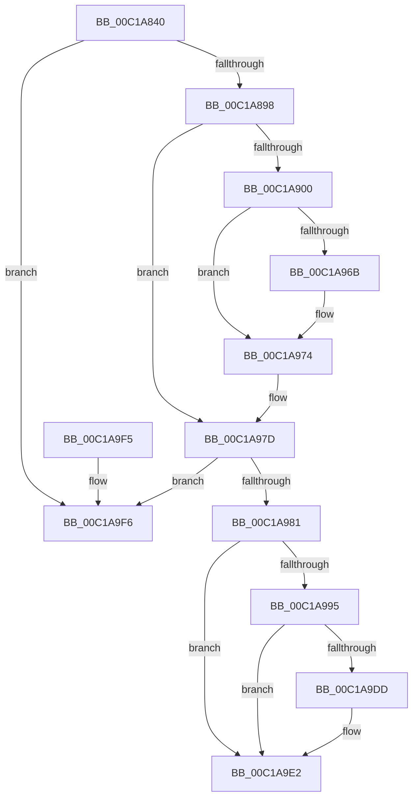

# CreateMiniNtBootKey

- RVA: `0x00C1A840`–`0x00C1AA0F` (길이 `463` bytes)
- VA: `0x0000000140C1A840`
- 실행 섹션: `INIT`
- PDB 이름 있음: `예`; PDB Function 태그: `아니요`
- unwind 정보 RVA: `0x000C3720`
- 디코드: `115`개 명령, `463/463` bytes 표시
- 미해석 바이트: `0` (있으면 어셈블리에 `.byte`로 보존)

> 이 문서는 커널 이미지의 기계어와 PDB 기호를 분석해 생성했습니다. 4번과 5번은 함수 원형과 자료형을 바이너리 사용 방식에서 추정한 C 해석이며 원본 소스 복구 결과는 아닙니다.

## 1. Dependencies

- 직접 호출 지점: **13**; 고유 호출 대상: **11**
- 직접 호출자로 확인된 함수: **1**
- RIP 상대 이미지 참조: **5**

### Outgoing calls
- `0x00C1A887` → [ExAllocatePool2](../../poolcode/B8/ExAllocatePool2_function_00B820F0.md) (function, `0x00B820F0`)
- `0x00C1A8AE` → [swprintf_s](../../text/50/swprintf_s_function_00504B20.md) (function, `0x00504B20`)
- `0x00C1A8C1` → [RtlInitUnicodeString](../../text/42/RtlInitUnicodeString_function_0042A780.md) (function, `0x0042A780`)
- `0x00C1A8F5` → [ZwOpenKey](../../text/6A/ZwOpenKey_function_006AD310.md) (function, `0x006AD310`)
- `0x00C1A90F` → [RtlInitUnicodeString](../../text/42/RtlInitUnicodeString_function_0042A780.md) (function, `0x0042A780`)
- `0x00C1A960` → [ZwCreateKey](../../text/6A/ZwCreateKey_function_006AD470.md) (function, `0x006AD470`)
- `0x00C1A96F` → [ZwClose](../../text/6A/ZwClose_function_006AD2B0.md) (function, `0x006AD2B0`)
- `0x00C1A978` → [ZwClose](../../text/6A/ZwClose_function_006AD2B0.md) (function, `0x006AD2B0`)
- `0x00C1A986` → [ExFreePoolWithTag](../../poolcode/B8/ExFreePoolWithTag_function_00B82870.md) (function, `0x00B82870`)
- `0x00C1A9AD` → [ExTryToAcquireFastMutex](../../text/44/ExTryToAcquireFastMutex_function_0044C2E0.md) (function, `0x0044C2E0`)
- `0x00C1A9C3` → [KeLeaveGuardedRegion](../../text/2E/KeLeaveGuardedRegion_function_002E2C40.md) (function, `0x002E2C40`)
- `0x00C1A9DD` → [KiRaiseIrqlProcessIrqlFlags](../../text/4F/KiRaiseIrqlProcessIrqlFlags_function_004F56FC.md) (function, `0x004F56FC`)
- `0x00C1AA09` → [KeBugCheckEx](../../text/4F/KeBugCheckEx_function_004FD660.md) (function, `0x004FD660`)

### Direct callers
- [Phase1InitializationDiscard](Phase1InitializationDiscard_function_00C1C728.md) at `0x00C1DA11`

### Static image references
- `0x00C1A898` → RVA `0x00FD9F00` (`PAGEDATA`; read)
- `0x00C1A89F` → RVA `0x00C791E0` (` ?? ::PBOPGDP::`string'`; read)
- `0x00C1A900` → RVA `0x00C79200` (` ?? ::PBOPGDP::`string'`; read)
- `0x00C1A98B` → RVA `0x01008698` (`INITDATA`; read)
- `0x00C1A9D5` → RVA `0x00FC6D20` (`ALMOSTRO`; read)

## 2. Other-region calls and transfers

- 다른 실행 섹션으로 향하는 call: **13**
  - `0x00C1A887` → [ExAllocatePool2](../../poolcode/B8/ExAllocatePool2_function_00B820F0.md) (`INIT` → `POOLCODE`)
  - `0x00C1A8AE` → [swprintf_s](../../text/50/swprintf_s_function_00504B20.md) (`INIT` → `.text`)
  - `0x00C1A8C1` → [RtlInitUnicodeString](../../text/42/RtlInitUnicodeString_function_0042A780.md) (`INIT` → `.text`)
  - `0x00C1A8F5` → [ZwOpenKey](../../text/6A/ZwOpenKey_function_006AD310.md) (`INIT` → `.text`)
  - `0x00C1A90F` → [RtlInitUnicodeString](../../text/42/RtlInitUnicodeString_function_0042A780.md) (`INIT` → `.text`)
  - `0x00C1A960` → [ZwCreateKey](../../text/6A/ZwCreateKey_function_006AD470.md) (`INIT` → `.text`)
  - `0x00C1A96F` → [ZwClose](../../text/6A/ZwClose_function_006AD2B0.md) (`INIT` → `.text`)
  - `0x00C1A978` → [ZwClose](../../text/6A/ZwClose_function_006AD2B0.md) (`INIT` → `.text`)
  - `0x00C1A986` → [ExFreePoolWithTag](../../poolcode/B8/ExFreePoolWithTag_function_00B82870.md) (`INIT` → `POOLCODE`)
  - `0x00C1A9AD` → [ExTryToAcquireFastMutex](../../text/44/ExTryToAcquireFastMutex_function_0044C2E0.md) (`INIT` → `.text`)
  - `0x00C1A9C3` → [KeLeaveGuardedRegion](../../text/2E/KeLeaveGuardedRegion_function_002E2C40.md) (`INIT` → `.text`)
  - `0x00C1A9DD` → [KiRaiseIrqlProcessIrqlFlags](../../text/4F/KiRaiseIrqlProcessIrqlFlags_function_004F56FC.md) (`INIT` → `.text`)
  - `0x00C1AA09` → [KeBugCheckEx](../../text/4F/KeBugCheckEx_function_004FD660.md) (`INIT` → `.text`)
- 별도 외부 분기/꼬리 이동을 확인하지 못했습니다.

## 3. Assembly (complete function range)

```asm
00C1A840  48 89 5C 24 20                  mov qword ptr [rsp + 0x20], rbx
00C1A845  55                              push rbp
00C1A846  56                              push rsi
00C1A847  57                              push rdi
00C1A848  48 8D 6C 24 B9                  lea rbp, [rsp - 0x47]
00C1A84D  48 81 EC C0 00 00 00            sub rsp, 0xc0
00C1A854  0F 57 C0                        xorps xmm0, xmm0
00C1A857  33 F6                           xor esi, esi
00C1A859  33 C0                           xor eax, eax
00C1A85B  89 75 67                        mov dword ptr [rbp + 0x67], esi
00C1A85E  BA 00 02 00 00                  mov edx, 0x200
00C1A863  48 89 75 6F                     mov qword ptr [rbp + 0x6f], rsi
00C1A867  B9 00 01 00 00                  mov ecx, 0x100
00C1A86C  48 89 45 F7                     mov qword ptr [rbp - 9], rax
00C1A870  41 B8 49 6E 69 74               mov r8d, 0x74696e49
00C1A876  89 45 FF                        mov dword ptr [rbp - 1], eax
00C1A879  0F 11 45 D7                     movups xmmword ptr [rbp - 0x29], xmm0
00C1A87D  8B DE                           mov ebx, esi
00C1A87F  0F 11 45 E7                     movups xmmword ptr [rbp - 0x19], xmm0
00C1A883  0F 11 45 C7                     movups xmmword ptr [rbp - 0x39], xmm0
00C1A887  E8 64 78 F6 FF                  call 0x140b820f0
00C1A88C  48 8B F8                        mov rdi, rax
00C1A88F  48 85 C0                        test rax, rax
00C1A892  0F 84 5E 01 00 00               je 0x140c1a9f6
00C1A898  4C 8B 0D 61 F6 3B 00            mov r9, qword ptr [rip + 0x3bf661]
00C1A89F  4C 8D 05 3A E9 05 00            lea r8, [rip + 0x5e93a]
00C1A8A6  BA 00 01 00 00                  mov edx, 0x100
00C1A8AB  48 8B C8                        mov rcx, rax
00C1A8AE  E8 6D A2 8E FF                  call 0x140504b20
00C1A8B3  48 8B D7                        mov rdx, rdi
00C1A8B6  66 89 B7 FE 01 00 00            mov word ptr [rdi + 0x1fe], si
00C1A8BD  48 8D 4D C7                     lea rcx, [rbp - 0x39]
00C1A8C1  E8 BA FE 80 FF                  call 0x14042a780
00C1A8C6  48 8D 45 C7                     lea rax, [rbp - 0x39]
00C1A8CA  C7 45 D7 30 00 00 00            mov dword ptr [rbp - 0x29], 0x30
00C1A8D1  0F 57 C0                        xorps xmm0, xmm0
00C1A8D4  48 89 45 E7                     mov qword ptr [rbp - 0x19], rax
00C1A8D8  4C 8D 45 D7                     lea r8, [rbp - 0x29]
00C1A8DC  48 89 75 DF                     mov qword ptr [rbp - 0x21], rsi
00C1A8E0  BA 3F 00 0F 00                  mov edx, 0xf003f
00C1A8E5  C7 45 EF 40 00 00 00            mov dword ptr [rbp - 0x11], 0x40
00C1A8EC  48 8D 4D 6F                     lea rcx, [rbp + 0x6f]
00C1A8F0  F3 0F 7F 45 F7                  movdqu xmmword ptr [rbp - 9], xmm0
00C1A8F5  E8 16 2A A9 FF                  call 0x1406ad310
00C1A8FA  8B D8                           mov ebx, eax
00C1A8FC  85 C0                           test eax, eax
00C1A8FE  78 7D                           js 0x140c1a97d
00C1A900  48 8D 15 F9 E8 05 00            lea rdx, [rip + 0x5e8f9]
00C1A907  48 89 75 77                     mov qword ptr [rbp + 0x77], rsi
00C1A90B  48 8D 4D C7                     lea rcx, [rbp - 0x39]
00C1A90F  E8 6C FE 80 FF                  call 0x14042a780
00C1A914  48 8B 45 6F                     mov rax, qword ptr [rbp + 0x6f]
00C1A918  4C 8D 45 D7                     lea r8, [rbp - 0x29]
00C1A91C  48 89 45 DF                     mov qword ptr [rbp - 0x21], rax
00C1A920  48 8D 4D 77                     lea rcx, [rbp + 0x77]
00C1A924  48 8D 45 C7                     lea rax, [rbp - 0x39]
00C1A928  C7 45 D7 30 00 00 00            mov dword ptr [rbp - 0x29], 0x30
00C1A92F  48 89 45 E7                     mov qword ptr [rbp - 0x19], rax
00C1A933  0F 57 C0                        xorps xmm0, xmm0
00C1A936  48 8D 45 67                     lea rax, [rbp + 0x67]
00C1A93A  C7 45 EF 40 00 00 00            mov dword ptr [rbp - 0x11], 0x40
00C1A941  48 89 44 24 30                  mov qword ptr [rsp + 0x30], rax
00C1A946  45 33 C9                        xor r9d, r9d
00C1A949  C7 44 24 28 01 00 00 00         mov dword ptr [rsp + 0x28], 1
00C1A951  BA 3F 00 0F 00                  mov edx, 0xf003f
00C1A956  48 89 74 24 20                  mov qword ptr [rsp + 0x20], rsi
00C1A95B  F3 0F 7F 45 F7                  movdqu xmmword ptr [rbp - 9], xmm0
00C1A960  E8 0B 2B A9 FF                  call 0x1406ad470
00C1A965  8B D8                           mov ebx, eax
00C1A967  85 C0                           test eax, eax
00C1A969  78 09                           js 0x140c1a974
00C1A96B  48 8B 4D 77                     mov rcx, qword ptr [rbp + 0x77]
00C1A96F  E8 3C 29 A9 FF                  call 0x1406ad2b0
00C1A974  48 8B 4D 6F                     mov rcx, qword ptr [rbp + 0x6f]
00C1A978  E8 33 29 A9 FF                  call 0x1406ad2b0
00C1A97D  85 DB                           test ebx, ebx
00C1A97F  78 75                           js 0x140c1a9f6
00C1A981  33 D2                           xor edx, edx
00C1A983  48 8B CF                        mov rcx, rdi
00C1A986  E8 E5 7E F6 FF                  call 0x140b82870
00C1A98B  8A 05 07 DD 3E 00               mov al, byte ptr [rip + 0x3edd07]
00C1A991  3C 01                           cmp al, 1
00C1A993  75 4D                           jne 0x140c1a9e2
00C1A995  0F 57 C0                        xorps xmm0, xmm0
00C1A998  48 8D 4D 07                     lea rcx, [rbp + 7]
00C1A99C  33 C0                           xor eax, eax
00C1A99E  0F 11 45 07                     movups xmmword ptr [rbp + 7], xmm0
00C1A9A2  89 45 37                        mov dword ptr [rbp + 0x37], eax
00C1A9A5  0F 11 45 17                     movups xmmword ptr [rbp + 0x17], xmm0
00C1A9A9  0F 11 45 27                     movups xmmword ptr [rbp + 0x27], xmm0
00C1A9AD  E8 2E 19 83 FF                  call 0x14044c2e0
00C1A9B2  65 48 8B 04 25 88 01 00 00      mov rax, qword ptr gs:[0x188]
00C1A9BB  66 FF 88 E6 01 00 00            dec word ptr [rax + 0x1e6]
00C1A9C2  90                              nop
00C1A9C3  E8 78 82 6C FF                  call 0x1402e2c40
00C1A9C8  44 0F 20 C1                     mov rcx, cr8
00C1A9CC  BA 02 00 00 00                  mov edx, 2
00C1A9D1  44 0F 22 C2                     mov cr8, rdx
00C1A9D5  39 35 45 C3 3A 00               cmp dword ptr [rip + 0x3ac345], esi
00C1A9DB  74 05                           je 0x140c1a9e2
00C1A9DD  E8 1A AD 8D FF                  call 0x1404f56fc
00C1A9E2  48 8B 9C 24 F8 00 00 00         mov rbx, qword ptr [rsp + 0xf8]
00C1A9EA  48 81 C4 C0 00 00 00            add rsp, 0xc0
00C1A9F1  5F                              pop rdi
00C1A9F2  5E                              pop rsi
00C1A9F3  5D                              pop rbp
00C1A9F4  C3                              ret
00C1A9F5  CC                              int3
00C1A9F6  45 33 C9                        xor r9d, r9d
00C1A9F9  48 63 D3                        movsxd rdx, ebx
00C1A9FC  48 89 74 24 20                  mov qword ptr [rsp + 0x20], rsi
00C1AA01  41 8D 49 32                     lea ecx, [r9 + 0x32]
00C1AA05  45 8D 41 06                     lea r8d, [r9 + 6]
00C1AA09  E8 52 2C 8E FF                  call 0x1404fd660
00C1AA0E  CC                              int3
```

## 4. C-style interpretation (structured pseudocode)

```c
__int64 __fastcall CreateMiniNtBootKey(void)
{
    __int64 result;
    __int64 v_rsi;
    __int64 v_rsp;
    unsigned int v_stack_m28;
    unsigned __int64 v_stack_m38;
    unsigned __int64 v_stack_m48;
    unsigned __int64 v_stack_m58;
    unsigned __int64 v_stack_m5F;
    unsigned int v_stack_m60;
    unsigned __int64 v_stack_m68;
    unsigned int v_stack_m70;
    unsigned __int64 v_stack_m78;
    unsigned __int64 v_stack_m80;
    unsigned __int64 v_stack_m88;
    unsigned __int64 v_stack_m98;
    unsigned __int64 v_stack_mA8;
    unsigned int v_stack_mB0;
    unsigned __int64 v_stack_mB8;
    unsigned __int64 v_stack_p10;
    unsigned __int64 v_stack_p18;
    unsigned __int64 v_stack_p20;
    unsigned int v_stack_p8;

    v_stack_p20 = v_rbx;
    v_rsp = (v_rsp) - (192);
    v_rsi = 0;
    result = 0;
    v_stack_p8 = 0;
    v_stack_p10 = 0;
    v_stack_m68 = 0;
    v_stack_m60 = 0;
    v_stack_m88 = v_xmm0;
    v_stack_m78 = v_xmm0;
    v_stack_m98 = v_xmm0;
    result = ExAllocatePool2(256, 512, (unsigned int)(0x74696E49ULL), a4);
    if (result == 0) goto loc_00C1A9F6;
    result = swprintf_s(result, 256, v_rip + 387386, *(unsigned __int64 *)(v_rip + 3929697));
    *(unsigned __int16 *)(result + 510) = 0;
    result = RtlInitUnicodeString(v_stack_m98, result, v_rip + 387386, *(unsigned __int64 *)(v_rip + 3929697));
    v_stack_m88 = 48;
    v_stack_m78 = v_stack_m98;
    v_stack_m80 = 0;
    v_stack_m70 = 64;
    v_stack_m68 = v_xmm0;
    result = ZwOpenKey(v_stack_p10, (unsigned int)(0xF003FULL), v_stack_m88, *(unsigned __int64 *)(v_rip + 3929697));
    if (sign_flag) goto loc_00C1A97D;
    v_stack_p18 = 0;
    result = RtlInitUnicodeString(v_stack_m98, v_rip + 387321, v_stack_m88, *(unsigned __int64 *)(v_rip + 3929697));
    v_stack_m80 = v_stack_p10;
    v_stack_m88 = 48;
    v_stack_m78 = v_stack_m98;
    v_stack_m70 = 64;
    v_stack_mA8 = v_stack_p8;
    a4 = 0;
    v_stack_mB0 = 1;
    v_stack_mB8 = 0;
    v_stack_m68 = v_xmm0;
    result = ZwCreateKey(v_stack_p18, (unsigned int)(0xF003FULL), v_stack_m88, a4);
    if (!(sign_flag)) {
        a1 = v_stack_p18;
        result = ZwClose(a1, (unsigned int)(0xF003FULL), v_stack_m88, a4);
    }
    result = ZwClose(v_stack_p10, (unsigned int)(0xF003FULL), v_stack_m88, a4);
loc_00C1A97D:
    if (sign_flag) goto loc_00C1A9F6;
    a2 = 0;
    result = ExFreePoolWithTag(result, a2, v_stack_m88, a4);
    if (((unsigned __int8)(*(unsigned __int8 *)(v_rip + 4119815))) != 1) goto loc_00C1A9E2;
    result = 0;
    v_stack_m58 = v_xmm0;
    v_stack_m28 = 0;
    v_stack_m48 = v_xmm0;
    v_stack_m38 = v_xmm0;
    result = ExTryToAcquireFastMutex(v_stack_m58, a2, v_stack_m88, a4);
    result = KeLeaveGuardedRegion(v_stack_m58, a2, v_stack_m88, a4);
    if ((*(unsigned int *)(v_rip + 3851077)) != 0) {
        result = KiRaiseIrqlProcessIrqlFlags(v_cr8, 2, v_stack_m88, a4);
    }
    v_rsp = (v_rsp) + (192);
    return result;
loc_00C1A9F6:
    a4 = 0;
    v_stack_p20 = 0;
    result = KeBugCheckEx(a4 + 50, (int)((unsigned int)(v_stack_p20)), a4 + 6, a4);
    return result;
}
```

## 5. (Beta) C Style

```c
void CreateMiniNtBootKey(void)
{
    int64_t result;
    int64_t local_rsi;
    int64_t local_rsp;
    uint32_t v_stack_m28;
    uint64_t v_stack_m38;
    uint64_t v_stack_m48;
    uint64_t v_stack_m58;
    uint64_t v_stack_m5F;
    uint32_t v_stack_m60;
    uint64_t v_stack_m68;
    uint32_t v_stack_m70;
    uint64_t v_stack_m78;
    uint64_t v_stack_m80;
    uint64_t v_stack_m88;
    uint64_t v_stack_m98;
    uint64_t v_stack_mA8;
    uint32_t v_stack_mB0;
    uint64_t v_stack_mB8;
    uint64_t v_stack_p10;
    uint64_t v_stack_p18;
    uint64_t v_stack_p20;
    uint32_t v_stack_p8;

    v_stack_p20 = local_rbx;
    local_rsp = (local_rsp) - (192);
    local_rsi = 0;
    result = 0;
    v_stack_p8 = 0;
    v_stack_p10 = 0;
    v_stack_m68 = 0;
    v_stack_m60 = 0;
    v_stack_m88 = v_xmm0;
    v_stack_m78 = v_xmm0;
    v_stack_m98 = v_xmm0;
    result = ExAllocatePool2(256, 512, (uint32_t)(0x74696E49ULL), a4);
    if (result == 0) goto loc_00C1A9F6;
    result = swprintf_s(result, 256, v_rip + 387386, *(uint64_t *)(v_rip + 0x3BF661));
    *(uint16_t *)(result + 0x1FE) = 0;
    result = RtlInitUnicodeString(v_stack_m98, result, v_rip + 387386, *(uint64_t *)(v_rip + 0x3BF661));
    v_stack_m88 = 48;
    v_stack_m78 = v_stack_m98;
    v_stack_m80 = 0;
    v_stack_m70 = 64;
    v_stack_m68 = v_xmm0;
    result = ZwOpenKey(v_stack_p10, (uint32_t)(0xF003FULL), v_stack_m88, *(uint64_t *)(v_rip + 0x3BF661));
    if (sign_flag) goto loc_00C1A97D;
    v_stack_p18 = 0;
    result = RtlInitUnicodeString(v_stack_m98, v_rip + 387321, v_stack_m88, *(uint64_t *)(v_rip + 0x3BF661));
    v_stack_m80 = v_stack_p10;
    v_stack_m88 = 48;
    v_stack_m78 = v_stack_m98;
    v_stack_m70 = 64;
    v_stack_mA8 = v_stack_p8;
    a4 = 0;
    v_stack_mB0 = 1;
    v_stack_mB8 = 0;
    v_stack_m68 = v_xmm0;
    result = ZwCreateKey(v_stack_p18, (uint32_t)(0xF003FULL), v_stack_m88, a4);
    if (!(sign_flag)) {
        a1 = v_stack_p18;
        result = ZwClose(a1, (uint32_t)(0xF003FULL), v_stack_m88, a4);
    }
    result = ZwClose(v_stack_p10, (uint32_t)(0xF003FULL), v_stack_m88, a4);
loc_00C1A97D:
    if (sign_flag) goto loc_00C1A9F6;
    a2 = 0;
    result = ExFreePoolWithTag(result, a2, v_stack_m88, a4);
    if (((uint8_t)(*(uint8_t *)(v_rip + 0x3EDD07))) != 1) goto loc_00C1A9E2;
    result = 0;
    v_stack_m58 = v_xmm0;
    v_stack_m28 = 0;
    v_stack_m48 = v_xmm0;
    v_stack_m38 = v_xmm0;
    result = ExTryToAcquireFastMutex(v_stack_m58, a2, v_stack_m88, a4);
    result = KeLeaveGuardedRegion(v_stack_m58, a2, v_stack_m88, a4);
    if ((*(uint32_t *)(v_rip + 0x3AC345)) != 0) {
        result = KiRaiseIrqlProcessIrqlFlags(v_cr8, 2, v_stack_m88, a4);
    }
    local_rsp = (local_rsp) + (192);
    return result;
loc_00C1A9F6:
    a4 = 0;
    v_stack_p20 = 0;
    result = KeBugCheckEx(a4 + 50, (int32_t)((uint32_t)(v_stack_p20)), a4 + 6, a4);
    return result;
}
```

## 6. Execution-region graph

[열기: 2D/3D 그래프와 함수 탐색 컨트롤 패널](../../../control-panel.html?section=init&rva=0x00C1A840&view=graph)

- 2D 그래프는 위에서 아래로 흐르고, 3D 그래프는 빈 공간을 드래그해 회전합니다. Shift+드래그는 이동, 휠은 확대·축소, 함수 노드 선택은 대상 보고서 이동입니다.

### Static fallback


