# CreateSystemRootLink

- RVA: `0x00C1AA18`–`0x00C1AE79` (길이 `1,121` bytes)
- VA: `0x0000000140C1AA18`
- 실행 섹션: `INIT`
- PDB 이름 있음: `예`; PDB Function 태그: `아니요`
- unwind 정보 RVA: `0x000C36F8`
- 디코드: `259`개 명령, `1,121/1,121` bytes 표시
- 미해석 바이트: `0` (있으면 어셈블리에 `.byte`로 보존)

> 이 문서는 커널 이미지의 기계어와 PDB 기호를 분석해 생성했습니다. 4번과 5번은 함수 원형과 자료형을 바이너리 사용 방식에서 추정한 C 해석이며 원본 소스 복구 결과는 아닙니다.

## 1. Dependencies

- 직접 호출 지점: **35**; 고유 호출 대상: **7**
- 직접 호출자로 확인된 함수: **1**
- RIP 상대 이미지 참조: **10**

### Outgoing calls
- `0x00C1AA8A` → [RtlInitUnicodeString](../../text/42/RtlInitUnicodeString_function_0042A780.md) (function, `0x0042A780`)
- `0x00C1AAC4` → [NtCreateDirectoryObject](../../page/A5/NtCreateDirectoryObject_function_00A561F0.md) (function, `0x00A561F0`)
- `0x00C1AADF` → [KeBugCheckEx](../../text/4F/KeBugCheckEx_function_004FD660.md) (function, `0x004FD660`)
- `0x00C1AAEA` → [NtClose](../../page/86/NtClose_function_00868870.md) (function, `0x00868870`)
- `0x00C1AAFA` → [RtlInitUnicodeString](../../text/42/RtlInitUnicodeString_function_0042A780.md) (function, `0x0042A780`)
- `0x00C1AB36` → [NtCreateDirectoryObject](../../page/A5/NtCreateDirectoryObject_function_00A561F0.md) (function, `0x00A561F0`)
- `0x00C1AB52` → [KeBugCheckEx](../../text/4F/KeBugCheckEx_function_004FD660.md) (function, `0x004FD660`)
- `0x00C1AB5D` → [NtClose](../../page/86/NtClose_function_00868870.md) (function, `0x00868870`)
- `0x00C1AB6D` → [RtlInitUnicodeString](../../text/42/RtlInitUnicodeString_function_0042A780.md) (function, `0x0042A780`)
- `0x00C1ABB5` → [RtlStringCbPrintfW](../../text/40/RtlStringCbPrintfW_function_0040FB40.md) (function, `0x0040FB40`)
- `0x00C1ABD1` → [KeBugCheckEx](../../text/4F/KeBugCheckEx_function_004FD660.md) (function, `0x004FD660`)
- `0x00C1ABE0` → [RtlInitUnicodeString](../../text/42/RtlInitUnicodeString_function_0042A780.md) (function, `0x0042A780`)
- `0x00C1ABF9` → [NtCreateSymbolicLinkObject](../../page/A3/NtCreateSymbolicLinkObject_function_00A33870.md) (function, `0x00A33870`)
- `0x00C1AC15` → [KeBugCheckEx](../../text/4F/KeBugCheckEx_function_004FD660.md) (function, `0x004FD660`)
- `0x00C1AC20` → [NtClose](../../page/86/NtClose_function_00868870.md) (function, `0x00868870`)
- `0x00C1AC30` → [RtlInitUnicodeString](../../text/42/RtlInitUnicodeString_function_0042A780.md) (function, `0x0042A780`)
- `0x00C1AC7E` → [RtlStringCbPrintfW](../../text/40/RtlStringCbPrintfW_function_0040FB40.md) (function, `0x0040FB40`)
- `0x00C1AC9A` → [KeBugCheckEx](../../text/4F/KeBugCheckEx_function_004FD660.md) (function, `0x004FD660`)
- `0x00C1ACA9` → [RtlInitUnicodeString](../../text/42/RtlInitUnicodeString_function_0042A780.md) (function, `0x0042A780`)
- `0x00C1ACCC` → [NtCreateSymbolicLinkObject](../../page/A3/NtCreateSymbolicLinkObject_function_00A33870.md) (function, `0x00A33870`)
- `0x00C1ACE8` → [KeBugCheckEx](../../text/4F/KeBugCheckEx_function_004FD660.md) (function, `0x004FD660`)
- `0x00C1ACF3` → [NtClose](../../page/86/NtClose_function_00868870.md) (function, `0x00868870`)
- `0x00C1AD03` → [RtlInitUnicodeString](../../text/42/RtlInitUnicodeString_function_0042A780.md) (function, `0x0042A780`)
- `0x00C1AD51` → [RtlStringCbPrintfW](../../text/40/RtlStringCbPrintfW_function_0040FB40.md) (function, `0x0040FB40`)
- `0x00C1AD6D` → [KeBugCheckEx](../../text/4F/KeBugCheckEx_function_004FD660.md) (function, `0x004FD660`)
- `0x00C1AD7C` → [RtlInitUnicodeString](../../text/42/RtlInitUnicodeString_function_0042A780.md) (function, `0x0042A780`)
- `0x00C1AD95` → [NtCreateSymbolicLinkObject](../../page/A3/NtCreateSymbolicLinkObject_function_00A33870.md) (function, `0x00A33870`)
- `0x00C1ADB1` → [KeBugCheckEx](../../text/4F/KeBugCheckEx_function_004FD660.md) (function, `0x004FD660`)
- `0x00C1ADBC` → [NtClose](../../page/86/NtClose_function_00868870.md) (function, `0x00868870`)
- `0x00C1ADCC` → [RtlInitUnicodeString](../../text/42/RtlInitUnicodeString_function_0042A780.md) (function, `0x0042A780`)
- `0x00C1AE05` → [RtlInitUnicodeString](../../text/42/RtlInitUnicodeString_function_0042A780.md) (function, `0x0042A780`)
- `0x00C1AE1E` → [NtCreateSymbolicLinkObject](../../page/A3/NtCreateSymbolicLinkObject_function_00A33870.md) (function, `0x00A33870`)
- `0x00C1AE3A` → [KeBugCheckEx](../../text/4F/KeBugCheckEx_function_004FD660.md) (function, `0x004FD660`)
- `0x00C1AE45` → [NtClose](../../page/86/NtClose_function_00868870.md) (function, `0x00868870`)
- `0x00C1AE56` → [_security_check_cookie](../../text/6A/_security_check_cookie_function_006AC640.md) (function, `0x006AC640`)

### Direct callers
- [Phase1InitializationDiscard](Phase1InitializationDiscard_function_00C1C728.md) at `0x00C1D359`

### Static image references
- `0x00C1AA3A` → RVA `0x00E0A740` (`.data`; read)
- `0x00C1AA71` → RVA `0x00C79210` (` ?? ::PBOPGDP::`string'`; read)
- `0x00C1AAA2` → RVA `0x00FD9AA8` (`PAGEDATA`; read)
- `0x00C1AAEF` → RVA `0x00C79230` (` ?? ::PBOPGDP::`string'`; read)
- `0x00C1AB62` → RVA `0x00C79240` (` ?? ::PBOPGDP::`string'`; read)
- `0x00C1AB82` → RVA `0x00C79270` (` ?? ::PBOPGDP::`string'`; read)
- `0x00C1AC25` → RVA `0x00C79290` (` ?? ::PBOPGDP::`string'`; read)
- `0x00C1AC50` → RVA `0x00C792B0` (` ?? ::PBOPGDP::`string'`; read)
- `0x00C1ACF8` → RVA `0x00C792C0` (` ?? ::PBOPGDP::`string'`; read)
- `0x00C1ADC1` → RVA `0x00C792F0` (` ?? ::PBOPGDP::`string'`; read)

## 2. Other-region calls and transfers

- 다른 실행 섹션으로 향하는 call: **35**
  - `0x00C1AA8A` → [RtlInitUnicodeString](../../text/42/RtlInitUnicodeString_function_0042A780.md) (`INIT` → `.text`)
  - `0x00C1AAC4` → [NtCreateDirectoryObject](../../page/A5/NtCreateDirectoryObject_function_00A561F0.md) (`INIT` → `PAGE`)
  - `0x00C1AADF` → [KeBugCheckEx](../../text/4F/KeBugCheckEx_function_004FD660.md) (`INIT` → `.text`)
  - `0x00C1AAEA` → [NtClose](../../page/86/NtClose_function_00868870.md) (`INIT` → `PAGE`)
  - `0x00C1AAFA` → [RtlInitUnicodeString](../../text/42/RtlInitUnicodeString_function_0042A780.md) (`INIT` → `.text`)
  - `0x00C1AB36` → [NtCreateDirectoryObject](../../page/A5/NtCreateDirectoryObject_function_00A561F0.md) (`INIT` → `PAGE`)
  - `0x00C1AB52` → [KeBugCheckEx](../../text/4F/KeBugCheckEx_function_004FD660.md) (`INIT` → `.text`)
  - `0x00C1AB5D` → [NtClose](../../page/86/NtClose_function_00868870.md) (`INIT` → `PAGE`)
  - `0x00C1AB6D` → [RtlInitUnicodeString](../../text/42/RtlInitUnicodeString_function_0042A780.md) (`INIT` → `.text`)
  - `0x00C1ABB5` → [RtlStringCbPrintfW](../../text/40/RtlStringCbPrintfW_function_0040FB40.md) (`INIT` → `.text`)
  - `0x00C1ABD1` → [KeBugCheckEx](../../text/4F/KeBugCheckEx_function_004FD660.md) (`INIT` → `.text`)
  - `0x00C1ABE0` → [RtlInitUnicodeString](../../text/42/RtlInitUnicodeString_function_0042A780.md) (`INIT` → `.text`)
  - `0x00C1ABF9` → [NtCreateSymbolicLinkObject](../../page/A3/NtCreateSymbolicLinkObject_function_00A33870.md) (`INIT` → `PAGE`)
  - `0x00C1AC15` → [KeBugCheckEx](../../text/4F/KeBugCheckEx_function_004FD660.md) (`INIT` → `.text`)
  - `0x00C1AC20` → [NtClose](../../page/86/NtClose_function_00868870.md) (`INIT` → `PAGE`)
  - `0x00C1AC30` → [RtlInitUnicodeString](../../text/42/RtlInitUnicodeString_function_0042A780.md) (`INIT` → `.text`)
  - `0x00C1AC7E` → [RtlStringCbPrintfW](../../text/40/RtlStringCbPrintfW_function_0040FB40.md) (`INIT` → `.text`)
  - `0x00C1AC9A` → [KeBugCheckEx](../../text/4F/KeBugCheckEx_function_004FD660.md) (`INIT` → `.text`)
  - `0x00C1ACA9` → [RtlInitUnicodeString](../../text/42/RtlInitUnicodeString_function_0042A780.md) (`INIT` → `.text`)
  - `0x00C1ACCC` → [NtCreateSymbolicLinkObject](../../page/A3/NtCreateSymbolicLinkObject_function_00A33870.md) (`INIT` → `PAGE`)
  - `0x00C1ACE8` → [KeBugCheckEx](../../text/4F/KeBugCheckEx_function_004FD660.md) (`INIT` → `.text`)
  - `0x00C1ACF3` → [NtClose](../../page/86/NtClose_function_00868870.md) (`INIT` → `PAGE`)
  - `0x00C1AD03` → [RtlInitUnicodeString](../../text/42/RtlInitUnicodeString_function_0042A780.md) (`INIT` → `.text`)
  - `0x00C1AD51` → [RtlStringCbPrintfW](../../text/40/RtlStringCbPrintfW_function_0040FB40.md) (`INIT` → `.text`)
  - `0x00C1AD6D` → [KeBugCheckEx](../../text/4F/KeBugCheckEx_function_004FD660.md) (`INIT` → `.text`)
  - `0x00C1AD7C` → [RtlInitUnicodeString](../../text/42/RtlInitUnicodeString_function_0042A780.md) (`INIT` → `.text`)
  - `0x00C1AD95` → [NtCreateSymbolicLinkObject](../../page/A3/NtCreateSymbolicLinkObject_function_00A33870.md) (`INIT` → `PAGE`)
  - `0x00C1ADB1` → [KeBugCheckEx](../../text/4F/KeBugCheckEx_function_004FD660.md) (`INIT` → `.text`)
  - `0x00C1ADBC` → [NtClose](../../page/86/NtClose_function_00868870.md) (`INIT` → `PAGE`)
  - `0x00C1ADCC` → [RtlInitUnicodeString](../../text/42/RtlInitUnicodeString_function_0042A780.md) (`INIT` → `.text`)
  - `0x00C1AE05` → [RtlInitUnicodeString](../../text/42/RtlInitUnicodeString_function_0042A780.md) (`INIT` → `.text`)
  - `0x00C1AE1E` → [NtCreateSymbolicLinkObject](../../page/A3/NtCreateSymbolicLinkObject_function_00A33870.md) (`INIT` → `PAGE`)
  - `0x00C1AE3A` → [KeBugCheckEx](../../text/4F/KeBugCheckEx_function_004FD660.md) (`INIT` → `.text`)
  - `0x00C1AE45` → [NtClose](../../page/86/NtClose_function_00868870.md) (`INIT` → `PAGE`)
  - `0x00C1AE56` → [_security_check_cookie](../../text/6A/_security_check_cookie_function_006AC640.md) (`INIT` → `.text`)
- 별도 외부 분기/꼬리 이동을 확인하지 못했습니다.

## 3. Assembly (complete function range)

```asm
00C1AA18  48 8B C4                        mov rax, rsp
00C1AA1B  48 89 58 10                     mov qword ptr [rax + 0x10], rbx
00C1AA1F  48 89 70 18                     mov qword ptr [rax + 0x18], rsi
00C1AA23  48 89 78 20                     mov qword ptr [rax + 0x20], rdi
00C1AA27  55                              push rbp
00C1AA28  41 54                           push r12
00C1AA2A  41 56                           push r14
00C1AA2C  48 8D A8 38 FE FF FF            lea rbp, [rax - 0x1c8]
00C1AA33  48 81 EC B0 02 00 00            sub rsp, 0x2b0
00C1AA3A  48 8B 05 FF FC 1E 00            mov rax, qword ptr [rip + 0x1efcff]
00C1AA41  48 33 C4                        xor rax, rsp
00C1AA44  48 89 85 A0 01 00 00            mov qword ptr [rbp + 0x1a0], rax
00C1AA4B  0F 57 C0                        xorps xmm0, xmm0
00C1AA4E  48 C7 44 24 38 30 00 00 00      mov qword ptr [rsp + 0x38], 0x30
00C1AA57  48 8B D9                        mov rbx, rcx
00C1AA5A  48 C7 44 24 50 50 00 00 00      mov qword ptr [rsp + 0x50], 0x50
00C1AA63  33 FF                           xor edi, edi
00C1AA65  48 8D 4D 90                     lea rcx, [rbp - 0x70]
00C1AA69  0F 57 C9                        xorps xmm1, xmm1
00C1AA6C  48 89 7C 24 78                  mov qword ptr [rsp + 0x78], rdi
00C1AA71  48 8D 15 98 E7 05 00            lea rdx, [rip + 0x5e798]
00C1AA78  48 89 7C 24 30                  mov qword ptr [rsp + 0x30], rdi
00C1AA7D  0F 11 45 90                     movups xmmword ptr [rbp - 0x70], xmm0
00C1AA81  0F 11 45 80                     movups xmmword ptr [rbp - 0x80], xmm0
00C1AA85  0F 11 4C 24 68                  movups xmmword ptr [rsp + 0x68], xmm1
00C1AA8A  E8 F1 FC 80 FF                  call 0x14042a780
00C1AA8F  48 8D 45 90                     lea rax, [rbp - 0x70]
00C1AA93  48 89 7C 24 40                  mov qword ptr [rsp + 0x40], rdi
00C1AA98  48 89 44 24 48                  mov qword ptr [rsp + 0x48], rax
00C1AA9D  4C 8D 44 24 38                  lea r8, [rsp + 0x38]
00C1AAA2  48 8B 05 FF EF 3B 00            mov rax, qword ptr [rip + 0x3befff]
00C1AAA9  48 8D 4C 24 78                  lea rcx, [rsp + 0x78]
00C1AAAE  BA 0F 00 0F 00                  mov edx, 0xf000f
00C1AAB3  48 89 44 24 58                  mov qword ptr [rsp + 0x58], rax
00C1AAB8  8D 77 30                        lea esi, [rdi + 0x30]
00C1AABB  48 89 7C 24 60                  mov qword ptr [rsp + 0x60], rdi
00C1AAC0  44 8D 77 50                     lea r14d, [rdi + 0x50]
00C1AAC4  E8 27 B7 E3 FF                  call 0x140a561f0
00C1AAC9  85 C0                           test eax, eax
00C1AACB  79 18                           jns 0x140c1aae5
00C1AACD  48 63 D0                        movsxd rdx, eax
00C1AAD0  8D 4F 64                        lea ecx, [rdi + 0x64]
00C1AAD3  45 33 C9                        xor r9d, r9d
00C1AAD6  48 89 7C 24 20                  mov qword ptr [rsp + 0x20], rdi
00C1AADB  44 8D 47 01                     lea r8d, [rdi + 1]
00C1AADF  E8 7C 2B 8E FF                  call 0x1404fd660
00C1AAE4  CC                              int3
00C1AAE5  48 8B 4C 24 78                  mov rcx, qword ptr [rsp + 0x78]
00C1AAEA  E8 81 DD C4 FF                  call 0x140868870
00C1AAEF  48 8D 15 3A E7 05 00            lea rdx, [rip + 0x5e73a]
00C1AAF6  48 8D 4D 90                     lea rcx, [rbp - 0x70]
00C1AAFA  E8 81 FC 80 FF                  call 0x14042a780
00C1AAFF  48 8D 45 90                     lea rax, [rbp - 0x70]
00C1AB03  89 74 24 38                     mov dword ptr [rsp + 0x38], esi
00C1AB07  48 89 44 24 48                  mov qword ptr [rsp + 0x48], rax
00C1AB0C  4C 8D 44 24 38                  lea r8, [rsp + 0x38]
00C1AB11  48 8B 05 90 EF 3B 00            mov rax, qword ptr [rip + 0x3bef90]
00C1AB18  48 8D 4C 24 78                  lea rcx, [rsp + 0x78]
00C1AB1D  BA 0F 00 0F 00                  mov edx, 0xf000f
00C1AB22  48 89 44 24 58                  mov qword ptr [rsp + 0x58], rax
00C1AB27  48 89 7C 24 40                  mov qword ptr [rsp + 0x40], rdi
00C1AB2C  44 89 74 24 50                  mov dword ptr [rsp + 0x50], r14d
00C1AB31  48 89 7C 24 60                  mov qword ptr [rsp + 0x60], rdi
00C1AB36  E8 B5 B6 E3 FF                  call 0x140a561f0
00C1AB3B  85 C0                           test eax, eax
00C1AB3D  79 19                           jns 0x140c1ab58
00C1AB3F  45 33 C9                        xor r9d, r9d
00C1AB42  48 63 D0                        movsxd rdx, eax
00C1AB45  48 89 7C 24 20                  mov qword ptr [rsp + 0x20], rdi
00C1AB4A  41 8D 49 64                     lea ecx, [r9 + 0x64]
00C1AB4E  45 8D 41 02                     lea r8d, [r9 + 2]
00C1AB52  E8 09 2B 8E FF                  call 0x1404fd660
00C1AB57  CC                              int3
00C1AB58  48 8B 4C 24 78                  mov rcx, qword ptr [rsp + 0x78]
00C1AB5D  E8 0E DD C4 FF                  call 0x140868870
00C1AB62  48 8D 15 D7 E6 05 00            lea rdx, [rip + 0x5e6d7]
00C1AB69  48 8D 4D 80                     lea rcx, [rbp - 0x80]
00C1AB6D  E8 0E FC 80 FF                  call 0x14042a780
00C1AB72  4C 8B 8B B8 00 00 00            mov r9, qword ptr [rbx + 0xb8]
00C1AB79  48 8D 45 80                     lea rax, [rbp - 0x80]
00C1AB7D  48 89 44 24 48                  mov qword ptr [rsp + 0x48], rax
00C1AB82  4C 8D 05 E7 E6 05 00            lea r8, [rip + 0x5e6e7]
00C1AB89  48 8B 05 18 EF 3B 00            mov rax, qword ptr [rip + 0x3bef18]
00C1AB90  48 8D 4D A0                     lea rcx, [rbp - 0x60]
00C1AB94  41 BC 00 02 00 00               mov r12d, 0x200
00C1AB9A  48 89 44 24 58                  mov qword ptr [rsp + 0x58], rax
00C1AB9F  41 8B D4                        mov edx, r12d
00C1ABA2  89 74 24 38                     mov dword ptr [rsp + 0x38], esi
00C1ABA6  48 89 7C 24 40                  mov qword ptr [rsp + 0x40], rdi
00C1ABAB  44 89 74 24 50                  mov dword ptr [rsp + 0x50], r14d
00C1ABB0  48 89 7C 24 60                  mov qword ptr [rsp + 0x60], rdi
00C1ABB5  E8 86 4F 7F FF                  call 0x14040fb40
00C1ABBA  85 C0                           test eax, eax
00C1ABBC  79 19                           jns 0x140c1abd7
00C1ABBE  45 33 C9                        xor r9d, r9d
00C1ABC1  48 63 D0                        movsxd rdx, eax
00C1ABC4  48 89 7C 24 20                  mov qword ptr [rsp + 0x20], rdi
00C1ABC9  41 8D 49 64                     lea ecx, [r9 + 0x64]
00C1ABCD  45 8D 41 03                     lea r8d, [r9 + 3]
00C1ABD1  E8 8A 2A 8E FF                  call 0x1404fd660
00C1ABD6  CC                              int3
00C1ABD7  48 8D 55 A0                     lea rdx, [rbp - 0x60]
00C1ABDB  48 8D 4C 24 68                  lea rcx, [rsp + 0x68]
00C1ABE0  E8 9B FB 80 FF                  call 0x14042a780
00C1ABE5  4C 8D 4C 24 68                  lea r9, [rsp + 0x68]
00C1ABEA  BA 01 00 0F 00                  mov edx, 0xf0001
00C1ABEF  4C 8D 44 24 38                  lea r8, [rsp + 0x38]
00C1ABF4  48 8D 4C 24 30                  lea rcx, [rsp + 0x30]
00C1ABF9  E8 72 8C E1 FF                  call 0x140a33870
00C1ABFE  85 C0                           test eax, eax
00C1AC00  79 19                           jns 0x140c1ac1b
00C1AC02  45 33 C9                        xor r9d, r9d
00C1AC05  48 63 D0                        movsxd rdx, eax
00C1AC08  48 89 7C 24 20                  mov qword ptr [rsp + 0x20], rdi
00C1AC0D  41 8D 49 64                     lea ecx, [r9 + 0x64]
00C1AC11  45 8D 41 04                     lea r8d, [r9 + 4]
00C1AC15  E8 46 2A 8E FF                  call 0x1404fd660
00C1AC1A  CC                              int3
00C1AC1B  48 8B 4C 24 30                  mov rcx, qword ptr [rsp + 0x30]
00C1AC20  E8 4B DC C4 FF                  call 0x140868870
00C1AC25  48 8D 15 64 E6 05 00            lea rdx, [rip + 0x5e664]
00C1AC2C  48 8D 4D 80                     lea rcx, [rbp - 0x80]
00C1AC30  E8 4B FB 80 FF                  call 0x14042a780
00C1AC35  48 8D 45 80                     lea rax, [rbp - 0x80]
00C1AC39  89 74 24 38                     mov dword ptr [rsp + 0x38], esi
00C1AC3D  48 89 44 24 48                  mov qword ptr [rsp + 0x48], rax
00C1AC42  4C 8D 0D F7 E5 05 00            lea r9, [rip + 0x5e5f7]
00C1AC49  48 8B 05 58 EE 3B 00            mov rax, qword ptr [rip + 0x3bee58]
00C1AC50  4C 8D 05 59 E6 05 00            lea r8, [rip + 0x5e659]
00C1AC57  48 89 44 24 58                  mov qword ptr [rsp + 0x58], rax
00C1AC5C  48 8D 4D A0                     lea rcx, [rbp - 0x60]
00C1AC60  48 8B 83 C8 00 00 00            mov rax, qword ptr [rbx + 0xc8]
00C1AC67  49 8B D4                        mov rdx, r12
00C1AC6A  48 89 44 24 20                  mov qword ptr [rsp + 0x20], rax
00C1AC6F  48 89 7C 24 40                  mov qword ptr [rsp + 0x40], rdi
00C1AC74  44 89 74 24 50                  mov dword ptr [rsp + 0x50], r14d
00C1AC79  48 89 7C 24 60                  mov qword ptr [rsp + 0x60], rdi
00C1AC7E  E8 BD 4E 7F FF                  call 0x14040fb40
00C1AC83  85 C0                           test eax, eax
00C1AC85  79 19                           jns 0x140c1aca0
00C1AC87  45 33 C9                        xor r9d, r9d
00C1AC8A  48 63 D0                        movsxd rdx, eax
00C1AC8D  48 89 7C 24 20                  mov qword ptr [rsp + 0x20], rdi
00C1AC92  41 8D 49 64                     lea ecx, [r9 + 0x64]
00C1AC96  45 8D 41 05                     lea r8d, [r9 + 5]
00C1AC9A  E8 C1 29 8E FF                  call 0x1404fd660
00C1AC9F  CC                              int3
00C1ACA0  48 8D 55 A0                     lea rdx, [rbp - 0x60]
00C1ACA4  48 8D 4C 24 68                  lea rcx, [rsp + 0x68]
00C1ACA9  E8 D2 FA 80 FF                  call 0x14042a780
00C1ACAE  B8 FE FF 00 00                  mov eax, 0xfffe
00C1ACB3  4C 8D 4C 24 68                  lea r9, [rsp + 0x68]
00C1ACB8  66 01 44 24 68                  add word ptr [rsp + 0x68], ax
00C1ACBD  4C 8D 44 24 38                  lea r8, [rsp + 0x38]
00C1ACC2  BA 01 00 0F 00                  mov edx, 0xf0001
00C1ACC7  48 8D 4C 24 30                  lea rcx, [rsp + 0x30]
00C1ACCC  E8 9F 8B E1 FF                  call 0x140a33870
00C1ACD1  85 C0                           test eax, eax
00C1ACD3  79 19                           jns 0x140c1acee
00C1ACD5  45 33 C9                        xor r9d, r9d
00C1ACD8  48 63 D0                        movsxd rdx, eax
00C1ACDB  48 89 7C 24 20                  mov qword ptr [rsp + 0x20], rdi
00C1ACE0  41 8D 49 64                     lea ecx, [r9 + 0x64]
00C1ACE4  45 8D 41 06                     lea r8d, [r9 + 6]
00C1ACE8  E8 73 29 8E FF                  call 0x1404fd660
00C1ACED  CC                              int3
00C1ACEE  48 8B 4C 24 30                  mov rcx, qword ptr [rsp + 0x30]
00C1ACF3  E8 78 DB C4 FF                  call 0x140868870
00C1ACF8  48 8D 15 C1 E5 05 00            lea rdx, [rip + 0x5e5c1]
00C1ACFF  48 8D 4D 80                     lea rcx, [rbp - 0x80]
00C1AD03  E8 78 FA 80 FF                  call 0x14042a780
00C1AD08  4C 8B 8B 50 01 00 00            mov r9, qword ptr [rbx + 0x150]
00C1AD0F  48 8D 45 80                     lea rax, [rbp - 0x80]
00C1AD13  48 89 44 24 48                  mov qword ptr [rsp + 0x48], rax
00C1AD18  48 8B 05 89 ED 3B 00            mov rax, qword ptr [rip + 0x3bed89]
00C1AD1F  48 89 44 24 58                  mov qword ptr [rsp + 0x58], rax
00C1AD24  89 74 24 38                     mov dword ptr [rsp + 0x38], esi
00C1AD28  48 89 7C 24 40                  mov qword ptr [rsp + 0x40], rdi
00C1AD2D  44 89 74 24 50                  mov dword ptr [rsp + 0x50], r14d
00C1AD32  48 89 7C 24 60                  mov qword ptr [rsp + 0x60], rdi
00C1AD37  4D 85 C9                        test r9, r9
00C1AD3A  75 07                           jne 0x140c1ad43
00C1AD3C  4C 8B 8B B8 00 00 00            mov r9, qword ptr [rbx + 0xb8]
00C1AD43  4C 8D 05 26 E5 05 00            lea r8, [rip + 0x5e526]
00C1AD4A  49 8B D4                        mov rdx, r12
00C1AD4D  48 8D 4D A0                     lea rcx, [rbp - 0x60]
00C1AD51  E8 EA 4D 7F FF                  call 0x14040fb40
00C1AD56  85 C0                           test eax, eax
00C1AD58  79 19                           jns 0x140c1ad73
00C1AD5A  45 33 C9                        xor r9d, r9d
00C1AD5D  48 63 D0                        movsxd rdx, eax
00C1AD60  48 89 7C 24 20                  mov qword ptr [rsp + 0x20], rdi
00C1AD65  41 8D 49 64                     lea ecx, [r9 + 0x64]
00C1AD69  45 8D 41 07                     lea r8d, [r9 + 7]
00C1AD6D  E8 EE 28 8E FF                  call 0x1404fd660
00C1AD72  CC                              int3
00C1AD73  48 8D 55 A0                     lea rdx, [rbp - 0x60]
00C1AD77  48 8D 4C 24 68                  lea rcx, [rsp + 0x68]
00C1AD7C  E8 FF F9 80 FF                  call 0x14042a780
00C1AD81  4C 8D 4C 24 68                  lea r9, [rsp + 0x68]
00C1AD86  BA 01 00 0F 00                  mov edx, 0xf0001
00C1AD8B  4C 8D 44 24 38                  lea r8, [rsp + 0x38]
00C1AD90  48 8D 4C 24 30                  lea rcx, [rsp + 0x30]
00C1AD95  E8 D6 8A E1 FF                  call 0x140a33870
00C1AD9A  85 C0                           test eax, eax
00C1AD9C  79 19                           jns 0x140c1adb7
00C1AD9E  45 33 C9                        xor r9d, r9d
00C1ADA1  48 63 D0                        movsxd rdx, eax
00C1ADA4  48 89 7C 24 20                  mov qword ptr [rsp + 0x20], rdi
00C1ADA9  41 8D 49 64                     lea ecx, [r9 + 0x64]
00C1ADAD  45 8D 41 08                     lea r8d, [r9 + 8]
00C1ADB1  E8 AA 28 8E FF                  call 0x1404fd660
00C1ADB6  CC                              int3
00C1ADB7  48 8B 4C 24 30                  mov rcx, qword ptr [rsp + 0x30]
00C1ADBC  E8 AF DA C4 FF                  call 0x140868870
00C1ADC1  48 8D 15 28 E5 05 00            lea rdx, [rip + 0x5e528]
00C1ADC8  48 8D 4D 80                     lea rcx, [rbp - 0x80]
00C1ADCC  E8 AF F9 80 FF                  call 0x14042a780
00C1ADD1  48 8D 45 80                     lea rax, [rbp - 0x80]
00C1ADD5  89 74 24 38                     mov dword ptr [rsp + 0x38], esi
00C1ADD9  48 89 44 24 48                  mov qword ptr [rsp + 0x48], rax
00C1ADDE  48 8D 15 DB E4 05 00            lea rdx, [rip + 0x5e4db]
00C1ADE5  48 8B 05 BC EC 3B 00            mov rax, qword ptr [rip + 0x3becbc]
00C1ADEC  48 8D 4C 24 68                  lea rcx, [rsp + 0x68]
00C1ADF1  48 89 44 24 58                  mov qword ptr [rsp + 0x58], rax
00C1ADF6  48 89 7C 24 40                  mov qword ptr [rsp + 0x40], rdi
00C1ADFB  44 89 74 24 50                  mov dword ptr [rsp + 0x50], r14d
00C1AE00  48 89 7C 24 60                  mov qword ptr [rsp + 0x60], rdi
00C1AE05  E8 76 F9 80 FF                  call 0x14042a780
00C1AE0A  4C 8D 4C 24 68                  lea r9, [rsp + 0x68]
00C1AE0F  BA 01 00 0F 00                  mov edx, 0xf0001
00C1AE14  4C 8D 44 24 38                  lea r8, [rsp + 0x38]
00C1AE19  48 8D 4C 24 30                  lea rcx, [rsp + 0x30]
00C1AE1E  E8 4D 8A E1 FF                  call 0x140a33870
00C1AE23  85 C0                           test eax, eax
00C1AE25  79 19                           jns 0x140c1ae40
00C1AE27  45 33 C9                        xor r9d, r9d
00C1AE2A  48 63 D0                        movsxd rdx, eax
00C1AE2D  48 89 7C 24 20                  mov qword ptr [rsp + 0x20], rdi
00C1AE32  41 8D 49 64                     lea ecx, [r9 + 0x64]
00C1AE36  45 8D 41 09                     lea r8d, [r9 + 9]
00C1AE3A  E8 21 28 8E FF                  call 0x1404fd660
00C1AE3F  CC                              int3
00C1AE40  48 8B 4C 24 30                  mov rcx, qword ptr [rsp + 0x30]
00C1AE45  E8 26 DA C4 FF                  call 0x140868870
00C1AE4A  33 C0                           xor eax, eax
00C1AE4C  48 8B 8D A0 01 00 00            mov rcx, qword ptr [rbp + 0x1a0]
00C1AE53  48 33 CC                        xor rcx, rsp
00C1AE56  E8 E5 17 A9 FF                  call 0x1406ac640
00C1AE5B  4C 8D 9C 24 B0 02 00 00         lea r11, [rsp + 0x2b0]
00C1AE63  49 8B 5B 28                     mov rbx, qword ptr [r11 + 0x28]
00C1AE67  49 8B 73 30                     mov rsi, qword ptr [r11 + 0x30]
00C1AE6B  49 8B 7B 38                     mov rdi, qword ptr [r11 + 0x38]
00C1AE6F  49 8B E3                        mov rsp, r11
00C1AE72  41 5E                           pop r14
00C1AE74  41 5C                           pop r12
00C1AE76  5D                              pop rbp
00C1AE77  C3                              ret
00C1AE78  CC                              int3
```

## 4. C-style interpretation (structured pseudocode)

```c
__int64 __fastcall CreateSystemRootLink(__int64 a1, __int64 a2, __int64 a3, int a4)
{
    __int64 result;
    __int64 v_rdi;
    __int64 v_rsp;
    unsigned __int64 v_stack_m18;
    unsigned __int64 v_stack_m250;
    unsigned __int64 v_stack_m260;
    unsigned __int64 v_stack_m268;
    unsigned __int64 v_stack_m270;
    unsigned __int64 v_stack_m278;
    unsigned __int64 v_stack_m280;
    unsigned __int64 v_stack_m288;
    unsigned __int64 v_stack_m290;
    unsigned __int64 v_stack_m298;
    unsigned __int64 v_stack_m2A8;

    *(unsigned __int64 *)(v_rsp + 16) = v_rbx;
    *(unsigned __int64 *)(v_rsp + 24) = v_rsi;
    *(unsigned __int64 *)(v_rsp + 32) = v_rdi;
    v_rsp = (v_rsp) - (688);
    result = (*(unsigned __int64 *)(v_rip + 2030847)) ^ (v_rsp);
    *(unsigned __int64 *)(v_rsp - 456 + 416) = result;
    v_stack_m290 = 48;
    v_stack_m278 = 80;
    v_rdi = 0;
    v_stack_m250 = 0;
    v_stack_m298 = 0;
    *(unsigned __int64 *)(v_rsp - 456 - 112) = v_xmm0;
    *(unsigned __int64 *)(v_rsp - 456 - 128) = v_xmm0;
    v_stack_m260 = v_xmm1;
    result = RtlInitUnicodeString(v_rsp - 456 - 112, v_rip + 386968, a3, a4);
    v_stack_m288 = 0;
    v_stack_m280 = v_rsp - 456 - 112;
    v_stack_m270 = *(unsigned __int64 *)(v_rip + 3928063);
    v_stack_m268 = 0;
    result = NtCreateDirectoryObject(v_stack_m250, (unsigned int)(0xF000FULL), v_stack_m290, a4);
    if (sign_flag) {
        a2 = (int)((unsigned int)(result));
        a1 = v_rdi + 100;
        a4 = 0;
        v_stack_m2A8 = 0;
        a3 = v_rdi + 1;
        result = KeBugCheckEx(a1, a2, a3, a4);
    }
    result = NtClose(v_stack_m250, a2, a3, a4);
    result = RtlInitUnicodeString(v_rsp - 456 - 112, v_rip + 386874, a3, a4);
    v_stack_m290 = (unsigned int)(v_rdi + 48);
    v_stack_m280 = v_rsp - 456 - 112;
    v_stack_m270 = *(unsigned __int64 *)(v_rip + 3927952);
    v_stack_m288 = 0;
    v_stack_m278 = (unsigned int)(v_rdi + 80);
    v_stack_m268 = 0;
    result = NtCreateDirectoryObject(v_stack_m250, (unsigned int)(0xF000FULL), v_stack_m290, a4);
    if (sign_flag) {
        a4 = 0;
        a2 = (int)((unsigned int)(result));
        v_stack_m2A8 = 0;
        a1 = a4 + 100;
        a3 = a4 + 2;
        result = KeBugCheckEx(a1, a2, a3, a4);
    }
    result = NtClose(v_stack_m250, a2, a3, a4);
    result = RtlInitUnicodeString(v_rsp - 456 - 128, v_rip + 386775, a3, a4);
    v_stack_m280 = v_rsp - 456 - 128;
    v_stack_m270 = *(unsigned __int64 *)(v_rip + 3927832);
    v_stack_m290 = (unsigned int)(v_rdi + 48);
    v_stack_m288 = 0;
    v_stack_m278 = (unsigned int)(v_rdi + 80);
    v_stack_m268 = 0;
    result = RtlStringCbPrintfW(v_rsp - 456 - 96, 512, v_rip + 386791, *(unsigned __int64 *)(a1 + 184));
    if (sign_flag) {
        a4 = 0;
        a2 = (int)((unsigned int)(result));
        v_stack_m2A8 = 0;
        a1 = a4 + 100;
        a3 = a4 + 3;
        result = KeBugCheckEx(a1, a2, a3, a4);
    }
    result = RtlInitUnicodeString(v_stack_m260, v_rsp - 456 - 96, a3, a4);
    result = NtCreateSymbolicLinkObject(v_stack_m298, (unsigned int)(0xF0001ULL), v_stack_m290, v_stack_m260);
    if (sign_flag) {
        a4 = 0;
        a2 = (int)((unsigned int)(result));
        v_stack_m2A8 = 0;
        a1 = a4 + 100;
        a3 = a4 + 4;
        result = KeBugCheckEx(a1, a2, a3, a4);
    }
    result = NtClose(v_stack_m298, a2, a3, a4);
    result = RtlInitUnicodeString(v_rsp - 456 - 128, v_rip + 386660, a3, a4);
    v_stack_m290 = (unsigned int)(v_rdi + 48);
    v_stack_m280 = v_rsp - 456 - 128;
    v_stack_m270 = *(unsigned __int64 *)(v_rip + 3927640);
    v_stack_m2A8 = *(unsigned __int64 *)(a1 + 200);
    v_stack_m288 = 0;
    v_stack_m278 = (unsigned int)(v_rdi + 80);
    v_stack_m268 = 0;
    result = RtlStringCbPrintfW(v_rsp - 456 - 96, 512, v_rip + 386649, v_rip + 386551);
    if (sign_flag) {
        a4 = 0;
        a2 = (int)((unsigned int)(result));
        v_stack_m2A8 = 0;
        a1 = a4 + 100;
        a3 = a4 + 5;
        result = KeBugCheckEx(a1, a2, a3, a4);
    }
    result = RtlInitUnicodeString(v_stack_m260, v_rsp - 456 - 96, a3, a4);
    result = NtCreateSymbolicLinkObject(v_stack_m298, (unsigned int)(0xF0001ULL), v_stack_m290, v_stack_m260);
    if (sign_flag) {
        a4 = 0;
        a2 = (int)((unsigned int)(result));
        v_stack_m2A8 = 0;
        a1 = a4 + 100;
        a3 = a4 + 6;
        result = KeBugCheckEx(a1, a2, a3, a4);
    }
    result = NtClose(v_stack_m298, a2, a3, a4);
    result = RtlInitUnicodeString(v_rsp - 456 - 128, v_rip + 386497, a3, a4);
    v_stack_m280 = v_rsp - 456 - 128;
    v_stack_m270 = *(unsigned __int64 *)(v_rip + 3927433);
    v_stack_m290 = (unsigned int)(v_rdi + 48);
    v_stack_m288 = 0;
    v_stack_m278 = (unsigned int)(v_rdi + 80);
    v_stack_m268 = 0;
    if (*(unsigned __int64 *)(a1 + 336) == 0) {
        a4 = *(unsigned __int64 *)(a1 + 184);
    }
    result = RtlStringCbPrintfW(v_rsp - 456 - 96, 512, v_rip + 386342, a4);
    if (sign_flag) {
        a4 = 0;
        a2 = (int)((unsigned int)(result));
        v_stack_m2A8 = 0;
        a1 = a4 + 100;
        a3 = a4 + 7;
        result = KeBugCheckEx(a1, a2, a3, a4);
    }
    result = RtlInitUnicodeString(v_stack_m260, v_rsp - 456 - 96, a3, a4);
    result = NtCreateSymbolicLinkObject(v_stack_m298, (unsigned int)(0xF0001ULL), v_stack_m290, v_stack_m260);
    if (sign_flag) {
        a4 = 0;
        a2 = (int)((unsigned int)(result));
        v_stack_m2A8 = 0;
        a1 = a4 + 100;
        a3 = a4 + 8;
        result = KeBugCheckEx(a1, a2, a3, a4);
    }
    result = NtClose(v_stack_m298, a2, a3, a4);
    result = RtlInitUnicodeString(v_rsp - 456 - 128, v_rip + 386344, a3, a4);
    v_stack_m290 = (unsigned int)(v_rdi + 48);
    v_stack_m280 = v_rsp - 456 - 128;
    v_stack_m270 = *(unsigned __int64 *)(v_rip + 3927228);
    v_stack_m288 = 0;
    v_stack_m278 = (unsigned int)(v_rdi + 80);
    v_stack_m268 = 0;
    result = RtlInitUnicodeString(v_stack_m260, v_rip + 386267, a3, a4);
    result = NtCreateSymbolicLinkObject(v_stack_m298, (unsigned int)(0xF0001ULL), v_stack_m290, v_stack_m260);
    if (sign_flag) {
        a4 = 0;
        a2 = (int)((unsigned int)(result));
        v_stack_m2A8 = 0;
        a1 = a4 + 100;
        a3 = a4 + 9;
        result = KeBugCheckEx(a1, a2, a3, a4);
    }
    result = NtClose(v_stack_m298, a2, a3, a4);
    result = 0;
    a1 = (*(unsigned __int64 *)(v_rsp - 456 + 416)) ^ (v_rsp);
    result = _security_check_cookie(a1, a2, a3, a4);
    return result;
}
```

## 5. (Beta) C Style

```c
int64_t CreateSystemRootLink(void *Arg1, int64_t Arg2, int64_t Arg3, int32_t Arg4)
{
    uint8_t *arg1 = (uint8_t *)Arg1;

    int64_t result;
    int64_t local_rdi;
    int64_t local_rsp;
    uint64_t v_stack_m18;
    uint64_t v_stack_m250;
    uint64_t v_stack_m260;
    uint64_t v_stack_m268;
    uint64_t v_stack_m270;
    uint64_t v_stack_m278;
    uint64_t v_stack_m280;
    uint64_t v_stack_m288;
    uint64_t v_stack_m290;
    uint64_t v_stack_m298;
    uint64_t v_stack_m2A8;

    *(uint64_t *)(local_rsp + 0x10) = local_rbx;
    *(uint64_t *)(local_rsp + 0x18) = local_rsi;
    *(uint64_t *)(local_rsp + 0x20) = local_rdi;
    local_rsp = (local_rsp) - (688);
    result = (*(uint64_t *)(v_rip + 0x1EFCFF)) ^ (local_rsp);
    *(uint64_t *)(local_rsp - 0x1C8 + 0x1A0) = result;
    v_stack_m290 = 48;
    v_stack_m278 = 80;
    local_rdi = 0;
    v_stack_m250 = 0;
    v_stack_m298 = 0;
    *(uint64_t *)(local_rsp - 0x1C8 - 0x70) = v_xmm0;
    *(uint64_t *)(local_rsp - 0x1C8 - 0x80) = v_xmm0;
    v_stack_m260 = v_xmm1;
    result = RtlInitUnicodeString(local_rsp - 456 - 112, v_rip + 386968, Arg3, Arg4);
    v_stack_m288 = 0;
    v_stack_m280 = local_rsp - 456 - 112;
    v_stack_m270 = *(uint64_t *)(v_rip + 0x3BEFFF);
    v_stack_m268 = 0;
    result = NtCreateDirectoryObject(v_stack_m250, (uint32_t)(0xF000FULL), v_stack_m290, Arg4);
    if (sign_flag) {
        Arg2 = (int32_t)((uint32_t)(result));
        Arg1 = local_rdi + 100;
        Arg4 = 0;
        v_stack_m2A8 = 0;
        Arg3 = local_rdi + 1;
        result = KeBugCheckEx(Arg1, Arg2, Arg3, Arg4);
    }
    result = NtClose(v_stack_m250, Arg2, Arg3, Arg4);
    result = RtlInitUnicodeString(local_rsp - 456 - 112, v_rip + 386874, Arg3, Arg4);
    v_stack_m290 = (uint32_t)(local_rdi + 48);
    v_stack_m280 = local_rsp - 456 - 112;
    v_stack_m270 = *(uint64_t *)(v_rip + 0x3BEF90);
    v_stack_m288 = 0;
    v_stack_m278 = (uint32_t)(local_rdi + 80);
    v_stack_m268 = 0;
    result = NtCreateDirectoryObject(v_stack_m250, (uint32_t)(0xF000FULL), v_stack_m290, Arg4);
    if (sign_flag) {
        Arg4 = 0;
        Arg2 = (int32_t)((uint32_t)(result));
        v_stack_m2A8 = 0;
        Arg1 = Arg4 + 100;
        Arg3 = Arg4 + 2;
        result = KeBugCheckEx(Arg1, Arg2, Arg3, Arg4);
    }
    result = NtClose(v_stack_m250, Arg2, Arg3, Arg4);
    result = RtlInitUnicodeString(local_rsp - 456 - 128, v_rip + 386775, Arg3, Arg4);
    v_stack_m280 = local_rsp - 456 - 128;
    v_stack_m270 = *(uint64_t *)(v_rip + 0x3BEF18);
    v_stack_m290 = (uint32_t)(local_rdi + 48);
    v_stack_m288 = 0;
    v_stack_m278 = (uint32_t)(local_rdi + 80);
    v_stack_m268 = 0;
    result = RtlStringCbPrintfW(local_rsp - 456 - 96, 512, v_rip + 386791, *(uint64_t *)(arg1 + 0xB8));
    if (sign_flag) {
        Arg4 = 0;
        Arg2 = (int32_t)((uint32_t)(result));
        v_stack_m2A8 = 0;
        Arg1 = Arg4 + 100;
        Arg3 = Arg4 + 3;
        result = KeBugCheckEx(Arg1, Arg2, Arg3, Arg4);
    }
    result = RtlInitUnicodeString(v_stack_m260, local_rsp - 456 - 96, Arg3, Arg4);
    result = NtCreateSymbolicLinkObject(v_stack_m298, (uint32_t)(0xF0001ULL), v_stack_m290, v_stack_m260);
    if (sign_flag) {
        Arg4 = 0;
        Arg2 = (int32_t)((uint32_t)(result));
        v_stack_m2A8 = 0;
        Arg1 = Arg4 + 100;
        Arg3 = Arg4 + 4;
        result = KeBugCheckEx(Arg1, Arg2, Arg3, Arg4);
    }
    result = NtClose(v_stack_m298, Arg2, Arg3, Arg4);
    result = RtlInitUnicodeString(local_rsp - 456 - 128, v_rip + 386660, Arg3, Arg4);
    v_stack_m290 = (uint32_t)(local_rdi + 48);
    v_stack_m280 = local_rsp - 456 - 128;
    v_stack_m270 = *(uint64_t *)(v_rip + 0x3BEE58);
    v_stack_m2A8 = *(uint64_t *)(arg1 + 0xC8);
    v_stack_m288 = 0;
    v_stack_m278 = (uint32_t)(local_rdi + 80);
    v_stack_m268 = 0;
    result = RtlStringCbPrintfW(local_rsp - 456 - 96, 512, v_rip + 386649, v_rip + 386551);
    if (sign_flag) {
        Arg4 = 0;
        Arg2 = (int32_t)((uint32_t)(result));
        v_stack_m2A8 = 0;
        Arg1 = Arg4 + 100;
        Arg3 = Arg4 + 5;
        result = KeBugCheckEx(Arg1, Arg2, Arg3, Arg4);
    }
    result = RtlInitUnicodeString(v_stack_m260, local_rsp - 456 - 96, Arg3, Arg4);
    result = NtCreateSymbolicLinkObject(v_stack_m298, (uint32_t)(0xF0001ULL), v_stack_m290, v_stack_m260);
    if (sign_flag) {
        Arg4 = 0;
        Arg2 = (int32_t)((uint32_t)(result));
        v_stack_m2A8 = 0;
        Arg1 = Arg4 + 100;
        Arg3 = Arg4 + 6;
        result = KeBugCheckEx(Arg1, Arg2, Arg3, Arg4);
    }
    result = NtClose(v_stack_m298, Arg2, Arg3, Arg4);
    result = RtlInitUnicodeString(local_rsp - 456 - 128, v_rip + 386497, Arg3, Arg4);
    v_stack_m280 = local_rsp - 456 - 128;
    v_stack_m270 = *(uint64_t *)(v_rip + 0x3BED89);
    v_stack_m290 = (uint32_t)(local_rdi + 48);
    v_stack_m288 = 0;
    v_stack_m278 = (uint32_t)(local_rdi + 80);
    v_stack_m268 = 0;
    if (*(uint64_t *)(arg1 + 0x150) == 0) {
        Arg4 = *(uint64_t *)(arg1 + 0xB8);
    }
    result = RtlStringCbPrintfW(local_rsp - 456 - 96, 512, v_rip + 386342, Arg4);
    if (sign_flag) {
        Arg4 = 0;
        Arg2 = (int32_t)((uint32_t)(result));
        v_stack_m2A8 = 0;
        Arg1 = Arg4 + 100;
        Arg3 = Arg4 + 7;
        result = KeBugCheckEx(Arg1, Arg2, Arg3, Arg4);
    }
    result = RtlInitUnicodeString(v_stack_m260, local_rsp - 456 - 96, Arg3, Arg4);
    result = NtCreateSymbolicLinkObject(v_stack_m298, (uint32_t)(0xF0001ULL), v_stack_m290, v_stack_m260);
    if (sign_flag) {
        Arg4 = 0;
        Arg2 = (int32_t)((uint32_t)(result));
        v_stack_m2A8 = 0;
        Arg1 = Arg4 + 100;
        Arg3 = Arg4 + 8;
        result = KeBugCheckEx(Arg1, Arg2, Arg3, Arg4);
    }
    result = NtClose(v_stack_m298, Arg2, Arg3, Arg4);
    result = RtlInitUnicodeString(local_rsp - 456 - 128, v_rip + 386344, Arg3, Arg4);
    v_stack_m290 = (uint32_t)(local_rdi + 48);
    v_stack_m280 = local_rsp - 456 - 128;
    v_stack_m270 = *(uint64_t *)(v_rip + 0x3BECBC);
    v_stack_m288 = 0;
    v_stack_m278 = (uint32_t)(local_rdi + 80);
    v_stack_m268 = 0;
    result = RtlInitUnicodeString(v_stack_m260, v_rip + 386267, Arg3, Arg4);
    result = NtCreateSymbolicLinkObject(v_stack_m298, (uint32_t)(0xF0001ULL), v_stack_m290, v_stack_m260);
    if (sign_flag) {
        Arg4 = 0;
        Arg2 = (int32_t)((uint32_t)(result));
        v_stack_m2A8 = 0;
        Arg1 = Arg4 + 100;
        Arg3 = Arg4 + 9;
        result = KeBugCheckEx(Arg1, Arg2, Arg3, Arg4);
    }
    result = NtClose(v_stack_m298, Arg2, Arg3, Arg4);
    result = 0;
    Arg1 = (*(uint64_t *)(local_rsp - 0x1C8 + 0x1A0)) ^ (local_rsp);
    result = _security_check_cookie(Arg1, Arg2, Arg3, Arg4);
    return result;
}
```

### 관측된 메모리 오프셋

구조체 형식이 확인되지 않은 접근은 인자 기준의 오프셋으로만 기록했습니다.

| 기준 인자 | 오프셋 표현 | 폭 (bit) | 접근 |
|---|---:|---:|---|
| `Arg1` | `+ 0xB8` | `64` | `R` |
| `Arg1` | `+ 0xC8` | `64` | `R` |
| `Arg1` | `+ 0x150` | `64` | `R` |

## 6. Execution-region graph

[열기: 2D/3D 그래프와 함수 탐색 컨트롤 패널](../../../control-panel.html?section=init&rva=0x00C1AA18&view=graph)

- 2D 그래프는 위에서 아래로 흐르고, 3D 그래프는 빈 공간을 드래그해 회전합니다. Shift+드래그는 이동, 휠은 확대·축소, 함수 노드 선택은 대상 보고서 이동입니다.

### Static fallback

```mermaid
flowchart TD
  bb_00C1AA18[BB_00C1AA18]
  bb_00C1AACD[BB_00C1AACD]
  bb_00C1AAE5[BB_00C1AAE5]
  bb_00C1AB3F[BB_00C1AB3F]
  bb_00C1AB58[BB_00C1AB58]
  bb_00C1ABBE[BB_00C1ABBE]
  bb_00C1ABD7[BB_00C1ABD7]
  bb_00C1AC02[BB_00C1AC02]
  bb_00C1AC1B[BB_00C1AC1B]
  bb_00C1AC87[BB_00C1AC87]
  bb_00C1ACA0[BB_00C1ACA0]
  bb_00C1ACD5[BB_00C1ACD5]
  bb_00C1ACEE[BB_00C1ACEE]
  bb_00C1AD3C[BB_00C1AD3C]
  bb_00C1AD43[BB_00C1AD43]
  bb_00C1AD5A[BB_00C1AD5A]
  bb_00C1AD73[BB_00C1AD73]
  bb_00C1AD9E[BB_00C1AD9E]
  bb_00C1ADB7[BB_00C1ADB7]
  bb_00C1AE27[BB_00C1AE27]
  bb_00C1AE40[BB_00C1AE40]
  bb_00C1AE78[BB_00C1AE78]
  bb_00C1AA18 -->|branch| bb_00C1AAE5
  bb_00C1AA18 -->|fallthrough| bb_00C1AACD
  bb_00C1AACD -->|flow| bb_00C1AAE5
  bb_00C1AAE5 -->|branch| bb_00C1AB58
  bb_00C1AAE5 -->|fallthrough| bb_00C1AB3F
  bb_00C1AB3F -->|flow| bb_00C1AB58
  bb_00C1AB58 -->|branch| bb_00C1ABD7
  bb_00C1AB58 -->|fallthrough| bb_00C1ABBE
  bb_00C1ABBE -->|flow| bb_00C1ABD7
  bb_00C1ABD7 -->|branch| bb_00C1AC1B
  bb_00C1ABD7 -->|fallthrough| bb_00C1AC02
  bb_00C1AC02 -->|flow| bb_00C1AC1B
  bb_00C1AC1B -->|branch| bb_00C1ACA0
  bb_00C1AC1B -->|fallthrough| bb_00C1AC87
  bb_00C1AC87 -->|flow| bb_00C1ACA0
  bb_00C1ACA0 -->|branch| bb_00C1ACEE
  bb_00C1ACA0 -->|fallthrough| bb_00C1ACD5
  bb_00C1ACD5 -->|flow| bb_00C1ACEE
  bb_00C1ACEE -->|branch| bb_00C1AD43
  bb_00C1ACEE -->|fallthrough| bb_00C1AD3C
  bb_00C1AD3C -->|flow| bb_00C1AD43
  bb_00C1AD43 -->|branch| bb_00C1AD73
  bb_00C1AD43 -->|fallthrough| bb_00C1AD5A
  bb_00C1AD5A -->|flow| bb_00C1AD73
  bb_00C1AD73 -->|branch| bb_00C1ADB7
  bb_00C1AD73 -->|fallthrough| bb_00C1AD9E
  bb_00C1AD9E -->|flow| bb_00C1ADB7
  bb_00C1ADB7 -->|branch| bb_00C1AE40
  bb_00C1ADB7 -->|fallthrough| bb_00C1AE27
  bb_00C1AE27 -->|flow| bb_00C1AE40
```


