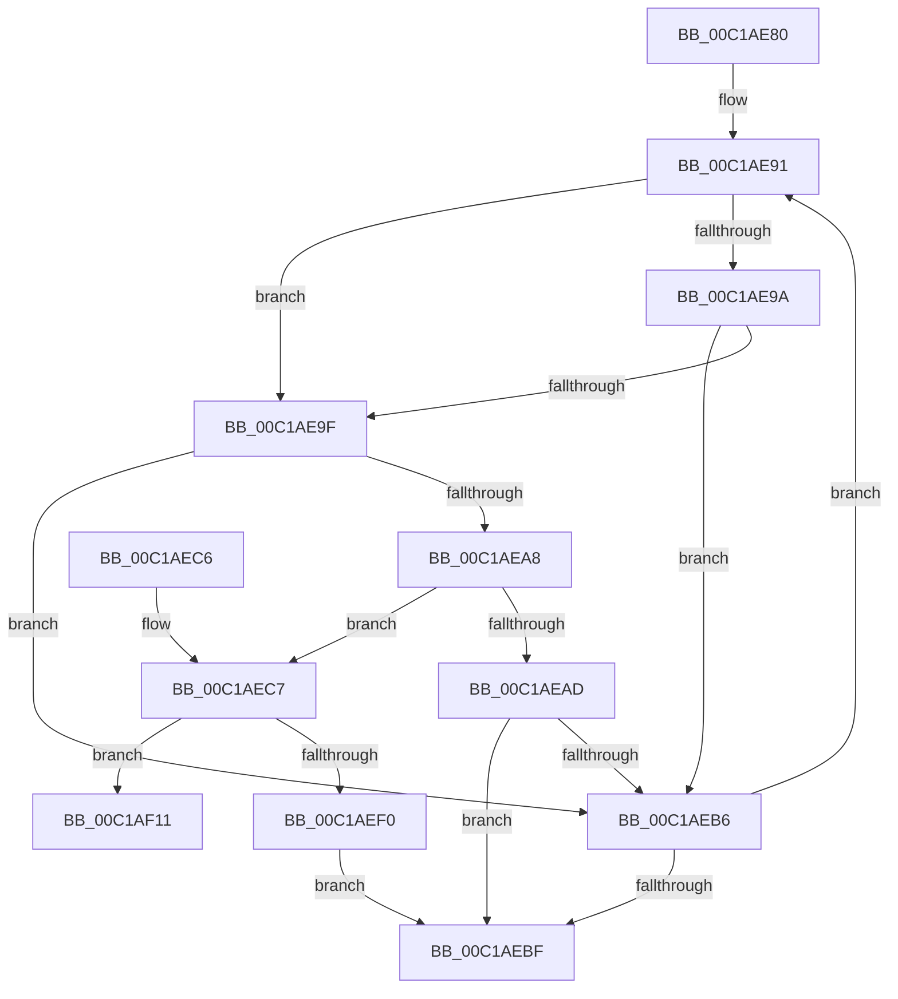

# ExBurnMemory

- RVA: `0x00C1AE80`–`0x00C1AF18` (길이 `152` bytes)
- VA: `0x0000000140C1AE80`
- 실행 섹션: `INIT`
- PDB 이름 있음: `예`; PDB Function 태그: `아니요`
- unwind 정보 RVA: `0x000DB714`
- 디코드: `42`개 명령, `152/152` bytes 표시
- 미해석 바이트: `0` (있으면 어셈블리에 `.byte`로 보존)

> 이 문서는 커널 이미지의 기계어와 PDB 기호를 분석해 생성했습니다. 4번과 5번은 함수 원형과 자료형을 바이너리 사용 방식에서 추정한 C 해석이며 원본 소스 복구 결과는 아닙니다.

## 1. Dependencies

- 직접 호출 지점: **0**; 고유 호출 대상: **0**
- 직접 호출자로 확인된 함수: **1**
- RIP 상대 이미지 참조: **6**

### Outgoing calls
- 직접 디코드된 call 명령이 없습니다.

### Direct callers
- [InitBootProcessor](InitBootProcessor_function_00C1B1C8.md) at `0x00C1B394`

### Static image references
- `0x00C1AED2` → RVA `0x00FC4180` (`.data`; write)
- `0x00C1AED9` → RVA `0x00FC4188` (`.data`; write)
- `0x00C1AEE0` → RVA `0x00FC4178` (`.data`; write)
- `0x00C1AEF0` → RVA `0x00FC4160` (`.data`; read)
- `0x00C1AEF7` → RVA `0x00FC4160` (`.data`; write)
- `0x00C1AEFE` → RVA `0x00FC4168` (`.data`; write)

## 2. Other-region calls and transfers

- 다른 실행 섹션으로 향하는 call: **0**
- 별도 외부 분기/꼬리 이동을 확인하지 못했습니다.

## 3. Assembly (complete function range)

```asm
00C1AE80  4C 8D 51 20                     lea r10, [rcx + 0x20]
00C1AE84  4C 8B CA                        mov r9, rdx
00C1AE87  4D 8B 42 08                     mov r8, qword ptr [r10 + 8]
00C1AE8B  41 BB 06 00 00 00               mov r11d, 6
00C1AE91  41 8B 40 18                     mov eax, dword ptr [r8 + 0x18]
00C1AE95  83 F8 02                        cmp eax, 2
00C1AE98  74 05                           je 0x140c1ae9f
00C1AE9A  83 F8 05                        cmp eax, 5
00C1AE9D  75 17                           jne 0x140c1aeb6
00C1AE9F  49 8B 48 28                     mov rcx, qword ptr [r8 + 0x28]
00C1AEA3  48 85 C9                        test rcx, rcx
00C1AEA6  74 0E                           je 0x140c1aeb6
00C1AEA8  49 3B C9                        cmp rcx, r9
00C1AEAB  77 1A                           ja 0x140c1aec7
00C1AEAD  45 89 58 18                     mov dword ptr [r8 + 0x18], r11d
00C1AEB1  4C 2B C9                        sub r9, rcx
00C1AEB4  74 09                           je 0x140c1aebf
00C1AEB6  4D 8B 40 08                     mov r8, qword ptr [r8 + 8]
00C1AEBA  4D 3B C2                        cmp r8, r10
00C1AEBD  75 D2                           jne 0x140c1ae91
00C1AEBF  49 2B D1                        sub rdx, r9
00C1AEC2  48 8B C2                        mov rax, rdx
00C1AEC5  C3                              ret
00C1AEC6  CC                              int3
00C1AEC7  49 2B C9                        sub rcx, r9
00C1AECA  49 89 48 28                     mov qword ptr [r8 + 0x28], rcx
00C1AECE  49 03 48 20                     add rcx, qword ptr [r8 + 0x20]
00C1AED2  48 89 0D A7 92 3A 00            mov qword ptr [rip + 0x3a92a7], rcx
00C1AED9  4C 89 0D A8 92 3A 00            mov qword ptr [rip + 0x3a92a8], r9
00C1AEE0  44 89 1D 91 92 3A 00            mov dword ptr [rip + 0x3a9291], r11d
00C1AEE7  49 8B 00                        mov rax, qword ptr [r8]
00C1AEEA  4C 39 40 08                     cmp qword ptr [rax + 8], r8
00C1AEEE  75 21                           jne 0x140c1af11
00C1AEF0  48 8D 0D 69 92 3A 00            lea rcx, [rip + 0x3a9269]
00C1AEF7  48 89 05 62 92 3A 00            mov qword ptr [rip + 0x3a9262], rax
00C1AEFE  4C 89 05 63 92 3A 00            mov qword ptr [rip + 0x3a9263], r8
00C1AF05  45 33 C9                        xor r9d, r9d
00C1AF08  48 89 48 08                     mov qword ptr [rax + 8], rcx
00C1AF0C  49 89 08                        mov qword ptr [r8], rcx
00C1AF0F  EB AE                           jmp 0x140c1aebf
00C1AF11  B9 03 00 00 00                  mov ecx, 3
00C1AF16  CD 29                           int 0x29
```

## 4. C-style interpretation (structured pseudocode)

```c
__int64 __fastcall ExBurnMemory(__int64 a1, __int64 a2)
{
loc_00C1AE91:
    if (((unsigned int)((unsigned int)(*(unsigned int *)(*(unsigned __int64 *)(a1 + 32 + 8) + 24)))) == 2) goto loc_00C1AE9F;
    if (((unsigned int)((unsigned int)(*(unsigned int *)(*(unsigned __int64 *)(a1 + 32 + 8) + 24)))) != 5) goto loc_00C1AEB6;
loc_00C1AE9F:
    if (*(unsigned __int64 *)(*(unsigned __int64 *)(a1 + 32 + 8) + 40) == 0) goto loc_00C1AEB6;
    if ((*(unsigned __int64 *)(*(unsigned __int64 *)(a1 + 32 + 8) + 40)) > a2) goto loc_00C1AEC7;
    *(unsigned int *)(*(unsigned __int64 *)(a1 + 32 + 8) + 24) = 6;
    a4 = (a2) - (*(unsigned __int64 *)(*(unsigned __int64 *)(a1 + 32 + 8) + 40));
    if (condition_is_equal) goto loc_00C1AEBF;
loc_00C1AEB6:
    if ((*(unsigned __int64 *)(*(unsigned __int64 *)(a1 + 32 + 8) + 8)) != (a1 + 32)) goto loc_00C1AE91;
loc_00C1AEBF:
    a2 = (a2) - (a4);
    return a2;
loc_00C1AEC7:
    a1 = (*(unsigned __int64 *)(*(unsigned __int64 *)(a1 + 32 + 8) + 40)) - (a4);
    *(unsigned __int64 *)(*(unsigned __int64 *)(*(unsigned __int64 *)(a1 + 32 + 8) + 8) + 40) = a1;
    a1 = (a1) + (*(unsigned __int64 *)(*(unsigned __int64 *)(*(unsigned __int64 *)(a1 + 32 + 8) + 8) + 32));
    *(unsigned __int64 *)(v_rip + 3838631) = a1;
    *(unsigned __int64 *)(v_rip + 3838632) = a4;
    *(unsigned int *)(v_rip + 3838609) = 6;
    if ((*(unsigned __int64 *)(*(unsigned __int64 *)(*(unsigned __int64 *)(*(unsigned __int64 *)(a1 + 32 + 8) + 8)) + 8)) != (*(unsigned __int64 *)(*(unsigned __int64 *)(a1 + 32 + 8) + 8))) goto loc_00C1AF11;
    *(unsigned __int64 *)(v_rip + 3838562) = *(unsigned __int64 *)(*(unsigned __int64 *)(*(unsigned __int64 *)(a1 + 32 + 8) + 8));
    *(unsigned __int64 *)(v_rip + 3838563) = *(unsigned __int64 *)(*(unsigned __int64 *)(a1 + 32 + 8) + 8);
    a4 = 0;
    *(unsigned __int64 *)(*(unsigned __int64 *)(*(unsigned __int64 *)(*(unsigned __int64 *)(a1 + 32 + 8) + 8)) + 8) = v_rip + 3838569;
    *(unsigned __int64 *)(*(unsigned __int64 *)(*(unsigned __int64 *)(a1 + 32 + 8) + 8)) = v_rip + 3838569;
    goto loc_00C1AEBF;
loc_00C1AF11:
    return *(unsigned __int64 *)(*(unsigned __int64 *)(*(unsigned __int64 *)(a1 + 32 + 8) + 8));
}
```

## 5. (Beta) C Style

```c
int64_t ExBurnMemory(void *Arg1, int64_t Arg2)
{
    uint8_t *arg1 = (uint8_t *)Arg1;

loc_00C1AE91:
    if (((uint32_t)((uint32_t)(*(uint32_t *)(*(uint64_t *)(arg1 + 0x20 + 0x8) + 0x18)))) == 2) goto loc_00C1AE9F;
    if (((uint32_t)((uint32_t)(*(uint32_t *)(*(uint64_t *)(arg1 + 0x20 + 0x8) + 0x18)))) != 5) goto loc_00C1AEB6;
loc_00C1AE9F:
    if (*(uint64_t *)(*(uint64_t *)(arg1 + 0x20 + 0x8) + 0x28) == 0) goto loc_00C1AEB6;
    if ((*(uint64_t *)(*(uint64_t *)(arg1 + 0x20 + 0x8) + 0x28)) > Arg2) goto loc_00C1AEC7;
    *(uint32_t *)(*(uint64_t *)(arg1 + 0x20 + 0x8) + 0x18) = 6;
    a4 = (Arg2) - (*(uint64_t *)(*(uint64_t *)(arg1 + 0x20 + 0x8) + 0x28));
    if (condition_is_equal) goto loc_00C1AEBF;
loc_00C1AEB6:
    if ((*(uint64_t *)(*(uint64_t *)(arg1 + 0x20 + 0x8) + 0x8)) != (Arg1 + 32)) goto loc_00C1AE91;
loc_00C1AEBF:
    Arg2 = (Arg2) - (a4);
    return Arg2;
loc_00C1AEC7:
    Arg1 = (*(uint64_t *)(*(uint64_t *)(arg1 + 0x20 + 0x8) + 0x28)) - (a4);
    *(void **)(*(uint64_t *)(*(uint64_t *)(arg1 + 0x20 + 0x8) + 0x8) + 0x28) = Arg1;
    Arg1 = (Arg1) + (*(uint64_t *)(*(uint64_t *)(*(uint64_t *)(arg1 + 0x20 + 0x8) + 0x8) + 0x20));
    *(void **)(v_rip + 0x3A92A7) = Arg1;
    *(uint64_t *)(v_rip + 0x3A92A8) = a4;
    *(uint32_t *)(v_rip + 0x3A9291) = 6;
    if ((*(uint64_t *)(*(uint64_t *)(*(uint64_t *)(*(uint64_t *)(arg1 + 0x20 + 0x8) + 0x8)) + 0x8)) != (*(uint64_t *)(*(uint64_t *)(arg1 + 0x20 + 0x8) + 0x8))) goto loc_00C1AF11;
    *(uint64_t *)(v_rip + 0x3A9262) = *(uint64_t *)(*(uint64_t *)(*(uint64_t *)(arg1 + 0x20 + 0x8) + 0x8));
    *(uint64_t *)(v_rip + 0x3A9263) = *(uint64_t *)(*(uint64_t *)(arg1 + 0x20 + 0x8) + 0x8);
    a4 = 0;
    *(uint64_t *)(*(uint64_t *)(*(uint64_t *)(*(uint64_t *)(arg1 + 0x20 + 0x8) + 0x8)) + 0x8) = v_rip + 3838569;
    *(uint64_t *)(*(uint64_t *)(*(uint64_t *)(arg1 + 0x20 + 0x8) + 0x8)) = v_rip + 3838569;
    goto loc_00C1AEBF;
loc_00C1AF11:
    return *(uint64_t *)(*(uint64_t *)(*(uint64_t *)(arg1 + 0x20 + 0x8) + 0x8));
}
```

### 관측된 메모리 오프셋

구조체 형식이 확인되지 않은 접근은 인자 기준의 오프셋으로만 기록했습니다.

| 기준 인자 | 오프셋 표현 | 폭 (bit) | 접근 |
|---|---:|---:|---|
| `Arg1` | `+ 0x8` | `64` | `R` |
| `Arg1` | `+ 0x20` | `64` | `R` |

## 6. Execution-region graph

[열기: 2D/3D 그래프와 함수 탐색 컨트롤 패널](../../../control-panel.html?section=init&rva=0x00C1AE80&view=graph)

- 2D 그래프는 위에서 아래로 흐르고, 3D 그래프는 빈 공간을 드래그해 회전합니다. Shift+드래그는 이동, 휠은 확대·축소, 함수 노드 선택은 대상 보고서 이동입니다.

### Static fallback


