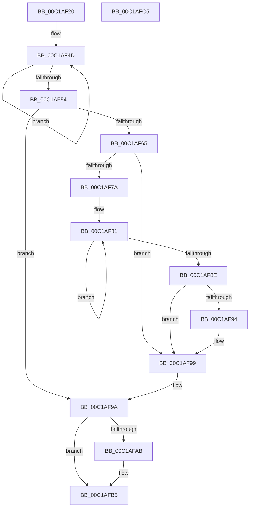

# ExpComputeCyclesPerYield

- RVA: `0x00C1AF20`–`0x00C1AFC6` (길이 `166` bytes)
- VA: `0x0000000140C1AF20`
- 실행 섹션: `INIT`
- PDB 이름 있음: `예`; PDB Function 태그: `아니요`
- unwind 정보 RVA: `0x00060BC4`
- 디코드: `49`개 명령, `166/166` bytes 표시
- 미해석 바이트: `0` (있으면 어셈블리에 `.byte`로 보존)

> 이 문서는 커널 이미지의 기계어와 PDB 기호를 분석해 생성했습니다. 4번과 5번은 함수 원형과 자료형을 바이너리 사용 방식에서 추정한 C 해석이며 원본 소스 복구 결과는 아닙니다.

## 1. Dependencies

- 직접 호출 지점: **2**; 고유 호출 대상: **2**
- 직접 호출자로 확인된 함수: **1**
- RIP 상대 이미지 참조: **0**

### Outgoing calls
- `0x00C1AF2F` → [KeDisableInterrupts](../../text/21/KeDisableInterrupts_function_00217BE0.md) (function, `0x00217BE0`)
- `0x00C1AF94` → [KiRemoveSystemWorkPriorityKick](../../text/26/KiRemoveSystemWorkPriorityKick_function_002631D0.md) (function, `0x002631D0`)

### Direct callers
- [Phase1InitializationDiscard](Phase1InitializationDiscard_function_00C1C728.md) at `0x00C1D9F5`

### Static image references
- 디코드된 RIP-relative 메모리 참조가 없습니다.

## 2. Other-region calls and transfers

- 다른 실행 섹션으로 향하는 call: **2**
  - `0x00C1AF2F` → [KeDisableInterrupts](../../text/21/KeDisableInterrupts_function_00217BE0.md) (`INIT` → `.text`)
  - `0x00C1AF94` → [KiRemoveSystemWorkPriorityKick](../../text/26/KiRemoveSystemWorkPriorityKick_function_002631D0.md) (`INIT` → `.text`)
- 별도 외부 분기/꼬리 이동을 확인하지 못했습니다.

## 3. Assembly (complete function range)

```asm
00C1AF20  48 89 5C 24 08                  mov qword ptr [rsp + 8], rbx
00C1AF25  48 89 74 24 10                  mov qword ptr [rsp + 0x10], rsi
00C1AF2A  57                              push rdi
00C1AF2B  48 83 EC 20                     sub rsp, 0x20
00C1AF2F  E8 AC CC 5F FF                  call 0x140217be0
00C1AF34  44 8A C0                        mov r8b, al
00C1AF37  0F 31                           rdtsc
00C1AF39  48 C1 E2 20                     shl rdx, 0x20
00C1AF3D  B9 00 01 00 00                  mov ecx, 0x100
00C1AF42  48 0B C2                        or rax, rdx
00C1AF45  BE 01 00 00 00                  mov esi, 1
00C1AF4A  48 8B F8                        mov rdi, rax
00C1AF4D  F3 90                           pause
00C1AF4F  48 2B CE                        sub rcx, rsi
00C1AF52  75 F9                           jne 0x140c1af4d
00C1AF54  0F 31                           rdtsc
00C1AF56  48 C1 E2 20                     shl rdx, 0x20
00C1AF5A  48 0B C2                        or rax, rdx
00C1AF5D  48 8B D8                        mov rbx, rax
00C1AF60  45 84 C0                        test r8b, r8b
00C1AF63  74 35                           je 0x140c1af9a
00C1AF65  65 48 8B 0C 25 20 00 00 00      mov rcx, qword ptr gs:[0x20]
00C1AF6E  4C 8B 81 B8 8E 00 00            mov r8, qword ptr [rcx + 0x8eb8]
00C1AF75  4D 85 C0                        test r8, r8
00C1AF78  74 1F                           je 0x140c1af99
00C1AF7A  41 0F 0D 08                     prefetchw byte ptr [r8]
00C1AF7E  41 8B 00                        mov eax, dword ptr [r8]
00C1AF81  8B D0                           mov edx, eax
00C1AF83  0F BA F2 15                     btr edx, 0x15
00C1AF87  F0 41 0F B1 10                  lock cmpxchg dword ptr [r8], edx
00C1AF8C  75 F3                           jne 0x140c1af81
00C1AF8E  0F BA E0 15                     bt eax, 0x15
00C1AF92  73 05                           jae 0x140c1af99
00C1AF94  E8 37 82 64 FF                  call 0x1402631d0
00C1AF99  FB                              sti
00C1AF9A  48 2B DF                        sub rbx, rdi
00C1AF9D  B8 FF FF 00 00                  mov eax, 0xffff
00C1AFA2  48 C1 EB 08                     shr rbx, 8
00C1AFA6  48 3B D8                        cmp rbx, rax
00C1AFA9  77 0A                           ja 0x140c1afb5
00C1AFAB  48 85 DB                        test rbx, rbx
00C1AFAE  48 8B C3                        mov rax, rbx
00C1AFB1  48 0F 44 C6                     cmove rax, rsi
00C1AFB5  48 8B 5C 24 30                  mov rbx, qword ptr [rsp + 0x30]
00C1AFBA  48 8B 74 24 38                  mov rsi, qword ptr [rsp + 0x38]
00C1AFBF  48 83 C4 20                     add rsp, 0x20
00C1AFC3  5F                              pop rdi
00C1AFC4  C3                              ret
00C1AFC5  CC                              int3
```

## 4. C-style interpretation (structured pseudocode)

```c
__int64 __fastcall ExpComputeCyclesPerYield(__int64 a1, __int64 a2)
{
    __int64 result;
    __int64 v_rbx;
    __int64 v_rsp;
    unsigned __int64 v_stack_p10;
    unsigned __int64 v_stack_p8;

    v_stack_p8 = v_rbx;
    v_stack_p10 = v_rsi;
    v_rsp = (v_rsp) - (32);
    result = KeDisableInterrupts(a1, a2, a3, a4);
    a2 = (a2) << (32);
    result = (result) | (a2);
loc_00C1AF4D:
    a1 = (256) - (1);
    if (condition_is_not_equal) goto loc_00C1AF4D;
    a2 = (a2) << (32);
    result = (result) | (a2);
    if ((unsigned __int8)((unsigned __int8)(result)) == 0) goto loc_00C1AF9A;
    if (*(unsigned __int64 *)(*(unsigned __int64 *)(gs_base + (0 + 32)) + 36536) == 0) goto loc_00C1AF99;
loc_00C1AF81:
    if (*(unsigned __int64 *)(*(unsigned __int64 *)(gs_base + (0 + 32)) + 36536) != 0) goto loc_00C1AF81;
    result = (unsigned int)(*(unsigned int *)(*(unsigned __int64 *)(*(unsigned __int64 *)(gs_base + (0 + 32)) + 36536)));
    if (!(condition_is_above_or_equal)) {
        result = KiRemoveSystemWorkPriorityKick(*(unsigned __int64 *)(gs_base + (0 + 32)), (unsigned int)((unsigned int)((unsigned int)(*(unsigned int *)(*(unsigned __int64 *)(*(unsigned __int64 *)(gs_base + (0 + 32)) + 36536))))), *(unsigned __int64 *)(*(unsigned __int64 *)(gs_base + (0 + 32)) + 36536), a4);
    }
loc_00C1AF9A:
    v_rbx = (result) - (result);
    v_rbx = (v_rbx) >> (8);
    result = (unsigned int)(0xFFFFULL);
    if (v_rbx <= ((unsigned int)(0xFFFFULL))) {
        result = v_rbx;
        if (v_rbx == 0) { result = 1; }
    }
    v_rsp = (v_rsp) + (32);
    return result;
}
```

## 5. (Beta) C Style

```c
int64_t ExpComputeCyclesPerYield(int64_t Arg1, int64_t Arg2)
{
    int64_t result;
    int64_t local_rbx;
    int64_t local_rsp;
    uint64_t v_stack_p10;
    uint64_t v_stack_p8;

    v_stack_p8 = local_rbx;
    v_stack_p10 = local_rsi;
    local_rsp = (local_rsp) - (32);
    result = KeDisableInterrupts(Arg1, Arg2, a3, a4);
    Arg2 = (Arg2) << (32);
    result = (result) | (Arg2);
loc_00C1AF4D:
    Arg1 = (256) - (1);
    if (condition_is_not_equal) goto loc_00C1AF4D;
    Arg2 = (Arg2) << (32);
    result = (result) | (Arg2);
    if ((uint8_t)((uint8_t)(result)) == 0) goto loc_00C1AF9A;
    if (*(uint64_t *)(*(uint64_t *)(gs_base + (0 + 0x20)) + 0x8EB8) == 0) goto loc_00C1AF99;
loc_00C1AF81:
    if (*(uint64_t *)(*(uint64_t *)(gs_base + (0 + 0x20)) + 0x8EB8) != 0) goto loc_00C1AF81;
    result = (uint32_t)(*(uint32_t *)(*(uint64_t *)(*(uint64_t *)(gs_base + (0 + 0x20)) + 0x8EB8)));
    if (!(condition_is_above_or_equal)) {
        result = KiRemoveSystemWorkPriorityKick(*(uint64_t *)(gs_base + (0 + 0x20)), (uint32_t)((uint32_t)((uint32_t)(*(uint32_t *)(*(uint64_t *)(*(uint64_t *)(gs_base + (0 + 0x20)) + 0x8EB8))))), *(uint64_t *)(*(uint64_t *)(gs_base + (0 + 0x20)) + 0x8EB8), a4);
    }
loc_00C1AF9A:
    local_rbx = (result) - (result);
    local_rbx = (local_rbx) >> (8);
    result = (uint32_t)(0xFFFFULL);
    if (local_rbx <= ((uint32_t)(0xFFFFULL))) {
        result = local_rbx;
        if (local_rbx == 0) { result = 1; }
    }
    local_rsp = (local_rsp) + (32);
    return result;
}
```

## 6. Execution-region graph

[열기: 2D/3D 그래프와 함수 탐색 컨트롤 패널](../../../control-panel.html?section=init&rva=0x00C1AF20&view=graph)

- 2D 그래프는 위에서 아래로 흐르고, 3D 그래프는 빈 공간을 드래그해 회전합니다. Shift+드래그는 이동, 휠은 확대·축소, 함수 노드 선택은 대상 보고서 이동입니다.

### Static fallback


