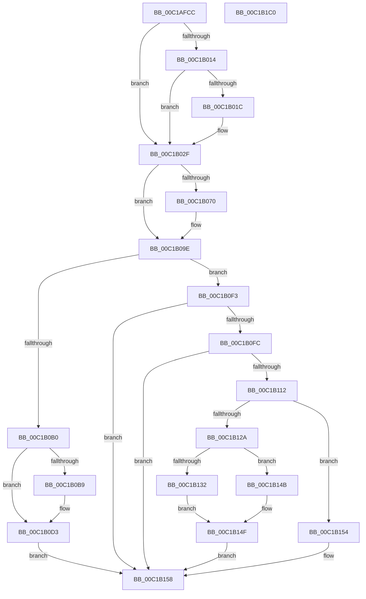

# GetBootSystemTime

- RVA: `0x00C1AFCC`–`0x00C1B1C1` (길이 `501` bytes)
- VA: `0x0000000140C1AFCC`
- 실행 섹션: `INIT`
- PDB 이름 있음: `예`; PDB Function 태그: `아니요`
- unwind 정보 RVA: `0x000C3848`
- 디코드: `130`개 명령, `501/501` bytes 표시
- 미해석 바이트: `0` (있으면 어셈블리에 `.byte`로 보존)

> 이 문서는 커널 이미지의 기계어와 PDB 기호를 분석해 생성했습니다. 4번과 5번은 함수 원형과 자료형을 바이너리 사용 방식에서 추정한 C 해석이며 원본 소스 복구 결과는 아닙니다.

## 1. Dependencies

- 직접 호출 지점: **10**; 고유 호출 대상: **7**
- 직접 호출자로 확인된 함수: **1**
- RIP 상대 이미지 참조: **11**

### Outgoing calls
- `0x00C1B01C` → [PsGetCurrentServerSiloGlobals](../../text/2F/PsGetCurrentServerSiloGlobals_function_002FE1F0.md) (function, `0x002FE1F0`)
- `0x00C1B03A` → [guard_dispatch_icall](../../text/6B/guard_dispatch_icall_function_006BAAD0.md) (function, `0x006BAAD0`)
- `0x00C1B055` → [RtlULongLongMult](../../text/43/RtlULongLongMult_function_0043E530.md) (function, `0x0043E530`)
- `0x00C1B0B9` → [PsGetCurrentServerSiloGlobals](../../text/2F/PsGetCurrentServerSiloGlobals_function_002FE1F0.md) (function, `0x002FE1F0`)
- `0x00C1B0DB` → [RtlpTimeToTimeFields](../../text/42/RtlpTimeToTimeFields_function_0042E110.md) (function, `0x0042E110`)
- `0x00C1B0E4` → [HalSetRealTimeClock](../../text/42/HalSetRealTimeClock_function_0042D310.md) (function, `0x0042D310`)
- `0x00C1B100` → [HalQueryRealTimeClock](../../text/42/HalQueryRealTimeClock_function_0042D810.md) (function, `0x0042D810`)
- `0x00C1B11A` → [RtlpTimeFieldsToTime](../../text/42/RtlpTimeFieldsToTime_function_0042E6C8.md) (function, `0x0042E6C8`)
- `0x00C1B132` → [PsGetCurrentServerSiloGlobals](../../text/2F/PsGetCurrentServerSiloGlobals_function_002FE1F0.md) (function, `0x002FE1F0`)
- `0x00C1B163` → [guard_dispatch_icall](../../text/6B/guard_dispatch_icall_function_006BAAD0.md) (function, `0x006BAAD0`)

### Direct callers
- [Phase1InitializationDiscard](Phase1InitializationDiscard_function_00C1C728.md) at `0x00C1CDD1`

### Static image references
- `0x00C1B014` → RVA `0x00E68570` (`.data`; read)
- `0x00C1B02F` → RVA `0x00E00A50` (`.data`; read)
- `0x00C1B0F3` → RVA `0x00EFF058` (`.data`; read)
- `0x00C1B15C` → RVA `0x00E00CF8` (`.data`; read)
- `0x00C1B174` → RVA `0x00FC70B8` (`ALMOSTRO`; write)
- `0x00C1B17B` → RVA `0x00FC70C0` (`ALMOSTRO`; write)
- `0x00C1B189` → RVA `0x00FC70D0` (`ALMOSTRO`; write)
- `0x00C1B193` → RVA `0x00FC70DC` (`ALMOSTRO`; write)
- `0x00C1B19C` → RVA `0x00FC70C8` (`ALMOSTRO`; write)
- `0x00C1B1A3` → RVA `0x00FC70D8` (`ALMOSTRO`; write)
- `0x00C1B1A9` → RVA `0x00FC70E0` (`ALMOSTRO`; write)

## 2. Other-region calls and transfers

- 다른 실행 섹션으로 향하는 call: **10**
  - `0x00C1B01C` → [PsGetCurrentServerSiloGlobals](../../text/2F/PsGetCurrentServerSiloGlobals_function_002FE1F0.md) (`INIT` → `.text`)
  - `0x00C1B03A` → [guard_dispatch_icall](../../text/6B/guard_dispatch_icall_function_006BAAD0.md) (`INIT` → `.text`)
  - `0x00C1B055` → [RtlULongLongMult](../../text/43/RtlULongLongMult_function_0043E530.md) (`INIT` → `.text`)
  - `0x00C1B0B9` → [PsGetCurrentServerSiloGlobals](../../text/2F/PsGetCurrentServerSiloGlobals_function_002FE1F0.md) (`INIT` → `.text`)
  - `0x00C1B0DB` → [RtlpTimeToTimeFields](../../text/42/RtlpTimeToTimeFields_function_0042E110.md) (`INIT` → `.text`)
  - `0x00C1B0E4` → [HalSetRealTimeClock](../../text/42/HalSetRealTimeClock_function_0042D310.md) (`INIT` → `.text`)
  - `0x00C1B100` → [HalQueryRealTimeClock](../../text/42/HalQueryRealTimeClock_function_0042D810.md) (`INIT` → `.text`)
  - `0x00C1B11A` → [RtlpTimeFieldsToTime](../../text/42/RtlpTimeFieldsToTime_function_0042E6C8.md) (`INIT` → `.text`)
  - `0x00C1B132` → [PsGetCurrentServerSiloGlobals](../../text/2F/PsGetCurrentServerSiloGlobals_function_002FE1F0.md) (`INIT` → `.text`)
  - `0x00C1B163` → [guard_dispatch_icall](../../text/6B/guard_dispatch_icall_function_006BAAD0.md) (`INIT` → `.text`)
- 별도 외부 분기/꼬리 이동을 확인하지 못했습니다.

## 3. Assembly (complete function range)

```asm
00C1AFCC  48 89 5C 24 18                  mov qword ptr [rsp + 0x18], rbx
00C1AFD1  55                              push rbp
00C1AFD2  56                              push rsi
00C1AFD3  57                              push rdi
00C1AFD4  41 54                           push r12
00C1AFD6  41 55                           push r13
00C1AFD8  41 56                           push r14
00C1AFDA  41 57                           push r15
00C1AFDC  48 8B EC                        mov rbp, rsp
00C1AFDF  48 83 EC 30                     sub rsp, 0x30
00C1AFE3  48 8B B9 48 0A 00 00            mov rdi, qword ptr [rcx + 0xa48]
00C1AFEA  33 DB                           xor ebx, ebx
00C1AFEC  41 83 CF FF                     or r15d, 0xffffffff
00C1AFF0  48 89 5D 48                     mov qword ptr [rbp + 0x48], rbx
00C1AFF4  0F 57 C0                        xorps xmm0, xmm0
00C1AFF7  48 89 5D 40                     mov qword ptr [rbp + 0x40], rbx
00C1AFFB  4C 8B E2                        mov r12, rdx
00C1AFFE  4C 8B E9                        mov r13, rcx
00C1B001  8D 73 01                        lea esi, [rbx + 1]
00C1B004  44 8A F3                        mov r14b, bl
00C1B007  0F 11 45 F0                     movups xmmword ptr [rbp - 0x10], xmm0
00C1B00B  40 84 B1 60 0A 00 00            test byte ptr [rcx + 0xa60], sil
00C1B012  75 1B                           jne 0x140c1b02f
00C1B014  39 1D 56 D5 24 00               cmp dword ptr [rip + 0x24d556], ebx
00C1B01A  75 13                           jne 0x140c1b02f
00C1B01C  E8 CF 31 6E FF                  call 0x1402fe1f0
00C1B021  48 8B 88 C8 04 00 00            mov rcx, qword ptr [rax + 0x4c8]
00C1B028  48 03 B9 B8 01 00 00            add rdi, qword ptr [rcx + 0x1b8]
00C1B02F  48 8B 05 1A 5A 1E 00            mov rax, qword ptr [rip + 0x1e5a1a]
00C1B036  48 8D 4D 48                     lea rcx, [rbp + 0x48]
00C1B03A  E8 91 FA A9 FF                  call 0x1406baad0
00C1B03F  4C 8B C8                        mov r9, rax
00C1B042  4C 8D 45 40                     lea r8, [rbp + 0x40]
00C1B046  4D 2B 8D 50 0A 00 00            sub r9, qword ptr [r13 + 0xa50]
00C1B04D  BA 80 96 98 00                  mov edx, 0x989680
00C1B052  49 8B C9                        mov rcx, r9
00C1B055  E8 D6 34 82 FF                  call 0x14043e530
00C1B05A  4C 8B 5D 48                     mov r11, qword ptr [rbp + 0x48]
00C1B05E  8B C8                           mov ecx, eax
00C1B060  48 8B 45 40                     mov rax, qword ptr [rbp + 0x40]
00C1B064  33 D2                           xor edx, edx
00C1B066  49 F7 F3                        div r11
00C1B069  4C 8B D0                        mov r10, rax
00C1B06C  85 C9                           test ecx, ecx
00C1B06E  79 2E                           jns 0x140c1b09e
00C1B070  33 D2                           xor edx, edx
00C1B072  49 8B C1                        mov rax, r9
00C1B075  49 F7 F3                        div r11
00C1B078  33 D2                           xor edx, edx
00C1B07A  48 8B C8                        mov rcx, rax
00C1B07D  4C 8B C0                        mov r8, rax
00C1B080  49 0F AF CB                     imul rcx, r11
00C1B084  4C 2B C9                        sub r9, rcx
00C1B087  49 69 C1 80 96 98 00            imul rax, r9, 0x989680
00C1B08E  49 F7 F3                        div r11
00C1B091  4C 8B D0                        mov r10, rax
00C1B094  49 69 C0 80 96 98 00            imul rax, r8, 0x989680
00C1B09B  4C 03 D0                        add r10, rax
00C1B09E  41 F6 85 60 0A 00 00 02         test byte ptr [r13 + 0xa60], 2
00C1B0A6  49 8D 1C 3A                     lea rbx, [r10 + rdi]
00C1B0AA  48 89 5D 40                     mov qword ptr [rbp + 0x40], rbx
00C1B0AE  75 43                           jne 0x140c1b0f3
00C1B0B0  83 3D B9 D4 24 00 00            cmp dword ptr [rip + 0x24d4b9], 0
00C1B0B7  75 1A                           jne 0x140c1b0d3
00C1B0B9  E8 32 31 6E FF                  call 0x1402fe1f0
00C1B0BE  48 8B 88 C8 04 00 00            mov rcx, qword ptr [rax + 0x4c8]
00C1B0C5  48 8B C3                        mov rax, rbx
00C1B0C8  48 2B 81 B8 01 00 00            sub rax, qword ptr [rcx + 0x1b8]
00C1B0CF  48 89 45 40                     mov qword ptr [rbp + 0x40], rax
00C1B0D3  48 8D 55 F0                     lea rdx, [rbp - 0x10]
00C1B0D7  48 8D 4D 40                     lea rcx, [rbp + 0x40]
00C1B0DB  E8 30 30 81 FF                  call 0x14042e110
00C1B0E0  48 8D 4D F0                     lea rcx, [rbp - 0x10]
00C1B0E4  E8 27 22 81 FF                  call 0x14042d310
00C1B0E9  44 8B FE                        mov r15d, esi
00C1B0EC  44 8A F0                        mov r14b, al
00C1B0EF  33 F6                           xor esi, esi
00C1B0F1  EB 65                           jmp 0x140c1b158
00C1B0F3  F6 05 5E 3F 2E 00 04            test byte ptr [rip + 0x2e3f5e], 4
00C1B0FA  75 5C                           jne 0x140c1b158
00C1B0FC  48 8D 4D F0                     lea rcx, [rbp - 0x10]
00C1B100  E8 0B 27 81 FF                  call 0x14042d810
00C1B105  33 F6                           xor esi, esi
00C1B107  44 8A F0                        mov r14b, al
00C1B10A  44 8D 7E 02                     lea r15d, [rsi + 2]
00C1B10E  84 C0                           test al, al
00C1B110  74 46                           je 0x140c1b158
00C1B112  48 8D 55 40                     lea rdx, [rbp + 0x40]
00C1B116  48 8D 4D F0                     lea rcx, [rbp - 0x10]
00C1B11A  E8 A9 35 81 FF                  call 0x14042e6c8
00C1B11F  44 8D 7E 03                     lea r15d, [rsi + 3]
00C1B123  44 8A F0                        mov r14b, al
00C1B126  84 C0                           test al, al
00C1B128  74 2A                           je 0x140c1b154
00C1B12A  39 35 40 D4 24 00               cmp dword ptr [rip + 0x24d440], esi
00C1B130  75 19                           jne 0x140c1b14b
00C1B132  E8 B9 30 6E FF                  call 0x1402fe1f0
00C1B137  48 8B 5D 40                     mov rbx, qword ptr [rbp + 0x40]
00C1B13B  48 8B 88 C8 04 00 00            mov rcx, qword ptr [rax + 0x4c8]
00C1B142  48 03 99 B8 01 00 00            add rbx, qword ptr [rcx + 0x1b8]
00C1B149  EB 04                           jmp 0x140c1b14f
00C1B14B  48 8B 5D 40                     mov rbx, qword ptr [rbp + 0x40]
00C1B14F  45 33 FF                        xor r15d, r15d
00C1B152  EB 04                           jmp 0x140c1b158
00C1B154  48 8B 5D 40                     mov rbx, qword ptr [rbp + 0x40]
00C1B158  49 89 1C 24                     mov qword ptr [r12], rbx
00C1B15C  48 8B 05 95 5B 1E 00            mov rax, qword ptr [rip + 0x1e5b95]
00C1B163  E8 68 F9 A9 FF                  call 0x1406baad0
00C1B168  49 8B 0C 24                     mov rcx, qword ptr [r12]
00C1B16C  48 8B 9C 24 80 00 00 00         mov rbx, qword ptr [rsp + 0x80]
00C1B174  48 89 0D 3D BF 3A 00            mov qword ptr [rip + 0x3abf3d], rcx
00C1B17B  48 89 3D 3E BF 3A 00            mov qword ptr [rip + 0x3abf3e], rdi
00C1B182  49 8B 8D 60 0A 00 00            mov rcx, qword ptr [r13 + 0xa60]
00C1B189  89 05 41 BF 3A 00               mov dword ptr [rip + 0x3abf41], eax
00C1B18F  41 0F B6 C6                     movzx eax, r14b
00C1B193  89 05 43 BF 3A 00               mov dword ptr [rip + 0x3abf43], eax
00C1B199  41 8A C6                        mov al, r14b
00C1B19C  48 89 0D 25 BF 3A 00            mov qword ptr [rip + 0x3abf25], rcx
00C1B1A3  89 35 2F BF 3A 00               mov dword ptr [rip + 0x3abf2f], esi
00C1B1A9  44 89 3D 30 BF 3A 00            mov dword ptr [rip + 0x3abf30], r15d
00C1B1B0  48 83 C4 30                     add rsp, 0x30
00C1B1B4  41 5F                           pop r15
00C1B1B6  41 5E                           pop r14
00C1B1B8  41 5D                           pop r13
00C1B1BA  41 5C                           pop r12
00C1B1BC  5F                              pop rdi
00C1B1BD  5E                              pop rsi
00C1B1BE  5D                              pop rbp
00C1B1BF  C3                              ret
00C1B1C0  CC                              int3
```

## 4. C-style interpretation (structured pseudocode)

```c
__int64 __fastcall GetBootSystemTime(__int64 a1, __int64 a2)
{
    __int64 result;
    __int64 v_r10;
    __int64 v_r15;
    __int64 v_rbx;
    __int64 v_rdi;
    __int64 v_rsi;
    __int64 v_rsp;
    unsigned __int64 v_stack_m48;
    unsigned __int64 v_stack_p10;
    unsigned __int64 v_stack_p18;
    unsigned __int64 v_stack_p8;

    v_stack_p18 = v_rbx;
    v_rsp = (v_rsp) - (48);
    v_rbx = 0;
    v_r15 = (unsigned int)((v_r15) | (0xFFFFFFFFULL));
    v_stack_p10 = 0;
    v_stack_p8 = 0;
    v_stack_m48 = v_xmm0;
    if (((*(unsigned __int8 *)(a1 + 2656)) & ((unsigned __int8)(v_rbx + 1))) != 0) goto loc_00C1B02F;
    v_rdi = *(unsigned __int64 *)(a1 + 2632);
    if ((*(unsigned int *)(v_rip + 2413910)) == 0) {
        result = PsGetCurrentServerSiloGlobals(a1, a2, a3, a4);
        a1 = *(unsigned __int64 *)(result + 1224);
        v_rdi = (*(unsigned __int64 *)(a1 + 2632)) + (*(unsigned __int64 *)(a1 + 440));
    }
    result = guard_dispatch_icall(v_stack_p10, a2, a3, a4);
    a4 = (result) - (*(unsigned __int64 *)(a1 + 2640));
    result = RtlULongLongMult(a4, (unsigned int)(0x989680ULL), v_stack_p8, a4);
    a2 = 0;
    result = v_stack_p8;
    v_r10 = v_stack_p8;
    if (sign_flag) {
        a2 = 0;
        result = a4;
        a2 = 0;
        a1 = result;
        a3 = result;
        a1 = (a1) * (v_stack_p10);
        a4 = (a4) - (a1);
        result = (result) * (a4);
        v_r10 = result;
        result = (result) * (a3);
        v_r10 = (v_r10) + (result);
    }
    v_stack_p8 = v_r10 + v_rdi * 1;
    if (((*(unsigned __int8 *)(a1 + 2656)) & (2)) != 0) goto loc_00C1B0F3;
    if ((*(unsigned int *)(v_rip + 2413753)) == 0) {
        result = PsGetCurrentServerSiloGlobals(a1, a2, a3, a4);
        a1 = *(unsigned __int64 *)(result + 1224);
        result = v_r10 + v_rdi * 1;
        result = (result) - (*(unsigned __int64 *)(a1 + 440));
        v_stack_p8 = result;
    }
    result = RtlpTimeToTimeFields(v_stack_p8, v_stack_m48, a3, a4);
    result = HalSetRealTimeClock(v_stack_m48, v_stack_m48, a3, a4);
    v_rsi = 0;
    goto loc_00C1B158;
loc_00C1B0F3:
    if (((*(unsigned __int8 *)(v_rip + 3030878)) & (4)) != 0) goto loc_00C1B158;
    result = HalQueryRealTimeClock(v_stack_m48, v_stack_m48, a3, a4);
    v_rsi = 0;
    if ((unsigned __int8)(result) == 0) goto loc_00C1B158;
    result = RtlpTimeFieldsToTime(v_stack_m48, v_stack_p8, a3, a4);
    if ((unsigned __int8)(result) == 0) goto loc_00C1B154;
    if ((*(unsigned int *)(v_rip + 2413632)) != 0) goto loc_00C1B14B;
    result = PsGetCurrentServerSiloGlobals(v_stack_m48, v_stack_p8, a3, a4);
    v_rbx = (v_stack_p8) + (*(unsigned __int64 *)(*(unsigned __int64 *)(result + 1224) + 440));
    goto loc_00C1B14F;
loc_00C1B14B:
loc_00C1B14F:
    v_r15 = 0;
    goto loc_00C1B158;
loc_00C1B154:
loc_00C1B158:
    *(unsigned __int64 *)(a2) = v_stack_p8;
    result = guard_dispatch_icall(*(unsigned __int64 *)(result + 1224), v_stack_p8, a3, a4);
    *(unsigned __int64 *)(v_rip + 3850045) = *(unsigned __int64 *)(a2);
    *(unsigned __int64 *)(v_rip + 3850046) = v_rdi;
    *(unsigned int *)(v_rip + 3850049) = (unsigned int)(result);
    *(unsigned int *)(v_rip + 3850051) = (unsigned int)((unsigned __int8)((unsigned __int8)(result)));
    *(unsigned __int64 *)(v_rip + 3850021) = *(unsigned __int64 *)(a1 + 2656);
    *(unsigned int *)(v_rip + 3850031) = 0;
    *(unsigned int *)(v_rip + 3850032) = 0;
    v_rsp = (v_rsp) + (48);
    return (unsigned __int8)((unsigned __int8)(result));
}
```

## 5. (Beta) C Style

```c
int64_t GetBootSystemTime(void *Arg1, void *Arg2)
{
    uint8_t *arg1 = (uint8_t *)Arg1;
    uint8_t *arg2 = (uint8_t *)Arg2;

    int64_t result;
    int64_t local_r10;
    int64_t local_r15;
    int64_t local_rbx;
    int64_t local_rdi;
    int64_t local_rsi;
    int64_t local_rsp;
    uint64_t v_stack_m48;
    uint64_t v_stack_p10;
    uint64_t v_stack_p18;
    uint64_t v_stack_p8;

    v_stack_p18 = local_rbx;
    local_rsp = (local_rsp) - (48);
    local_rbx = 0;
    local_r15 = (uint32_t)((local_r15) | (0xFFFFFFFFULL));
    v_stack_p10 = 0;
    v_stack_p8 = 0;
    v_stack_m48 = v_xmm0;
    if (((*(uint8_t *)(arg1 + 0xA60)) & ((uint8_t)(local_rbx + 1))) != 0) goto loc_00C1B02F;
    local_rdi = *(uint64_t *)(arg1 + 0xA48);
    if ((*(uint32_t *)(v_rip + 0x24D556)) == 0) {
        result = PsGetCurrentServerSiloGlobals(Arg1, Arg2, a3, a4);
        Arg1 = *(uint64_t *)(result + 0x4C8);
        local_rdi = (*(uint64_t *)(arg1 + 0xA48)) + (*(uint64_t *)(arg1 + 0x1B8));
    }
    result = guard_dispatch_icall(v_stack_p10, Arg2, a3, a4);
    a4 = (result) - (*(uint64_t *)(arg1 + 0xA50));
    result = RtlULongLongMult(a4, (uint32_t)(0x989680ULL), v_stack_p8, a4);
    Arg2 = 0;
    result = v_stack_p8;
    local_r10 = v_stack_p8;
    if (sign_flag) {
        Arg2 = 0;
        result = a4;
        Arg2 = 0;
        Arg1 = result;
        a3 = result;
        Arg1 = (Arg1) * (v_stack_p10);
        a4 = (a4) - (Arg1);
        result = (result) * (a4);
        local_r10 = result;
        result = (result) * (a3);
        local_r10 = (local_r10) + (result);
    }
    v_stack_p8 = local_r10 + local_rdi * 1;
    if (((*(uint8_t *)(arg1 + 0xA60)) & (2)) != 0) goto loc_00C1B0F3;
    if ((*(uint32_t *)(v_rip + 0x24D4B9)) == 0) {
        result = PsGetCurrentServerSiloGlobals(Arg1, Arg2, a3, a4);
        Arg1 = *(uint64_t *)(result + 0x4C8);
        result = local_r10 + local_rdi * 1;
        result = (result) - (*(uint64_t *)(arg1 + 0x1B8));
        v_stack_p8 = result;
    }
    result = RtlpTimeToTimeFields(v_stack_p8, v_stack_m48, a3, a4);
    result = HalSetRealTimeClock(v_stack_m48, v_stack_m48, a3, a4);
    local_rsi = 0;
    goto loc_00C1B158;
loc_00C1B0F3:
    if (((*(uint8_t *)(v_rip + 0x2E3F5E)) & (4)) != 0) goto loc_00C1B158;
    result = HalQueryRealTimeClock(v_stack_m48, v_stack_m48, a3, a4);
    local_rsi = 0;
    if ((uint8_t)(result) == 0) goto loc_00C1B158;
    result = RtlpTimeFieldsToTime(v_stack_m48, v_stack_p8, a3, a4);
    if ((uint8_t)(result) == 0) goto loc_00C1B154;
    if ((*(uint32_t *)(v_rip + 0x24D440)) != 0) goto loc_00C1B14B;
    result = PsGetCurrentServerSiloGlobals(v_stack_m48, v_stack_p8, a3, a4);
    local_rbx = (v_stack_p8) + (*(uint64_t *)(*(uint64_t *)(result + 0x4C8) + 0x1B8));
    goto loc_00C1B14F;
loc_00C1B14B:
loc_00C1B14F:
    local_r15 = 0;
    goto loc_00C1B158;
loc_00C1B154:
loc_00C1B158:
    *(uint64_t *)(arg2) = v_stack_p8;
    result = guard_dispatch_icall(*(uint64_t *)(result + 0x4C8), v_stack_p8, a3, a4);
    *(uint64_t *)(v_rip + 0x3ABF3D) = *(uint64_t *)(arg2);
    *(uint64_t *)(v_rip + 0x3ABF3E) = local_rdi;
    *(uint32_t *)(v_rip + 0x3ABF41) = (uint32_t)(result);
    *(uint32_t *)(v_rip + 0x3ABF43) = (uint32_t)((uint8_t)((uint8_t)(result)));
    *(uint64_t *)(v_rip + 0x3ABF25) = *(uint64_t *)(arg1 + 0xA60);
    *(uint32_t *)(v_rip + 0x3ABF2F) = 0;
    *(uint32_t *)(v_rip + 0x3ABF30) = 0;
    local_rsp = (local_rsp) + (48);
    return (uint8_t)((uint8_t)(result));
}
```

### 관측된 메모리 오프셋

구조체 형식이 확인되지 않은 접근은 인자 기준의 오프셋으로만 기록했습니다.

| 기준 인자 | 오프셋 표현 | 폭 (bit) | 접근 |
|---|---:|---:|---|
| `Arg1` | `+ 0xA48` | `64` | `R` |
| `Arg1` | `+ 0xA50` | `64` | `R` |
| `Arg1` | `+ 0xA60` | `8` | `R` |
| `Arg1` | `+ 0xA60` | `64` | `R` |
| `Arg2` | `+ 0x0` | `64` | `R` |
| `Arg2` | `+ 0x0` | `64` | `W` |

## 6. Execution-region graph

[열기: 2D/3D 그래프와 함수 탐색 컨트롤 패널](../../../control-panel.html?section=init&rva=0x00C1AFCC&view=graph)

- 2D 그래프는 위에서 아래로 흐르고, 3D 그래프는 빈 공간을 드래그해 회전합니다. Shift+드래그는 이동, 휠은 확대·축소, 함수 노드 선택은 대상 보고서 이동입니다.

### Static fallback


