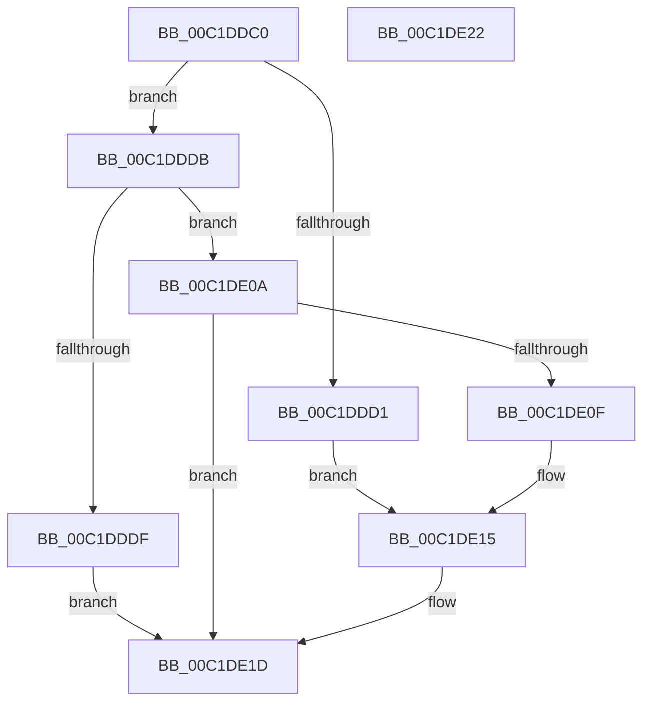

# HalReportResourceUsage

- RVA: `0x00C1DDC0`–`0x00C1DE23` (길이 `99` bytes)
- VA: `0x0000000140C1DDC0`
- 실행 섹션: `INIT`
- PDB 이름 있음: `예`; PDB Function 태그: `아니요`
- unwind 정보 RVA: `0x0005D2F4`
- 디코드: `29`개 명령, `99/99` bytes 표시
- 미해석 바이트: `0` (있으면 어셈블리에 `.byte`로 보존)

> 이 문서는 커널 이미지의 기계어와 PDB 기호를 분석해 생성했습니다. 4번과 5번은 함수 원형과 자료형을 바이너리 사용 방식에서 추정한 C 해석이며 원본 소스 복구 결과는 아닙니다.

## 1. Dependencies

- 직접 호출 지점: **4**; 고유 호출 대상: **3**
- 직접 호출자로 확인된 함수: **2**
- RIP 상대 이미지 참조: **1**

### Outgoing calls
- `0x00C1DDE8` → [HalpInitSystemHelper](../../pagelk/B5/HalpInitSystemHelper_function_00B5B738.md) (function, `0x00B5B738`)
- `0x00C1DDF9` → [RtlInitUnicodeString](../../text/42/RtlInitUnicodeString_function_0042A780.md) (function, `0x0042A780`)
- `0x00C1DE03` → [HalpReportResourceUsage](HalpReportResourceUsage_function_00C1F034.md) (function, `0x00C1F034`)
- `0x00C1DE18` → [HalpInitSystemHelper](../../pagelk/B5/HalpInitSystemHelper_function_00B5B738.md) (function, `0x00B5B738`)

### Direct callers
- [Phase1InitializationDiscard](Phase1InitializationDiscard_function_00C1C728.md) at `0x00C1D1FE`
- [Phase1InitializationDiscard](Phase1InitializationDiscard_function_00C1C728.md) at `0x00C1D7DA`
- [PoInitSystem](../C7/PoInitSystem_function_00C72358.md) at `0x00C72DDF`

### Static image references
- `0x00C1DDED` → RVA `0x00023838` (`.rdata`; read)

## 2. Other-region calls and transfers

- 다른 실행 섹션으로 향하는 call: **3**
  - `0x00C1DDE8` → [HalpInitSystemHelper](../../pagelk/B5/HalpInitSystemHelper_function_00B5B738.md) (`INIT` → `PAGELK`)
  - `0x00C1DDF9` → [RtlInitUnicodeString](../../text/42/RtlInitUnicodeString_function_0042A780.md) (`INIT` → `.text`)
  - `0x00C1DE18` → [HalpInitSystemHelper](../../pagelk/B5/HalpInitSystemHelper_function_00B5B738.md) (`INIT` → `PAGELK`)
- 별도 외부 분기/꼬리 이동을 확인하지 못했습니다.

## 3. Assembly (complete function range)

```asm
00C1DDC0  48 83 EC 38                     sub rsp, 0x38
00C1DDC4  0F 57 C0                        xorps xmm0, xmm0
00C1DDC7  0F 11 44 24 20                  movups xmmword ptr [rsp + 0x20], xmm0
00C1DDCC  83 F9 FF                        cmp ecx, -1
00C1DDCF  75 0A                           jne 0x140c1dddb
00C1DDD1  BA 18 00 00 00                  mov edx, 0x18
00C1DDD6  8D 4A FF                        lea ecx, [rdx - 1]
00C1DDD9  EB 3A                           jmp 0x140c1de15
00C1DDDB  85 C9                           test ecx, ecx
00C1DDDD  75 2B                           jne 0x140c1de0a
00C1DDDF  8D 51 1C                        lea edx, [rcx + 0x1c]
00C1DDE2  45 33 C0                        xor r8d, r8d
00C1DDE5  8D 4A FF                        lea ecx, [rdx - 1]
00C1DDE8  E8 4B D9 F3 FF                  call 0x140b5b738
00C1DDED  48 8D 15 44 5A 40 FF            lea rdx, [rip - 0xbfa5bc]
00C1DDF4  48 8D 4C 24 20                  lea rcx, [rsp + 0x20]
00C1DDF9  E8 82 C9 80 FF                  call 0x14042a780
00C1DDFE  48 8D 4C 24 20                  lea rcx, [rsp + 0x20]
00C1DE03  E8 2C 12 00 00                  call 0x140c1f034
00C1DE08  EB 13                           jmp 0x140c1de1d
00C1DE0A  83 F9 01                        cmp ecx, 1
00C1DE0D  75 0E                           jne 0x140c1de1d
00C1DE0F  8D 51 1D                        lea edx, [rcx + 0x1d]
00C1DE12  8D 4A FF                        lea ecx, [rdx - 1]
00C1DE15  45 33 C0                        xor r8d, r8d
00C1DE18  E8 1B D9 F3 FF                  call 0x140b5b738
00C1DE1D  48 83 C4 38                     add rsp, 0x38
00C1DE21  C3                              ret
00C1DE22  CC                              int3
```

## 4. C-style interpretation (structured pseudocode)

```c
__int64 __fastcall HalReportResourceUsage(int a1, __int64 a2, int a3)
{
    __int64 result;
    __int64 v_rsp;
    unsigned __int64 v_stack_m18;

    v_rsp = (v_rsp) - (56);
    v_stack_m18 = v_xmm0;
    if (a1 != -1) goto loc_00C1DDDB;
    goto loc_00C1DE15;
loc_00C1DDDB:
    if ((unsigned int)(24 - 1) != 0) goto loc_00C1DE0A;
    a3 = 0;
    result = HalpInitSystemHelper(24 - 1 + 28 - 1, 24 - 1 + 28, a3, a4);
    result = RtlInitUnicodeString(v_stack_m18, v_rip - 12559804, a3, a4);
    result = HalpReportResourceUsage(v_stack_m18, v_rip - 12559804, a3, a4);
    goto loc_00C1DE1D;
loc_00C1DE0A:
    if (((unsigned int)(v_stack_m18)) != 1) goto loc_00C1DE1D;
loc_00C1DE15:
    a3 = 0;
    result = HalpInitSystemHelper(v_stack_m18 + 29 - 1, v_stack_m18 + 29, a3, a4);
loc_00C1DE1D:
    v_rsp = (v_rsp) + (56);
    return result;
}
```

## 5. (Beta) C Style

```c
int64_t HalReportResourceUsage(int32_t Arg1, int64_t Arg2, int32_t Arg3)
{
    int64_t result;
    int64_t local_rsp;
    uint64_t v_stack_m18;

    local_rsp = (local_rsp) - (56);
    v_stack_m18 = v_xmm0;
    if (Arg1 != -1) goto loc_00C1DDDB;
    goto loc_00C1DE15;
loc_00C1DDDB:
    if ((uint32_t)(24 - 1) != 0) goto loc_00C1DE0A;
    Arg3 = 0;
    result = HalpInitSystemHelper(24 - 1 + 28 - 1, 24 - 1 + 28, Arg3, a4);
    result = RtlInitUnicodeString(v_stack_m18, v_rip - 12559804, Arg3, a4);
    result = HalpReportResourceUsage(v_stack_m18, v_rip - 12559804, Arg3, a4);
    goto loc_00C1DE1D;
loc_00C1DE0A:
    if (((uint32_t)(v_stack_m18)) != 1) goto loc_00C1DE1D;
loc_00C1DE15:
    Arg3 = 0;
    result = HalpInitSystemHelper(v_stack_m18 + 29 - 1, v_stack_m18 + 29, Arg3, a4);
loc_00C1DE1D:
    local_rsp = (local_rsp) + (56);
    return result;
}
```

## 6. Execution-region graph

[열기: 2D/3D 그래프와 함수 탐색 컨트롤 패널](../../../control-panel.html?section=init&rva=0x00C1DDC0&view=graph)

- 2D 그래프는 위에서 아래로 흐르고, 3D 그래프는 빈 공간을 드래그해 회전합니다. Shift+드래그는 이동, 휠은 확대·축소, 함수 노드 선택은 대상 보고서 이동입니다.

### Static fallback


