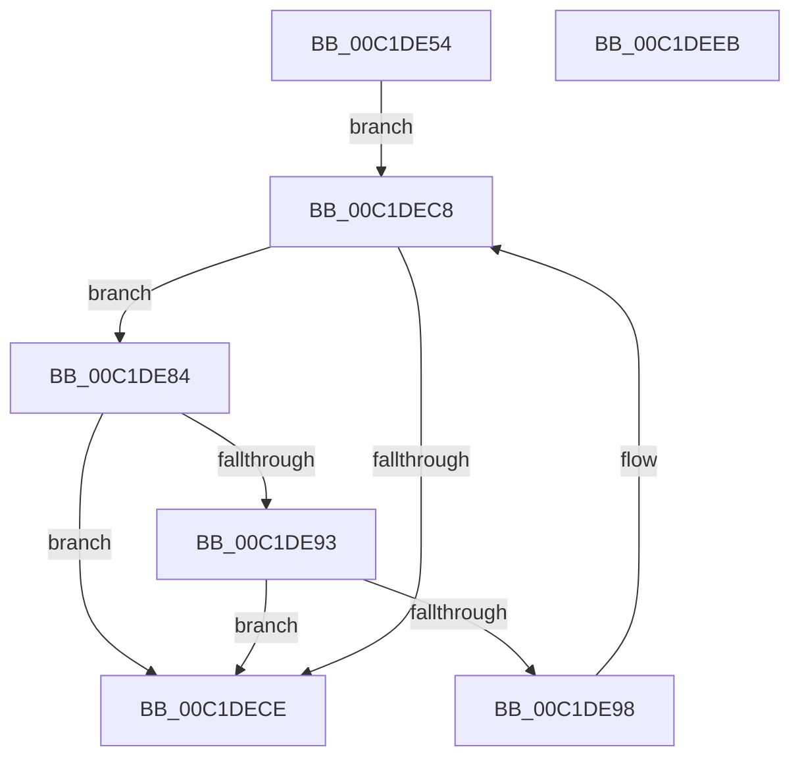

# HalpAcpiCacheOverrideTables

- RVA: `0x00C1DE54`–`0x00C1DEEC` (길이 `152` bytes)
- VA: `0x0000000140C1DE54`
- 실행 섹션: `INIT`
- PDB 이름 있음: `예`; PDB Function 태그: `아니요`
- unwind 정보 RVA: `0x000A06E8`
- 디코드: `49`개 명령, `152/152` bytes 표시
- 미해석 바이트: `0` (있으면 어셈블리에 `.byte`로 보존)

> 이 문서는 커널 이미지의 기계어와 PDB 기호를 분석해 생성했습니다. 4번과 5번은 함수 원형과 자료형을 바이너리 사용 방식에서 추정한 C 해석이며 원본 소스 복구 결과는 아닙니다.

## 1. Dependencies

- 직접 호출 지점: **2**; 고유 호출 대상: **2**
- 직접 호출자로 확인된 함수: **1**
- RIP 상대 이미지 참조: **0**

### Outgoing calls
- `0x00C1DEA7` → [memcpy](../../text/6C/memcpy_function_006C6840.md) (function, `0x006C6840`)
- `0x00C1DEB5` → [HalpAcpiCacheTable](../../text/53/HalpAcpiCacheTable_function_0053ED64.md) (function, `0x0053ED64`)

### Direct callers
- [HalpAcpiTableCacheInit](../C7/HalpAcpiTableCacheInit_function_00C77650.md) at `0x00C77752`

### Static image references
- 디코드된 RIP-relative 메모리 참조가 없습니다.

## 2. Other-region calls and transfers

- 다른 실행 섹션으로 향하는 call: **2**
  - `0x00C1DEA7` → [memcpy](../../text/6C/memcpy_function_006C6840.md) (`INIT` → `.text`)
  - `0x00C1DEB5` → [HalpAcpiCacheTable](../../text/53/HalpAcpiCacheTable_function_0053ED64.md) (`INIT` → `.text`)
- 별도 외부 분기/꼬리 이동을 확인하지 못했습니다.

## 3. Assembly (complete function range)

```asm
00C1DE54  48 8B C4                        mov rax, rsp
00C1DE57  48 89 58 10                     mov qword ptr [rax + 0x10], rbx
00C1DE5B  48 89 68 18                     mov qword ptr [rax + 0x18], rbp
00C1DE5F  48 89 70 20                     mov qword ptr [rax + 0x20], rsi
00C1DE63  48 89 48 08                     mov qword ptr [rax + 8], rcx
00C1DE67  57                              push rdi
00C1DE68  41 54                           push r12
00C1DE6A  41 55                           push r13
00C1DE6C  41 56                           push r14
00C1DE6E  41 57                           push r15
00C1DE70  48 83 EC 20                     sub rsp, 0x20
00C1DE74  44 8B 74 24 70                  mov r14d, dword ptr [rsp + 0x70]
00C1DE79  4D 8B F9                        mov r15, r9
00C1DE7C  45 8B E0                        mov r12d, r8d
00C1DE7F  4C 8B EA                        mov r13, rdx
00C1DE82  EB 44                           jmp 0x140c1dec8
00C1DE84  41 8B 6F 04                     mov ebp, dword ptr [r15 + 4]
00C1DE88  8D 75 1F                        lea esi, [rbp + 0x1f]
00C1DE8B  83 E6 F8                        and esi, 0xfffffff8
00C1DE8E  44 3B E6                        cmp r12d, esi
00C1DE91  72 3B                           jb 0x140c1dece
00C1DE93  44 3B F5                        cmp r14d, ebp
00C1DE96  72 36                           jb 0x140c1dece
00C1DE98  49 83 65 10 00                  and qword ptr [r13 + 0x10], 0
00C1DE9D  49 8D 4D 18                     lea rcx, [r13 + 0x18]
00C1DEA1  44 8B C5                        mov r8d, ebp
00C1DEA4  49 8B D7                        mov rdx, r15
00C1DEA7  E8 94 89 AA FF                  call 0x1406c6840
00C1DEAC  48 8B 4C 24 50                  mov rcx, qword ptr [rsp + 0x50]
00C1DEB1  49 8D 55 18                     lea rdx, [r13 + 0x18]
00C1DEB5  E8 AA 0E 92 FF                  call 0x14053ed64
00C1DEBA  8B C6                           mov eax, esi
00C1DEBC  44 2B E6                        sub r12d, esi
00C1DEBF  4C 03 E8                        add r13, rax
00C1DEC2  44 2B F5                        sub r14d, ebp
00C1DEC5  4C 03 FD                        add r15, rbp
00C1DEC8  41 83 FE 24                     cmp r14d, 0x24
00C1DECC  73 B6                           jae 0x140c1de84
00C1DECE  48 8B 5C 24 58                  mov rbx, qword ptr [rsp + 0x58]
00C1DED3  48 8B 6C 24 60                  mov rbp, qword ptr [rsp + 0x60]
00C1DED8  48 8B 74 24 68                  mov rsi, qword ptr [rsp + 0x68]
00C1DEDD  48 83 C4 20                     add rsp, 0x20
00C1DEE1  41 5F                           pop r15
00C1DEE3  41 5E                           pop r14
00C1DEE5  41 5D                           pop r13
00C1DEE7  41 5C                           pop r12
00C1DEE9  5F                              pop rdi
00C1DEEA  C3                              ret
00C1DEEB  CC                              int3
```

## 4. C-style interpretation (structured pseudocode)

```c
__int64 __fastcall HalpAcpiCacheOverrideTables(__int64 a1, __int64 a2, int a3, __int64 a4, unsigned int a5)
{
    __int64 result;
    __int64 v_r12;
    __int64 v_r13;
    __int64 v_r14;
    __int64 v_r15;
    __int64 v_rsi;
    __int64 v_rsp;
    unsigned __int64 v_stack_p10;
    unsigned __int64 v_stack_p18;
    unsigned __int64 v_stack_p20;
    unsigned __int64 v_stack_p8;

    *(unsigned __int64 *)(v_rsp + 16) = v_rbx;
    *(unsigned __int64 *)(v_rsp + 24) = v_rbp;
    *(unsigned __int64 *)(v_rsp + 32) = v_rsi;
    *(unsigned __int64 *)(v_rsp + 8) = a1;
    v_rsp = (v_rsp) - (32);
    goto loc_00C1DEC8;
loc_00C1DE84:
    v_rsi = (unsigned int)(((unsigned int)(*(unsigned int *)(a4 + 4)) + 31) & (0xFFFFFFF8ULL));
    if (((unsigned int)((unsigned int)(a3))) < ((unsigned int)(v_rsi))) goto loc_00C1DECE;
    if (((unsigned int)((unsigned int)(a5))) < ((unsigned int)((unsigned int)(*(unsigned int *)(a4 + 4))))) goto loc_00C1DECE;
    result = memcpy(a2 + 24, a4, (unsigned int)((unsigned int)((unsigned int)(*(unsigned int *)(a4 + 4)))), a4);
    result = HalpAcpiCacheTable(v_stack_p8, a2 + 24, (unsigned int)((unsigned int)((unsigned int)(*(unsigned int *)(a4 + 4)))), a4);
    v_r12 = (unsigned int)(((unsigned int)(a3)) - ((unsigned int)(v_rsi)));
    v_r13 = (a2) + ((unsigned int)((unsigned int)(v_rsi)));
    v_r14 = (unsigned int)(((unsigned int)(a5)) - ((unsigned int)((unsigned int)(*(unsigned int *)(a4 + 4)))));
    v_r15 = (a4) + ((unsigned int)(*(unsigned int *)(a4 + 4)));
loc_00C1DEC8:
    if (((unsigned int)(v_r14)) >= 36) goto loc_00C1DE84;
loc_00C1DECE:
    v_rsp = (v_rsp) + (32);
    return (unsigned int)((unsigned int)(v_rsi));
}
```

## 5. (Beta) C Style

```c
int64_t HalpAcpiCacheOverrideTables(int64_t Arg1, void *Arg2, int32_t Arg3, void *Arg4, uint32_t Arg5)
{
    uint8_t *arg2 = (uint8_t *)Arg2;
    uint8_t *arg4 = (uint8_t *)Arg4;

    int64_t result;
    int64_t local_r12;
    int64_t local_r13;
    int64_t local_r14;
    int64_t local_r15;
    int64_t local_rsi;
    int64_t local_rsp;
    uint64_t v_stack_p10;
    uint64_t v_stack_p18;
    uint64_t v_stack_p20;
    uint64_t v_stack_p8;

    *(uint64_t *)(local_rsp + 0x10) = local_rbx;
    *(uint64_t *)(local_rsp + 0x18) = local_rbp;
    *(uint64_t *)(local_rsp + 0x20) = local_rsi;
    *(uint64_t *)(local_rsp + 0x8) = Arg1;
    local_rsp = (local_rsp) - (32);
    goto loc_00C1DEC8;
loc_00C1DE84:
    local_rsi = (uint32_t)(((uint32_t)(*(uint32_t *)(arg4 + 0x4)) + 31) & (0xFFFFFFF8ULL));
    if (((uint32_t)((uint32_t)(Arg3))) < ((uint32_t)(local_rsi))) goto loc_00C1DECE;
    if (((uint32_t)((uint32_t)(Arg5))) < ((uint32_t)((uint32_t)(*(uint32_t *)(arg4 + 0x4))))) goto loc_00C1DECE;
    result = memcpy(Arg2 + 24, Arg4, (uint32_t)((uint32_t)((uint32_t)(*(uint32_t *)(arg4 + 0x4)))), Arg4);
    result = HalpAcpiCacheTable(v_stack_p8, Arg2 + 24, (uint32_t)((uint32_t)((uint32_t)(*(uint32_t *)(arg4 + 0x4)))), Arg4);
    local_r12 = (uint32_t)(((uint32_t)(Arg3)) - ((uint32_t)(local_rsi)));
    local_r13 = (Arg2) + ((uint32_t)((uint32_t)(local_rsi)));
    local_r14 = (uint32_t)(((uint32_t)(Arg5)) - ((uint32_t)((uint32_t)(*(uint32_t *)(arg4 + 0x4)))));
    local_r15 = (Arg4) + ((uint32_t)(*(uint32_t *)(arg4 + 0x4)));
loc_00C1DEC8:
    if (((uint32_t)(local_r14)) >= 36) goto loc_00C1DE84;
loc_00C1DECE:
    local_rsp = (local_rsp) + (32);
    return (uint32_t)((uint32_t)(local_rsi));
}
```

### 관측된 메모리 오프셋

구조체 형식이 확인되지 않은 접근은 인자 기준의 오프셋으로만 기록했습니다.

| 기준 인자 | 오프셋 표현 | 폭 (bit) | 접근 |
|---|---:|---:|---|
| `Arg2` | `+ 0x10` | `64` | `R/W` |
| `Arg2` | `+ 0x18` | `64` | `R` |
| `Arg4` | `+ 0x4` | `32` | `R` |

## 6. Execution-region graph

[열기: 2D/3D 그래프와 함수 탐색 컨트롤 패널](../../../control-panel.html?section=init&rva=0x00C1DE54&view=graph)

- 2D 그래프는 위에서 아래로 흐르고, 3D 그래프는 빈 공간을 드래그해 회전합니다. Shift+드래그는 이동, 휠은 확대·축소, 함수 노드 선택은 대상 보고서 이동입니다.

### Static fallback


