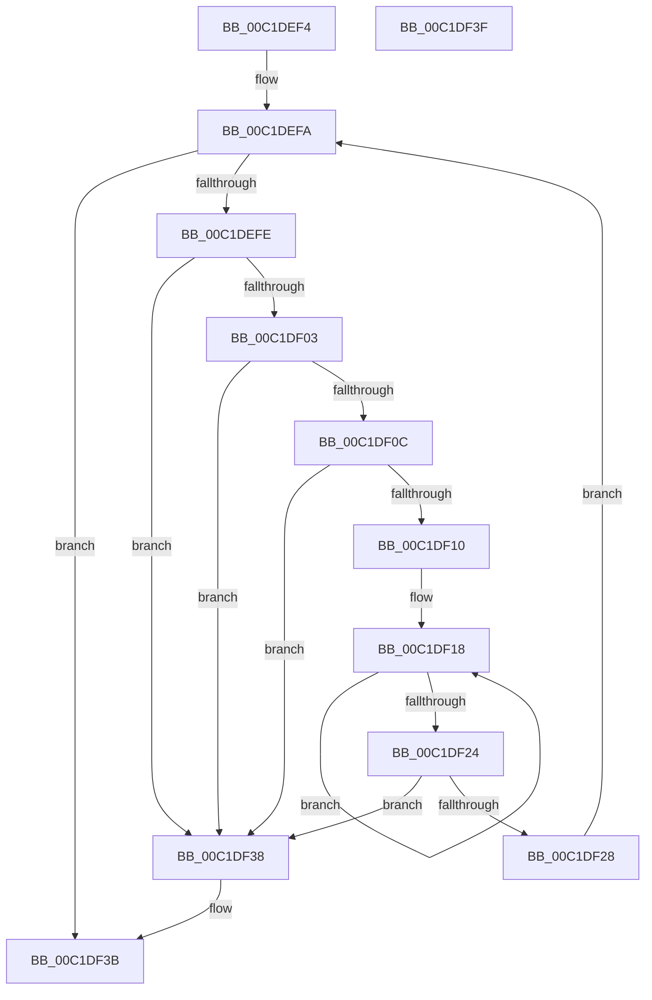

# HalpAcpiCalculateCacheSizeForOverrideTables

- RVA: `0x00C1DEF4`–`0x00C1DF40` (길이 `76` bytes)
- VA: `0x0000000140C1DEF4`
- 실행 섹션: `INIT`
- PDB 이름 있음: `예`; PDB Function 태그: `아니요`
- unwind 정보 RVA: `0x000DB714`
- 디코드: `30`개 명령, `76/76` bytes 표시
- 미해석 바이트: `0` (있으면 어셈블리에 `.byte`로 보존)

> 이 문서는 커널 이미지의 기계어와 PDB 기호를 분석해 생성했습니다. 4번과 5번은 함수 원형과 자료형을 바이너리 사용 방식에서 추정한 C 해석이며 원본 소스 복구 결과는 아닙니다.

## 1. Dependencies

- 직접 호출 지점: **0**; 고유 호출 대상: **0**
- 직접 호출자로 확인된 함수: **1**
- RIP 상대 이미지 참조: **0**

### Outgoing calls
- 직접 디코드된 call 명령이 없습니다.

### Direct callers
- [HalpAcpiTableCacheInit](../C7/HalpAcpiTableCacheInit_function_00C77650.md) at `0x00C77717`

### Static image references
- 디코드된 RIP-relative 메모리 참조가 없습니다.

## 2. Other-region calls and transfers

- 다른 실행 섹션으로 향하는 call: **0**
- 별도 외부 분기/꼬리 이동을 확인하지 못했습니다.

## 3. Assembly (complete function range)

```asm
00C1DEF4  4C 8B C9                        mov r9, rcx
00C1DEF7  45 33 C0                        xor r8d, r8d
00C1DEFA  85 D2                           test edx, edx
00C1DEFC  74 3D                           je 0x140c1df3b
00C1DEFE  83 FA 24                        cmp edx, 0x24
00C1DF01  72 35                           jb 0x140c1df38
00C1DF03  41 8B 49 04                     mov ecx, dword ptr [r9 + 4]
00C1DF07  83 F9 24                        cmp ecx, 0x24
00C1DF0A  72 2C                           jb 0x140c1df38
00C1DF0C  3B CA                           cmp ecx, edx
00C1DF0E  77 28                           ja 0x140c1df38
00C1DF10  4D 8B D1                        mov r10, r9
00C1DF13  32 C0                           xor al, al
00C1DF15  44 8B D9                        mov r11d, ecx
00C1DF18  41 02 02                        add al, byte ptr [r10]
00C1DF1B  49 FF C2                        inc r10
00C1DF1E  49 83 EB 01                     sub r11, 1
00C1DF22  75 F4                           jne 0x140c1df18
00C1DF24  84 C0                           test al, al
00C1DF26  75 10                           jne 0x140c1df38
00C1DF28  8D 41 1F                        lea eax, [rcx + 0x1f]
00C1DF2B  2B D1                           sub edx, ecx
00C1DF2D  83 E0 F8                        and eax, 0xfffffff8
00C1DF30  44 03 C0                        add r8d, eax
00C1DF33  4C 03 C9                        add r9, rcx
00C1DF36  EB C2                           jmp 0x140c1defa
00C1DF38  45 33 C0                        xor r8d, r8d
00C1DF3B  41 8B C0                        mov eax, r8d
00C1DF3E  C3                              ret
00C1DF3F  CC                              int3
```

## 4. C-style interpretation (structured pseudocode)

```c
__int64 __fastcall HalpAcpiCalculateCacheSizeForOverrideTables(__int64 a1, int a2, int a3)
{
    __int64 result;
    __int64 v_r10;
    __int64 v_r11;

    a3 = 0;
loc_00C1DEFA:
    if (a2 == 0) goto loc_00C1DF3B;
    if (a2 < 36) goto loc_00C1DF38;
    if (((unsigned int)((unsigned int)(*(unsigned int *)(a1 + 4)))) < 36) goto loc_00C1DF38;
    if (((unsigned int)((unsigned int)(*(unsigned int *)(a1 + 4)))) > a2) goto loc_00C1DF38;
    result = 0;
loc_00C1DF18:
    result = (unsigned __int8)((result) + (*(unsigned __int8 *)(a1)));
    v_r10 = (a1) + 1;
    v_r11 = ((unsigned int)((unsigned int)((unsigned int)(*(unsigned int *)(a1 + 4))))) - (1);
    if (condition_is_not_equal) goto loc_00C1DF18;
    if ((unsigned __int8)(result) != 0) goto loc_00C1DF38;
    a2 = (unsigned int)((a2) - ((unsigned int)((unsigned int)(*(unsigned int *)(a1 + 4)))));
    result = (unsigned int)(((unsigned int)(*(unsigned int *)(a1 + 4)) + 31) & (0xFFFFFFF8ULL));
    a3 = (unsigned int)((a3) + ((unsigned int)(result)));
    a4 = (a1) + ((unsigned int)(*(unsigned int *)(a1 + 4)));
    goto loc_00C1DEFA;
loc_00C1DF38:
    a3 = 0;
loc_00C1DF3B:
    return 0;
}
```

## 5. (Beta) C Style

```c
int64_t HalpAcpiCalculateCacheSizeForOverrideTables(void *Arg1, int32_t Arg2, int32_t Arg3)
{
    uint8_t *arg1 = (uint8_t *)Arg1;

    int64_t result;
    int64_t local_r10;
    int64_t local_r11;

    Arg3 = 0;
loc_00C1DEFA:
    if (Arg2 == 0) goto loc_00C1DF3B;
    if (Arg2 < 36) goto loc_00C1DF38;
    if (((uint32_t)((uint32_t)(*(uint32_t *)(arg1 + 0x4)))) < 36) goto loc_00C1DF38;
    if (((uint32_t)((uint32_t)(*(uint32_t *)(arg1 + 0x4)))) > Arg2) goto loc_00C1DF38;
    result = 0;
loc_00C1DF18:
    result = (uint8_t)((result) + (*(uint8_t *)(arg1)));
    local_r10 = (Arg1) + 1;
    local_r11 = ((uint32_t)((uint32_t)((uint32_t)(*(uint32_t *)(arg1 + 0x4))))) - (1);
    if (condition_is_not_equal) goto loc_00C1DF18;
    if ((uint8_t)(result) != 0) goto loc_00C1DF38;
    Arg2 = (uint32_t)((Arg2) - ((uint32_t)((uint32_t)(*(uint32_t *)(arg1 + 0x4)))));
    result = (uint32_t)(((uint32_t)(*(uint32_t *)(arg1 + 0x4)) + 31) & (0xFFFFFFF8ULL));
    Arg3 = (uint32_t)((Arg3) + ((uint32_t)(result)));
    a4 = (Arg1) + ((uint32_t)(*(uint32_t *)(arg1 + 0x4)));
    goto loc_00C1DEFA;
loc_00C1DF38:
    Arg3 = 0;
loc_00C1DF3B:
    return 0;
}
```

### 관측된 메모리 오프셋

구조체 형식이 확인되지 않은 접근은 인자 기준의 오프셋으로만 기록했습니다.

| 기준 인자 | 오프셋 표현 | 폭 (bit) | 접근 |
|---|---:|---:|---|
| `Arg1` | `+ 0x4` | `32` | `R` |

## 6. Execution-region graph

[열기: 2D/3D 그래프와 함수 탐색 컨트롤 패널](../../../control-panel.html?section=init&rva=0x00C1DEF4&view=graph)

- 2D 그래프는 위에서 아래로 흐르고, 3D 그래프는 빈 공간을 드래그해 회전합니다. Shift+드래그는 이동, 휠은 확대·축소, 함수 노드 선택은 대상 보고서 이동입니다.

### Static fallback


