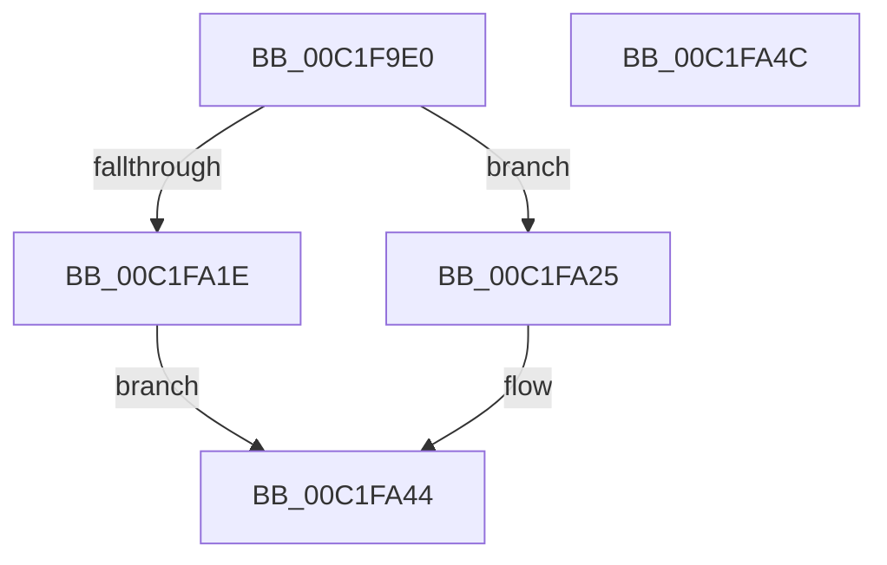

# HalpAcpiDetectPiix4

- RVA: `0x00C1F9E0`–`0x00C1FA4D` (길이 `109` bytes)
- VA: `0x0000000140C1F9E0`
- 실행 섹션: `INIT`
- PDB 이름 있음: `예`; PDB Function 태그: `아니요`
- unwind 정보 RVA: `0x0005CF00`
- 디코드: `27`개 명령, `109/109` bytes 표시
- 미해석 바이트: `0` (있으면 어셈블리에 `.byte`로 보존)

> 이 문서는 커널 이미지의 기계어와 PDB 기호를 분석해 생성했습니다. 4번과 5번은 함수 원형과 자료형을 바이너리 사용 방식에서 추정한 C 해석이며 원본 소스 복구 결과는 아닙니다.

## 1. Dependencies

- 직접 호출 지점: **2**; 고유 호출 대상: **2**
- 직접 호출자로 확인된 함수: **1**
- RIP 상대 이미지 참조: **7**

### Outgoing calls
- `0x00C1FA14` → [HalpMmAllocCtxAlloc](../../text/3E/HalpMmAllocCtxAlloc_function_003E10B8.md) (function, `0x003E10B8`)
- `0x00C1FA3F` → [ExQueueWorkItem](../../text/2F/ExQueueWorkItem_function_002F9520.md) (function, `0x002F9520`)

### Direct callers
- [HalpAcpiInitSystem](../../pagelk/B5/HalpAcpiInitSystem_function_00B5D390.md) at `0x00B5D3BD`

### Static image references
- `0x00C1F9E8` → RVA `0x00F8FE42` (`.data`; write)
- `0x00C1F9EF` → RVA `0x00F8FE48` (`.data`; read)
- `0x00C1F9F6` → RVA `0x00F8FE40` (`.data`; write)
- `0x00C1F9FD` → RVA `0x00F8FE44` (`.data`; write)
- `0x00C1FA03` → RVA `0x00F8FE50` (`.data`; write)
- `0x00C1FA0D` → RVA `0x00F8FE48` (`.data`; write)
- `0x00C1FA25` → RVA `0x00708810` (`HalpAcpiDetectPiix4Work`; read)

## 2. Other-region calls and transfers

- 다른 실행 섹션으로 향하는 call: **2**
  - `0x00C1FA14` → [HalpMmAllocCtxAlloc](../../text/3E/HalpMmAllocCtxAlloc_function_003E10B8.md) (`INIT` → `.text`)
  - `0x00C1FA3F` → [ExQueueWorkItem](../../text/2F/ExQueueWorkItem_function_002F9520.md) (`INIT` → `.text`)
- 별도 외부 분기/꼬리 이동을 확인하지 못했습니다.

## 3. Assembly (complete function range)

```asm
00C1F9E0  40 53                           push rbx
00C1F9E2  48 83 EC 20                     sub rsp, 0x20
00C1F9E6  33 DB                           xor ebx, ebx
00C1F9E8  C6 05 53 04 37 00 06            mov byte ptr [rip + 0x370453], 6
00C1F9EF  48 8D 05 52 04 37 00            lea rax, [rip + 0x370452]
00C1F9F6  66 89 1D 43 04 37 00            mov word ptr [rip + 0x370443], bx
00C1F9FD  89 1D 41 04 37 00               mov dword ptr [rip + 0x370441], ebx
00C1FA03  48 89 05 46 04 37 00            mov qword ptr [rip + 0x370446], rax
00C1FA0A  8D 53 20                        lea edx, [rbx + 0x20]
00C1FA0D  48 89 05 34 04 37 00            mov qword ptr [rip + 0x370434], rax
00C1FA14  E8 9F 16 7C FF                  call 0x1403e10b8
00C1FA19  48 85 C0                        test rax, rax
00C1FA1C  75 07                           jne 0x140c1fa25
00C1FA1E  BB 9A 00 00 C0                  mov ebx, 0xc000009a
00C1FA23  EB 1F                           jmp 0x140c1fa44
00C1FA25  48 8D 0D E4 8D AE FF            lea rcx, [rip - 0x51721c]
00C1FA2C  48 89 40 18                     mov qword ptr [rax + 0x18], rax
00C1FA30  48 89 48 10                     mov qword ptr [rax + 0x10], rcx
00C1FA34  BA 01 00 00 00                  mov edx, 1
00C1FA39  48 8B C8                        mov rcx, rax
00C1FA3C  48 89 18                        mov qword ptr [rax], rbx
00C1FA3F  E8 DC 9A 6D FF                  call 0x1402f9520
00C1FA44  8B C3                           mov eax, ebx
00C1FA46  48 83 C4 20                     add rsp, 0x20
00C1FA4A  5B                              pop rbx
00C1FA4B  C3                              ret
00C1FA4C  CC                              int3
```

## 4. C-style interpretation (structured pseudocode)

```c
__int64 __fastcall HalpAcpiDetectPiix4(void)
{
    __int64 result;
    __int64 v_rbx;
    __int64 v_rsp;

    v_rsp = (v_rsp) - (32);
    v_rbx = 0;
    *(unsigned __int8 *)(v_rip + 3605587) = 6;
    *(unsigned __int16 *)(v_rip + 3605571) = 0;
    *(unsigned int *)(v_rip + 3605569) = 0;
    *(unsigned __int64 *)(v_rip + 3605574) = v_rip + 3605586;
    *(unsigned __int64 *)(v_rip + 3605556) = v_rip + 3605586;
    result = HalpMmAllocCtxAlloc(a1, v_rbx + 32, a3, a4);
    if (result != 0) goto loc_00C1FA25;
    goto loc_00C1FA44;
loc_00C1FA25:
    *(unsigned __int64 *)(result + 24) = result;
    *(unsigned __int64 *)(result + 16) = v_rip - 5337628;
    *(unsigned __int64 *)(result) = (unsigned int)(0xC000009AULL);
    result = ExQueueWorkItem(result, 1, a3, a4);
loc_00C1FA44:
    v_rsp = (v_rsp) + (32);
    return (unsigned int)((unsigned int)((unsigned int)(0xC000009AULL)));
}
```

## 5. (Beta) C Style

```c
void HalpAcpiDetectPiix4(void)
{
    int64_t result;
    int64_t local_rbx;
    int64_t local_rsp;

    local_rsp = (local_rsp) - (32);
    local_rbx = 0;
    *(uint8_t *)(v_rip + 0x370453) = 6;
    *(uint16_t *)(v_rip + 0x370443) = 0;
    *(uint32_t *)(v_rip + 0x370441) = 0;
    *(uint64_t *)(v_rip + 0x370446) = v_rip + 3605586;
    *(uint64_t *)(v_rip + 0x370434) = v_rip + 3605586;
    result = HalpMmAllocCtxAlloc(a1, local_rbx + 32, a3, a4);
    if (result != 0) goto loc_00C1FA25;
    goto loc_00C1FA44;
loc_00C1FA25:
    *(uint64_t *)(result + 0x18) = result;
    *(uint64_t *)(result + 0x10) = v_rip - 5337628;
    *(uint64_t *)(result) = (uint32_t)(0xC000009AULL);
    result = ExQueueWorkItem(result, 1, a3, a4);
loc_00C1FA44:
    local_rsp = (local_rsp) + (32);
    return (uint32_t)((uint32_t)((uint32_t)(0xC000009AULL)));
}
```

## 6. Execution-region graph

[열기: 2D/3D 그래프와 함수 탐색 컨트롤 패널](../../../control-panel.html?section=init&rva=0x00C1F9E0&view=graph)

- 2D 그래프는 위에서 아래로 흐르고, 3D 그래프는 빈 공간을 드래그해 회전합니다. Shift+드래그는 이동, 휠은 확대·축소, 함수 노드 선택은 대상 보고서 이동입니다.

### Static fallback


