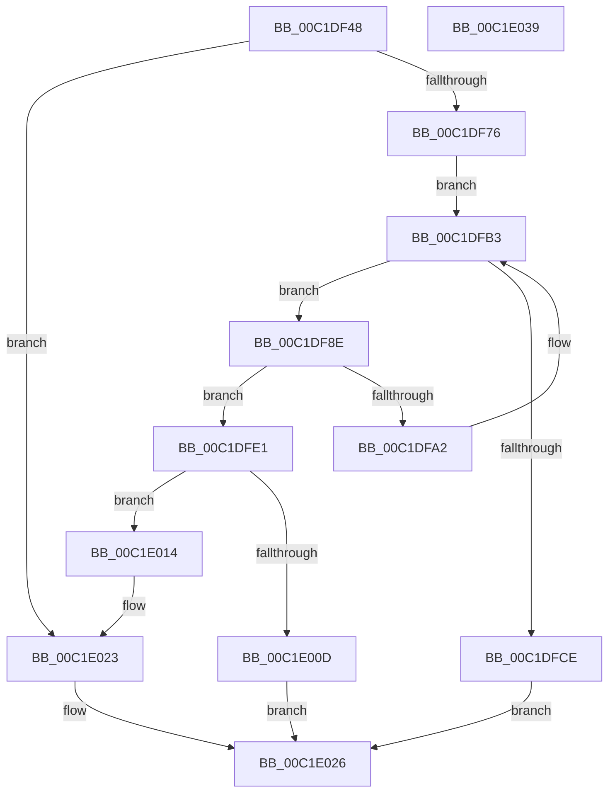

# HalpAcpiFindRsdp

- RVA: `0x00C1DF48`–`0x00C1E03A` (길이 `242` bytes)
- VA: `0x0000000140C1DF48`
- 실행 섹션: `INIT`
- PDB 이름 있음: `예`; PDB Function 태그: `아니요`
- unwind 정보 RVA: `0x000BF2D4`
- 디코드: `69`개 명령, `242/242` bytes 표시
- 미해석 바이트: `0` (있으면 어셈블리에 `.byte`로 보존)

> 이 문서는 커널 이미지의 기계어와 PDB 기호를 분석해 생성했습니다. 4번과 5번은 함수 원형과 자료형을 바이너리 사용 방식에서 추정한 C 해석이며 원본 소스 복구 결과는 아닙니다.

## 1. Dependencies

- 직접 호출 지점: **5**; 고유 호출 대상: **5**
- 직접 호출자로 확인된 함수: **1**
- RIP 상대 이미지 참조: **4**

### Outgoing calls
- `0x00C1DF99` → [strcmp](../../text/6C/strcmp_function_006C7000.md) (function, `0x006C7000`)
- `0x00C1DFC1` → [KeFindConfigurationNextEntry](../C3/KeFindConfigurationNextEntry_function_00C39540.md) (function, `0x00C39540`)
- `0x00C1DFD5` → [DbgPrint](../../text/35/DbgPrint_function_00358CB0.md) (function, `0x00358CB0`)
- `0x00C1DFF9` → [HalpAcpiAllocateMemory](../../text/53/HalpAcpiAllocateMemory_function_0053ECE0.md) (function, `0x0053ECE0`)
- `0x00C1E01E` → [memcpy](../../text/6C/memcpy_function_006C6840.md) (function, `0x006C6840`)

### Direct callers
- [HalpAcpiTableCacheInit](../C7/HalpAcpiTableCacheInit_function_00C77650.md) at `0x00C776E6`

### Static image references
- `0x00C1DF5A` → RVA `0x00E0F680` (`.data`; read)
- `0x00C1DF92` → RVA `0x00023980` (`.rdata`; read)
- `0x00C1DFCE` → RVA `0x00023990` (`.rdata`; read)
- `0x00C1DFFE` → RVA `0x00E0F680` (`.data`; write)

## 2. Other-region calls and transfers

- 다른 실행 섹션으로 향하는 call: **4**
  - `0x00C1DF99` → [strcmp](../../text/6C/strcmp_function_006C7000.md) (`INIT` → `.text`)
  - `0x00C1DFD5` → [DbgPrint](../../text/35/DbgPrint_function_00358CB0.md) (`INIT` → `.text`)
  - `0x00C1DFF9` → [HalpAcpiAllocateMemory](../../text/53/HalpAcpiAllocateMemory_function_0053ECE0.md) (`INIT` → `.text`)
  - `0x00C1E01E` → [memcpy](../../text/6C/memcpy_function_006C6840.md) (`INIT` → `.text`)
- 별도 외부 분기/꼬리 이동을 확인하지 못했습니다.

## 3. Assembly (complete function range)

```asm
00C1DF48  48 8B C4                        mov rax, rsp
00C1DF4B  48 89 58 08                     mov qword ptr [rax + 8], rbx
00C1DF4F  55                              push rbp
00C1DF50  56                              push rsi
00C1DF51  57                              push rdi
00C1DF52  41 56                           push r14
00C1DF54  41 57                           push r15
00C1DF56  48 83 EC 30                     sub rsp, 0x30
00C1DF5A  48 8B 3D 1F 17 1F 00            mov rdi, qword ptr [rip + 0x1f171f]
00C1DF61  33 DB                           xor ebx, ebx
00C1DF63  48 89 58 18                     mov qword ptr [rax + 0x18], rbx
00C1DF67  4C 8B FA                        mov r15, rdx
00C1DF6A  48 8B E9                        mov rbp, rcx
00C1DF6D  48 85 FF                        test rdi, rdi
00C1DF70  0F 85 AD 00 00 00               jne 0x140c1e023
00C1DF76  48 8B 89 B0 00 00 00            mov rcx, qword ptr [rcx + 0xb0]
00C1DF7D  8D 73 0C                        lea esi, [rbx + 0xc]
00C1DF80  48 89 58 20                     mov qword ptr [rax + 0x20], rbx
00C1DF84  48 8D 40 20                     lea rax, [rax + 0x20]
00C1DF88  44 8D 73 03                     lea r14d, [rbx + 3]
00C1DF8C  EB 25                           jmp 0x140c1dfb3
00C1DF8E  48 8B 4F 38                     mov rcx, qword ptr [rdi + 0x38]
00C1DF92  48 8D 15 E7 59 40 FF            lea rdx, [rip - 0xbfa619]
00C1DF99  E8 62 90 AA FF                  call 0x1406c7000
00C1DF9E  85 C0                           test eax, eax
00C1DFA0  74 3F                           je 0x140c1dfe1
00C1DFA2  48 8B 8D B0 00 00 00            mov rcx, qword ptr [rbp + 0xb0]
00C1DFA9  48 8D 44 24 70                  lea rax, [rsp + 0x70]
00C1DFAE  48 89 7C 24 70                  mov qword ptr [rsp + 0x70], rdi
00C1DFB3  45 33 C9                        xor r9d, r9d
00C1DFB6  48 89 44 24 20                  mov qword ptr [rsp + 0x20], rax
00C1DFBB  44 8B C6                        mov r8d, esi
00C1DFBE  41 8B D6                        mov edx, r14d
00C1DFC1  E8 7A B5 01 00                  call 0x140c39540
00C1DFC6  48 8B F8                        mov rdi, rax
00C1DFC9  48 85 C0                        test rax, rax
00C1DFCC  75 C0                           jne 0x140c1df8e
00C1DFCE  48 8D 0D BB 59 40 FF            lea rcx, [rip - 0xbfa645]
00C1DFD5  E8 D6 AC 73 FF                  call 0x140358cb0
00C1DFDA  BB 25 02 00 C0                  mov ebx, 0xc0000225
00C1DFDF  EB 45                           jmp 0x140c1e026
00C1DFE1  48 8B 77 40                     mov rsi, qword ptr [rdi + 0x40]
00C1DFE5  8B 46 24                        mov eax, dword ptr [rsi + 0x24]
00C1DFE8  8D 0C 40                        lea ecx, [rax + rax*2]
00C1DFEB  44 8D 34 CD 10 00 00 00         lea r14d, [rcx*8 + 0x10]
00C1DFF3  48 8B CD                        mov rcx, rbp
00C1DFF6  41 8B D6                        mov edx, r14d
00C1DFF9  E8 E2 0C 92 FF                  call 0x14053ece0
00C1DFFE  48 89 05 7B 16 1F 00            mov qword ptr [rip + 0x1f167b], rax
00C1E005  48 8B F8                        mov rdi, rax
00C1E008  48 85 C0                        test rax, rax
00C1E00B  75 07                           jne 0x140c1e014
00C1E00D  BB 9A 00 00 C0                  mov ebx, 0xc000009a
00C1E012  EB 12                           jmp 0x140c1e026
00C1E014  45 8B C6                        mov r8d, r14d
00C1E017  48 8D 56 1C                     lea rdx, [rsi + 0x1c]
00C1E01B  48 8B C8                        mov rcx, rax
00C1E01E  E8 1D 88 AA FF                  call 0x1406c6840
00C1E023  49 89 3F                        mov qword ptr [r15], rdi
00C1E026  8B C3                           mov eax, ebx
00C1E028  48 8B 5C 24 60                  mov rbx, qword ptr [rsp + 0x60]
00C1E02D  48 83 C4 30                     add rsp, 0x30
00C1E031  41 5F                           pop r15
00C1E033  41 5E                           pop r14
00C1E035  5F                              pop rdi
00C1E036  5E                              pop rsi
00C1E037  5D                              pop rbp
00C1E038  C3                              ret
00C1E039  CC                              int3
```

## 4. C-style interpretation (structured pseudocode)

```c
__int64 __fastcall HalpAcpiFindRsdp(__int64 a1, __int64 a2, __int64 a3, int a4)
{
    __int64 result;
    __int64 v_rbx;
    __int64 v_rsp;
    unsigned __int64 v_stack_m38;
    unsigned __int64 v_stack_p18;
    unsigned __int64 v_stack_p8;

    *(unsigned __int64 *)(v_rsp + 8) = v_rbx;
    v_rsp = (v_rsp) - (48);
    v_rbx = 0;
    *(unsigned __int64 *)(v_rsp + 24) = 0;
    if (*(unsigned __int64 *)(v_rip + 2037535) != 0) goto loc_00C1E023;
    *(unsigned __int64 *)(v_rsp + 32) = 0;
    goto loc_00C1DFB3;
loc_00C1DF8E:
    result = strcmp(*(unsigned __int64 *)(*(unsigned __int64 *)(v_rip + 2037535) + 56), v_rip - 12559897, a3, a4);
    if ((unsigned int)(result) == 0) goto loc_00C1DFE1;
    v_stack_p18 = *(unsigned __int64 *)(v_rip + 2037535);
loc_00C1DFB3:
    a4 = 0;
    v_stack_m38 = v_stack_p18;
    result = KeFindConfigurationNextEntry(*(unsigned __int64 *)(a1 + 176), (unsigned int)((unsigned int)(v_rbx + 3)), (unsigned int)((unsigned int)(v_rbx + 12)), a4);
    if (result != 0) goto loc_00C1DF8E;
    result = DbgPrint(v_rip - 12559941, (unsigned int)((unsigned int)(v_rbx + 3)), (unsigned int)((unsigned int)(v_rbx + 12)), a4);
    goto loc_00C1E026;
loc_00C1DFE1:
    result = HalpAcpiAllocateMemory(a1, (unsigned int)((unsigned int)((unsigned int)(*(unsigned int *)(*(unsigned __int64 *)(result + 64) + 36)) + (unsigned int)(*(unsigned int *)(*(unsigned __int64 *)(result + 64) + 36)) * 2 * 8 + 16)), (unsigned int)((unsigned int)(v_rbx + 12)), a4);
    *(unsigned __int64 *)(v_rip + 2037371) = result;
    if (result != 0) goto loc_00C1E014;
    goto loc_00C1E026;
loc_00C1E014:
    result = memcpy(result, *(unsigned __int64 *)(result + 64) + 28, (unsigned int)((unsigned int)((unsigned int)(*(unsigned int *)(*(unsigned __int64 *)(result + 64) + 36)) + (unsigned int)(*(unsigned int *)(*(unsigned __int64 *)(result + 64) + 36)) * 2 * 8 + 16)), a4);
loc_00C1E023:
    *(unsigned __int64 *)(a2) = result;
loc_00C1E026:
    v_rsp = (v_rsp) + (48);
    return (unsigned int)((unsigned int)((unsigned int)(0xC000009AULL)));
}
```

## 5. (Beta) C Style

```c
int64_t HalpAcpiFindRsdp(void *Arg1, void *Arg2, int64_t Arg3, int32_t Arg4)
{
    uint8_t *arg1 = (uint8_t *)Arg1;
    uint8_t *arg2 = (uint8_t *)Arg2;

    int64_t result;
    int64_t local_rbx;
    int64_t local_rsp;
    uint64_t v_stack_m38;
    uint64_t v_stack_p18;
    uint64_t v_stack_p8;

    *(uint64_t *)(local_rsp + 0x8) = local_rbx;
    local_rsp = (local_rsp) - (48);
    local_rbx = 0;
    *(uint64_t *)(local_rsp + 0x18) = 0;
    if (*(uint64_t *)(v_rip + 0x1F171F) != 0) goto loc_00C1E023;
    *(uint64_t *)(local_rsp + 0x20) = 0;
    goto loc_00C1DFB3;
loc_00C1DF8E:
    result = strcmp(*(uint64_t *)(*(uint64_t *)(v_rip + 0x1F171F) + 0x38), v_rip - 12559897, Arg3, Arg4);
    if ((uint32_t)(result) == 0) goto loc_00C1DFE1;
    v_stack_p18 = *(uint64_t *)(v_rip + 0x1F171F);
loc_00C1DFB3:
    Arg4 = 0;
    v_stack_m38 = v_stack_p18;
    result = KeFindConfigurationNextEntry(*(uint64_t *)(arg1 + 0xB0), (uint32_t)((uint32_t)(local_rbx + 3)), (uint32_t)((uint32_t)(local_rbx + 12)), Arg4);
    if (result != 0) goto loc_00C1DF8E;
    result = DbgPrint(v_rip - 12559941, (uint32_t)((uint32_t)(local_rbx + 3)), (uint32_t)((uint32_t)(local_rbx + 12)), Arg4);
    goto loc_00C1E026;
loc_00C1DFE1:
    result = HalpAcpiAllocateMemory(Arg1, (uint32_t)((uint32_t)((uint32_t)(*(uint32_t *)(*(uint64_t *)(result + 0x40) + 0x24)) + (uint32_t)(*(uint32_t *)(*(uint64_t *)(result + 0x40) + 0x24)) * 2 * 8 + 16)), (uint32_t)((uint32_t)(local_rbx + 12)), Arg4);
    *(uint64_t *)(v_rip + 0x1F167B) = result;
    if (result != 0) goto loc_00C1E014;
    goto loc_00C1E026;
loc_00C1E014:
    result = memcpy(result, *(uint64_t *)(result + 0x40) + 28, (uint32_t)((uint32_t)((uint32_t)(*(uint32_t *)(*(uint64_t *)(result + 0x40) + 0x24)) + (uint32_t)(*(uint32_t *)(*(uint64_t *)(result + 0x40) + 0x24)) * 2 * 8 + 16)), Arg4);
loc_00C1E023:
    *(uint64_t *)(arg2) = result;
loc_00C1E026:
    local_rsp = (local_rsp) + (48);
    return (uint32_t)((uint32_t)((uint32_t)(0xC000009AULL)));
}
```

### 관측된 메모리 오프셋

구조체 형식이 확인되지 않은 접근은 인자 기준의 오프셋으로만 기록했습니다.

| 기준 인자 | 오프셋 표현 | 폭 (bit) | 접근 |
|---|---:|---:|---|
| `Arg1` | `+ 0xB0` | `64` | `R` |
| `Arg2` | `+ 0x0` | `64` | `W` |

## 6. Execution-region graph

[열기: 2D/3D 그래프와 함수 탐색 컨트롤 패널](../../../control-panel.html?section=init&rva=0x00C1DF48&view=graph)

- 2D 그래프는 위에서 아래로 흐르고, 3D 그래프는 빈 공간을 드래그해 회전합니다. Shift+드래그는 이동, 휠은 확대·축소, 함수 노드 선택은 대상 보고서 이동입니다.

### Static fallback


