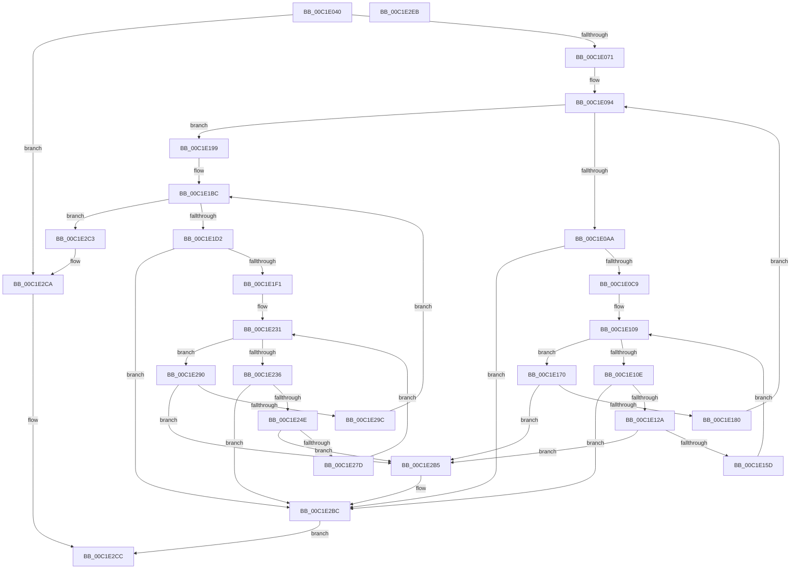

# HalpAcpiPrmCacheInit

- RVA: `0x00C1E040`–`0x00C1E2EC` (길이 `684` bytes)
- VA: `0x0000000140C1E040`
- 실행 섹션: `INIT`
- PDB 이름 있음: `예`; PDB Function 태그: `아니요`
- unwind 정보 RVA: `0x0005FEF8`
- 디코드: `166`개 명령, `684/684` bytes 표시
- 미해석 바이트: `0` (있으면 어셈블리에 `.byte`로 보존)

> 이 문서는 커널 이미지의 기계어와 PDB 기호를 분석해 생성했습니다. 4번과 5번은 함수 원형과 자료형을 바이너리 사용 방식에서 추정한 C 해석이며 원본 소스 복구 결과는 아닙니다.

## 1. Dependencies

- 직접 호출 지점: **4**; 고유 호출 대상: **1**
- 직접 호출자로 확인된 함수: **1**
- RIP 상대 이미지 참조: **11**

### Outgoing calls
- `0x00C1E0B8` → [ExAllocatePool2](../../poolcode/B8/ExAllocatePool2_function_00B820F0.md) (function, `0x00B820F0`)
- `0x00C1E11C` → [ExAllocatePool2](../../poolcode/B8/ExAllocatePool2_function_00B820F0.md) (function, `0x00B820F0`)
- `0x00C1E1E0` → [ExAllocatePool2](../../poolcode/B8/ExAllocatePool2_function_00B820F0.md) (function, `0x00B820F0`)
- `0x00C1E244` → [ExAllocatePool2](../../poolcode/B8/ExAllocatePool2_function_00B820F0.md) (function, `0x00B820F0`)

### Direct callers
- [HalpAcpiInitSystem](../../pagelk/B5/HalpAcpiInitSystem_function_00B5D390.md) at `0x00B5D3CD`

### Static image references
- `0x00C1E05D` → RVA `0x00E0F678` (`.data`; read)
- `0x00C1E064` → RVA `0x00FC1A00` (`.data`; read)
- `0x00C1E071` → RVA `0x00E0F650` (`.data`; read)
- `0x00C1E078` → RVA `0x00E0F658` (`.data`; write)
- `0x00C1E07F` → RVA `0x00E0F650` (`.data`; write)
- `0x00C1E170` → RVA `0x00E0F658` (`.data`; read)
- `0x00C1E199` → RVA `0x00E0F688` (`.data`; read)
- `0x00C1E1A0` → RVA `0x00E0F690` (`.data`; write)
- `0x00C1E1A7` → RVA `0x00E0F688` (`.data`; write)
- `0x00C1E290` → RVA `0x00E0F690` (`.data`; read)
- `0x00C1E2C3` → RVA `0x00E0F678` (`.data`; write)

## 2. Other-region calls and transfers

- 다른 실행 섹션으로 향하는 call: **4**
  - `0x00C1E0B8` → [ExAllocatePool2](../../poolcode/B8/ExAllocatePool2_function_00B820F0.md) (`INIT` → `POOLCODE`)
  - `0x00C1E11C` → [ExAllocatePool2](../../poolcode/B8/ExAllocatePool2_function_00B820F0.md) (`INIT` → `POOLCODE`)
  - `0x00C1E1E0` → [ExAllocatePool2](../../poolcode/B8/ExAllocatePool2_function_00B820F0.md) (`INIT` → `POOLCODE`)
  - `0x00C1E244` → [ExAllocatePool2](../../poolcode/B8/ExAllocatePool2_function_00B820F0.md) (`INIT` → `POOLCODE`)
- 별도 외부 분기/꼬리 이동을 확인하지 못했습니다.

## 3. Assembly (complete function range)

```asm
00C1E040  48 8B C4                        mov rax, rsp
00C1E043  48 89 58 08                     mov qword ptr [rax + 8], rbx
00C1E047  48 89 68 10                     mov qword ptr [rax + 0x10], rbp
00C1E04B  48 89 70 18                     mov qword ptr [rax + 0x18], rsi
00C1E04F  48 89 78 20                     mov qword ptr [rax + 0x20], rdi
00C1E053  41 54                           push r12
00C1E055  41 56                           push r14
00C1E057  41 57                           push r15
00C1E059  48 83 EC 20                     sub rsp, 0x20
00C1E05D  80 3D 14 16 1F 00 00            cmp byte ptr [rip + 0x1f1614], 0
00C1E064  48 8B 2D 95 39 3A 00            mov rbp, qword ptr [rip + 0x3a3995]
00C1E06B  0F 85 59 02 00 00               jne 0x140c1e2ca
00C1E071  4C 8D 25 D8 15 1F 00            lea r12, [rip + 0x1f15d8]
00C1E078  4C 89 25 D9 15 1F 00            mov qword ptr [rip + 0x1f15d9], r12
00C1E07F  4C 89 25 CA 15 1F 00            mov qword ptr [rip + 0x1f15ca], r12
00C1E086  48 8B 85 F0 00 00 00            mov rax, qword ptr [rbp + 0xf0]
00C1E08D  48 8B B8 28 0A 00 00            mov rdi, qword ptr [rax + 0xa28]
00C1E094  48 8B 85 F0 00 00 00            mov rax, qword ptr [rbp + 0xf0]
00C1E09B  48 05 28 0A 00 00               add rax, 0xa28
00C1E0A1  48 3B F8                        cmp rdi, rax
00C1E0A4  0F 84 EF 00 00 00               je 0x140c1e199
00C1E0AA  BA 60 00 00 00                  mov edx, 0x60
00C1E0AF  41 B8 48 61 6C 41               mov r8d, 0x416c6148
00C1E0B5  8D 4A E0                        lea ecx, [rdx - 0x20]
00C1E0B8  E8 33 40 F6 FF                  call 0x140b820f0
00C1E0BD  48 8B D8                        mov rbx, rax
00C1E0C0  48 85 C0                        test rax, rax
00C1E0C3  0F 84 F3 01 00 00               je 0x140c1e2bc
00C1E0C9  0F 10 07                        movups xmm0, xmmword ptr [rdi]
00C1E0CC  4C 8D 70 50                     lea r14, [rax + 0x50]
00C1E0D0  4C 8D 7F 50                     lea r15, [rdi + 0x50]
00C1E0D4  0F 11 00                        movups xmmword ptr [rax], xmm0
00C1E0D7  0F 10 4F 10                     movups xmm1, xmmword ptr [rdi + 0x10]
00C1E0DB  0F 11 48 10                     movups xmmword ptr [rax + 0x10], xmm1
00C1E0DF  0F 10 47 20                     movups xmm0, xmmword ptr [rdi + 0x20]
00C1E0E3  0F 11 40 20                     movups xmmword ptr [rax + 0x20], xmm0
00C1E0E7  0F 10 4F 30                     movups xmm1, xmmword ptr [rdi + 0x30]
00C1E0EB  0F 11 48 30                     movups xmmword ptr [rax + 0x30], xmm1
00C1E0EF  0F 10 47 40                     movups xmm0, xmmword ptr [rdi + 0x40]
00C1E0F3  0F 11 40 40                     movups xmmword ptr [rax + 0x40], xmm0
00C1E0F7  0F 10 4F 50                     movups xmm1, xmmword ptr [rdi + 0x50]
00C1E0FB  0F 11 48 50                     movups xmmword ptr [rax + 0x50], xmm1
00C1E0FF  4D 89 76 08                     mov qword ptr [r14 + 8], r14
00C1E103  4D 89 36                        mov qword ptr [r14], r14
00C1E106  49 8B 37                        mov rsi, qword ptr [r15]
00C1E109  49 3B F7                        cmp rsi, r15
00C1E10C  74 62                           je 0x140c1e170
00C1E10E  BA 50 00 00 00                  mov edx, 0x50
00C1E113  41 B8 48 61 6C 41               mov r8d, 0x416c6148
00C1E119  8D 4A F0                        lea ecx, [rdx - 0x10]
00C1E11C  E8 CF 3F F6 FF                  call 0x140b820f0
00C1E121  48 85 C0                        test rax, rax
00C1E124  0F 84 92 01 00 00               je 0x140c1e2bc
00C1E12A  0F 10 06                        movups xmm0, xmmword ptr [rsi]
00C1E12D  0F 11 00                        movups xmmword ptr [rax], xmm0
00C1E130  0F 10 4E 10                     movups xmm1, xmmword ptr [rsi + 0x10]
00C1E134  0F 11 48 10                     movups xmmword ptr [rax + 0x10], xmm1
00C1E138  0F 10 46 20                     movups xmm0, xmmword ptr [rsi + 0x20]
00C1E13C  0F 11 40 20                     movups xmmword ptr [rax + 0x20], xmm0
00C1E140  0F 10 4E 30                     movups xmm1, xmmword ptr [rsi + 0x30]
00C1E144  0F 11 48 30                     movups xmmword ptr [rax + 0x30], xmm1
00C1E148  0F 10 46 40                     movups xmm0, xmmword ptr [rsi + 0x40]
00C1E14C  0F 11 40 40                     movups xmmword ptr [rax + 0x40], xmm0
00C1E150  49 8B 4E 08                     mov rcx, qword ptr [r14 + 8]
00C1E154  4C 39 31                        cmp qword ptr [rcx], r14
00C1E157  0F 85 58 01 00 00               jne 0x140c1e2b5
00C1E15D  4C 89 30                        mov qword ptr [rax], r14
00C1E160  48 89 48 08                     mov qword ptr [rax + 8], rcx
00C1E164  48 89 01                        mov qword ptr [rcx], rax
00C1E167  49 89 46 08                     mov qword ptr [r14 + 8], rax
00C1E16B  48 8B 36                        mov rsi, qword ptr [rsi]
00C1E16E  EB 99                           jmp 0x140c1e109
00C1E170  48 8B 05 E1 14 1F 00            mov rax, qword ptr [rip + 0x1f14e1]
00C1E177  4C 39 20                        cmp qword ptr [rax], r12
00C1E17A  0F 85 35 01 00 00               jne 0x140c1e2b5
00C1E180  4C 89 23                        mov qword ptr [rbx], r12
00C1E183  48 89 43 08                     mov qword ptr [rbx + 8], rax
00C1E187  48 89 18                        mov qword ptr [rax], rbx
00C1E18A  48 89 1D C7 14 1F 00            mov qword ptr [rip + 0x1f14c7], rbx
00C1E191  48 8B 3F                        mov rdi, qword ptr [rdi]
00C1E194  E9 FB FE FF FF                  jmp 0x140c1e094
00C1E199  4C 8D 25 E8 14 1F 00            lea r12, [rip + 0x1f14e8]
00C1E1A0  4C 89 25 E9 14 1F 00            mov qword ptr [rip + 0x1f14e9], r12
00C1E1A7  4C 89 25 DA 14 1F 00            mov qword ptr [rip + 0x1f14da], r12
00C1E1AE  48 8B 85 F0 00 00 00            mov rax, qword ptr [rbp + 0xf0]
00C1E1B5  48 8B B8 38 0A 00 00            mov rdi, qword ptr [rax + 0xa38]
00C1E1BC  48 8B 85 F0 00 00 00            mov rax, qword ptr [rbp + 0xf0]
00C1E1C3  48 05 38 0A 00 00               add rax, 0xa38
00C1E1C9  48 3B F8                        cmp rdi, rax
00C1E1CC  0F 84 F1 00 00 00               je 0x140c1e2c3
00C1E1D2  BA 60 00 00 00                  mov edx, 0x60
00C1E1D7  41 B8 48 61 6C 41               mov r8d, 0x416c6148
00C1E1DD  8D 4A E0                        lea ecx, [rdx - 0x20]
00C1E1E0  E8 0B 3F F6 FF                  call 0x140b820f0
00C1E1E5  48 8B D8                        mov rbx, rax
00C1E1E8  48 85 C0                        test rax, rax
00C1E1EB  0F 84 CB 00 00 00               je 0x140c1e2bc
00C1E1F1  0F 10 07                        movups xmm0, xmmword ptr [rdi]
00C1E1F4  4C 8D 70 50                     lea r14, [rax + 0x50]
00C1E1F8  4C 8D 7F 50                     lea r15, [rdi + 0x50]
00C1E1FC  0F 11 00                        movups xmmword ptr [rax], xmm0
00C1E1FF  0F 10 4F 10                     movups xmm1, xmmword ptr [rdi + 0x10]
00C1E203  0F 11 48 10                     movups xmmword ptr [rax + 0x10], xmm1
00C1E207  0F 10 47 20                     movups xmm0, xmmword ptr [rdi + 0x20]
00C1E20B  0F 11 40 20                     movups xmmword ptr [rax + 0x20], xmm0
00C1E20F  0F 10 4F 30                     movups xmm1, xmmword ptr [rdi + 0x30]
00C1E213  0F 11 48 30                     movups xmmword ptr [rax + 0x30], xmm1
00C1E217  0F 10 47 40                     movups xmm0, xmmword ptr [rdi + 0x40]
00C1E21B  0F 11 40 40                     movups xmmword ptr [rax + 0x40], xmm0
00C1E21F  0F 10 4F 50                     movups xmm1, xmmword ptr [rdi + 0x50]
00C1E223  0F 11 48 50                     movups xmmword ptr [rax + 0x50], xmm1
00C1E227  4D 89 76 08                     mov qword ptr [r14 + 8], r14
00C1E22B  4D 89 36                        mov qword ptr [r14], r14
00C1E22E  49 8B 37                        mov rsi, qword ptr [r15]
00C1E231  49 3B F7                        cmp rsi, r15
00C1E234  74 5A                           je 0x140c1e290
00C1E236  BA 50 00 00 00                  mov edx, 0x50
00C1E23B  41 B8 48 61 6C 41               mov r8d, 0x416c6148
00C1E241  8D 4A F0                        lea ecx, [rdx - 0x10]
00C1E244  E8 A7 3E F6 FF                  call 0x140b820f0
00C1E249  48 85 C0                        test rax, rax
00C1E24C  74 6E                           je 0x140c1e2bc
00C1E24E  0F 10 06                        movups xmm0, xmmword ptr [rsi]
00C1E251  0F 11 00                        movups xmmword ptr [rax], xmm0
00C1E254  0F 10 4E 10                     movups xmm1, xmmword ptr [rsi + 0x10]
00C1E258  0F 11 48 10                     movups xmmword ptr [rax + 0x10], xmm1
00C1E25C  0F 10 46 20                     movups xmm0, xmmword ptr [rsi + 0x20]
00C1E260  0F 11 40 20                     movups xmmword ptr [rax + 0x20], xmm0
00C1E264  0F 10 4E 30                     movups xmm1, xmmword ptr [rsi + 0x30]
00C1E268  0F 11 48 30                     movups xmmword ptr [rax + 0x30], xmm1
00C1E26C  0F 10 46 40                     movups xmm0, xmmword ptr [rsi + 0x40]
00C1E270  0F 11 40 40                     movups xmmword ptr [rax + 0x40], xmm0
00C1E274  49 8B 4E 08                     mov rcx, qword ptr [r14 + 8]
00C1E278  4C 39 31                        cmp qword ptr [rcx], r14
00C1E27B  75 38                           jne 0x140c1e2b5
00C1E27D  4C 89 30                        mov qword ptr [rax], r14
00C1E280  48 89 48 08                     mov qword ptr [rax + 8], rcx
00C1E284  48 89 01                        mov qword ptr [rcx], rax
00C1E287  49 89 46 08                     mov qword ptr [r14 + 8], rax
00C1E28B  48 8B 36                        mov rsi, qword ptr [rsi]
00C1E28E  EB A1                           jmp 0x140c1e231
00C1E290  48 8B 05 F9 13 1F 00            mov rax, qword ptr [rip + 0x1f13f9]
00C1E297  4C 39 20                        cmp qword ptr [rax], r12
00C1E29A  75 19                           jne 0x140c1e2b5
00C1E29C  4C 89 23                        mov qword ptr [rbx], r12
00C1E29F  48 89 43 08                     mov qword ptr [rbx + 8], rax
00C1E2A3  48 89 18                        mov qword ptr [rax], rbx
00C1E2A6  48 89 1D E3 13 1F 00            mov qword ptr [rip + 0x1f13e3], rbx
00C1E2AD  48 8B 3F                        mov rdi, qword ptr [rdi]
00C1E2B0  E9 07 FF FF FF                  jmp 0x140c1e1bc
00C1E2B5  B9 03 00 00 00                  mov ecx, 3
00C1E2BA  CD 29                           int 0x29
00C1E2BC  B8 17 00 00 C0                  mov eax, 0xc0000017
00C1E2C1  EB 09                           jmp 0x140c1e2cc
00C1E2C3  C6 05 AE 13 1F 00 01            mov byte ptr [rip + 0x1f13ae], 1
00C1E2CA  33 C0                           xor eax, eax
00C1E2CC  48 8B 5C 24 40                  mov rbx, qword ptr [rsp + 0x40]
00C1E2D1  48 8B 6C 24 48                  mov rbp, qword ptr [rsp + 0x48]
00C1E2D6  48 8B 74 24 50                  mov rsi, qword ptr [rsp + 0x50]
00C1E2DB  48 8B 7C 24 58                  mov rdi, qword ptr [rsp + 0x58]
00C1E2E0  48 83 C4 20                     add rsp, 0x20
00C1E2E4  41 5F                           pop r15
00C1E2E6  41 5E                           pop r14
00C1E2E8  41 5C                           pop r12
00C1E2EA  C3                              ret
00C1E2EB  CC                              int3
```

## 4. C-style interpretation (structured pseudocode)

```c
__int64 __fastcall HalpAcpiPrmCacheInit(void)
{
    __int64 result;
    __int64 v_rsp;
    unsigned __int64 v_stack_p10;
    unsigned __int64 v_stack_p18;
    unsigned __int64 v_stack_p20;
    unsigned __int64 v_stack_p8;

    *(unsigned __int64 *)(v_rsp + 8) = v_rbx;
    *(unsigned __int64 *)(v_rsp + 16) = v_rbp;
    *(unsigned __int64 *)(v_rsp + 24) = v_rsi;
    *(unsigned __int64 *)(v_rsp + 32) = v_rdi;
    v_rsp = (v_rsp) - (32);
    if ((*(unsigned __int8 *)(v_rip + 2037268)) != 0) goto loc_00C1E2CA;
    *(unsigned __int64 *)(v_rip + 2037209) = v_rip + 2037208;
    *(unsigned __int64 *)(v_rip + 2037194) = v_rip + 2037208;
loc_00C1E094:
    result = (*(unsigned __int64 *)(*(unsigned __int64 *)(v_rip + 3815829) + 240)) + (0xA28ULL);
    if ((*(unsigned __int64 *)(*(unsigned __int64 *)(*(unsigned __int64 *)(v_rip + 3815829) + 240) + 2600)) == result) goto loc_00C1E199;
    result = ExAllocatePool2(96 - 32, 96, (unsigned int)(0x416C6148ULL), a4);
    if (result == 0) goto loc_00C1E2BC;
    *(unsigned __int64 *)(result) = v_xmm0;
    *(unsigned __int64 *)(result + 16) = v_xmm1;
    *(unsigned __int64 *)(result + 32) = v_xmm0;
    *(unsigned __int64 *)(result + 48) = v_xmm1;
    *(unsigned __int64 *)(result + 64) = v_xmm0;
    *(unsigned __int64 *)(result + 80) = v_xmm1;
    *(unsigned __int64 *)(result + 80 + 8) = result + 80;
    *(unsigned __int64 *)(result + 80) = result + 80;
loc_00C1E109:
    if ((*(unsigned __int64 *)(*(unsigned __int64 *)(*(unsigned __int64 *)(*(unsigned __int64 *)(v_rip + 3815829) + 240) + 2600) + 80)) == (*(unsigned __int64 *)(*(unsigned __int64 *)(*(unsigned __int64 *)(v_rip + 3815829) + 240) + 2600) + 80)) goto loc_00C1E170;
    result = ExAllocatePool2(80 - 16, 80, (unsigned int)(0x416C6148ULL), a4);
    if (result == 0) goto loc_00C1E2BC;
    *(unsigned __int64 *)(result) = v_xmm0;
    *(unsigned __int64 *)(result + 16) = v_xmm1;
    *(unsigned __int64 *)(result + 32) = v_xmm0;
    *(unsigned __int64 *)(result + 48) = v_xmm1;
    *(unsigned __int64 *)(result + 64) = v_xmm0;
    if ((*(unsigned __int64 *)(*(unsigned __int64 *)(result + 80 + 8))) != (result + 80)) goto loc_00C1E2B5;
    *(unsigned __int64 *)(result) = result + 80;
    *(unsigned __int64 *)(result + 8) = *(unsigned __int64 *)(result + 80 + 8);
    *(unsigned __int64 *)(*(unsigned __int64 *)(result + 80 + 8)) = result;
    *(unsigned __int64 *)(result + 80 + 8) = result;
    goto loc_00C1E109;
loc_00C1E170:
    if ((*(unsigned __int64 *)(*(unsigned __int64 *)(v_rip + 2036961))) != (v_rip + 2037208)) goto loc_00C1E2B5;
    *(unsigned __int64 *)(result) = v_rip + 2037208;
    *(unsigned __int64 *)(result + 8) = *(unsigned __int64 *)(v_rip + 2036961);
    *(unsigned __int64 *)(*(unsigned __int64 *)(v_rip + 2036961)) = result;
    *(unsigned __int64 *)(v_rip + 2036935) = result;
    goto loc_00C1E094;
loc_00C1E199:
    *(unsigned __int64 *)(v_rip + 2036969) = v_rip + 2036968;
    *(unsigned __int64 *)(v_rip + 2036954) = v_rip + 2036968;
loc_00C1E1BC:
    result = (*(unsigned __int64 *)(*(unsigned __int64 *)(v_rip + 3815829) + 240)) + (0xA38ULL);
    if ((*(unsigned __int64 *)(*(unsigned __int64 *)(*(unsigned __int64 *)(v_rip + 3815829) + 240) + 2616)) == result) goto loc_00C1E2C3;
    result = ExAllocatePool2(96 - 32, 96, (unsigned int)(0x416C6148ULL), a4);
    if (result == 0) goto loc_00C1E2BC;
    *(unsigned __int64 *)(result) = v_xmm0;
    *(unsigned __int64 *)(result + 16) = v_xmm1;
    *(unsigned __int64 *)(result + 32) = v_xmm0;
    *(unsigned __int64 *)(result + 48) = v_xmm1;
    *(unsigned __int64 *)(result + 64) = v_xmm0;
    *(unsigned __int64 *)(result + 80) = v_xmm1;
    *(unsigned __int64 *)(result + 80 + 8) = result + 80;
    *(unsigned __int64 *)(result + 80) = result + 80;
loc_00C1E231:
    if ((*(unsigned __int64 *)(*(unsigned __int64 *)(*(unsigned __int64 *)(*(unsigned __int64 *)(v_rip + 3815829) + 240) + 2616) + 80)) == (*(unsigned __int64 *)(*(unsigned __int64 *)(*(unsigned __int64 *)(v_rip + 3815829) + 240) + 2616) + 80)) goto loc_00C1E290;
    result = ExAllocatePool2(80 - 16, 80, (unsigned int)(0x416C6148ULL), a4);
    if (result == 0) goto loc_00C1E2BC;
    *(unsigned __int64 *)(result) = v_xmm0;
    *(unsigned __int64 *)(result + 16) = v_xmm1;
    *(unsigned __int64 *)(result + 32) = v_xmm0;
    *(unsigned __int64 *)(result + 48) = v_xmm1;
    *(unsigned __int64 *)(result + 64) = v_xmm0;
    if ((*(unsigned __int64 *)(*(unsigned __int64 *)(result + 80 + 8))) != (result + 80)) goto loc_00C1E2B5;
    *(unsigned __int64 *)(result) = result + 80;
    *(unsigned __int64 *)(result + 8) = *(unsigned __int64 *)(result + 80 + 8);
    *(unsigned __int64 *)(*(unsigned __int64 *)(result + 80 + 8)) = result;
    *(unsigned __int64 *)(result + 80 + 8) = result;
    goto loc_00C1E231;
loc_00C1E290:
    if ((*(unsigned __int64 *)(*(unsigned __int64 *)(v_rip + 2036729))) != (v_rip + 2036968)) goto loc_00C1E2B5;
    *(unsigned __int64 *)(result) = v_rip + 2036968;
    *(unsigned __int64 *)(result + 8) = *(unsigned __int64 *)(v_rip + 2036729);
    *(unsigned __int64 *)(*(unsigned __int64 *)(v_rip + 2036729)) = result;
    *(unsigned __int64 *)(v_rip + 2036707) = result;
    goto loc_00C1E1BC;
loc_00C1E2B5:
loc_00C1E2BC:
    goto loc_00C1E2CC;
loc_00C1E2C3:
    *(unsigned __int8 *)(v_rip + 2036654) = 1;
loc_00C1E2CA:
    result = 0;
loc_00C1E2CC:
    v_rsp = (v_rsp) + (32);
    return result;
}
```

## 5. (Beta) C Style

```c
void HalpAcpiPrmCacheInit(void)
{
    int64_t result;
    int64_t local_rsp;
    uint64_t v_stack_p10;
    uint64_t v_stack_p18;
    uint64_t v_stack_p20;
    uint64_t v_stack_p8;

    *(uint64_t *)(local_rsp + 0x8) = local_rbx;
    *(uint64_t *)(local_rsp + 0x10) = local_rbp;
    *(uint64_t *)(local_rsp + 0x18) = local_rsi;
    *(uint64_t *)(local_rsp + 0x20) = local_rdi;
    local_rsp = (local_rsp) - (32);
    if ((*(uint8_t *)(v_rip + 0x1F1614)) != 0) goto loc_00C1E2CA;
    *(uint64_t *)(v_rip + 0x1F15D9) = v_rip + 2037208;
    *(uint64_t *)(v_rip + 0x1F15CA) = v_rip + 2037208;
loc_00C1E094:
    result = (*(uint64_t *)(*(uint64_t *)(v_rip + 0x3A3995) + 0xF0)) + (0xA28ULL);
    if ((*(uint64_t *)(*(uint64_t *)(*(uint64_t *)(v_rip + 0x3A3995) + 0xF0) + 0xA28)) == result) goto loc_00C1E199;
    result = ExAllocatePool2(96 - 32, 96, (uint32_t)(0x416C6148ULL), a4);
    if (result == 0) goto loc_00C1E2BC;
    *(uint64_t *)(result) = v_xmm0;
    *(uint64_t *)(result + 0x10) = v_xmm1;
    *(uint64_t *)(result + 0x20) = v_xmm0;
    *(uint64_t *)(result + 0x30) = v_xmm1;
    *(uint64_t *)(result + 0x40) = v_xmm0;
    *(uint64_t *)(result + 0x50) = v_xmm1;
    *(uint64_t *)(result + 0x50 + 0x8) = result + 80;
    *(uint64_t *)(result + 0x50) = result + 80;
loc_00C1E109:
    if ((*(uint64_t *)(*(uint64_t *)(*(uint64_t *)(*(uint64_t *)(v_rip + 0x3A3995) + 0xF0) + 0xA28) + 0x50)) == (*(uint64_t *)(*(uint64_t *)(*(uint64_t *)(v_rip + 0x3A3995) + 0xF0) + 0xA28) + 80)) goto loc_00C1E170;
    result = ExAllocatePool2(80 - 16, 80, (uint32_t)(0x416C6148ULL), a4);
    if (result == 0) goto loc_00C1E2BC;
    *(uint64_t *)(result) = v_xmm0;
    *(uint64_t *)(result + 0x10) = v_xmm1;
    *(uint64_t *)(result + 0x20) = v_xmm0;
    *(uint64_t *)(result + 0x30) = v_xmm1;
    *(uint64_t *)(result + 0x40) = v_xmm0;
    if ((*(uint64_t *)(*(uint64_t *)(result + 0x50 + 0x8))) != (result + 80)) goto loc_00C1E2B5;
    *(uint64_t *)(result) = result + 80;
    *(uint64_t *)(result + 0x8) = *(uint64_t *)(result + 0x50 + 0x8);
    *(uint64_t *)(*(uint64_t *)(result + 0x50 + 0x8)) = result;
    *(uint64_t *)(result + 0x50 + 0x8) = result;
    goto loc_00C1E109;
loc_00C1E170:
    if ((*(uint64_t *)(*(uint64_t *)(v_rip + 0x1F14E1))) != (v_rip + 2037208)) goto loc_00C1E2B5;
    *(uint64_t *)(result) = v_rip + 2037208;
    *(uint64_t *)(result + 0x8) = *(uint64_t *)(v_rip + 0x1F14E1);
    *(uint64_t *)(*(uint64_t *)(v_rip + 0x1F14E1)) = result;
    *(uint64_t *)(v_rip + 0x1F14C7) = result;
    goto loc_00C1E094;
loc_00C1E199:
    *(uint64_t *)(v_rip + 0x1F14E9) = v_rip + 2036968;
    *(uint64_t *)(v_rip + 0x1F14DA) = v_rip + 2036968;
loc_00C1E1BC:
    result = (*(uint64_t *)(*(uint64_t *)(v_rip + 0x3A3995) + 0xF0)) + (0xA38ULL);
    if ((*(uint64_t *)(*(uint64_t *)(*(uint64_t *)(v_rip + 0x3A3995) + 0xF0) + 0xA38)) == result) goto loc_00C1E2C3;
    result = ExAllocatePool2(96 - 32, 96, (uint32_t)(0x416C6148ULL), a4);
    if (result == 0) goto loc_00C1E2BC;
    *(uint64_t *)(result) = v_xmm0;
    *(uint64_t *)(result + 0x10) = v_xmm1;
    *(uint64_t *)(result + 0x20) = v_xmm0;
    *(uint64_t *)(result + 0x30) = v_xmm1;
    *(uint64_t *)(result + 0x40) = v_xmm0;
    *(uint64_t *)(result + 0x50) = v_xmm1;
    *(uint64_t *)(result + 0x50 + 0x8) = result + 80;
    *(uint64_t *)(result + 0x50) = result + 80;
loc_00C1E231:
    if ((*(uint64_t *)(*(uint64_t *)(*(uint64_t *)(*(uint64_t *)(v_rip + 0x3A3995) + 0xF0) + 0xA38) + 0x50)) == (*(uint64_t *)(*(uint64_t *)(*(uint64_t *)(v_rip + 0x3A3995) + 0xF0) + 0xA38) + 80)) goto loc_00C1E290;
    result = ExAllocatePool2(80 - 16, 80, (uint32_t)(0x416C6148ULL), a4);
    if (result == 0) goto loc_00C1E2BC;
    *(uint64_t *)(result) = v_xmm0;
    *(uint64_t *)(result + 0x10) = v_xmm1;
    *(uint64_t *)(result + 0x20) = v_xmm0;
    *(uint64_t *)(result + 0x30) = v_xmm1;
    *(uint64_t *)(result + 0x40) = v_xmm0;
    if ((*(uint64_t *)(*(uint64_t *)(result + 0x50 + 0x8))) != (result + 80)) goto loc_00C1E2B5;
    *(uint64_t *)(result) = result + 80;
    *(uint64_t *)(result + 0x8) = *(uint64_t *)(result + 0x50 + 0x8);
    *(uint64_t *)(*(uint64_t *)(result + 0x50 + 0x8)) = result;
    *(uint64_t *)(result + 0x50 + 0x8) = result;
    goto loc_00C1E231;
loc_00C1E290:
    if ((*(uint64_t *)(*(uint64_t *)(v_rip + 0x1F13F9))) != (v_rip + 2036968)) goto loc_00C1E2B5;
    *(uint64_t *)(result) = v_rip + 2036968;
    *(uint64_t *)(result + 0x8) = *(uint64_t *)(v_rip + 0x1F13F9);
    *(uint64_t *)(*(uint64_t *)(v_rip + 0x1F13F9)) = result;
    *(uint64_t *)(v_rip + 0x1F13E3) = result;
    goto loc_00C1E1BC;
loc_00C1E2B5:
loc_00C1E2BC:
    goto loc_00C1E2CC;
loc_00C1E2C3:
    *(uint8_t *)(v_rip + 0x1F13AE) = 1;
loc_00C1E2CA:
    result = 0;
loc_00C1E2CC:
    local_rsp = (local_rsp) + (32);
    return result;
}
```

## 6. Execution-region graph

[열기: 2D/3D 그래프와 함수 탐색 컨트롤 패널](../../../control-panel.html?section=init&rva=0x00C1E040&view=graph)

- 2D 그래프는 위에서 아래로 흐르고, 3D 그래프는 빈 공간을 드래그해 회전합니다. Shift+드래그는 이동, 휠은 확대·축소, 함수 노드 선택은 대상 보고서 이동입니다.

### Static fallback


