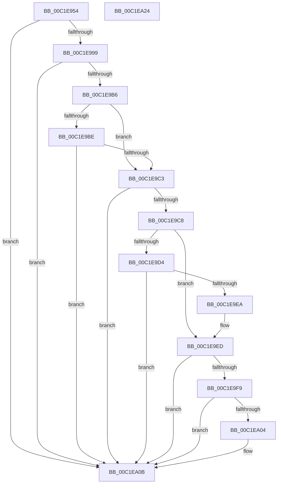

# HalpAllocPhysicalMemoryFromDescriptor

- RVA: `0x00C1E954`–`0x00C1EA25` (길이 `209` bytes)
- VA: `0x0000000140C1E954`
- 실행 섹션: `INIT`
- PDB 이름 있음: `예`; PDB Function 태그: `아니요`
- unwind 정보 RVA: `0x000BE9E8`
- 디코드: `66`개 명령, `209/209` bytes 표시
- 미해석 바이트: `0` (있으면 어셈블리에 `.byte`로 보존)

> 이 문서는 커널 이미지의 기계어와 PDB 기호를 분석해 생성했습니다. 4번과 5번은 함수 원형과 자료형을 바이너리 사용 방식에서 추정한 C 해석이며 원본 소스 복구 결과는 아닙니다.

## 1. Dependencies

- 직접 호출 지점: **0**; 고유 호출 대상: **0**
- 직접 호출자로 확인된 함수: **1**
- RIP 상대 이미지 참조: **0**

### Outgoing calls
- 직접 디코드된 call 명령이 없습니다.

### Direct callers
- [HalpAllocPhysicalMemoryInternal](../C7/HalpAllocPhysicalMemoryInternal_function_00C772C4.md) at `0x00C77380`

### Static image references
- 디코드된 RIP-relative 메모리 참조가 없습니다.

## 2. Other-region calls and transfers

- 다른 실행 섹션으로 향하는 call: **0**
- 별도 외부 분기/꼬리 이동을 확인하지 못했습니다.

## 3. Assembly (complete function range)

```asm
00C1E954  48 8B C4                        mov rax, rsp
00C1E957  48 89 58 08                     mov qword ptr [rax + 8], rbx
00C1E95B  48 89 68 10                     mov qword ptr [rax + 0x10], rbp
00C1E95F  48 89 70 18                     mov qword ptr [rax + 0x18], rsi
00C1E963  48 89 78 20                     mov qword ptr [rax + 0x20], rdi
00C1E967  41 56                           push r14
00C1E969  41 57                           push r15
00C1E96B  44 8B 5C 24 38                  mov r11d, dword ptr [rsp + 0x38]
00C1E970  33 C0                           xor eax, eax
00C1E972  48 8B 59 20                     mov rbx, qword ptr [rcx + 0x20]
00C1E976  41 8B F3                        mov esi, r11d
00C1E979  48 8B 79 28                     mov rdi, qword ptr [rcx + 0x28]
00C1E97D  4D 8B F8                        mov r15, r8
00C1E980  48 C1 EE 0C                     shr rsi, 0xc
00C1E984  48 03 FB                        add rdi, rbx
00C1E987  4C 8B D6                        mov r10, rsi
00C1E98A  4C 8B F2                        mov r14, rdx
00C1E98D  49 C1 E2 0C                     shl r10, 0xc
00C1E991  48 8B E9                        mov rbp, rcx
00C1E994  4D 3B D3                        cmp r10, r11
00C1E997  75 72                           jne 0x140c1ea0b
00C1E999  48 0F BD CE                     bsr rcx, rsi
00C1E99D  41 B8 FF FF FF FF               mov r8d, 0xffffffff
00C1E9A3  41 8B D0                        mov edx, r8d
00C1E9A6  0F 45 D1                        cmovne edx, ecx
00C1E9A9  48 0F BC CE                     bsf rcx, rsi
00C1E9AD  44 0F 45 C1                     cmovne r8d, ecx
00C1E9B1  41 3A D0                        cmp dl, r8b
00C1E9B4  75 55                           jne 0x140c1ea0b
00C1E9B6  8B 4D 18                        mov ecx, dword ptr [rbp + 0x18]
00C1E9B9  83 F9 02                        cmp ecx, 2
00C1E9BC  74 05                           je 0x140c1e9c3
00C1E9BE  83 F9 05                        cmp ecx, 5
00C1E9C1  75 48                           jne 0x140c1ea0b
00C1E9C3  48 85 DB                        test rbx, rbx
00C1E9C6  74 43                           je 0x140c1ea0b
00C1E9C8  49 3B DF                        cmp rbx, r15
00C1E9CB  49 0F 42 DF                     cmovb rbx, r15
00C1E9CF  48 85 F6                        test rsi, rsi
00C1E9D2  74 19                           je 0x140c1e9ed
00C1E9D4  48 8D 56 FF                     lea rdx, [rsi - 1]
00C1E9D8  48 03 D3                        add rdx, rbx
00C1E9DB  48 8D 4E FF                     lea rcx, [rsi - 1]
00C1E9DF  48 F7 D1                        not rcx
00C1E9E2  48 23 D1                        and rdx, rcx
00C1E9E5  48 3B D3                        cmp rdx, rbx
00C1E9E8  72 21                           jb 0x140c1ea0b
00C1E9EA  48 8B DA                        mov rbx, rdx
00C1E9ED  49 3B FE                        cmp rdi, r14
00C1E9F0  49 0F 47 FE                     cmova rdi, r14
00C1E9F4  48 3B DF                        cmp rbx, rdi
00C1E9F7  73 12                           jae 0x140c1ea0b
00C1E9F9  48 2B FB                        sub rdi, rbx
00C1E9FC  41 8B C9                        mov ecx, r9d
00C1E9FF  48 3B CF                        cmp rcx, rdi
00C1EA02  77 07                           ja 0x140c1ea0b
00C1EA04  48 8B C3                        mov rax, rbx
00C1EA07  48 C1 E0 0C                     shl rax, 0xc
00C1EA0B  48 8B 5C 24 18                  mov rbx, qword ptr [rsp + 0x18]
00C1EA10  48 8B 6C 24 20                  mov rbp, qword ptr [rsp + 0x20]
00C1EA15  48 8B 74 24 28                  mov rsi, qword ptr [rsp + 0x28]
00C1EA1A  48 8B 7C 24 30                  mov rdi, qword ptr [rsp + 0x30]
00C1EA1F  41 5F                           pop r15
00C1EA21  41 5E                           pop r14
00C1EA23  C3                              ret
00C1EA24  CC                              int3
```

## 4. C-style interpretation (structured pseudocode)

```c
__int64 __fastcall HalpAllocPhysicalMemoryFromDescriptor(__int64 a1, __int64 a2, __int64 a3, int a4, unsigned int a5)
{
    __int64 result;
    __int64 v_r10;
    __int64 v_rbx;
    __int64 v_rdi;
    __int64 v_rsi;
    unsigned __int64 v_stack_p10;
    unsigned __int64 v_stack_p18;
    unsigned __int64 v_stack_p20;
    unsigned __int64 v_stack_p8;

    *(unsigned __int64 *)(v_rsp + 8) = v_rbx;
    *(unsigned __int64 *)(v_rsp + 16) = v_rbp;
    *(unsigned __int64 *)(v_rsp + 24) = v_rsi;
    *(unsigned __int64 *)(v_rsp + 32) = v_rdi;
    result = 0;
    v_rsi = ((unsigned int)((unsigned int)((unsigned int)(a5)))) >> (12);
    v_rdi = (*(unsigned __int64 *)(a1 + 40)) + (*(unsigned __int64 *)(a1 + 32));
    v_r10 = (v_rsi) << (12);
    if (v_r10 != ((unsigned int)(a5))) goto loc_00C1EA0B;
    a2 = (unsigned int)((unsigned int)((unsigned int)(0xFFFFFFFFULL)));
    if (v_r10 != ((unsigned int)(a5))) { a2 = (unsigned int)(a1); }
    a3 = (unsigned int)(0xFFFFFFFFULL);
    if (v_r10 != ((unsigned int)(a5))) { a3 = (unsigned int)(a1); }
    if (((unsigned __int8)(a2)) != ((unsigned __int8)(a3))) goto loc_00C1EA0B;
    if (((unsigned int)((unsigned int)(*(unsigned int *)(a1 + 24)))) == 2) goto loc_00C1E9C3;
    if (((unsigned int)((unsigned int)(*(unsigned int *)(a1 + 24)))) != 5) goto loc_00C1EA0B;
loc_00C1E9C3:
    if (*(unsigned __int64 *)(a1 + 32) == 0) goto loc_00C1EA0B;
    v_rbx = *(unsigned __int64 *)(a1 + 32);
    if ((*(unsigned __int64 *)(a1 + 32)) < a3) { v_rbx = a3; }
    if (v_rsi == 0) goto loc_00C1E9ED;
    a2 = (v_rsi - 1) + (v_rbx);
    a1 = ~(v_rsi - 1);
    a2 = (a2) & (a1);
    if (a2 < v_rbx) goto loc_00C1EA0B;
loc_00C1E9ED:
    if (v_rdi > a2) { v_rdi = a2; }
    if (a2 >= v_rdi) goto loc_00C1EA0B;
    v_rdi = (v_rdi) - (a2);
    if (((unsigned int)(a4)) <= v_rdi) {
        result = a2;
        result = (result) << (12);
    }
    return result;
}
```

## 5. (Beta) C Style

```c
int64_t HalpAllocPhysicalMemoryFromDescriptor(void *Arg1, int64_t Arg2, int64_t Arg3, int32_t Arg4, uint32_t Arg5)
{
    uint8_t *arg1 = (uint8_t *)Arg1;

    int64_t result;
    int64_t local_r10;
    int64_t local_rbx;
    int64_t local_rdi;
    int64_t local_rsi;
    uint64_t v_stack_p10;
    uint64_t v_stack_p18;
    uint64_t v_stack_p20;
    uint64_t v_stack_p8;

    *(uint64_t *)(local_rsp + 0x8) = local_rbx;
    *(uint64_t *)(local_rsp + 0x10) = local_rbp;
    *(uint64_t *)(local_rsp + 0x18) = local_rsi;
    *(uint64_t *)(local_rsp + 0x20) = local_rdi;
    result = 0;
    local_rsi = ((uint32_t)((uint32_t)((uint32_t)(Arg5)))) >> (12);
    local_rdi = (*(uint64_t *)(arg1 + 0x28)) + (*(uint64_t *)(arg1 + 0x20));
    local_r10 = (local_rsi) << (12);
    if (local_r10 != ((uint32_t)(Arg5))) goto loc_00C1EA0B;
    Arg2 = (uint32_t)((uint32_t)((uint32_t)(0xFFFFFFFFULL)));
    if (local_r10 != ((uint32_t)(Arg5))) { Arg2 = (uint32_t)(Arg1); }
    Arg3 = (uint32_t)(0xFFFFFFFFULL);
    if (local_r10 != ((uint32_t)(Arg5))) { Arg3 = (uint32_t)(Arg1); }
    if (((uint8_t)(Arg2)) != ((uint8_t)(Arg3))) goto loc_00C1EA0B;
    if (((uint32_t)((uint32_t)(*(uint32_t *)(arg1 + 0x18)))) == 2) goto loc_00C1E9C3;
    if (((uint32_t)((uint32_t)(*(uint32_t *)(arg1 + 0x18)))) != 5) goto loc_00C1EA0B;
loc_00C1E9C3:
    if (*(uint64_t *)(arg1 + 0x20) == 0) goto loc_00C1EA0B;
    local_rbx = *(uint64_t *)(arg1 + 0x20);
    if ((*(uint64_t *)(arg1 + 0x20)) < Arg3) { local_rbx = Arg3; }
    if (local_rsi == 0) goto loc_00C1E9ED;
    Arg2 = (local_rsi - 1) + (local_rbx);
    Arg1 = ~(local_rsi - 1);
    Arg2 = (Arg2) & (Arg1);
    if (Arg2 < local_rbx) goto loc_00C1EA0B;
loc_00C1E9ED:
    if (local_rdi > Arg2) { local_rdi = Arg2; }
    if (Arg2 >= local_rdi) goto loc_00C1EA0B;
    local_rdi = (local_rdi) - (Arg2);
    if (((uint32_t)(Arg4)) <= local_rdi) {
        result = Arg2;
        result = (result) << (12);
    }
    return result;
}
```

### 관측된 메모리 오프셋

구조체 형식이 확인되지 않은 접근은 인자 기준의 오프셋으로만 기록했습니다.

| 기준 인자 | 오프셋 표현 | 폭 (bit) | 접근 |
|---|---:|---:|---|
| `Arg1` | `+ 0x18` | `32` | `R` |
| `Arg1` | `+ 0x20` | `64` | `R` |
| `Arg1` | `+ 0x28` | `64` | `R` |

## 6. Execution-region graph

[열기: 2D/3D 그래프와 함수 탐색 컨트롤 패널](../../../control-panel.html?section=init&rva=0x00C1E954&view=graph)

- 2D 그래프는 위에서 아래로 흐르고, 3D 그래프는 빈 공간을 드래그해 회전합니다. Shift+드래그는 이동, 휠은 확대·축소, 함수 노드 선택은 대상 보고서 이동입니다.

### Static fallback


