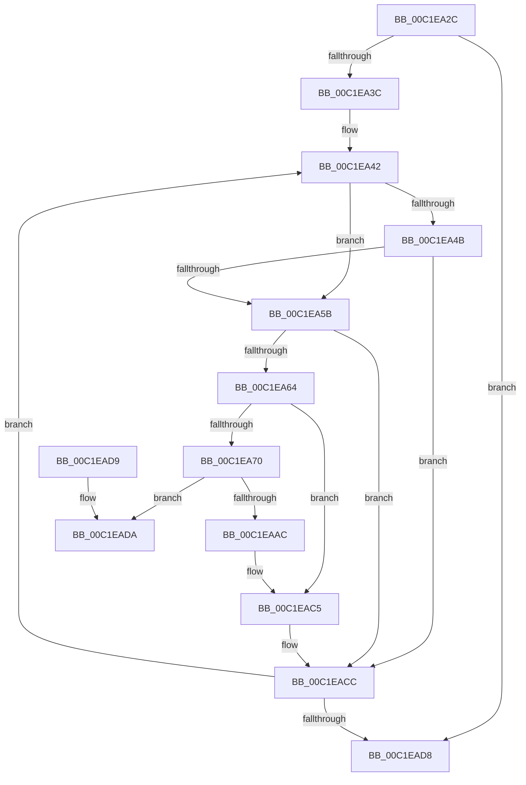

# HalpConsumeLowMemory

- RVA: `0x00C1EA2C`–`0x00C1EAE1` (길이 `181` bytes)
- VA: `0x0000000140C1EA2C`
- 실행 섹션: `INIT`
- PDB 이름 있음: `예`; PDB Function 태그: `아니요`
- unwind 정보 RVA: `0x000DB714`
- 디코드: `47`개 명령, `181/181` bytes 표시
- 미해석 바이트: `0` (있으면 어셈블리에 `.byte`로 보존)

> 이 문서는 커널 이미지의 기계어와 PDB 기호를 분석해 생성했습니다. 4번과 5번은 함수 원형과 자료형을 바이너리 사용 방식에서 추정한 C 해석이며 원본 소스 복구 결과는 아닙니다.

## 1. Dependencies

- 직접 호출 지점: **0**; 고유 호출 대상: **0**
- 직접 호출자로 확인된 함수: **1**
- RIP 상대 이미지 참조: **3**

### Outgoing calls
- 직접 디코드된 call 명령이 없습니다.

### Direct callers
- [HalpMmInitSystem](../../pagelk/B5/HalpMmInitSystem_function_00B5DA60.md) at `0x00B5DACA`

### Static image references
- `0x00C1EA70` → RVA `0x00FC2CB8` (`.data`; read)
- `0x00C1EA87` → RVA `0x00E03B18` (`.data`; read)
- `0x00C1EA8E` → RVA `0x00FC2CB8` (`.data`; write)

## 2. Other-region calls and transfers

- 다른 실행 섹션으로 향하는 call: **0**
- 별도 외부 분기/꼬리 이동을 확인하지 못했습니다.

## 3. Assembly (complete function range)

```asm
00C1EA2C  4C 8D 49 20                     lea r9, [rcx + 0x20]
00C1EA30  49 8B 11                        mov rdx, qword ptr [r9]
00C1EA33  49 3B D1                        cmp rdx, r9
00C1EA36  0F 84 9C 00 00 00               je 0x140c1ead8
00C1EA3C  41 BB 00 01 00 00               mov r11d, 0x100
00C1EA42  48 63 42 18                     movsxd rax, dword ptr [rdx + 0x18]
00C1EA46  83 F8 23                        cmp eax, 0x23
00C1EA49  77 10                           ja 0x140c1ea5b
00C1EA4B  48 B9 48 00 40 C4 0B 00 00 00   movabs rcx, 0xbc4400048
00C1EA55  48 0F A3 C1                     bt rcx, rax
00C1EA59  72 71                           jb 0x140c1eacc
00C1EA5B  48 8B 4A 20                     mov rcx, qword ptr [rdx + 0x20]
00C1EA5F  49 3B CB                        cmp rcx, r11
00C1EA62  73 68                           jae 0x140c1eacc
00C1EA64  4C 8B 52 28                     mov r10, qword ptr [rdx + 0x28]
00C1EA68  4C 03 D1                        add r10, rcx
00C1EA6B  4D 3B D3                        cmp r10, r11
00C1EA6E  76 55                           jbe 0x140c1eac5
00C1EA70  8B 0D 42 42 3A 00               mov ecx, dword ptr [rip + 0x3a4242]
00C1EA76  49 8D 82 00 FF FF FF            lea rax, [r10 - 0x100]
00C1EA7D  4C 8D 04 49                     lea r8, [rcx + rcx*2]
00C1EA81  FF C1                           inc ecx
00C1EA83  49 C1 E0 04                     shl r8, 4
00C1EA87  4C 03 05 8A 50 1E 00            add r8, qword ptr [rip + 0x1e508a]
00C1EA8E  89 0D 24 42 3A 00               mov dword ptr [rip + 0x3a4224], ecx
00C1EA94  49 89 40 28                     mov qword ptr [r8 + 0x28], rax
00C1EA98  4D 89 58 20                     mov qword ptr [r8 + 0x20], r11
00C1EA9C  8B 42 18                        mov eax, dword ptr [rdx + 0x18]
00C1EA9F  41 89 40 18                     mov dword ptr [r8 + 0x18], eax
00C1EAA3  48 8B 42 08                     mov rax, qword ptr [rdx + 8]
00C1EAA7  48 39 10                        cmp qword ptr [rax], rdx
00C1EAAA  75 2E                           jne 0x140c1eada
00C1EAAC  49 89 40 08                     mov qword ptr [r8 + 8], rax
00C1EAB0  49 89 10                        mov qword ptr [r8], rdx
00C1EAB3  4C 89 00                        mov qword ptr [rax], r8
00C1EAB6  49 8B C3                        mov rax, r11
00C1EAB9  4C 89 42 08                     mov qword ptr [rdx + 8], r8
00C1EABD  48 2B 42 20                     sub rax, qword ptr [rdx + 0x20]
00C1EAC1  48 89 42 28                     mov qword ptr [rdx + 0x28], rax
00C1EAC5  C7 42 18 1A 00 00 00            mov dword ptr [rdx + 0x18], 0x1a
00C1EACC  48 8B 12                        mov rdx, qword ptr [rdx]
00C1EACF  49 3B D1                        cmp rdx, r9
00C1EAD2  0F 85 6A FF FF FF               jne 0x140c1ea42
00C1EAD8  C3                              ret
00C1EAD9  CC                              int3
00C1EADA  B9 03 00 00 00                  mov ecx, 3
00C1EADF  CD 29                           int 0x29
```

## 4. C-style interpretation (structured pseudocode)

```c
__int64 __fastcall HalpConsumeLowMemory(__int64 a1)
{
    __int64 result;
    __int64 v_r10;

    if ((*(unsigned __int64 *)(a1 + 32)) == (a1 + 32)) goto loc_00C1EAD8;
loc_00C1EA42:
    if (((unsigned int)((int)(*(unsigned int *)(*(unsigned __int64 *)(a1 + 32) + 24)))) > 35) goto loc_00C1EA5B;
    if (((unsigned int)((int)(*(unsigned int *)(*(unsigned __int64 *)(a1 + 32) + 24)))) < 35) goto loc_00C1EACC;
loc_00C1EA5B:
    if ((*(unsigned __int64 *)(*(unsigned __int64 *)(a1 + 32) + 32)) >= 256) goto loc_00C1EACC;
    v_r10 = (*(unsigned __int64 *)(*(unsigned __int64 *)(a1 + 32) + 40)) + (*(unsigned __int64 *)(*(unsigned __int64 *)(a1 + 32) + 32));
    if (v_r10 <= 256) goto loc_00C1EAC5;
    a1 = (unsigned int)(((unsigned int)(*(unsigned int *)(v_rip + 3818050))) + 1);
    a3 = ((unsigned int)(*(unsigned int *)(v_rip + 3818050)) + (unsigned int)(*(unsigned int *)(v_rip + 3818050)) * 2) << (4);
    a3 = (a3) + (*(unsigned __int64 *)(v_rip + 1986698));
    *(unsigned int *)(v_rip + 3818020) = (unsigned int)(a1);
    *(unsigned __int64 *)(a3 + 40) = v_r10 - 256;
    *(unsigned __int64 *)(a3 + 32) = 256;
    *(unsigned int *)(a3 + 24) = (unsigned int)((unsigned int)(*(unsigned int *)(*(unsigned __int64 *)(a1 + 32) + 24)));
    if ((*(unsigned __int64 *)(*(unsigned __int64 *)(*(unsigned __int64 *)(a1 + 32) + 8))) != (*(unsigned __int64 *)(a1 + 32))) goto loc_00C1EADA;
    *(unsigned __int64 *)(a3 + 8) = *(unsigned __int64 *)(*(unsigned __int64 *)(a1 + 32) + 8);
    *(unsigned __int64 *)(a3) = *(unsigned __int64 *)(a1 + 32);
    *(unsigned __int64 *)(*(unsigned __int64 *)(*(unsigned __int64 *)(a1 + 32) + 8)) = a3;
    *(unsigned __int64 *)(*(unsigned __int64 *)(a1 + 32) + 8) = a3;
    result = (256) - (*(unsigned __int64 *)(*(unsigned __int64 *)(a1 + 32) + 32));
    *(unsigned __int64 *)(*(unsigned __int64 *)(a1 + 32) + 40) = result;
loc_00C1EAC5:
    *(unsigned int *)(*(unsigned __int64 *)(a1 + 32) + 24) = 26;
loc_00C1EACC:
    if ((*(unsigned __int64 *)(*(unsigned __int64 *)(a1 + 32))) != (a1 + 32)) goto loc_00C1EA42;
loc_00C1EAD8:
    return result;
loc_00C1EADA:
    return result;
}
```

## 5. (Beta) C Style

```c
int64_t HalpConsumeLowMemory(void *Arg1)
{
    uint8_t *arg1 = (uint8_t *)Arg1;

    int64_t result;
    int64_t local_r10;

    if ((*(uint64_t *)(arg1 + 0x20)) == (Arg1 + 32)) goto loc_00C1EAD8;
loc_00C1EA42:
    if (((uint32_t)((int32_t)(*(uint32_t *)(*(uint64_t *)(arg1 + 0x20) + 0x18)))) > 35) goto loc_00C1EA5B;
    if (((uint32_t)((int32_t)(*(uint32_t *)(*(uint64_t *)(arg1 + 0x20) + 0x18)))) < 35) goto loc_00C1EACC;
loc_00C1EA5B:
    if ((*(uint64_t *)(*(uint64_t *)(arg1 + 0x20) + 0x20)) >= 256) goto loc_00C1EACC;
    local_r10 = (*(uint64_t *)(*(uint64_t *)(arg1 + 0x20) + 0x28)) + (*(uint64_t *)(*(uint64_t *)(arg1 + 0x20) + 0x20));
    if (local_r10 <= 256) goto loc_00C1EAC5;
    Arg1 = (uint32_t)(((uint32_t)(*(uint32_t *)(v_rip + 0x3A4242))) + 1);
    a3 = ((uint32_t)(*(uint32_t *)(v_rip + 0x3A4242)) + (uint32_t)(*(uint32_t *)(v_rip + 0x3A4242)) * 2) << (4);
    a3 = (a3) + (*(uint64_t *)(v_rip + 0x1E508A));
    *(uint32_t *)(v_rip + 0x3A4224) = (uint32_t)(Arg1);
    *(uint64_t *)(a3 + 0x28) = local_r10 - 256;
    *(uint64_t *)(a3 + 0x20) = 256;
    *(uint32_t *)(a3 + 0x18) = (uint32_t)((uint32_t)(*(uint32_t *)(*(uint64_t *)(arg1 + 0x20) + 0x18)));
    if ((*(uint64_t *)(*(uint64_t *)(*(uint64_t *)(arg1 + 0x20) + 0x8))) != (*(uint64_t *)(arg1 + 0x20))) goto loc_00C1EADA;
    *(uint64_t *)(a3 + 0x8) = *(uint64_t *)(*(uint64_t *)(arg1 + 0x20) + 0x8);
    *(uint64_t *)(a3) = *(uint64_t *)(arg1 + 0x20);
    *(uint64_t *)(*(uint64_t *)(*(uint64_t *)(arg1 + 0x20) + 0x8)) = a3;
    *(uint64_t *)(*(uint64_t *)(arg1 + 0x20) + 0x8) = a3;
    result = (256) - (*(uint64_t *)(*(uint64_t *)(arg1 + 0x20) + 0x20));
    *(uint64_t *)(*(uint64_t *)(arg1 + 0x20) + 0x28) = result;
loc_00C1EAC5:
    *(uint32_t *)(*(uint64_t *)(arg1 + 0x20) + 0x18) = 26;
loc_00C1EACC:
    if ((*(uint64_t *)(*(uint64_t *)(arg1 + 0x20))) != (Arg1 + 32)) goto loc_00C1EA42;
loc_00C1EAD8:
    return result;
loc_00C1EADA:
    return result;
}
```

### 관측된 메모리 오프셋

구조체 형식이 확인되지 않은 접근은 인자 기준의 오프셋으로만 기록했습니다.

| 기준 인자 | 오프셋 표현 | 폭 (bit) | 접근 |
|---|---:|---:|---|
| `Arg1` | `+ 0x0` | `64` | `R` |
| `Arg1` | `+ 0x20` | `64` | `R` |

## 6. Execution-region graph

[열기: 2D/3D 그래프와 함수 탐색 컨트롤 패널](../../../control-panel.html?section=init&rva=0x00C1EA2C&view=graph)

- 2D 그래프는 위에서 아래로 흐르고, 3D 그래프는 빈 공간을 드래그해 회전합니다. Shift+드래그는 이동, 휠은 확대·축소, 함수 노드 선택은 대상 보고서 이동입니다.

### Static fallback


