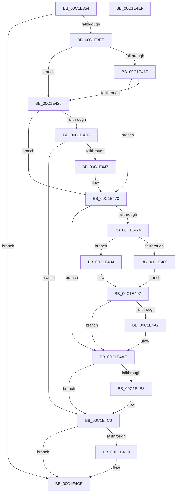

# HalpDmaFinalizeDoubleBufferingDisposition

- RVA: `0x00C1E354`–`0x00C1E4F0` (길이 `412` bytes)
- VA: `0x0000000140C1E354`
- 실행 섹션: `INIT`
- PDB 이름 있음: `예`; PDB Function 태그: `아니요`
- unwind 정보 RVA: `0x000BD7B8`
- 디코드: `101`개 명령, `412/412` bytes 표시
- 미해석 바이트: `0` (있으면 어셈블리에 `.byte`로 보존)

> 이 문서는 커널 이미지의 기계어와 PDB 기호를 분석해 생성했습니다. 4번과 5번은 함수 원형과 자료형을 바이너리 사용 방식에서 추정한 C 해석이며 원본 소스 복구 결과는 아닙니다.

## 1. Dependencies

- 직접 호출 지점: **8**; 고유 호출 대상: **7**
- 직접 호출자로 확인된 함수: **1**
- RIP 상대 이미지 참조: **5**

### Outgoing calls
- `0x00C1E3E1` → [ZwOpenKey](../../text/6A/ZwOpenKey_function_006AD310.md) (function, `0x006AD310`)
- `0x00C1E413` → [ZwQueryValueKey](../../text/6A/ZwQueryValueKey_function_006AD3B0.md) (function, `0x006AD3B0`)
- `0x00C1E43A` → [ExAllocatePool2](../../poolcode/B8/ExAllocatePool2_function_00B820F0.md) (function, `0x00B820F0`)
- `0x00C1E46B` → [ZwQueryValueKey](../../text/6A/ZwQueryValueKey_function_006AD3B0.md) (function, `0x006AD3B0`)
- `0x00C1E48F` → [memcpy](../../text/6C/memcpy_function_006C6840.md) (function, `0x006C6840`)
- `0x00C1E4BB` → [ExFreePoolWithTag](../../poolcode/B8/ExFreePoolWithTag_function_00B82870.md) (function, `0x00B82870`)
- `0x00C1E4C9` → [ZwClose](../../text/6A/ZwClose_function_006AD2B0.md) (function, `0x006AD2B0`)
- `0x00C1E4D5` → [_security_check_cookie](../../text/6A/_security_check_cookie_function_006AC640.md) (function, `0x006AC640`)

### Direct callers
- [HalpDmaInitSystem](../../pagelk/B5/HalpDmaInitSystem_function_00B5DB50.md) at `0x00B5DB8C`

### Static image references
- `0x00C1E36B` → RVA `0x00E0A740` (`.data`; read)
- `0x00C1E37D` → RVA `0x00023B50` (`.rdata`; read)
- `0x00C1E394` → RVA `0x00023C00` (`.rdata`; read)
- `0x00C1E49E` → RVA `0x00FC3C08` (`.data`; read)
- `0x00C1E4A7` → RVA `0x00FC3C08` (`.data`; write)

## 2. Other-region calls and transfers

- 다른 실행 섹션으로 향하는 call: **8**
  - `0x00C1E3E1` → [ZwOpenKey](../../text/6A/ZwOpenKey_function_006AD310.md) (`INIT` → `.text`)
  - `0x00C1E413` → [ZwQueryValueKey](../../text/6A/ZwQueryValueKey_function_006AD3B0.md) (`INIT` → `.text`)
  - `0x00C1E43A` → [ExAllocatePool2](../../poolcode/B8/ExAllocatePool2_function_00B820F0.md) (`INIT` → `POOLCODE`)
  - `0x00C1E46B` → [ZwQueryValueKey](../../text/6A/ZwQueryValueKey_function_006AD3B0.md) (`INIT` → `.text`)
  - `0x00C1E48F` → [memcpy](../../text/6C/memcpy_function_006C6840.md) (`INIT` → `.text`)
  - `0x00C1E4BB` → [ExFreePoolWithTag](../../poolcode/B8/ExFreePoolWithTag_function_00B82870.md) (`INIT` → `POOLCODE`)
  - `0x00C1E4C9` → [ZwClose](../../text/6A/ZwClose_function_006AD2B0.md) (`INIT` → `.text`)
  - `0x00C1E4D5` → [_security_check_cookie](../../text/6A/_security_check_cookie_function_006AC640.md) (`INIT` → `.text`)
- 별도 외부 분기/꼬리 이동을 확인하지 못했습니다.

## 3. Assembly (complete function range)

```asm
00C1E354  48 89 5C 24 08                  mov qword ptr [rsp + 8], rbx
00C1E359  48 89 7C 24 10                  mov qword ptr [rsp + 0x10], rdi
00C1E35E  55                              push rbp
00C1E35F  48 8D 6C 24 A9                  lea rbp, [rsp - 0x57]
00C1E364  48 81 EC B0 00 00 00            sub rsp, 0xb0
00C1E36B  48 8B 05 CE C3 1E 00            mov rax, qword ptr [rip + 0x1ec3ce]
00C1E372  48 33 C4                        xor rax, rsp
00C1E375  48 89 45 47                     mov qword ptr [rbp + 0x47], rax
00C1E379  83 65 23 00                     and dword ptr [rbp + 0x23], 0
00C1E37D  48 8D 05 CC 57 40 FF            lea rax, [rip - 0xbfa834]
00C1E384  83 65 D7 00                     and dword ptr [rbp - 0x29], 0
00C1E388  4C 8D 45 07                     lea r8, [rbp + 7]
00C1E38C  48 89 45 FF                     mov qword ptr [rbp - 1], rax
00C1E390  48 8D 4D DF                     lea rcx, [rbp - 0x21]
00C1E394  48 8D 05 65 58 40 FF            lea rax, [rip - 0xbfa79b]
00C1E39B  48 C7 45 07 30 00 00 00         mov qword ptr [rbp + 7], 0x30
00C1E3A3  83 65 0B 00                     and dword ptr [rbp + 0xb], 0
00C1E3A7  33 DB                           xor ebx, ebx
00C1E3A9  48 21 5D DF                     and qword ptr [rbp - 0x21], rbx
00C1E3AD  0F 57 C0                        xorps xmm0, xmm0
00C1E3B0  48 21 5D 0F                     and qword ptr [rbp + 0xf], rbx
00C1E3B4  BA 19 00 02 00                  mov edx, 0x20019
00C1E3B9  48 89 45 EF                     mov qword ptr [rbp - 0x11], rax
00C1E3BD  48 8D 45 F7                     lea rax, [rbp - 9]
00C1E3C1  48 89 45 17                     mov qword ptr [rbp + 0x17], rax
00C1E3C5  48 C7 45 F7 A8 00 AA 00         mov qword ptr [rbp - 9], 0xaa00a8
00C1E3CD  48 C7 45 E7 1A 00 1C 00         mov qword ptr [rbp - 0x19], 0x1c001a
00C1E3D5  C7 45 1F 40 02 00 00            mov dword ptr [rbp + 0x1f], 0x240
00C1E3DC  F3 0F 7F 45 27                  movdqu xmmword ptr [rbp + 0x27], xmm0
00C1E3E1  E8 2A EF A8 FF                  call 0x1406ad310
00C1E3E6  85 C0                           test eax, eax
00C1E3E8  0F 85 E0 00 00 00               jne 0x140c1e4ce
00C1E3EE  48 8B 4D DF                     mov rcx, qword ptr [rbp - 0x21]
00C1E3F2  48 8D 45 D7                     lea rax, [rbp - 0x29]
00C1E3F6  48 89 44 24 28                  mov qword ptr [rsp + 0x28], rax
00C1E3FB  4C 8D 4D 37                     lea r9, [rbp + 0x37]
00C1E3FF  44 8D 43 02                     lea r8d, [rbx + 2]
00C1E403  C7 44 24 20 10 00 00 00         mov dword ptr [rsp + 0x20], 0x10
00C1E40B  48 8D 55 E7                     lea rdx, [rbp - 0x19]
00C1E40F  48 8D 7D 37                     lea rdi, [rbp + 0x37]
00C1E413  E8 98 EF A8 FF                  call 0x1406ad3b0
00C1E418  3D 05 00 00 80                  cmp eax, 0x80000005
00C1E41D  74 07                           je 0x140c1e426
00C1E41F  3D 23 00 00 C0                  cmp eax, 0xc0000023
00C1E424  75 4A                           jne 0x140c1e470
00C1E426  83 7D D7 10                     cmp dword ptr [rbp - 0x29], 0x10
00C1E42A  76 44                           jbe 0x140c1e470
00C1E42C  8B 55 D7                        mov edx, dword ptr [rbp - 0x29]
00C1E42F  B9 02 01 00 00                  mov ecx, 0x102
00C1E434  41 B8 48 61 6C 44               mov r8d, 0x446c6148
00C1E43A  E8 B1 3C F6 FF                  call 0x140b820f0
00C1E43F  48 8B D8                        mov rbx, rax
00C1E442  48 85 C0                        test rax, rax
00C1E445  74 79                           je 0x140c1e4c0
00C1E447  8B 4D D7                        mov ecx, dword ptr [rbp - 0x29]
00C1E44A  48 8D 55 E7                     lea rdx, [rbp - 0x19]
00C1E44E  48 8B F8                        mov rdi, rax
00C1E451  4C 8B CB                        mov r9, rbx
00C1E454  48 8D 45 D7                     lea rax, [rbp - 0x29]
00C1E458  41 B8 02 00 00 00               mov r8d, 2
00C1E45E  48 89 44 24 28                  mov qword ptr [rsp + 0x28], rax
00C1E463  89 4C 24 20                     mov dword ptr [rsp + 0x20], ecx
00C1E467  48 8B 4D DF                     mov rcx, qword ptr [rbp - 0x21]
00C1E46B  E8 40 EF A8 FF                  call 0x1406ad3b0
00C1E470  85 C0                           test eax, eax
00C1E472  75 3A                           jne 0x140c1e4ae
00C1E474  8B 47 08                        mov eax, dword ptr [rdi + 8]
00C1E477  48 8D 57 0C                     lea rdx, [rdi + 0xc]
00C1E47B  83 F8 04                        cmp eax, 4
00C1E47E  72 04                           jb 0x140c1e484
00C1E480  8B 02                           mov eax, dword ptr [rdx]
00C1E482  EB 13                           jmp 0x140c1e497
00C1E484  83 65 DB 00                     and dword ptr [rbp - 0x25], 0
00C1E488  48 8D 4D DB                     lea rcx, [rbp - 0x25]
00C1E48C  4C 8B C0                        mov r8, rax
00C1E48F  E8 AC 83 AA FF                  call 0x1406c6840
00C1E494  8B 45 DB                        mov eax, dword ptr [rbp - 0x25]
00C1E497  48 C1 E0 1E                     shl rax, 0x1e
00C1E49B  48 FF C8                        dec rax
00C1E49E  48 3B 05 63 57 3A 00            cmp rax, qword ptr [rip + 0x3a5763]
00C1E4A5  76 07                           jbe 0x140c1e4ae
00C1E4A7  48 89 05 5A 57 3A 00            mov qword ptr [rip + 0x3a575a], rax
00C1E4AE  48 85 DB                        test rbx, rbx
00C1E4B1  74 0D                           je 0x140c1e4c0
00C1E4B3  BA 48 61 6C 44                  mov edx, 0x446c6148
00C1E4B8  48 8B CB                        mov rcx, rbx
00C1E4BB  E8 B0 43 F6 FF                  call 0x140b82870
00C1E4C0  48 8B 4D DF                     mov rcx, qword ptr [rbp - 0x21]
00C1E4C4  48 85 C9                        test rcx, rcx
00C1E4C7  74 05                           je 0x140c1e4ce
00C1E4C9  E8 E2 ED A8 FF                  call 0x1406ad2b0
00C1E4CE  48 8B 4D 47                     mov rcx, qword ptr [rbp + 0x47]
00C1E4D2  48 33 CC                        xor rcx, rsp
00C1E4D5  E8 66 E1 A8 FF                  call 0x1406ac640
00C1E4DA  4C 8D 9C 24 B0 00 00 00         lea r11, [rsp + 0xb0]
00C1E4E2  49 8B 5B 10                     mov rbx, qword ptr [r11 + 0x10]
00C1E4E6  49 8B 7B 18                     mov rdi, qword ptr [r11 + 0x18]
00C1E4EA  49 8B E3                        mov rsp, r11
00C1E4ED  5D                              pop rbp
00C1E4EE  C3                              ret
00C1E4EF  CC                              int3
```

## 4. C-style interpretation (structured pseudocode)

```c
__int64 __fastcall HalpDmaFinalizeDoubleBufferingDisposition(void)
{
    __int64 result;
    __int64 v_rbx;
    __int64 v_rsp;
    unsigned __int64 v_stack_m18;
    unsigned __int64 v_stack_m28;
    unsigned __int64 v_stack_m38;
    unsigned int v_stack_m3C;
    unsigned int v_stack_m40;
    unsigned __int64 v_stack_m48;
    unsigned __int64 v_stack_m50;
    unsigned int v_stack_m54;
    unsigned __int64 v_stack_m58;
    unsigned __int64 v_stack_m5F;
    unsigned __int64 v_stack_m60;
    unsigned __int64 v_stack_m68;
    unsigned __int64 v_stack_m70;
    unsigned __int64 v_stack_m78;
    unsigned __int64 v_stack_m8;
    unsigned __int64 v_stack_m80;
    unsigned int v_stack_m84;
    unsigned int v_stack_m88;
    unsigned __int64 v_stack_m90;
    unsigned int v_stack_m98;
    unsigned __int64 v_stack_p10;
    unsigned __int64 v_stack_p8;

    v_stack_p8 = v_rbx;
    v_stack_p10 = v_rdi;
    v_rsp = (v_rsp) - (176);
    result = (*(unsigned __int64 *)(v_rip + 2016206)) ^ (v_rsp);
    v_stack_m18 = result;
    v_stack_m60 = v_rip - 12560436;
    v_stack_m58 = 48;
    v_rbx = 0;
    v_stack_m70 = v_rip - 12560283;
    v_stack_m48 = v_stack_m68;
    v_stack_m68 = 0xAA00A8ULL;
    v_stack_m78 = 0x1C001AULL;
    v_stack_m40 = 576;
    v_stack_m38 = v_xmm0;
    result = ZwOpenKey(v_stack_m80, (unsigned int)(0x20019ULL), v_stack_m58, a4);
    if ((unsigned int)(result) != 0) goto loc_00C1E4CE;
    v_stack_m90 = v_stack_m88;
    v_stack_m98 = 16;
    result = ZwQueryValueKey(v_stack_m80, v_stack_m78, v_rbx + 2, v_stack_m28);
    if (((unsigned int)(result)) == 0x80000005ULL) goto loc_00C1E426;
    if (((unsigned int)(result)) != 0xC0000023ULL) goto loc_00C1E470;
loc_00C1E426:
    if (v_stack_m88 <= 16) goto loc_00C1E470;
    result = ExAllocatePool2(258, (unsigned int)(v_stack_m88), (unsigned int)(0x446C6148ULL), v_stack_m28);
    if (result == 0) goto loc_00C1E4C0;
    v_stack_m90 = v_stack_m88;
    v_stack_m98 = (unsigned int)((unsigned int)(v_stack_m88));
    result = ZwQueryValueKey(v_stack_m80, v_stack_m78, 2, result);
loc_00C1E470:
    if ((unsigned int)(result) != 0) goto loc_00C1E4AE;
    if (((unsigned int)((unsigned int)(*(unsigned int *)(result + 8)))) < 4) goto loc_00C1E484;
    goto loc_00C1E497;
loc_00C1E484:
    result = memcpy(v_stack_m84, result + 12, (unsigned int)(*(unsigned int *)(result + 12)), result);
loc_00C1E497:
    result = ((unsigned int)(v_stack_m84)) << (30);
    result = (result) - 1;
    if (result >= = (*(unsigned __int64 *)(v_rip + 3823459))) {
        *(unsigned __int64 *)(v_rip + 3823450) = result;
    }
    if (result != 0) {
        a2 = 0x446C6148ULL;
        a1 = result;
        result = ExFreePoolWithTag(a1, a2, (unsigned int)(*(unsigned int *)(result + 12)), result);
    }
    if (v_stack_m80 != 0) {
        result = ZwClose(v_stack_m80, a2, (unsigned int)(*(unsigned int *)(result + 12)), result);
    }
    a1 = (v_stack_m18) ^ (v_rsp);
    result = _security_check_cookie(a1, a2, (unsigned int)(*(unsigned int *)(result + 12)), result);
    return result;
}
```

## 5. (Beta) C Style

```c
void HalpDmaFinalizeDoubleBufferingDisposition(void)
{
    int64_t result;
    int64_t local_rbx;
    int64_t local_rsp;
    uint64_t v_stack_m18;
    uint64_t v_stack_m28;
    uint64_t v_stack_m38;
    uint32_t v_stack_m3C;
    uint32_t v_stack_m40;
    uint64_t v_stack_m48;
    uint64_t v_stack_m50;
    uint32_t v_stack_m54;
    uint64_t v_stack_m58;
    uint64_t v_stack_m5F;
    uint64_t v_stack_m60;
    uint64_t v_stack_m68;
    uint64_t v_stack_m70;
    uint64_t v_stack_m78;
    uint64_t v_stack_m8;
    uint64_t v_stack_m80;
    uint32_t v_stack_m84;
    uint32_t v_stack_m88;
    uint64_t v_stack_m90;
    uint32_t v_stack_m98;
    uint64_t v_stack_p10;
    uint64_t v_stack_p8;

    v_stack_p8 = local_rbx;
    v_stack_p10 = local_rdi;
    local_rsp = (local_rsp) - (176);
    result = (*(uint64_t *)(v_rip + 0x1EC3CE)) ^ (local_rsp);
    v_stack_m18 = result;
    v_stack_m60 = v_rip - 12560436;
    v_stack_m58 = 48;
    local_rbx = 0;
    v_stack_m70 = v_rip - 12560283;
    v_stack_m48 = v_stack_m68;
    v_stack_m68 = 0xAA00A8ULL;
    v_stack_m78 = 0x1C001AULL;
    v_stack_m40 = 576;
    v_stack_m38 = v_xmm0;
    result = ZwOpenKey(v_stack_m80, (uint32_t)(0x20019ULL), v_stack_m58, a4);
    if ((uint32_t)(result) != 0) goto loc_00C1E4CE;
    v_stack_m90 = v_stack_m88;
    v_stack_m98 = 16;
    result = ZwQueryValueKey(v_stack_m80, v_stack_m78, local_rbx + 2, v_stack_m28);
    if (((uint32_t)(result)) == 0x80000005ULL) goto loc_00C1E426;
    if (((uint32_t)(result)) != 0xC0000023ULL) goto loc_00C1E470;
loc_00C1E426:
    if (v_stack_m88 <= 16) goto loc_00C1E470;
    result = ExAllocatePool2(258, (uint32_t)(v_stack_m88), (uint32_t)(0x446C6148ULL), v_stack_m28);
    if (result == 0) goto loc_00C1E4C0;
    v_stack_m90 = v_stack_m88;
    v_stack_m98 = (uint32_t)((uint32_t)(v_stack_m88));
    result = ZwQueryValueKey(v_stack_m80, v_stack_m78, 2, result);
loc_00C1E470:
    if ((uint32_t)(result) != 0) goto loc_00C1E4AE;
    if (((uint32_t)((uint32_t)(*(uint32_t *)(result + 0x8)))) < 4) goto loc_00C1E484;
    goto loc_00C1E497;
loc_00C1E484:
    result = memcpy(v_stack_m84, result + 12, (uint32_t)(*(uint32_t *)(result + 0xC)), result);
loc_00C1E497:
    result = ((uint32_t)(v_stack_m84)) << (30);
    result = (result) - 1;
    if (result >= = (*(uint64_t *)(v_rip + 0x3A5763))) {
        *(uint64_t *)(v_rip + 0x3A575A) = result;
    }
    if (result != 0) {
        a2 = 0x446C6148ULL;
        a1 = result;
        result = ExFreePoolWithTag(a1, a2, (uint32_t)(*(uint32_t *)(result + 0xC)), result);
    }
    if (v_stack_m80 != 0) {
        result = ZwClose(v_stack_m80, a2, (uint32_t)(*(uint32_t *)(result + 0xC)), result);
    }
    a1 = (v_stack_m18) ^ (local_rsp);
    result = _security_check_cookie(a1, a2, (uint32_t)(*(uint32_t *)(result + 0xC)), result);
    return result;
}
```

## 6. Execution-region graph

[열기: 2D/3D 그래프와 함수 탐색 컨트롤 패널](../../../control-panel.html?section=init&rva=0x00C1E354&view=graph)

- 2D 그래프는 위에서 아래로 흐르고, 3D 그래프는 빈 공간을 드래그해 회전합니다. Shift+드래그는 이동, 휠은 확대·축소, 함수 노드 선택은 대상 보고서 이동입니다.

### Static fallback


