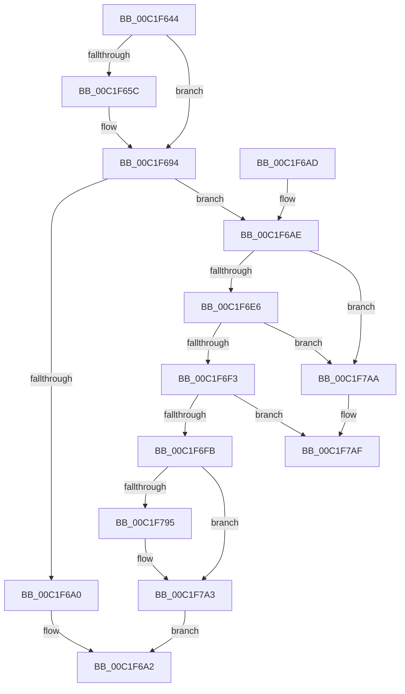

# HalpEfiInitialization

- RVA: `0x00C1F644`–`0x00C1F7C9` (길이 `389` bytes)
- VA: `0x0000000140C1F644`
- 실행 섹션: `INIT`
- PDB 이름 있음: `예`; PDB Function 태그: `아니요`
- unwind 정보 RVA: `0x000C40E0`
- 디코드: `79`개 명령, `389/389` bytes 표시
- 미해석 바이트: `0` (있으면 어셈블리에 `.byte`로 보존)

> 이 문서는 커널 이미지의 기계어와 PDB 기호를 분석해 생성했습니다. 4번과 5번은 함수 원형과 자료형을 바이너리 사용 방식에서 추정한 C 해석이며 원본 소스 복구 결과는 아닙니다.

## 1. Dependencies

- 직접 호출 지점: **2**; 고유 호출 대상: **2**
- 직접 호출자로 확인된 함수: **1**
- RIP 상대 이미지 참조: **26**

### Outgoing calls
- `0x00C1F785` → [KeRegisterBugCheckReasonCallback](../../text/47/KeRegisterBugCheckReasonCallback_function_004720A0.md) (function, `0x004720A0`)
- `0x00C1F7C3` → [KeBugCheckEx](../../text/4F/KeBugCheckEx_function_004FD660.md) (function, `0x004FD660`)

### Direct callers
- [HalpFirmwareInitDiscard](HalpFirmwareInitDiscard_function_00C1FCE0.md) at `0x00C1FD1C`

### Static image references
- `0x00C1F663` → RVA `0x00FC1A40` (`.data`; read)
- `0x00C1F671` → RVA `0x00FC1A50` (`.data`; read)
- `0x00C1F67F` → RVA `0x00FC1A60` (`.data`; read)
- `0x00C1F68D` → RVA `0x00FC1A70` (`.data`; read)
- `0x00C1F696` → RVA `0x00FC1A28` (`.data`; write)
- `0x00C1F6AE` → RVA `0x00FC1C28` (`.data`; write)
- `0x00C1F6B4` → RVA `0x00FC1C38` (`.data`; write)
- `0x00C1F6BA` → RVA `0x00FC1C3C` (`.data`; write)
- `0x00C1F6C0` → RVA `0x00FC1C24` (`.data`; write)
- `0x00C1F6D2` → RVA `0x00FC1A80` (`.data`; write)
- `0x00C1F6D8` → RVA `0x00FC1A84` (`.data`; write)
- `0x00C1F702` → RVA `0x00024198` (`.rdata`; read)
- `0x00C1F712` → RVA `0x01201870` (`CFGRO`; write)
- `0x00C1F71D` → RVA `0x01201878` (`CFGRO`; write)
- `0x00C1F728` → RVA `0x01201880` (`CFGRO`; write)
- `0x00C1F733` → RVA `0x01201888` (`CFGRO`; write)
- `0x00C1F73E` → RVA `0x01201890` (`CFGRO`; write)
- `0x00C1F749` → RVA `0x01201898` (`CFGRO`; write)
- `0x00C1F754` → RVA `0x012018A0` (`CFGRO`; write)
- `0x00C1F75F` → RVA `0x012018A8` (`CFGRO`; write)
- `0x00C1F76A` → RVA `0x00E103A8` (`.data`; read)
- `0x00C1F771` → RVA `0x00E103D4` (`.data`; write)
- `0x00C1F777` → RVA `0x0054E250` (`HalpEfiBugCheckAddPagesCallback`; read)
- `0x00C1F77E` → RVA `0x012018B0` (`CFGRO`; write)
- `0x00C1F795` → RVA `0x01201A20` (`CFGRO`; read)
- `0x00C1F79C` → RVA `0x01200010` (`CFGRO`; write)

## 2. Other-region calls and transfers

- 다른 실행 섹션으로 향하는 call: **2**
  - `0x00C1F785` → [KeRegisterBugCheckReasonCallback](../../text/47/KeRegisterBugCheckReasonCallback_function_004720A0.md) (`INIT` → `.text`)
  - `0x00C1F7C3` → [KeBugCheckEx](../../text/4F/KeBugCheckEx_function_004FD660.md) (`INIT` → `.text`)
- 별도 외부 분기/꼬리 이동을 확인하지 못했습니다.

## 3. Assembly (complete function range)

```asm
00C1F644  48 89 5C 24 08                  mov qword ptr [rsp + 8], rbx
00C1F649  57                              push rdi
00C1F64A  48 83 EC 30                     sub rsp, 0x30
00C1F64E  8B 81 08 01 00 00               mov eax, dword ptr [rcx + 0x108]
00C1F654  48 8B D9                        mov rbx, rcx
00C1F657  83 E0 01                        and eax, 1
00C1F65A  74 38                           je 0x140c1f694
00C1F65C  0F 10 81 08 01 00 00            movups xmm0, xmmword ptr [rcx + 0x108]
00C1F663  0F 11 05 D6 23 3A 00            movups xmmword ptr [rip + 0x3a23d6], xmm0
00C1F66A  0F 10 89 18 01 00 00            movups xmm1, xmmword ptr [rcx + 0x118]
00C1F671  0F 11 0D D8 23 3A 00            movups xmmword ptr [rip + 0x3a23d8], xmm1
00C1F678  0F 10 81 28 01 00 00            movups xmm0, xmmword ptr [rcx + 0x128]
00C1F67F  0F 11 05 DA 23 3A 00            movups xmmword ptr [rip + 0x3a23da], xmm0
00C1F686  0F 10 89 38 01 00 00            movups xmm1, xmmword ptr [rcx + 0x138]
00C1F68D  0F 11 0D DC 23 3A 00            movups xmmword ptr [rip + 0x3a23dc], xmm1
00C1F694  33 D2                           xor edx, edx
00C1F696  88 05 8C 23 3A 00               mov byte ptr [rip + 0x3a238c], al
00C1F69C  84 C0                           test al, al
00C1F69E  75 0E                           jne 0x140c1f6ae
00C1F6A0  33 C0                           xor eax, eax
00C1F6A2  48 8B 5C 24 40                  mov rbx, qword ptr [rsp + 0x40]
00C1F6A7  48 83 C4 30                     add rsp, 0x30
00C1F6AB  5F                              pop rdi
00C1F6AC  C3                              ret
00C1F6AD  CC                              int3
00C1F6AE  89 15 74 25 3A 00               mov dword ptr [rip + 0x3a2574], edx
00C1F6B4  89 15 7E 25 3A 00               mov dword ptr [rip + 0x3a257e], edx
00C1F6BA  89 15 7C 25 3A 00               mov dword ptr [rip + 0x3a257c], edx
00C1F6C0  89 15 5E 25 3A 00               mov dword ptr [rip + 0x3a255e], edx
00C1F6C6  8B 81 24 01 00 00               mov eax, dword ptr [rcx + 0x124]
00C1F6CC  8B B9 20 01 00 00               mov edi, dword ptr [rcx + 0x120]
00C1F6D2  89 3D A8 23 3A 00               mov dword ptr [rip + 0x3a23a8], edi
00C1F6D8  89 05 A6 23 3A 00               mov dword ptr [rip + 0x3a23a6], eax
00C1F6DE  85 C0                           test eax, eax
00C1F6E0  0F 85 C4 00 00 00               jne 0x140c1f7aa
00C1F6E6  48 39 91 18 01 00 00            cmp qword ptr [rcx + 0x118], rdx
00C1F6ED  0F 84 B7 00 00 00               je 0x140c1f7aa
00C1F6F3  85 FF                           test edi, edi
00C1F6F5  0F 88 B4 00 00 00               js 0x140c1f7af
00C1F6FB  48 8B 89 18 01 00 00            mov rcx, qword ptr [rcx + 0x118]
00C1F702  4C 8D 0D 8F 4A 40 FF            lea r9, [rip - 0xbfb571]
00C1F709  41 B8 04 00 00 00               mov r8d, 4
00C1F70F  48 8B 01                        mov rax, qword ptr [rcx]
00C1F712  48 89 05 57 21 5E 00            mov qword ptr [rip + 0x5e2157], rax
00C1F719  48 8B 41 08                     mov rax, qword ptr [rcx + 8]
00C1F71D  48 89 05 54 21 5E 00            mov qword ptr [rip + 0x5e2154], rax
00C1F724  48 8B 41 50                     mov rax, qword ptr [rcx + 0x50]
00C1F728  48 89 05 51 21 5E 00            mov qword ptr [rip + 0x5e2151], rax
00C1F72F  48 8B 41 30                     mov rax, qword ptr [rcx + 0x30]
00C1F733  48 89 05 4E 21 5E 00            mov qword ptr [rip + 0x5e214e], rax
00C1F73A  48 8B 41 38                     mov rax, qword ptr [rcx + 0x38]
00C1F73E  48 89 05 4B 21 5E 00            mov qword ptr [rip + 0x5e214b], rax
00C1F745  48 8B 41 40                     mov rax, qword ptr [rcx + 0x40]
00C1F749  48 89 05 48 21 5E 00            mov qword ptr [rip + 0x5e2148], rax
00C1F750  48 8B 41 58                     mov rax, qword ptr [rcx + 0x58]
00C1F754  48 89 05 45 21 5E 00            mov qword ptr [rip + 0x5e2145], rax
00C1F75B  48 8B 41 60                     mov rax, qword ptr [rcx + 0x60]
00C1F75F  48 89 05 42 21 5E 00            mov qword ptr [rip + 0x5e2142], rax
00C1F766  48 8B 41 68                     mov rax, qword ptr [rcx + 0x68]
00C1F76A  48 8D 0D 37 0C 1F 00            lea rcx, [rip + 0x1f0c37]
00C1F771  88 15 5D 0C 1F 00               mov byte ptr [rip + 0x1f0c5d], dl
00C1F777  48 8D 15 D2 EA 92 FF            lea rdx, [rip - 0x6d152e]
00C1F77E  48 89 05 2B 21 5E 00            mov qword ptr [rip + 0x5e212b], rax
00C1F785  E8 16 29 85 FF                  call 0x1404720a0
00C1F78A  8B 8B 08 01 00 00               mov ecx, dword ptr [rbx + 0x108]
00C1F790  F6 C1 02                        test cl, 2
00C1F793  74 0E                           je 0x140c1f7a3
00C1F795  48 8D 05 84 22 5E 00            lea rax, [rip + 0x5e2284]
00C1F79C  48 89 05 6D 08 5E 00            mov qword ptr [rip + 0x5e086d], rax
00C1F7A3  8B C7                           mov eax, edi
00C1F7A5  E9 F8 FE FF FF                  jmp 0x140c1f6a2
00C1F7AA  BF 01 00 00 C0                  mov edi, 0xc0000001
00C1F7AF  45 33 C9                        xor r9d, r9d
00C1F7B2  48 89 54 24 20                  mov qword ptr [rsp + 0x20], rdx
00C1F7B7  4C 63 C7                        movsxd r8, edi
00C1F7BA  BA 00 50 00 00                  mov edx, 0x5000
00C1F7BF  41 8D 49 5C                     lea ecx, [r9 + 0x5c]
00C1F7C3  E8 98 DE 8D FF                  call 0x1404fd660
00C1F7C8  CC                              int3
```

## 4. C-style interpretation (structured pseudocode)

```c
__int64 __fastcall HalpEfiInitialization(__int64 a1, int a2)
{
    __int64 result;
    __int64 v_rsp;
    unsigned __int64 v_stack_p20;
    unsigned __int64 v_stack_p8;

    v_stack_p8 = v_rbx;
    v_rsp = (v_rsp) - (48);
    result = (unsigned int)(((unsigned int)(*(unsigned int *)(a1 + 264))) & (1));
    if (!(condition_is_equal)) {
        *(unsigned __int64 *)(v_rip + 3810262) = v_xmm0;
        *(unsigned __int64 *)(v_rip + 3810264) = v_xmm1;
        *(unsigned __int64 *)(v_rip + 3810266) = v_xmm0;
        *(unsigned __int64 *)(v_rip + 3810268) = v_xmm1;
    }
    a2 = 0;
    *(unsigned __int8 *)(v_rip + 3810188) = (unsigned __int8)(result);
    if ((unsigned __int8)(result) != 0) goto loc_00C1F6AE;
    result = 0;
loc_00C1F6A2:
    v_rsp = (v_rsp) + (48);
    return result;
loc_00C1F6AE:
    *(unsigned int *)(v_rip + 3810676) = 0;
    *(unsigned int *)(v_rip + 3810686) = 0;
    *(unsigned int *)(v_rip + 3810684) = 0;
    *(unsigned int *)(v_rip + 3810654) = 0;
    *(unsigned int *)(v_rip + 3810216) = (unsigned int)((unsigned int)(*(unsigned int *)(a1 + 288)));
    *(unsigned int *)(v_rip + 3810214) = (unsigned int)((unsigned int)(*(unsigned int *)(a1 + 292)));
    if ((unsigned int)((unsigned int)(*(unsigned int *)(a1 + 292))) != 0) goto loc_00C1F7AA;
    if ((*(unsigned __int64 *)(a1 + 280)) == 0) goto loc_00C1F7AA;
    if (sign_flag) goto loc_00C1F7AF;
    *(unsigned __int64 *)(v_rip + 6168919) = *(unsigned __int64 *)(*(unsigned __int64 *)(a1 + 280));
    *(unsigned __int64 *)(v_rip + 6168916) = *(unsigned __int64 *)(*(unsigned __int64 *)(a1 + 280) + 8);
    *(unsigned __int64 *)(v_rip + 6168913) = *(unsigned __int64 *)(*(unsigned __int64 *)(a1 + 280) + 80);
    *(unsigned __int64 *)(v_rip + 6168910) = *(unsigned __int64 *)(*(unsigned __int64 *)(a1 + 280) + 48);
    *(unsigned __int64 *)(v_rip + 6168907) = *(unsigned __int64 *)(*(unsigned __int64 *)(a1 + 280) + 56);
    *(unsigned __int64 *)(v_rip + 6168904) = *(unsigned __int64 *)(*(unsigned __int64 *)(a1 + 280) + 64);
    *(unsigned __int64 *)(v_rip + 6168901) = *(unsigned __int64 *)(*(unsigned __int64 *)(a1 + 280) + 88);
    *(unsigned __int64 *)(v_rip + 6168898) = *(unsigned __int64 *)(*(unsigned __int64 *)(a1 + 280) + 96);
    *(unsigned __int8 *)(v_rip + 2034781) = 0;
    *(unsigned __int64 *)(v_rip + 6168875) = *(unsigned __int64 *)(*(unsigned __int64 *)(a1 + 280) + 104);
    result = KeRegisterBugCheckReasonCallback(v_rip + 2034743, v_rip - 7148846, 4, v_rip - 12563825);
    if ((((unsigned __int8)((unsigned int)(*(unsigned int *)(v_stack_p8 + 264)))) & (2)) != 0) {
        result = v_rip + 6169220;
        *(unsigned __int64 *)(v_rip + 6162541) = result;
    }
    goto loc_00C1F6A2;
loc_00C1F7AA:
loc_00C1F7AF:
    a4 = 0;
    v_stack_p20 = v_rip - 7148846;
    result = KeBugCheckEx(a4 + 92, (unsigned int)(0x5000ULL), (int)((unsigned int)((unsigned int)(0xC0000001ULL))), a4);
    return result;
}
```

## 5. (Beta) C Style

```c
int64_t HalpEfiInitialization(void *Arg1, int32_t Arg2)
{
    uint8_t *arg1 = (uint8_t *)Arg1;

    int64_t result;
    int64_t local_rsp;
    uint64_t v_stack_p20;
    uint64_t v_stack_p8;

    v_stack_p8 = local_rbx;
    local_rsp = (local_rsp) - (48);
    result = (uint32_t)(((uint32_t)(*(uint32_t *)(arg1 + 0x108))) & (1));
    if (!(condition_is_equal)) {
        *(uint64_t *)(v_rip + 0x3A23D6) = v_xmm0;
        *(uint64_t *)(v_rip + 0x3A23D8) = v_xmm1;
        *(uint64_t *)(v_rip + 0x3A23DA) = v_xmm0;
        *(uint64_t *)(v_rip + 0x3A23DC) = v_xmm1;
    }
    Arg2 = 0;
    *(uint8_t *)(v_rip + 0x3A238C) = (uint8_t)(result);
    if ((uint8_t)(result) != 0) goto loc_00C1F6AE;
    result = 0;
loc_00C1F6A2:
    local_rsp = (local_rsp) + (48);
    return result;
loc_00C1F6AE:
    *(uint32_t *)(v_rip + 0x3A2574) = 0;
    *(uint32_t *)(v_rip + 0x3A257E) = 0;
    *(uint32_t *)(v_rip + 0x3A257C) = 0;
    *(uint32_t *)(v_rip + 0x3A255E) = 0;
    *(uint32_t *)(v_rip + 0x3A23A8) = (uint32_t)((uint32_t)(*(uint32_t *)(arg1 + 0x120)));
    *(uint32_t *)(v_rip + 0x3A23A6) = (uint32_t)((uint32_t)(*(uint32_t *)(arg1 + 0x124)));
    if ((uint32_t)((uint32_t)(*(uint32_t *)(arg1 + 0x124))) != 0) goto loc_00C1F7AA;
    if ((*(uint64_t *)(arg1 + 0x118)) == 0) goto loc_00C1F7AA;
    if (sign_flag) goto loc_00C1F7AF;
    *(uint64_t *)(v_rip + 0x5E2157) = *(uint64_t *)(*(uint64_t *)(arg1 + 0x118));
    *(uint64_t *)(v_rip + 0x5E2154) = *(uint64_t *)(*(uint64_t *)(arg1 + 0x118) + 0x8);
    *(uint64_t *)(v_rip + 0x5E2151) = *(uint64_t *)(*(uint64_t *)(arg1 + 0x118) + 0x50);
    *(uint64_t *)(v_rip + 0x5E214E) = *(uint64_t *)(*(uint64_t *)(arg1 + 0x118) + 0x30);
    *(uint64_t *)(v_rip + 0x5E214B) = *(uint64_t *)(*(uint64_t *)(arg1 + 0x118) + 0x38);
    *(uint64_t *)(v_rip + 0x5E2148) = *(uint64_t *)(*(uint64_t *)(arg1 + 0x118) + 0x40);
    *(uint64_t *)(v_rip + 0x5E2145) = *(uint64_t *)(*(uint64_t *)(arg1 + 0x118) + 0x58);
    *(uint64_t *)(v_rip + 0x5E2142) = *(uint64_t *)(*(uint64_t *)(arg1 + 0x118) + 0x60);
    *(uint8_t *)(v_rip + 0x1F0C5D) = 0;
    *(uint64_t *)(v_rip + 0x5E212B) = *(uint64_t *)(*(uint64_t *)(arg1 + 0x118) + 0x68);
    result = KeRegisterBugCheckReasonCallback(v_rip + 2034743, v_rip - 7148846, 4, v_rip - 12563825);
    if ((((uint8_t)((uint32_t)(*(uint32_t *)(v_stack_p8 + 0x108)))) & (2)) != 0) {
        result = v_rip + 6169220;
        *(uint64_t *)(v_rip + 0x5E086D) = result;
    }
    goto loc_00C1F6A2;
loc_00C1F7AA:
loc_00C1F7AF:
    a4 = 0;
    v_stack_p20 = v_rip - 7148846;
    result = KeBugCheckEx(a4 + 92, (uint32_t)(0x5000ULL), (int32_t)((uint32_t)((uint32_t)(0xC0000001ULL))), a4);
    return result;
}
```

### 관측된 메모리 오프셋

구조체 형식이 확인되지 않은 접근은 인자 기준의 오프셋으로만 기록했습니다.

| 기준 인자 | 오프셋 표현 | 폭 (bit) | 접근 |
|---|---:|---:|---|
| `Arg1` | `+ 0x108` | `32` | `R` |
| `Arg1` | `+ 0x108` | `128` | `R` |
| `Arg1` | `+ 0x118` | `64` | `R` |
| `Arg1` | `+ 0x118` | `128` | `R` |
| `Arg1` | `+ 0x120` | `32` | `R` |
| `Arg1` | `+ 0x124` | `32` | `R` |
| `Arg1` | `+ 0x128` | `128` | `R` |
| `Arg1` | `+ 0x138` | `128` | `R` |

## 6. Execution-region graph

[열기: 2D/3D 그래프와 함수 탐색 컨트롤 패널](../../../control-panel.html?section=init&rva=0x00C1F644&view=graph)

- 2D 그래프는 위에서 아래로 흐르고, 3D 그래프는 빈 공간을 드래그해 회전합니다. Shift+드래그는 이동, 휠은 확대·축소, 함수 노드 선택은 대상 보고서 이동입니다.

### Static fallback


