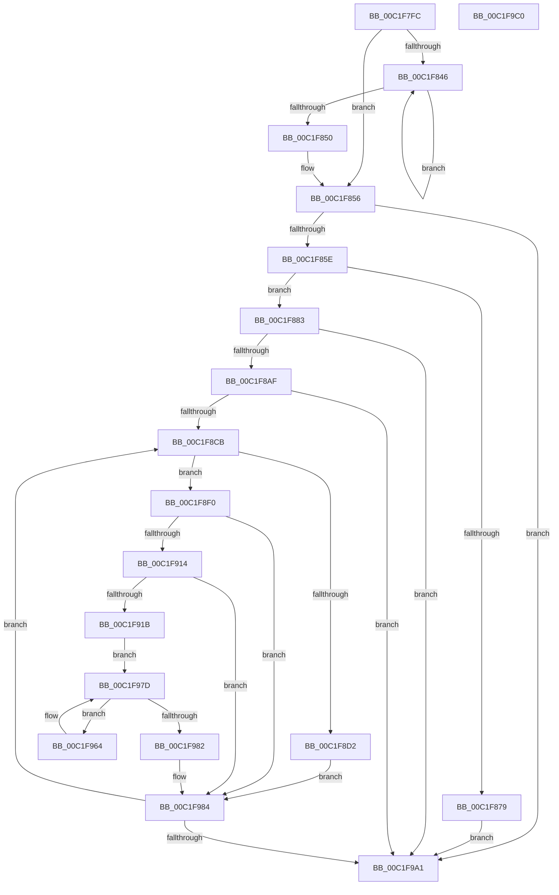

# HalpExtInitExtensions

- RVA: `0x00C1F7FC`–`0x00C1F9C1` (길이 `453` bytes)
- VA: `0x0000000140C1F7FC`
- 실행 섹션: `INIT`
- PDB 이름 있음: `예`; PDB Function 태그: `아니요`
- unwind 정보 RVA: `0x0008C2BC`
- 디코드: `123`개 명령, `453/453` bytes 표시
- 미해석 바이트: `0` (있으면 어셈블리에 `.byte`로 보존)

> 이 문서는 커널 이미지의 기계어와 PDB 기호를 분석해 생성했습니다. 4번과 5번은 함수 원형과 자료형을 바이너리 사용 방식에서 추정한 C 해석이며 원본 소스 복구 결과는 아닙니다.

## 1. Dependencies

- 직접 호출 지점: **6**; 고유 호출 대상: **5**
- 직접 호출자로 확인된 함수: **1**
- RIP 상대 이미지 참조: **6**

### Outgoing calls
- `0x00C1F868` → [HalpMmAllocateMemoryInternal](../../text/54/HalpMmAllocateMemoryInternal_function_00544990.md) (function, `0x00544990`)
- `0x00C1F88B` → [memset](../../text/6C/memset_function_006C6C40.md) (function, `0x006C6C40`)
- `0x00C1F89E` → [HalpAcpiGetTable](../../text/3F/HalpAcpiGetTable_function_003F6BF8.md) (function, `0x003F6BF8`)
- `0x00C1F8E6` → [DbgPrintEx](../../text/35/DbgPrintEx_function_00359290.md) (function, `0x00359290`)
- `0x00C1F90B` → [guard_dispatch_icall](../../text/6B/guard_dispatch_icall_function_006BAAD0.md) (function, `0x006BAAD0`)
- `0x00C1F975` → [guard_dispatch_icall](../../text/6B/guard_dispatch_icall_function_006BAAD0.md) (function, `0x006BAAD0`)

### Direct callers
- [HalpHalExtInitSystem](../../pagelk/B5/HalpHalExtInitSystem_function_00B5D2E0.md) at `0x00B5D2F0`

### Static image references
- `0x00C1F81A` → RVA `0x00FC1A18` (`.data`; write)
- `0x00C1F838` → RVA `0x00FC1A10` (`.data`; write)
- `0x00C1F86D` → RVA `0x00FC1A08` (`.data`; write)
- `0x00C1F8D6` → RVA `0x000241A8` (`.rdata`; read)
- `0x00C1F8F4` → RVA `0x00E002E0` (`.data`; read)
- `0x00C1F92A` → RVA `0x00FC1A08` (`.data`; read)

## 2. Other-region calls and transfers

- 다른 실행 섹션으로 향하는 call: **6**
  - `0x00C1F868` → [HalpMmAllocateMemoryInternal](../../text/54/HalpMmAllocateMemoryInternal_function_00544990.md) (`INIT` → `.text`)
  - `0x00C1F88B` → [memset](../../text/6C/memset_function_006C6C40.md) (`INIT` → `.text`)
  - `0x00C1F89E` → [HalpAcpiGetTable](../../text/3F/HalpAcpiGetTable_function_003F6BF8.md) (`INIT` → `.text`)
  - `0x00C1F8E6` → [DbgPrintEx](../../text/35/DbgPrintEx_function_00359290.md) (`INIT` → `.text`)
  - `0x00C1F90B` → [guard_dispatch_icall](../../text/6B/guard_dispatch_icall_function_006BAAD0.md) (`INIT` → `.text`)
  - `0x00C1F975` → [guard_dispatch_icall](../../text/6B/guard_dispatch_icall_function_006BAAD0.md) (`INIT` → `.text`)
- 별도 외부 분기/꼬리 이동을 확인하지 못했습니다.

## 3. Assembly (complete function range)

```asm
00C1F7FC  48 8B C4                        mov rax, rsp
00C1F7FF  48 89 58 10                     mov qword ptr [rax + 0x10], rbx
00C1F803  48 89 68 18                     mov qword ptr [rax + 0x18], rbp
00C1F807  48 89 70 20                     mov qword ptr [rax + 0x20], rsi
00C1F80B  57                              push rdi
00C1F80C  41 54                           push r12
00C1F80E  41 55                           push r13
00C1F810  41 56                           push r14
00C1F812  41 57                           push r15
00C1F814  48 83 EC 30                     sub rsp, 0x30
00C1F818  33 DB                           xor ebx, ebx
00C1F81A  48 89 0D F7 21 3A 00            mov qword ptr [rip + 0x3a21f7], rcx
00C1F821  48 8B E9                        mov rbp, rcx
00C1F824  48 89 58 08                     mov qword ptr [rax + 8], rbx
00C1F828  48 8B 89 F0 00 00 00            mov rcx, qword ptr [rcx + 0xf0]
00C1F82F  8B FB                           mov edi, ebx
00C1F831  48 81 C1 18 0A 00 00            add rcx, 0xa18
00C1F838  89 1D D2 21 3A 00               mov dword ptr [rip + 0x3a21d2], ebx
00C1F83E  48 8B 01                        mov rax, qword ptr [rcx]
00C1F841  48 3B C1                        cmp rax, rcx
00C1F844  74 10                           je 0x140c1f856
00C1F846  48 8B 00                        mov rax, qword ptr [rax]
00C1F849  FF C7                           inc edi
00C1F84B  48 3B C1                        cmp rax, rcx
00C1F84E  75 F6                           jne 0x140c1f846
00C1F850  89 3D BA 21 3A 00               mov dword ptr [rip + 0x3a21ba], edi
00C1F856  85 FF                           test edi, edi
00C1F858  0F 84 43 01 00 00               je 0x140c1f9a1
00C1F85E  C1 E7 06                        shl edi, 6
00C1F861  BA 01 00 00 00                  mov edx, 1
00C1F866  8B CF                           mov ecx, edi
00C1F868  E8 23 51 92 FF                  call 0x140544990
00C1F86D  48 89 05 94 21 3A 00            mov qword ptr [rip + 0x3a2194], rax
00C1F874  48 85 C0                        test rax, rax
00C1F877  75 0A                           jne 0x140c1f883
00C1F879  BB 17 00 00 C0                  mov ebx, 0xc0000017
00C1F87E  E9 1E 01 00 00                  jmp 0x140c1f9a1
00C1F883  44 8B C7                        mov r8d, edi
00C1F886  33 D2                           xor edx, edx
00C1F888  48 8B C8                        mov rcx, rax
00C1F88B  E8 B0 73 AA FF                  call 0x1406c6c40
00C1F890  45 33 C9                        xor r9d, r9d
00C1F893  45 33 C0                        xor r8d, r8d
00C1F896  BA 43 53 52 54                  mov edx, 0x54525343
00C1F89B  48 8B CD                        mov rcx, rbp
00C1F89E  E8 55 73 7D FF                  call 0x1403f6bf8
00C1F8A3  4C 8B E8                        mov r13, rax
00C1F8A6  48 85 C0                        test rax, rax
00C1F8A9  0F 84 F2 00 00 00               je 0x140c1f9a1
00C1F8AF  48 8B 85 F0 00 00 00            mov rax, qword ptr [rbp + 0xf0]
00C1F8B6  44 8B F3                        mov r14d, ebx
00C1F8B9  48 05 18 0A 00 00               add rax, 0xa18
00C1F8BF  48 8B 38                        mov rdi, qword ptr [rax]
00C1F8C2  48 3B F8                        cmp rdi, rax
00C1F8C5  0F 84 D6 00 00 00               je 0x140c1f9a1
00C1F8CB  8B 47 28                        mov eax, dword ptr [rdi + 0x28]
00C1F8CE  85 C0                           test eax, eax
00C1F8D0  79 1E                           jns 0x140c1f8f0
00C1F8D2  4C 8B 4F 30                     mov r9, qword ptr [rdi + 0x30]
00C1F8D6  4C 8D 05 CB 48 40 FF            lea r8, [rip - 0xbfb735]
00C1F8DD  33 D2                           xor edx, edx
00C1F8DF  89 44 24 20                     mov dword ptr [rsp + 0x20], eax
00C1F8E3  8D 4A 65                        lea ecx, [rdx + 0x65]
00C1F8E6  E8 A5 99 73 FF                  call 0x140359290
00C1F8EB  E9 94 00 00 00                  jmp 0x140c1f984
00C1F8F0  4C 8B 7F 10                     mov r15, qword ptr [rdi + 0x10]
00C1F8F4  4C 8D 05 E5 09 1E 00            lea r8, [rip + 0x1e09e5]
00C1F8FB  48 8D 54 24 60                  lea rdx, [rsp + 0x60]
00C1F900  33 C9                           xor ecx, ecx
00C1F902  49 8B 47 38                     mov rax, qword ptr [r15 + 0x38]
00C1F906  48 89 5C 24 60                  mov qword ptr [rsp + 0x60], rbx
00C1F90B  E8 C0 B1 A9 FF                  call 0x1406baad0
00C1F910  85 C0                           test eax, eax
00C1F912  78 70                           js 0x140c1f984
00C1F914  48 39 5C 24 60                  cmp qword ptr [rsp + 0x60], rbx
00C1F919  74 69                           je 0x140c1f984
00C1F91B  49 8B 47 38                     mov rax, qword ptr [r15 + 0x38]
00C1F91F  4C 8D 67 18                     lea r12, [rdi + 0x18]
00C1F923  41 8B F6                        mov esi, r14d
00C1F926  48 C1 E6 06                     shl rsi, 6
00C1F92A  48 03 35 D7 20 3A 00            add rsi, qword ptr [rip + 0x3a20d7]
00C1F931  48 89 46 08                     mov qword ptr [rsi + 8], rax
00C1F935  48 8B 44 24 60                  mov rax, qword ptr [rsp + 0x60]
00C1F93A  48 89 46 10                     mov qword ptr [rsi + 0x10], rax
00C1F93E  89 5E 18                        mov dword ptr [rsi + 0x18], ebx
00C1F941  49 8B 47 30                     mov rax, qword ptr [r15 + 0x30]
00C1F945  48 89 46 30                     mov qword ptr [rsi + 0x30], rax
00C1F949  41 8B 47 40                     mov eax, dword ptr [r15 + 0x40]
00C1F94D  89 46 38                        mov dword ptr [rsi + 0x38], eax
00C1F950  48 8D 46 20                     lea rax, [rsi + 0x20]
00C1F954  C6 06 01                        mov byte ptr [rsi], 1
00C1F957  48 89 40 08                     mov qword ptr [rax + 8], rax
00C1F95B  48 89 00                        mov qword ptr [rax], rax
00C1F95E  4D 8B 3C 24                     mov r15, qword ptr [r12]
00C1F962  EB 19                           jmp 0x140c1f97d
00C1F964  48 8B 46 10                     mov rax, qword ptr [rsi + 0x10]
00C1F968  41 8B CE                        mov ecx, r14d
00C1F96B  41 8B 57 10                     mov edx, dword ptr [r15 + 0x10]
00C1F96F  49 03 D5                        add rdx, r13
00C1F972  48 8B 00                        mov rax, qword ptr [rax]
00C1F975  E8 56 B1 A9 FF                  call 0x1406baad0
00C1F97A  4D 8B 3F                        mov r15, qword ptr [r15]
00C1F97D  4D 3B FC                        cmp r15, r12
00C1F980  75 E2                           jne 0x140c1f964
00C1F982  88 1E                           mov byte ptr [rsi], bl
00C1F984  48 8B 8D F0 00 00 00            mov rcx, qword ptr [rbp + 0xf0]
00C1F98B  41 FF C6                        inc r14d
00C1F98E  48 8B 3F                        mov rdi, qword ptr [rdi]
00C1F991  48 81 C1 18 0A 00 00            add rcx, 0xa18
00C1F998  48 3B F9                        cmp rdi, rcx
00C1F99B  0F 85 2A FF FF FF               jne 0x140c1f8cb
00C1F9A1  48 8B 6C 24 70                  mov rbp, qword ptr [rsp + 0x70]
00C1F9A6  8B C3                           mov eax, ebx
00C1F9A8  48 8B 5C 24 68                  mov rbx, qword ptr [rsp + 0x68]
00C1F9AD  48 8B 74 24 78                  mov rsi, qword ptr [rsp + 0x78]
00C1F9B2  48 83 C4 30                     add rsp, 0x30
00C1F9B6  41 5F                           pop r15
00C1F9B8  41 5E                           pop r14
00C1F9BA  41 5D                           pop r13
00C1F9BC  41 5C                           pop r12
00C1F9BE  5F                              pop rdi
00C1F9BF  C3                              ret
00C1F9C0  CC                              int3
```

## 4. C-style interpretation (structured pseudocode)

```c
__int64 __fastcall HalpExtInitExtensions(__int64 a1, __int64 a2, __int64 a3, int a4)
{
    __int64 result;
    __int64 v_r14;
    __int64 v_rbx;
    __int64 v_rdi;
    __int64 v_rsi;
    __int64 v_rsp;
    unsigned int v_stack_m38;
    unsigned __int64 v_stack_p10;
    unsigned __int64 v_stack_p18;
    unsigned __int64 v_stack_p20;
    unsigned __int64 v_stack_p8;

    *(unsigned __int64 *)(v_rsp + 16) = v_rbx;
    *(unsigned __int64 *)(v_rsp + 24) = v_rbp;
    *(unsigned __int64 *)(v_rsp + 32) = v_rsi;
    v_rsp = (v_rsp) - (48);
    v_rbx = 0;
    *(unsigned __int64 *)(v_rip + 3809783) = a1;
    *(unsigned __int64 *)(v_rsp + 8) = 0;
    a1 = (*(unsigned __int64 *)(a1 + 240)) + (0xA18ULL);
    *(unsigned int *)(v_rip + 3809746) = 0;
    if ((*(unsigned __int64 *)(a1)) == a1) goto loc_00C1F856;
loc_00C1F846:
    v_rdi = (unsigned int)((0) + 1);
    if ((*(unsigned __int64 *)(*(unsigned __int64 *)(a1))) != a1) goto loc_00C1F846;
    *(unsigned int *)(v_rip + 3809722) = (unsigned int)(v_rdi);
loc_00C1F856:
    if ((unsigned int)(v_rdi) == 0) goto loc_00C1F9A1;
    v_rdi = (unsigned int)((v_rdi) << (6));
    result = HalpMmAllocateMemoryInternal((unsigned int)((unsigned int)(v_rdi)), 1, a3, a4);
    *(unsigned __int64 *)(v_rip + 3809684) = result;
    if (result != 0) goto loc_00C1F883;
    goto loc_00C1F9A1;
loc_00C1F883:
    a2 = 0;
    result = memset(result, a2, (unsigned int)((unsigned int)(v_rdi)), a4);
    a4 = 0;
    a3 = 0;
    result = HalpAcpiGetTable(a1, (unsigned int)(0x54525343ULL), a3, a4);
    if (result == 0) goto loc_00C1F9A1;
    result = (*(unsigned __int64 *)(a1 + 240)) + (0xA18ULL);
    if ((*(unsigned __int64 *)(result)) == result) goto loc_00C1F9A1;
loc_00C1F8CB:
    if (!sign_flag) goto loc_00C1F8F0;
    a2 = 0;
    v_stack_m38 = (unsigned int)((unsigned int)(*(unsigned int *)(*(unsigned __int64 *)(result) + 40)));
    result = DbgPrintEx(a2 + 101, a2, v_rip - 12564277, *(unsigned __int64 *)(*(unsigned __int64 *)(result) + 48));
    goto loc_00C1F984;
loc_00C1F8F0:
    a1 = 0;
    v_stack_p8 = (unsigned int)(0xC0000017ULL);
    result = guard_dispatch_icall(a1, v_stack_p8, v_rip + 1968613, *(unsigned __int64 *)(*(unsigned __int64 *)(result) + 48));
    if (sign_flag) goto loc_00C1F984;
    if (v_stack_p8 == ((unsigned int)(0xC0000017ULL))) goto loc_00C1F984;
    v_rsi = ((unsigned int)((unsigned int)((unsigned int)((unsigned int)((unsigned int)(0xC0000017ULL)))))) << (6);
    v_rsi = (v_rsi) + (*(unsigned __int64 *)(v_rip + 3809495));
    *(unsigned __int64 *)(v_rsi + 8) = *(unsigned __int64 *)(*(unsigned __int64 *)(*(unsigned __int64 *)(result) + 16) + 56);
    *(unsigned __int64 *)(v_rsi + 16) = v_stack_p8;
    *(unsigned int *)(v_rsi + 24) = (unsigned int)((unsigned int)(0xC0000017ULL));
    *(unsigned __int64 *)(v_rsi + 48) = *(unsigned __int64 *)(*(unsigned __int64 *)(*(unsigned __int64 *)(result) + 16) + 48);
    *(unsigned int *)(v_rsi + 56) = (unsigned int)((unsigned int)(*(unsigned int *)(*(unsigned __int64 *)(*(unsigned __int64 *)(result) + 16) + 64)));
    *(unsigned __int8 *)(v_rsi) = 1;
    *(unsigned __int64 *)(v_rsi + 32 + 8) = v_rsi + 32;
    *(unsigned __int64 *)(v_rsi + 32) = v_rsi + 32;
    goto loc_00C1F97D;
loc_00C1F964:
    a2 = ((unsigned int)(*(unsigned int *)(*(unsigned __int64 *)(*(unsigned __int64 *)(result) + 24) + 16))) + (result);
    result = guard_dispatch_icall((unsigned int)((unsigned int)((unsigned int)((unsigned int)((unsigned int)(0xC0000017ULL))))), a2, v_rip + 1968613, *(unsigned __int64 *)(*(unsigned __int64 *)(result) + 48));
loc_00C1F97D:
    if ((*(unsigned __int64 *)(*(unsigned __int64 *)(*(unsigned __int64 *)(result) + 24))) != (*(unsigned __int64 *)(result) + 24)) goto loc_00C1F964;
    *(unsigned __int8 *)(v_rsi) = (unsigned __int8)((unsigned int)(0xC0000017ULL));
loc_00C1F984:
    v_r14 = (unsigned int)(((unsigned int)((unsigned int)((unsigned int)(0xC0000017ULL)))) + 1);
    a1 = (*(unsigned __int64 *)(a1 + 240)) + (0xA18ULL);
    if ((*(unsigned __int64 *)(*(unsigned __int64 *)(result))) != a1) goto loc_00C1F8CB;
loc_00C1F9A1:
    v_rsp = (v_rsp) + (48);
    return (unsigned int)((unsigned int)((unsigned int)(0xC0000017ULL)));
}
```

## 5. (Beta) C Style

```c
int64_t HalpExtInitExtensions(void *Arg1, int64_t Arg2, int64_t Arg3, int32_t Arg4)
{
    uint8_t *arg1 = (uint8_t *)Arg1;

    int64_t result;
    int64_t local_r14;
    int64_t local_rbx;
    int64_t local_rdi;
    int64_t local_rsi;
    int64_t local_rsp;
    uint32_t v_stack_m38;
    uint64_t v_stack_p10;
    uint64_t v_stack_p18;
    uint64_t v_stack_p20;
    uint64_t v_stack_p8;

    *(uint64_t *)(local_rsp + 0x10) = local_rbx;
    *(uint64_t *)(local_rsp + 0x18) = local_rbp;
    *(uint64_t *)(local_rsp + 0x20) = local_rsi;
    local_rsp = (local_rsp) - (48);
    local_rbx = 0;
    *(void **)(v_rip + 0x3A21F7) = Arg1;
    *(uint64_t *)(local_rsp + 0x8) = 0;
    Arg1 = (*(uint64_t *)(arg1 + 0xF0)) + (0xA18ULL);
    *(uint32_t *)(v_rip + 0x3A21D2) = 0;
    if ((*(uint64_t *)(arg1)) == Arg1) goto loc_00C1F856;
loc_00C1F846:
    local_rdi = (uint32_t)((0) + 1);
    if ((*(uint64_t *)(*(uint64_t *)(arg1))) != Arg1) goto loc_00C1F846;
    *(uint32_t *)(v_rip + 0x3A21BA) = (uint32_t)(local_rdi);
loc_00C1F856:
    if ((uint32_t)(local_rdi) == 0) goto loc_00C1F9A1;
    local_rdi = (uint32_t)((local_rdi) << (6));
    result = HalpMmAllocateMemoryInternal((uint32_t)((uint32_t)(local_rdi)), 1, Arg3, Arg4);
    *(uint64_t *)(v_rip + 0x3A2194) = result;
    if (result != 0) goto loc_00C1F883;
    goto loc_00C1F9A1;
loc_00C1F883:
    Arg2 = 0;
    result = memset(result, Arg2, (uint32_t)((uint32_t)(local_rdi)), Arg4);
    Arg4 = 0;
    Arg3 = 0;
    result = HalpAcpiGetTable(Arg1, (uint32_t)(0x54525343ULL), Arg3, Arg4);
    if (result == 0) goto loc_00C1F9A1;
    result = (*(uint64_t *)(arg1 + 0xF0)) + (0xA18ULL);
    if ((*(uint64_t *)(result)) == result) goto loc_00C1F9A1;
loc_00C1F8CB:
    if (!sign_flag) goto loc_00C1F8F0;
    Arg2 = 0;
    v_stack_m38 = (uint32_t)((uint32_t)(*(uint32_t *)(*(uint64_t *)(result) + 0x28)));
    result = DbgPrintEx(Arg2 + 101, Arg2, v_rip - 12564277, *(uint64_t *)(*(uint64_t *)(result) + 0x30));
    goto loc_00C1F984;
loc_00C1F8F0:
    Arg1 = 0;
    v_stack_p8 = (uint32_t)(0xC0000017ULL);
    result = guard_dispatch_icall(Arg1, v_stack_p8, v_rip + 1968613, *(uint64_t *)(*(uint64_t *)(result) + 0x30));
    if (sign_flag) goto loc_00C1F984;
    if (v_stack_p8 == ((uint32_t)(0xC0000017ULL))) goto loc_00C1F984;
    local_rsi = ((uint32_t)((uint32_t)((uint32_t)((uint32_t)((uint32_t)(0xC0000017ULL)))))) << (6);
    local_rsi = (local_rsi) + (*(uint64_t *)(v_rip + 0x3A20D7));
    *(uint64_t *)(local_rsi + 0x8) = *(uint64_t *)(*(uint64_t *)(*(uint64_t *)(result) + 0x10) + 0x38);
    *(uint64_t *)(local_rsi + 0x10) = v_stack_p8;
    *(uint32_t *)(local_rsi + 0x18) = (uint32_t)((uint32_t)(0xC0000017ULL));
    *(uint64_t *)(local_rsi + 0x30) = *(uint64_t *)(*(uint64_t *)(*(uint64_t *)(result) + 0x10) + 0x30);
    *(uint32_t *)(local_rsi + 0x38) = (uint32_t)((uint32_t)(*(uint32_t *)(*(uint64_t *)(*(uint64_t *)(result) + 0x10) + 0x40)));
    *(uint8_t *)(local_rsi) = 1;
    *(uint64_t *)(local_rsi + 0x20 + 0x8) = local_rsi + 32;
    *(uint64_t *)(local_rsi + 0x20) = local_rsi + 32;
    goto loc_00C1F97D;
loc_00C1F964:
    Arg2 = ((uint32_t)(*(uint32_t *)(*(uint64_t *)(*(uint64_t *)(result) + 0x18) + 0x10))) + (result);
    result = guard_dispatch_icall((uint32_t)((uint32_t)((uint32_t)((uint32_t)((uint32_t)(0xC0000017ULL))))), Arg2, v_rip + 1968613, *(uint64_t *)(*(uint64_t *)(result) + 0x30));
loc_00C1F97D:
    if ((*(uint64_t *)(*(uint64_t *)(*(uint64_t *)(result) + 0x18))) != (*(uint64_t *)(result) + 24)) goto loc_00C1F964;
    *(uint8_t *)(local_rsi) = (uint8_t)((uint32_t)(0xC0000017ULL));
loc_00C1F984:
    local_r14 = (uint32_t)(((uint32_t)((uint32_t)((uint32_t)(0xC0000017ULL)))) + 1);
    Arg1 = (*(uint64_t *)(arg1 + 0xF0)) + (0xA18ULL);
    if ((*(uint64_t *)(*(uint64_t *)(result))) != Arg1) goto loc_00C1F8CB;
loc_00C1F9A1:
    local_rsp = (local_rsp) + (48);
    return (uint32_t)((uint32_t)((uint32_t)(0xC0000017ULL)));
}
```

### 관측된 메모리 오프셋

구조체 형식이 확인되지 않은 접근은 인자 기준의 오프셋으로만 기록했습니다.

| 기준 인자 | 오프셋 표현 | 폭 (bit) | 접근 |
|---|---:|---:|---|
| `Arg1` | `+ 0xF0` | `64` | `R` |

## 6. Execution-region graph

[열기: 2D/3D 그래프와 함수 탐색 컨트롤 패널](../../../control-panel.html?section=init&rva=0x00C1F7FC&view=graph)

- 2D 그래프는 위에서 아래로 흐르고, 3D 그래프는 빈 공간을 드래그해 회전합니다. Shift+드래그는 이동, 휠은 확대·축소, 함수 노드 선택은 대상 보고서 이동입니다.

### Static fallback


