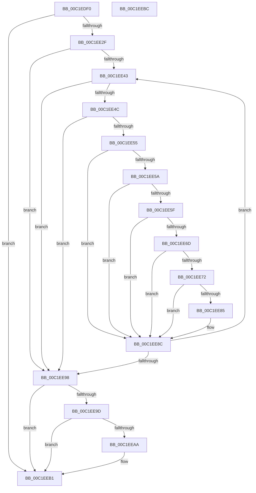

# HalpGetHotPlugMemoryInfo

- RVA: `0x00C1EDF0`–`0x00C1EEBD` (길이 `205` bytes)
- VA: `0x0000000140C1EDF0`
- 실행 섹션: `INIT`
- PDB 이름 있음: `예`; PDB Function 태그: `아니요`
- unwind 정보 RVA: `0x0005CAAC`
- 디코드: `61`개 명령, `205/205` bytes 표시
- 미해석 바이트: `0` (있으면 어셈블리에 `.byte`로 보존)

> 이 문서는 커널 이미지의 기계어와 PDB 기호를 분석해 생성했습니다. 4번과 5번은 함수 원형과 자료형을 바이너리 사용 방식에서 추정한 C 해석이며 원본 소스 복구 결과는 아닙니다.

## 1. Dependencies

- 직접 호출 지점: **2**; 고유 호출 대상: **1**
- 직접 호출자로 확인된 함수: **1**
- RIP 상대 이미지 참조: **2**

### Outgoing calls
- `0x00C1EE08` → [HalpAcpiGetTable](../../text/3F/HalpAcpiGetTable_function_003F6BF8.md) (function, `0x003F6BF8`)
- `0x00C1EE1E` → [HalpAcpiGetTable](../../text/3F/HalpAcpiGetTable_function_003F6BF8.md) (function, `0x003F6BF8`)

### Direct callers
- [HalpDpInitDiscard](HalpDpInitDiscard_function_00C1F7D0.md) at `0x00C1F7D4`

### Static image references
- `0x00C1EE7C` → RVA `0x00FC2C70` (`.data`; read)
- `0x00C1EE85` → RVA `0x00FC2C70` (`.data`; write)

## 2. Other-region calls and transfers

- 다른 실행 섹션으로 향하는 call: **2**
  - `0x00C1EE08` → [HalpAcpiGetTable](../../text/3F/HalpAcpiGetTable_function_003F6BF8.md) (`INIT` → `.text`)
  - `0x00C1EE1E` → [HalpAcpiGetTable](../../text/3F/HalpAcpiGetTable_function_003F6BF8.md) (`INIT` → `.text`)
- 별도 외부 분기/꼬리 이동을 확인하지 못했습니다.

## 3. Assembly (complete function range)

```asm
00C1EDF0  48 89 5C 24 08                  mov qword ptr [rsp + 8], rbx
00C1EDF5  57                              push rdi
00C1EDF6  48 83 EC 20                     sub rsp, 0x20
00C1EDFA  45 33 C9                        xor r9d, r9d
00C1EDFD  45 33 C0                        xor r8d, r8d
00C1EE00  BA 53 52 41 54                  mov edx, 0x54415253
00C1EE05  48 8B D9                        mov rbx, rcx
00C1EE08  E8 EB 7D 7D FF                  call 0x1403f6bf8
00C1EE0D  45 33 C9                        xor r9d, r9d
00C1EE10  45 33 C0                        xor r8d, r8d
00C1EE13  BA 4D 53 43 54                  mov edx, 0x5443534d
00C1EE18  48 8B CB                        mov rcx, rbx
00C1EE1B  48 8B F8                        mov rdi, rax
00C1EE1E  E8 D5 7D 7D FF                  call 0x1403f6bf8
00C1EE23  4C 8B D0                        mov r10, rax
00C1EE26  48 85 FF                        test rdi, rdi
00C1EE29  0F 84 82 00 00 00               je 0x140c1eeb1
00C1EE2F  44 8B 47 04                     mov r8d, dword ptr [rdi + 4]
00C1EE33  48 8D 57 30                     lea rdx, [rdi + 0x30]
00C1EE37  4C 03 C7                        add r8, rdi
00C1EE3A  48 8D 4A 02                     lea rcx, [rdx + 2]
00C1EE3E  49 3B C8                        cmp rcx, r8
00C1EE41  77 55                           ja 0x140c1ee98
00C1EE43  0F B6 4A 01                     movzx ecx, byte ptr [rdx + 1]
00C1EE47  80 F9 02                        cmp cl, 2
00C1EE4A  72 4C                           jb 0x140c1ee98
00C1EE4C  4C 8D 0C 0A                     lea r9, [rdx + rcx]
00C1EE50  4D 3B C8                        cmp r9, r8
00C1EE53  77 43                           ja 0x140c1ee98
00C1EE55  80 3A 01                        cmp byte ptr [rdx], 1
00C1EE58  75 32                           jne 0x140c1ee8c
00C1EE5A  80 F9 28                        cmp cl, 0x28
00C1EE5D  72 2D                           jb 0x140c1ee8c
00C1EE5F  8B 42 1C                        mov eax, dword ptr [rdx + 0x1c]
00C1EE62  48 8B 4A 10                     mov rcx, qword ptr [rdx + 0x10]
00C1EE66  83 E0 03                        and eax, 3
00C1EE69  3C 03                           cmp al, 3
00C1EE6B  75 1F                           jne 0x140c1ee8c
00C1EE6D  48 85 C9                        test rcx, rcx
00C1EE70  74 1A                           je 0x140c1ee8c
00C1EE72  48 8B 42 08                     mov rax, qword ptr [rdx + 8]
00C1EE76  48 FF C8                        dec rax
00C1EE79  48 03 C1                        add rax, rcx
00C1EE7C  48 3B 05 ED 3D 3A 00            cmp rax, qword ptr [rip + 0x3a3ded]
00C1EE83  7E 07                           jle 0x140c1ee8c
00C1EE85  48 89 05 E4 3D 3A 00            mov qword ptr [rip + 0x3a3de4], rax
00C1EE8C  49 8D 41 02                     lea rax, [r9 + 2]
00C1EE90  49 8B D1                        mov rdx, r9
00C1EE93  49 3B C0                        cmp rax, r8
00C1EE96  76 AB                           jbe 0x140c1ee43
00C1EE98  4D 85 D2                        test r10, r10
00C1EE9B  74 14                           je 0x140c1eeb1
00C1EE9D  49 8B 42 30                     mov rax, qword ptr [r10 + 0x30]
00C1EEA1  48 3B 05 C8 3D 3A 00            cmp rax, qword ptr [rip + 0x3a3dc8]
00C1EEA8  7E 07                           jle 0x140c1eeb1
00C1EEAA  48 89 05 BF 3D 3A 00            mov qword ptr [rip + 0x3a3dbf], rax
00C1EEB1  48 8B 5C 24 30                  mov rbx, qword ptr [rsp + 0x30]
00C1EEB6  48 83 C4 20                     add rsp, 0x20
00C1EEBA  5F                              pop rdi
00C1EEBB  C3                              ret
00C1EEBC  CC                              int3
```

## 4. C-style interpretation (structured pseudocode)

```c
__int64 __fastcall HalpGetHotPlugMemoryInfo(__int64 a1, __int64 a2, int a3, int a4)
{
    __int64 result;
    __int64 v_rsp;
    unsigned __int64 v_stack_p8;

    v_stack_p8 = v_rbx;
    v_rsp = (v_rsp) - (32);
    a4 = 0;
    a3 = 0;
    result = HalpAcpiGetTable(a1, (unsigned int)(0x54415253ULL), a3, a4);
    a4 = 0;
    a3 = 0;
    result = HalpAcpiGetTable(a1, (unsigned int)(0x5443534DULL), a3, a4);
    if (result == 0) goto loc_00C1EEB1;
    a3 = ((unsigned int)(*(unsigned int *)(result + 4))) + (result);
    if ((result + 48 + 2) > a3) goto loc_00C1EE98;
loc_00C1EE43:
    if (((unsigned __int8)(*(unsigned __int8 *)(result + 48 + 1))) < 2) goto loc_00C1EE98;
    if ((result + 48 + *(unsigned __int8 *)(result + 48 + 1) * 1) > a3) goto loc_00C1EE98;
    if ((*(unsigned __int8 *)(result + 48)) != 1) goto loc_00C1EE8C;
    if (((unsigned __int8)(*(unsigned __int8 *)(result + 48 + 1))) < 40) goto loc_00C1EE8C;
    result = (unsigned int)(((unsigned int)(*(unsigned int *)(result + 48 + 28))) & (3));
    if (((unsigned __int8)(result)) != 3) goto loc_00C1EE8C;
    if (*(unsigned __int64 *)(result + 48 + 16) == 0) goto loc_00C1EE8C;
    result = (*(unsigned __int64 *)(result + 48 + 8)) - 1;
    result = (result) + (*(unsigned __int64 *)(result + 48 + 16));
    if (result >= = (*(unsigned __int64 *)(v_rip + 3816941))) {
        *(unsigned __int64 *)(v_rip + 3816932) = result;
    }
    if ((result + 48 + *(unsigned __int8 *)(result + 48 + 1) * 1 + 2) <= a3) goto loc_00C1EE43;
loc_00C1EE98:
    if (result == 0) goto loc_00C1EEB1;
    if ((*(unsigned __int64 *)(result + 48)) >= = (*(unsigned __int64 *)(v_rip + 3816904))) {
        *(unsigned __int64 *)(v_rip + 3816895) = *(unsigned __int64 *)(result + 48);
    }
    v_rsp = (v_rsp) + (32);
    return *(unsigned __int64 *)(result + 48);
}
```

## 5. (Beta) C Style

```c
int64_t HalpGetHotPlugMemoryInfo(int64_t Arg1, int64_t Arg2, int32_t Arg3, int32_t Arg4)
{
    int64_t result;
    int64_t local_rsp;
    uint64_t v_stack_p8;

    v_stack_p8 = local_rbx;
    local_rsp = (local_rsp) - (32);
    Arg4 = 0;
    Arg3 = 0;
    result = HalpAcpiGetTable(Arg1, (uint32_t)(0x54415253ULL), Arg3, Arg4);
    Arg4 = 0;
    Arg3 = 0;
    result = HalpAcpiGetTable(Arg1, (uint32_t)(0x5443534DULL), Arg3, Arg4);
    if (result == 0) goto loc_00C1EEB1;
    Arg3 = ((uint32_t)(*(uint32_t *)(result + 0x4))) + (result);
    if ((result + 48 + 2) > Arg3) goto loc_00C1EE98;
loc_00C1EE43:
    if (((uint8_t)(*(uint8_t *)(result + 0x30 + 0x1))) < 2) goto loc_00C1EE98;
    if ((result + 48 + *(uint8_t *)(result + 0x30 + 0x1) * 1) > Arg3) goto loc_00C1EE98;
    if ((*(uint8_t *)(result + 0x30)) != 1) goto loc_00C1EE8C;
    if (((uint8_t)(*(uint8_t *)(result + 0x30 + 0x1))) < 40) goto loc_00C1EE8C;
    result = (uint32_t)(((uint32_t)(*(uint32_t *)(result + 0x30 + 0x1C))) & (3));
    if (((uint8_t)(result)) != 3) goto loc_00C1EE8C;
    if (*(uint64_t *)(result + 0x30 + 0x10) == 0) goto loc_00C1EE8C;
    result = (*(uint64_t *)(result + 0x30 + 0x8)) - 1;
    result = (result) + (*(uint64_t *)(result + 0x30 + 0x10));
    if (result >= = (*(uint64_t *)(v_rip + 0x3A3DED))) {
        *(uint64_t *)(v_rip + 0x3A3DE4) = result;
    }
    if ((result + 48 + *(uint8_t *)(result + 0x30 + 0x1) * 1 + 2) <= Arg3) goto loc_00C1EE43;
loc_00C1EE98:
    if (result == 0) goto loc_00C1EEB1;
    if ((*(uint64_t *)(result + 0x30)) >= = (*(uint64_t *)(v_rip + 0x3A3DC8))) {
        *(uint64_t *)(v_rip + 0x3A3DBF) = *(uint64_t *)(result + 0x30);
    }
    local_rsp = (local_rsp) + (32);
    return *(uint64_t *)(result + 0x30);
}
```

## 6. Execution-region graph

[열기: 2D/3D 그래프와 함수 탐색 컨트롤 패널](../../../control-panel.html?section=init&rva=0x00C1EDF0&view=graph)

- 2D 그래프는 위에서 아래로 흐르고, 3D 그래프는 빈 공간을 드래그해 회전합니다. Shift+드래그는 이동, 휠은 확대·축소, 함수 노드 선택은 대상 보고서 이동입니다.

### Static fallback


