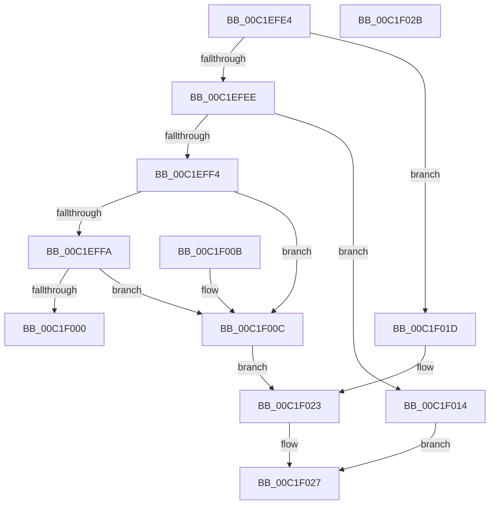

# HalpGetResourceSortValue

- RVA: `0x00C1EFE4`–`0x00C1F02C` (길이 `72` bytes)
- VA: `0x0000000140C1EFE4`
- 실행 섹션: `INIT`
- PDB 이름 있음: `예`; PDB Function 태그: `아니요`
- unwind 정보 RVA: `0x000DB714`
- 디코드: `23`개 명령, `72/72` bytes 표시
- 미해석 바이트: `0` (있으면 어셈블리에 `.byte`로 보존)

> 이 문서는 커널 이미지의 기계어와 PDB 기호를 분석해 생성했습니다. 4번과 5번은 함수 원형과 자료형을 바이너리 사용 방식에서 추정한 C 해석이며 원본 소스 복구 결과는 아닙니다.

## 1. Dependencies

- 직접 호출 지점: **0**; 고유 호출 대상: **0**
- 직접 호출자로 확인된 함수: **1**
- RIP 상대 이미지 참조: **0**

### Outgoing calls
- 직접 디코드된 call 명령이 없습니다.

### Direct callers
- [HalpReportResourceUsage](HalpReportResourceUsage_function_00C1F034.md) at `0x00C1F4C7`
- [HalpReportResourceUsage](HalpReportResourceUsage_function_00C1F034.md) at `0x00C1F4EE`
- [HalpReportResourceUsage](HalpReportResourceUsage_function_00C1F034.md) at `0x00C1F561`

### Static image references
- 디코드된 RIP-relative 메모리 참조가 없습니다.

## 2. Other-region calls and transfers

- 다른 실행 섹션으로 향하는 call: **0**
- 별도 외부 분기/꼬리 이동을 확인하지 못했습니다.

## 3. Assembly (complete function range)

```asm
00C1EFE4  44 0F B6 09                     movzx r9d, byte ptr [rcx]
00C1EFE8  41 83 E9 01                     sub r9d, 1
00C1EFEC  74 2F                           je 0x140c1f01d
00C1EFEE  41 83 E9 01                     sub r9d, 1
00C1EFF2  74 20                           je 0x140c1f014
00C1EFF4  41 83 E9 01                     sub r9d, 1
00C1EFF8  74 12                           je 0x140c1f00c
00C1EFFA  41 83 F9 04                     cmp r9d, 4
00C1EFFE  74 0C                           je 0x140c1f00c
00C1F000  49 83 20 00                     and qword ptr [r8], 0
00C1F004  C7 02 04 00 00 00               mov dword ptr [rdx], 4
00C1F00A  C3                              ret
00C1F00B  CC                              int3
00C1F00C  C7 02 02 00 00 00               mov dword ptr [rdx], 2
00C1F012  EB 0F                           jmp 0x140c1f023
00C1F014  83 22 00                        and dword ptr [rdx], 0
00C1F017  0F B7 41 04                     movzx eax, word ptr [rcx + 4]
00C1F01B  EB 0A                           jmp 0x140c1f027
00C1F01D  C7 02 01 00 00 00               mov dword ptr [rdx], 1
00C1F023  48 8B 41 04                     mov rax, qword ptr [rcx + 4]
00C1F027  49 89 00                        mov qword ptr [r8], rax
00C1F02A  C3                              ret
00C1F02B  CC                              int3
```

## 4. C-style interpretation (structured pseudocode)

```c
__int64 __fastcall HalpGetResourceSortValue(__int64 a1, __int64 a2, __int64 a3)
{
    a4 = (unsigned int)((*(unsigned __int8 *)(a1)) - (1));
    if (condition_is_equal) goto loc_00C1F01D;
    a4 = (unsigned int)((a4) - (1));
    if (condition_is_equal) goto loc_00C1F014;
    a4 = (unsigned int)((a4) - (1));
    if (condition_is_equal) goto loc_00C1F00C;
    if (((unsigned int)(a4)) == 4) goto loc_00C1F00C;
    *(unsigned int *)(a2) = 4;
    return result;
loc_00C1F00C:
    *(unsigned int *)(a2) = 2;
    goto loc_00C1F023;
loc_00C1F014:
    goto loc_00C1F027;
loc_00C1F01D:
    *(unsigned int *)(a2) = 1;
loc_00C1F023:
loc_00C1F027:
    *(unsigned __int64 *)(a3) = *(unsigned __int64 *)(a1 + 4);
    return *(unsigned __int64 *)(a1 + 4);
}
```

## 5. (Beta) C Style

```c
int64_t HalpGetResourceSortValue(void *Arg1, void *Arg2, void *Arg3)
{
    uint8_t *arg1 = (uint8_t *)Arg1;
    uint8_t *arg2 = (uint8_t *)Arg2;
    uint8_t *arg3 = (uint8_t *)Arg3;

    a4 = (uint32_t)((*(uint8_t *)(arg1)) - (1));
    if (condition_is_equal) goto loc_00C1F01D;
    a4 = (uint32_t)((a4) - (1));
    if (condition_is_equal) goto loc_00C1F014;
    a4 = (uint32_t)((a4) - (1));
    if (condition_is_equal) goto loc_00C1F00C;
    if (((uint32_t)(a4)) == 4) goto loc_00C1F00C;
    *(uint32_t *)(arg2) = 4;
    return result;
loc_00C1F00C:
    *(uint32_t *)(arg2) = 2;
    goto loc_00C1F023;
loc_00C1F014:
    goto loc_00C1F027;
loc_00C1F01D:
    *(uint32_t *)(arg2) = 1;
loc_00C1F023:
loc_00C1F027:
    *(uint64_t *)(arg3) = *(uint64_t *)(arg1 + 0x4);
    return *(uint64_t *)(arg1 + 0x4);
}
```

### 관측된 메모리 오프셋

구조체 형식이 확인되지 않은 접근은 인자 기준의 오프셋으로만 기록했습니다.

| 기준 인자 | 오프셋 표현 | 폭 (bit) | 접근 |
|---|---:|---:|---|
| `Arg1` | `+ 0x0` | `8` | `R` |
| `Arg1` | `+ 0x4` | `16` | `R` |
| `Arg1` | `+ 0x4` | `64` | `R` |
| `Arg2` | `+ 0x0` | `32` | `R/W` |
| `Arg2` | `+ 0x0` | `32` | `W` |
| `Arg3` | `+ 0x0` | `64` | `R/W` |
| `Arg3` | `+ 0x0` | `64` | `W` |

## 6. Execution-region graph

[열기: 2D/3D 그래프와 함수 탐색 컨트롤 패널](../../../control-panel.html?section=init&rva=0x00C1EFE4&view=graph)

- 2D 그래프는 위에서 아래로 흐르고, 3D 그래프는 빈 공간을 드래그해 회전합니다. Shift+드래그는 이동, 휠은 확대·축소, 함수 노드 선택은 대상 보고서 이동입니다.

### Static fallback


