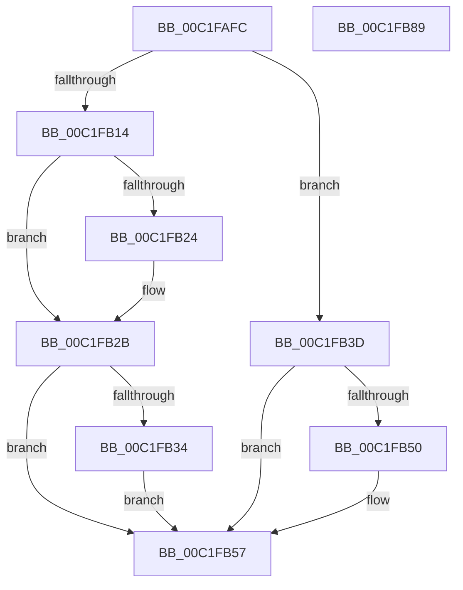

# HalpHvInitDiscard

- RVA: `0x00C1FAFC`–`0x00C1FB8A` (길이 `142` bytes)
- VA: `0x0000000140C1FAFC`
- 실행 섹션: `INIT`
- PDB 이름 있음: `예`; PDB Function 태그: `아니요`
- unwind 정보 RVA: `0x0005CF00`
- 디코드: `30`개 명령, `142/142` bytes 표시
- 미해석 바이트: `0` (있으면 어셈블리에 `.byte`로 보존)

> 이 문서는 커널 이미지의 기계어와 PDB 기호를 분석해 생성했습니다. 4번과 5번은 함수 원형과 자료형을 바이너리 사용 방식에서 추정한 C 해석이며 원본 소스 복구 결과는 아닙니다.

## 1. Dependencies

- 직접 호출 지점: **1**; 고유 호출 대상: **1**
- 직접 호출자로 확인된 함수: **1**
- RIP 상대 이미지 참조: **12**

### Outgoing calls
- `0x00C1FB05` → [HalpEnlightenmentInitialize](../../text/54/HalpEnlightenmentInitialize_function_0054C9C0.md) (function, `0x0054C9C0`)

### Direct callers
- [HalpHvInitSystem](../../pagelk/B5/HalpHvInitSystem_function_00B5D420.md) at `0x00B5D42C`

### Static image references
- `0x00C1FB0C` → RVA `0x00FC1ED0` (`.data`; read)
- `0x00C1FB14` → RVA `0x00FC1C90` (`.data`; read)
- `0x00C1FB1B` → RVA `0x00FC1ED8` (`.data`; write)
- `0x00C1FB24` → RVA `0x00FC1C42` (`.data`; write)
- `0x00C1FB2B` → RVA `0x00FC1CD0` (`.data`; read)
- `0x00C1FB34` → RVA `0x00FC1C48` (`.data`; write)
- `0x00C1FB57` → RVA `0x0054C460` (`HalpPrepareForBugcheck`; read)
- `0x00C1FB5E` → RVA `0x00E008F8` (`.data`; write)
- `0x00C1FB65` → RVA `0x0054D4D0` (`HalpSaveAndDisableEnlightenment`; read)
- `0x00C1FB6C` → RVA `0x00E00A00` (`.data`; write)
- `0x00C1FB73` → RVA `0x0054D130` (`HalpRestoreHvEnlightenment`; read)
- `0x00C1FB7A` → RVA `0x00E00A08` (`.data`; write)

## 2. Other-region calls and transfers

- 다른 실행 섹션으로 향하는 call: **1**
  - `0x00C1FB05` → [HalpEnlightenmentInitialize](../../text/54/HalpEnlightenmentInitialize_function_0054C9C0.md) (`INIT` → `.text`)
- 별도 외부 분기/꼬리 이동을 확인하지 못했습니다.

## 3. Assembly (complete function range)

```asm
00C1FAFC  40 53                           push rbx
00C1FAFE  48 83 EC 20                     sub rsp, 0x20
00C1FB02  48 8B D9                        mov rbx, rcx
00C1FB05  E8 B6 CE 92 FF                  call 0x14054c9c0
00C1FB0A  33 C0                           xor eax, eax
00C1FB0C  38 05 BE 23 3A 00               cmp byte ptr [rip + 0x3a23be], al
00C1FB12  74 29                           je 0x140c1fb3d
00C1FB14  48 39 05 75 21 3A 00            cmp qword ptr [rip + 0x3a2175], rax
00C1FB1B  C6 05 B6 23 3A 00 01            mov byte ptr [rip + 0x3a23b6], 1
00C1FB22  74 07                           je 0x140c1fb2b
00C1FB24  C6 05 17 21 3A 00 01            mov byte ptr [rip + 0x3a2117], 1
00C1FB2B  48 39 05 9E 21 3A 00            cmp qword ptr [rip + 0x3a219e], rax
00C1FB32  74 23                           je 0x140c1fb57
00C1FB34  C6 05 0D 21 3A 00 01            mov byte ptr [rip + 0x3a210d], 1
00C1FB3B  EB 1A                           jmp 0x140c1fb57
00C1FB3D  48 8B 83 F0 00 00 00            mov rax, qword ptr [rbx + 0xf0]
00C1FB44  F7 80 84 00 00 00 00 02 00 00   test dword ptr [rax + 0x84], 0x200
00C1FB4E  74 07                           je 0x140c1fb57
00C1FB50  C6 05 81 23 3A 00 01            mov byte ptr [rip + 0x3a2381], 1
00C1FB57  48 8D 05 02 C9 92 FF            lea rax, [rip - 0x6d36fe]
00C1FB5E  48 89 05 93 0D 1E 00            mov qword ptr [rip + 0x1e0d93], rax
00C1FB65  48 8D 05 64 D9 92 FF            lea rax, [rip - 0x6d269c]
00C1FB6C  48 89 05 8D 0E 1E 00            mov qword ptr [rip + 0x1e0e8d], rax
00C1FB73  48 8D 05 B6 D5 92 FF            lea rax, [rip - 0x6d2a4a]
00C1FB7A  48 89 05 87 0E 1E 00            mov qword ptr [rip + 0x1e0e87], rax
00C1FB81  33 C0                           xor eax, eax
00C1FB83  48 83 C4 20                     add rsp, 0x20
00C1FB87  5B                              pop rbx
00C1FB88  C3                              ret
00C1FB89  CC                              int3
```

## 4. C-style interpretation (structured pseudocode)

```c
__int64 __fastcall HalpHvInitDiscard(__int64 a1)
{
    __int64 result;
    __int64 v_rsp;

    v_rsp = (v_rsp) - (32);
    result = HalpEnlightenmentInitialize(a1, a2, a3, a4);
    result = 0;
    if ((*(unsigned __int8 *)(v_rip + 3810238)) == 0) goto loc_00C1FB3D;
    *(unsigned __int8 *)(v_rip + 3810230) = 1;
    if ((*(unsigned __int64 *)(v_rip + 3809653)) != 0) {
        *(unsigned __int8 *)(v_rip + 3809559) = 1;
    }
    if ((*(unsigned __int64 *)(v_rip + 3809694)) == 0) goto loc_00C1FB57;
    *(unsigned __int8 *)(v_rip + 3809549) = 1;
    goto loc_00C1FB57;
loc_00C1FB3D:
    if (((*(unsigned int *)(*(unsigned __int64 *)(a1 + 240) + 132)) & (512)) != 0) {
        *(unsigned __int8 *)(v_rip + 3810177) = 1;
    }
    *(unsigned __int64 *)(v_rip + 1969555) = v_rip - 7157502;
    *(unsigned __int64 *)(v_rip + 1969805) = v_rip - 7153308;
    *(unsigned __int64 *)(v_rip + 1969799) = v_rip - 7154250;
    result = 0;
    v_rsp = (v_rsp) + (32);
    return result;
}
```

## 5. (Beta) C Style

```c
int64_t HalpHvInitDiscard(void *Arg1)
{
    uint8_t *arg1 = (uint8_t *)Arg1;

    int64_t result;
    int64_t local_rsp;

    local_rsp = (local_rsp) - (32);
    result = HalpEnlightenmentInitialize(Arg1, a2, a3, a4);
    result = 0;
    if ((*(uint8_t *)(v_rip + 0x3A23BE)) == 0) goto loc_00C1FB3D;
    *(uint8_t *)(v_rip + 0x3A23B6) = 1;
    if ((*(uint64_t *)(v_rip + 0x3A2175)) != 0) {
        *(uint8_t *)(v_rip + 0x3A2117) = 1;
    }
    if ((*(uint64_t *)(v_rip + 0x3A219E)) == 0) goto loc_00C1FB57;
    *(uint8_t *)(v_rip + 0x3A210D) = 1;
    goto loc_00C1FB57;
loc_00C1FB3D:
    if (((*(uint32_t *)(*(uint64_t *)(arg1 + 0xF0) + 0x84)) & (512)) != 0) {
        *(uint8_t *)(v_rip + 0x3A2381) = 1;
    }
    *(uint64_t *)(v_rip + 0x1E0D93) = v_rip - 7157502;
    *(uint64_t *)(v_rip + 0x1E0E8D) = v_rip - 7153308;
    *(uint64_t *)(v_rip + 0x1E0E87) = v_rip - 7154250;
    result = 0;
    local_rsp = (local_rsp) + (32);
    return result;
}
```

### 관측된 메모리 오프셋

구조체 형식이 확인되지 않은 접근은 인자 기준의 오프셋으로만 기록했습니다.

| 기준 인자 | 오프셋 표현 | 폭 (bit) | 접근 |
|---|---:|---:|---|
| `Arg1` | `+ 0xF0` | `64` | `R` |

## 6. Execution-region graph

[열기: 2D/3D 그래프와 함수 탐색 컨트롤 패널](../../../control-panel.html?section=init&rva=0x00C1FAFC&view=graph)

- 2D 그래프는 위에서 아래로 흐르고, 3D 그래프는 빈 공간을 드래그해 회전합니다. Shift+드래그는 이동, 휠은 확대·축소, 함수 노드 선택은 대상 보고서 이동입니다.

### Static fallback


