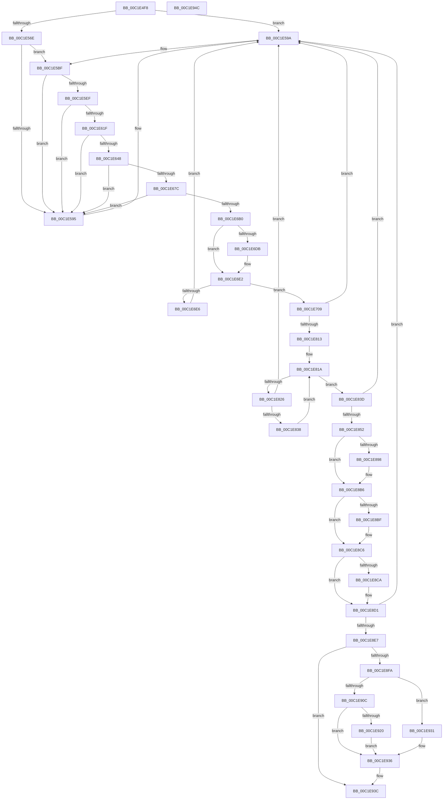

# HalpInitializeInterrupts

- RVA: `0x00C1E4F8`–`0x00C1E94D` (길이 `1,109` bytes)
- VA: `0x0000000140C1E4F8`
- 실행 섹션: `INIT`
- PDB 이름 있음: `예`; PDB Function 태그: `아니요`
- unwind 정보 RVA: `0x000A9A38`
- 디코드: `248`개 명령, `1,109/1,109` bytes 표시
- 미해석 바이트: `0` (있으면 어셈블리에 `.byte`로 보존)

> 이 문서는 커널 이미지의 기계어와 PDB 기호를 분석해 생성했습니다. 4번과 5번은 함수 원형과 자료형을 바이너리 사용 방식에서 추정한 C 해석이며 원본 소스 복구 결과는 아닙니다.

## 1. Dependencies

- 직접 호출 지점: **32**; 고유 호출 대상: **12**
- 직접 호출자로 확인된 함수: **1**
- RIP 상대 이미지 참조: **47**

### Outgoing calls
- `0x00C1E559` → [memset](../../text/6C/memset_function_006C6C40.md) (function, `0x006C6C40`)
- `0x00C1E563` → [HalpInterruptParseAcpiTables](../../text/55/HalpInterruptParseAcpiTables_function_00557DD4.md) (function, `0x00557DD4`)
- `0x00C1E56E` → [HalQueryMaximumProcessorCount](../../text/4A/HalQueryMaximumProcessorCount_function_004AC9A0.md) (function, `0x004AC9A0`)
- `0x00C1E584` → [HalpMmAllocateMemoryInternal](../../text/54/HalpMmAllocateMemoryInternal_function_00544990.md) (function, `0x00544990`)
- `0x00C1E5B9` → [KeBugCheckEx](../../text/4F/KeBugCheckEx_function_004FD660.md) (function, `0x004FD660`)
- `0x00C1E5C7` → [memset](../../text/6C/memset_function_006C6C40.md) (function, `0x006C6C40`)
- `0x00C1E5DE` → [HalpMmAllocateMemoryInternal](../../text/54/HalpMmAllocateMemoryInternal_function_00544990.md) (function, `0x00544990`)
- `0x00C1E5F7` → [memset](../../text/6C/memset_function_006C6C40.md) (function, `0x006C6C40`)
- `0x00C1E60A` → [HalpMmAllocateMemoryInternal](../../text/54/HalpMmAllocateMemoryInternal_function_00544990.md) (function, `0x00544990`)
- `0x00C1E629` → [memset](../../text/6C/memset_function_006C6C40.md) (function, `0x006C6C40`)
- `0x00C1E633` → [HalpMmAllocateMemoryInternal](../../text/54/HalpMmAllocateMemoryInternal_function_00544990.md) (function, `0x00544990`)
- `0x00C1E650` → [memset](../../text/6C/memset_function_006C6C40.md) (function, `0x006C6C40`)
- `0x00C1E667` → [HalpMmAllocateMemoryInternal](../../text/54/HalpMmAllocateMemoryInternal_function_00544990.md) (function, `0x00544990`)
- `0x00C1E684` → [memset](../../text/6C/memset_function_006C6C40.md) (function, `0x006C6C40`)
- `0x00C1E69B` → [HalpMmAllocateMemoryInternal](../../text/54/HalpMmAllocateMemoryInternal_function_00544990.md) (function, `0x00544990`)
- `0x00C1E6B8` → [memset](../../text/6C/memset_function_006C6C40.md) (function, `0x006C6C40`)
- `0x00C1E6D0` → [HalpApicDiscover](../../text/56/HalpApicDiscover_function_005699E4.md) (function, `0x005699E4`)
- `0x00C1E6DB` → [HalpPicDiscover](../../text/56/HalpPicDiscover_function_0056A7C4.md) (function, `0x0056A7C4`)
- `0x00C1E6FF` → [HalpInterruptSetProblemEx](../../text/48/HalpInterruptSetProblemEx_function_0048AC8C.md) (function, `0x0048AC8C`)
- `0x00C1E71F` → [HalpInterruptSetIdtEntry](../../text/55/HalpInterruptSetIdtEntry_function_0055BAE0.md) (function, `0x0055BAE0`)
- `0x00C1E738` → [HalpInterruptSetIdtEntry](../../text/55/HalpInterruptSetIdtEntry_function_0055BAE0.md) (function, `0x0055BAE0`)
- `0x00C1E74F` → [HalpInterruptSetIdtEntry](../../text/55/HalpInterruptSetIdtEntry_function_0055BAE0.md) (function, `0x0055BAE0`)
- `0x00C1E76E` → [HalpInterruptSetIdtEntry](../../text/55/HalpInterruptSetIdtEntry_function_0055BAE0.md) (function, `0x0055BAE0`)
- `0x00C1E785` → [HalpInterruptSetIdtEntry](../../text/55/HalpInterruptSetIdtEntry_function_0055BAE0.md) (function, `0x0055BAE0`)
- `0x00C1E79C` → [HalpInterruptSetIdtEntry](../../text/55/HalpInterruptSetIdtEntry_function_0055BAE0.md) (function, `0x0055BAE0`)
- `0x00C1E7B3` → [HalpInterruptSetIdtEntry](../../text/55/HalpInterruptSetIdtEntry_function_0055BAE0.md) (function, `0x0055BAE0`)
- `0x00C1E7CE` → [HalpInterruptSetIdtEntry](../../text/55/HalpInterruptSetIdtEntry_function_0055BAE0.md) (function, `0x0055BAE0`)
- `0x00C1E804` → [HalpInterruptSelectController](../../text/55/HalpInterruptSelectController_function_005587A8.md) (function, `0x005587A8`)
- `0x00C1E829` → [HalpInterruptInitializeController](../../text/55/HalpInterruptInitializeController_function_00557914.md) (function, `0x00557914`)
- `0x00C1E843` → [HalpInterruptParseAcpiTables](../../text/55/HalpInterruptParseAcpiTables_function_00557DD4.md) (function, `0x00557DD4`)
- `0x00C1E8D8` → [HalpInterruptInitializeIpis](../../text/54/HalpInterruptInitializeIpis_function_005462AC.md) (function, `0x005462AC`)
- `0x00C1E90C` → [HalQueryMaximumProcessorCount](../../text/4A/HalQueryMaximumProcessorCount_function_004AC9A0.md) (function, `0x004AC9A0`)

### Direct callers
- [HalpInterruptInitDiscard](../C2/HalpInterruptInitDiscard_function_00C20194.md) at `0x00C201FF`

### Static image references
- `0x00C1E50B` → RVA `0x00F906E0` (`.data`; read)
- `0x00C1E512` → RVA `0x00F906F0` (`.data`; read/write)
- `0x00C1E51D` → RVA `0x00F90528` (`.data`; read/write)
- `0x00C1E525` → RVA `0x00FC3908` (`.data`; read)
- `0x00C1E52C` → RVA `0x00FC3904` (`.data`; read/write)
- `0x00C1E53B` → RVA `0x00F906E8` (`.data`; write)
- `0x00C1E542` → RVA `0x00F906E0` (`.data`; write)
- `0x00C1E54F` → RVA `0x00FC3900` (`.data`; write)
- `0x00C1E576` → RVA `0x00E1020C` (`.data`; write)
- `0x00C1E589` → RVA `0x00E101E8` (`.data`; write)
- `0x00C1E59A` → RVA `0x00F90694` (`.data`; read)
- `0x00C1E5CC` → RVA `0x00E1020C` (`.data`; read)
- `0x00C1E5E3` → RVA `0x00E101F8` (`.data`; write)
- `0x00C1E60F` → RVA `0x00FC3E30` (`.data`; write)
- `0x00C1E638` → RVA `0x00FC3E10` (`.data`; write)
- `0x00C1E66C` → RVA `0x00FC3E20` (`.data`; write)
- `0x00C1E6A0` → RVA `0x00FC19B0` (`.data`; write)
- `0x00C1E6C6` → RVA `0x00FC19B0` (`.data`; read)
- `0x00C1E6E6` → RVA `0x00023C30` (`.rdata`; read)
- `0x00C1E70D` → RVA `0x0055B810` (`HalpInterruptCmciService`; read)
- `0x00C1E72C` → RVA `0x0055B830` (`HalpInterruptDeferredRecoveryService`; read)
- `0x00C1E764` → RVA `0x0055B8A0` (`HalpInterruptSpuriousService`; read)
- `0x00C1E77B` → RVA `0x0055B8D0` (`HalpInterruptStubService`; read)
- `0x00C1E792` → RVA `0x004B9450` (`HalpInterruptLocalErrorService`; read)
- `0x00C1E7A9` → RVA `0x0055B850` (`HalpInterruptRebootService`; read)
- `0x00C1E7C4` → RVA `0x00445B70` (`HalpPerfInterrupt`; read)
- `0x00C1E7D8` → RVA `0x010088D2` (`INITDATA`; write)
- `0x00C1E7DF` → RVA `0x01008ADA` (`INITDATA`; write)
- `0x00C1E7E6` → RVA `0x01008ADB` (`INITDATA`; write)
- `0x00C1E7F0` → RVA `0x010089AF` (`INITDATA`; write)
- `0x00C1E7F7` → RVA `0x01008F2B` (`INITDATA`; write)
- `0x00C1E7FE` → RVA `0x01008F2C` (`INITDATA`; write)
- `0x00C1E813` → RVA `0x00FC38F0` (`.data`; read)
- `0x00C1E857` → RVA `0x00010850` (`.rdata`; read)
- `0x00C1E85F` → RVA `0x00F90680` (`.data`; read)
- `0x00C1E866` → RVA `0x00F90680` (`.data`; write)
- `0x00C1E875` → RVA `0x00F9068D` (`.data`; write)
- `0x00C1E87E` → RVA `0x00F9068C` (`.data`; write)
- `0x00C1E885` → RVA `0x00F9068F` (`.data`; write)
- `0x00C1E88C` → RVA `0x00F90682` (`.data`; write)
- `0x00C1E898` → RVA `0x00E101E8` (`.data`; read)
- `0x00C1E89F` → RVA `0x00E10200` (`.data`; write)
- `0x00C1E8B6` → RVA `0x00E10200` (`.data`; read)
- `0x00C1E8CA` → RVA `0x00E0A818` (`.data`; read/write)
- `0x00C1E8D1` → RVA `0x00E101F0` (`.data`; write)
- `0x00C1E8E7` → RVA `0x00E101F0` (`.data`; read)
- `0x00C1E936` → RVA `0x00F90970` (`.data`; write)

## 2. Other-region calls and transfers

- 다른 실행 섹션으로 향하는 call: **32**
  - `0x00C1E559` → [memset](../../text/6C/memset_function_006C6C40.md) (`INIT` → `.text`)
  - `0x00C1E563` → [HalpInterruptParseAcpiTables](../../text/55/HalpInterruptParseAcpiTables_function_00557DD4.md) (`INIT` → `.text`)
  - `0x00C1E56E` → [HalQueryMaximumProcessorCount](../../text/4A/HalQueryMaximumProcessorCount_function_004AC9A0.md) (`INIT` → `.text`)
  - `0x00C1E584` → [HalpMmAllocateMemoryInternal](../../text/54/HalpMmAllocateMemoryInternal_function_00544990.md) (`INIT` → `.text`)
  - `0x00C1E5B9` → [KeBugCheckEx](../../text/4F/KeBugCheckEx_function_004FD660.md) (`INIT` → `.text`)
  - `0x00C1E5C7` → [memset](../../text/6C/memset_function_006C6C40.md) (`INIT` → `.text`)
  - `0x00C1E5DE` → [HalpMmAllocateMemoryInternal](../../text/54/HalpMmAllocateMemoryInternal_function_00544990.md) (`INIT` → `.text`)
  - `0x00C1E5F7` → [memset](../../text/6C/memset_function_006C6C40.md) (`INIT` → `.text`)
  - `0x00C1E60A` → [HalpMmAllocateMemoryInternal](../../text/54/HalpMmAllocateMemoryInternal_function_00544990.md) (`INIT` → `.text`)
  - `0x00C1E629` → [memset](../../text/6C/memset_function_006C6C40.md) (`INIT` → `.text`)
  - `0x00C1E633` → [HalpMmAllocateMemoryInternal](../../text/54/HalpMmAllocateMemoryInternal_function_00544990.md) (`INIT` → `.text`)
  - `0x00C1E650` → [memset](../../text/6C/memset_function_006C6C40.md) (`INIT` → `.text`)
  - `0x00C1E667` → [HalpMmAllocateMemoryInternal](../../text/54/HalpMmAllocateMemoryInternal_function_00544990.md) (`INIT` → `.text`)
  - `0x00C1E684` → [memset](../../text/6C/memset_function_006C6C40.md) (`INIT` → `.text`)
  - `0x00C1E69B` → [HalpMmAllocateMemoryInternal](../../text/54/HalpMmAllocateMemoryInternal_function_00544990.md) (`INIT` → `.text`)
  - `0x00C1E6B8` → [memset](../../text/6C/memset_function_006C6C40.md) (`INIT` → `.text`)
  - `0x00C1E6D0` → [HalpApicDiscover](../../text/56/HalpApicDiscover_function_005699E4.md) (`INIT` → `.text`)
  - `0x00C1E6DB` → [HalpPicDiscover](../../text/56/HalpPicDiscover_function_0056A7C4.md) (`INIT` → `.text`)
  - `0x00C1E6FF` → [HalpInterruptSetProblemEx](../../text/48/HalpInterruptSetProblemEx_function_0048AC8C.md) (`INIT` → `.text`)
  - `0x00C1E71F` → [HalpInterruptSetIdtEntry](../../text/55/HalpInterruptSetIdtEntry_function_0055BAE0.md) (`INIT` → `.text`)
  - `0x00C1E738` → [HalpInterruptSetIdtEntry](../../text/55/HalpInterruptSetIdtEntry_function_0055BAE0.md) (`INIT` → `.text`)
  - `0x00C1E74F` → [HalpInterruptSetIdtEntry](../../text/55/HalpInterruptSetIdtEntry_function_0055BAE0.md) (`INIT` → `.text`)
  - `0x00C1E76E` → [HalpInterruptSetIdtEntry](../../text/55/HalpInterruptSetIdtEntry_function_0055BAE0.md) (`INIT` → `.text`)
  - `0x00C1E785` → [HalpInterruptSetIdtEntry](../../text/55/HalpInterruptSetIdtEntry_function_0055BAE0.md) (`INIT` → `.text`)
  - `0x00C1E79C` → [HalpInterruptSetIdtEntry](../../text/55/HalpInterruptSetIdtEntry_function_0055BAE0.md) (`INIT` → `.text`)
  - `0x00C1E7B3` → [HalpInterruptSetIdtEntry](../../text/55/HalpInterruptSetIdtEntry_function_0055BAE0.md) (`INIT` → `.text`)
  - `0x00C1E7CE` → [HalpInterruptSetIdtEntry](../../text/55/HalpInterruptSetIdtEntry_function_0055BAE0.md) (`INIT` → `.text`)
  - `0x00C1E804` → [HalpInterruptSelectController](../../text/55/HalpInterruptSelectController_function_005587A8.md) (`INIT` → `.text`)
  - `0x00C1E829` → [HalpInterruptInitializeController](../../text/55/HalpInterruptInitializeController_function_00557914.md) (`INIT` → `.text`)
  - `0x00C1E843` → [HalpInterruptParseAcpiTables](../../text/55/HalpInterruptParseAcpiTables_function_00557DD4.md) (`INIT` → `.text`)
  - `0x00C1E8D8` → [HalpInterruptInitializeIpis](../../text/54/HalpInterruptInitializeIpis_function_005462AC.md) (`INIT` → `.text`)
  - `0x00C1E90C` → [HalQueryMaximumProcessorCount](../../text/4A/HalQueryMaximumProcessorCount_function_004AC9A0.md) (`INIT` → `.text`)
- 별도 외부 분기/꼬리 이동을 확인하지 못했습니다.

## 3. Assembly (complete function range)

```asm
00C1E4F8  48 89 5C 24 08                  mov qword ptr [rsp + 8], rbx
00C1E4FD  56                              push rsi
00C1E4FE  57                              push rdi
00C1E4FF  41 56                           push r14
00C1E501  48 83 EC 30                     sub rsp, 0x30
00C1E505  48 83 64 24 60 00               and qword ptr [rsp + 0x60], 0
00C1E50B  48 8D 05 CE 21 37 00            lea rax, [rip + 0x3721ce]
00C1E512  48 83 25 D6 21 37 00 00         and qword ptr [rip + 0x3721d6], 0
00C1E51A  48 8B F1                        mov rsi, rcx
00C1E51D  48 83 25 03 20 37 00 00         and qword ptr [rip + 0x372003], 0
00C1E525  48 8D 0D DC 53 3A 00            lea rcx, [rip + 0x3a53dc]
00C1E52C  83 25 D1 53 3A 00 00            and dword ptr [rip + 0x3a53d1], 0
00C1E533  33 D2                           xor edx, edx
00C1E535  41 B8 00 01 00 00               mov r8d, 0x100
00C1E53B  48 89 05 A6 21 37 00            mov qword ptr [rip + 0x3721a6], rax
00C1E542  48 89 05 97 21 37 00            mov qword ptr [rip + 0x372197], rax
00C1E549  41 BE 01 00 00 00               mov r14d, 1
00C1E54F  C7 05 A7 53 3A 00 01 00 20 00   mov dword ptr [rip + 0x3a53a7], 0x200001
00C1E559  E8 E2 86 AA FF                  call 0x1406c6c40
00C1E55E  33 D2                           xor edx, edx
00C1E560  48 8B CE                        mov rcx, rsi
00C1E563  E8 6C 98 93 FF                  call 0x140557dd4
00C1E568  8B D8                           mov ebx, eax
00C1E56A  85 C0                           test eax, eax
00C1E56C  78 2C                           js 0x140c1e59a
00C1E56E  E8 2D E4 88 FF                  call 0x1404ac9a0
00C1E573  41 8B D6                        mov edx, r14d
00C1E576  89 05 90 1C 1F 00               mov dword ptr [rip + 0x1f1c90], eax
00C1E57C  8D 1C 40                        lea ebx, [rax + rax*2]
00C1E57F  C1 E3 03                        shl ebx, 3
00C1E582  8B CB                           mov ecx, ebx
00C1E584  E8 07 64 92 FF                  call 0x140544990
00C1E589  48 89 05 58 1C 1F 00            mov qword ptr [rip + 0x1f1c58], rax
00C1E590  48 85 C0                        test rax, rax
00C1E593  75 2A                           jne 0x140c1e5bf
00C1E595  BB 17 00 00 C0                  mov ebx, 0xc0000017
00C1E59A  4C 63 0D F3 20 37 00            movsxd r9, dword ptr [rip + 0x3720f3]
00C1E5A1  BA 00 02 00 00                  mov edx, 0x200
00C1E5A6  48 63 C3                        movsxd rax, ebx
00C1E5A9  B9 5C 00 00 00                  mov ecx, 0x5c
00C1E5AE  41 B8 31 06 25 05               mov r8d, 0x5250631
00C1E5B4  48 89 44 24 20                  mov qword ptr [rsp + 0x20], rax
00C1E5B9  E8 A2 F0 8D FF                  call 0x1404fd660
00C1E5BE  CC                              int3
00C1E5BF  44 8B C3                        mov r8d, ebx
00C1E5C2  33 D2                           xor edx, edx
00C1E5C4  48 8B C8                        mov rcx, rax
00C1E5C7  E8 74 86 AA FF                  call 0x1406c6c40
00C1E5CC  8B 05 3A 1C 1F 00               mov eax, dword ptr [rip + 0x1f1c3a]
00C1E5D2  41 8B D6                        mov edx, r14d
00C1E5D5  8D 1C 85 00 00 00 00            lea ebx, [rax*4]
00C1E5DC  8B CB                           mov ecx, ebx
00C1E5DE  E8 AD 63 92 FF                  call 0x140544990
00C1E5E3  48 89 05 0E 1C 1F 00            mov qword ptr [rip + 0x1f1c0e], rax
00C1E5EA  48 85 C0                        test rax, rax
00C1E5ED  74 A6                           je 0x140c1e595
00C1E5EF  44 8B C3                        mov r8d, ebx
00C1E5F2  33 D2                           xor edx, edx
00C1E5F4  48 8B C8                        mov rcx, rax
00C1E5F7  E8 44 86 AA FF                  call 0x1406c6c40
00C1E5FC  8B 1D 0A 1C 1F 00               mov ebx, dword ptr [rip + 0x1f1c0a]
00C1E602  41 8B D6                        mov edx, r14d
00C1E605  C1 E3 06                        shl ebx, 6
00C1E608  8B CB                           mov ecx, ebx
00C1E60A  E8 81 63 92 FF                  call 0x140544990
00C1E60F  48 89 05 1A 58 3A 00            mov qword ptr [rip + 0x3a581a], rax
00C1E616  48 85 C0                        test rax, rax
00C1E619  0F 84 76 FF FF FF               je 0x140c1e595
00C1E61F  44 8B C3                        mov r8d, ebx
00C1E622  33 D2                           xor edx, edx
00C1E624  48 8B C8                        mov rcx, rax
00C1E627  8B FB                           mov edi, ebx
00C1E629  E8 12 86 AA FF                  call 0x1406c6c40
00C1E62E  41 8B D6                        mov edx, r14d
00C1E631  8B CB                           mov ecx, ebx
00C1E633  E8 58 63 92 FF                  call 0x140544990
00C1E638  48 89 05 D1 57 3A 00            mov qword ptr [rip + 0x3a57d1], rax
00C1E63F  48 85 C0                        test rax, rax
00C1E642  0F 84 4D FF FF FF               je 0x140c1e595
00C1E648  44 8B C7                        mov r8d, edi
00C1E64B  33 D2                           xor edx, edx
00C1E64D  48 8B C8                        mov rcx, rax
00C1E650  E8 EB 85 AA FF                  call 0x1406c6c40
00C1E655  8B 05 B1 1B 1F 00               mov eax, dword ptr [rip + 0x1f1bb1]
00C1E65B  41 8B D6                        mov edx, r14d
00C1E65E  8D 1C C5 00 00 00 00            lea ebx, [rax*8]
00C1E665  8B CB                           mov ecx, ebx
00C1E667  E8 24 63 92 FF                  call 0x140544990
00C1E66C  48 89 05 AD 57 3A 00            mov qword ptr [rip + 0x3a57ad], rax
00C1E673  48 85 C0                        test rax, rax
00C1E676  0F 84 19 FF FF FF               je 0x140c1e595
00C1E67C  44 8B C3                        mov r8d, ebx
00C1E67F  33 D2                           xor edx, edx
00C1E681  48 8B C8                        mov rcx, rax
00C1E684  E8 B7 85 AA FF                  call 0x1406c6c40
00C1E689  8B 05 7D 1B 1F 00               mov eax, dword ptr [rip + 0x1f1b7d]
00C1E68F  41 8B D6                        mov edx, r14d
00C1E692  8D 1C C5 00 00 00 00            lea ebx, [rax*8]
00C1E699  8B CB                           mov ecx, ebx
00C1E69B  E8 F0 62 92 FF                  call 0x140544990
00C1E6A0  48 89 05 09 33 3A 00            mov qword ptr [rip + 0x3a3309], rax
00C1E6A7  48 85 C0                        test rax, rax
00C1E6AA  0F 84 E5 FE FF FF               je 0x140c1e595
00C1E6B0  44 8B C3                        mov r8d, ebx
00C1E6B3  33 D2                           xor edx, edx
00C1E6B5  48 8B C8                        mov rcx, rax
00C1E6B8  E8 83 85 AA FF                  call 0x1406c6c40
00C1E6BD  65 48 8B 0C 25 18 00 00 00      mov rcx, qword ptr gs:[0x18]
00C1E6C6  48 8B 05 E3 32 3A 00            mov rax, qword ptr [rip + 0x3a32e3]
00C1E6CD  48 89 08                        mov qword ptr [rax], rcx
00C1E6D0  E8 0F B3 94 FF                  call 0x1405699e4
00C1E6D5  8B D8                           mov ebx, eax
00C1E6D7  85 C0                           test eax, eax
00C1E6D9  78 07                           js 0x140c1e6e2
00C1E6DB  E8 E4 C0 94 FF                  call 0x14056a7c4
00C1E6E0  8B D8                           mov ebx, eax
00C1E6E2  85 DB                           test ebx, ebx
00C1E6E4  79 23                           jns 0x140c1e709
00C1E6E6  4C 8D 0D 43 55 40 FF            lea r9, [rip - 0xbfaabd]
00C1E6ED  C7 44 24 20 A2 02 00 00         mov dword ptr [rsp + 0x20], 0x2a2
00C1E6F5  44 8B C3                        mov r8d, ebx
00C1E6F8  BA 03 00 00 00                  mov edx, 3
00C1E6FD  33 C9                           xor ecx, ecx
00C1E6FF  E8 88 C5 86 FF                  call 0x14048ac8c
00C1E704  E9 91 FE FF FF                  jmp 0x140c1e59a
00C1E709  48 83 CF FF                     or rdi, 0xffffffffffffffff
00C1E70D  48 8D 15 FC D0 93 FF            lea rdx, [rip - 0x6c2f04]
00C1E714  41 B0 05                        mov r8b, 5
00C1E717  48 89 7C 24 20                  mov qword ptr [rsp + 0x20], rdi
00C1E71C  8D 4F 36                        lea ecx, [rdi + 0x36]
00C1E71F  E8 BC D3 93 FF                  call 0x14055bae0
00C1E724  41 B0 0E                        mov r8b, 0xe
00C1E727  48 89 7C 24 20                  mov qword ptr [rsp + 0x20], rdi
00C1E72C  48 8D 15 FD D0 93 FF            lea rdx, [rip - 0x6c2f03]
00C1E733  B9 E3 00 00 00                  mov ecx, 0xe3
00C1E738  E8 A3 D3 93 FF                  call 0x14055bae0
00C1E73D  41 B0 05                        mov r8b, 5
00C1E740  48 89 7C 24 20                  mov qword ptr [rsp + 0x20], rdi
00C1E745  48 8D 15 C4 D0 93 FF            lea rdx, [rip - 0x6c2f3c]
00C1E74C  8D 4F 37                        lea ecx, [rdi + 0x37]
00C1E74F  E8 8C D3 93 FF                  call 0x14055bae0
00C1E754  BB DF 00 00 00                  mov ebx, 0xdf
00C1E759  48 C7 44 24 20 FE FF FF FF      mov qword ptr [rsp + 0x20], 0xfffffffffffffffe
00C1E762  8B CB                           mov ecx, ebx
00C1E764  48 8D 15 35 D1 93 FF            lea rdx, [rip - 0x6c2ecb]
00C1E76B  41 B0 0F                        mov r8b, 0xf
00C1E76E  E8 6D D3 93 FF                  call 0x14055bae0
00C1E773  41 B0 0F                        mov r8b, 0xf
00C1E776  48 89 7C 24 20                  mov qword ptr [rsp + 0x20], rdi
00C1E77B  48 8D 15 4E D1 93 FF            lea rdx, [rip - 0x6c2eb2]
00C1E782  8D 4B F9                        lea ecx, [rbx - 7]
00C1E785  E8 56 D3 93 FF                  call 0x14055bae0
00C1E78A  41 B0 0F                        mov r8b, 0xf
00C1E78D  48 89 7C 24 20                  mov qword ptr [rsp + 0x20], rdi
00C1E792  48 8D 15 B7 AC 89 FF            lea rdx, [rip - 0x765349]
00C1E799  8D 4B 03                        lea ecx, [rbx + 3]
00C1E79C  E8 3F D3 93 FF                  call 0x14055bae0
00C1E7A1  41 B0 0F                        mov r8b, 0xf
00C1E7A4  48 89 7C 24 20                  mov qword ptr [rsp + 0x20], rdi
00C1E7A9  48 8D 15 A0 D0 93 FF            lea rdx, [rip - 0x6c2f60]
00C1E7B0  8D 4B F8                        lea ecx, [rbx - 8]
00C1E7B3  E8 28 D3 93 FF                  call 0x14055bae0
00C1E7B8  41 B0 0F                        mov r8b, 0xf
00C1E7BB  48 C7 44 24 20 FD FF FF FF      mov qword ptr [rsp + 0x20], 0xfffffffffffffffd
00C1E7C4  48 8D 15 A5 73 82 FF            lea rdx, [rip - 0x7d8c5b]
00C1E7CB  8D 4B 1F                        lea ecx, [rbx + 0x1f]
00C1E7CE  E8 0D D3 93 FF                  call 0x14055bae0
00C1E7D3  48 8D 4C 24 60                  lea rcx, [rsp + 0x60]
00C1E7D8  C6 05 F3 A0 3E 00 11            mov byte ptr [rip + 0x3ea0f3], 0x11
00C1E7DF  C6 05 F4 A2 3E 00 0F            mov byte ptr [rip + 0x3ea2f4], 0xf
00C1E7E6  C7 05 EB A2 3E 00 02 00 00 00   mov dword ptr [rip + 0x3ea2eb], 2
00C1E7F0  C6 05 B8 A1 3E 00 11            mov byte ptr [rip + 0x3ea1b8], 0x11
00C1E7F7  C6 05 2D A7 3E 00 0F            mov byte ptr [rip + 0x3ea72d], 0xf
00C1E7FE  89 1D 28 A7 3E 00               mov dword ptr [rip + 0x3ea728], ebx
00C1E804  E8 9F 9F 93 FF                  call 0x1405587a8
00C1E809  8B D8                           mov ebx, eax
00C1E80B  85 C0                           test eax, eax
00C1E80D  0F 88 87 FD FF FF               js 0x140c1e59a
00C1E813  48 8B 3D D6 50 3A 00            mov rdi, qword ptr [rip + 0x3a50d6]
00C1E81A  48 8D 05 CF 50 3A 00            lea rax, [rip + 0x3a50cf]
00C1E821  48 3B F8                        cmp rdi, rax
00C1E824  74 17                           je 0x140c1e83d
00C1E826  48 8B CF                        mov rcx, rdi
00C1E829  E8 E6 90 93 FF                  call 0x140557914
00C1E82E  8B D8                           mov ebx, eax
00C1E830  85 C0                           test eax, eax
00C1E832  0F 88 62 FD FF FF               js 0x140c1e59a
00C1E838  48 8B 3F                        mov rdi, qword ptr [rdi]
00C1E83B  EB DD                           jmp 0x140c1e81a
00C1E83D  41 8B D6                        mov edx, r14d
00C1E840  48 8B CE                        mov rcx, rsi
00C1E843  E8 8C 95 93 FF                  call 0x140557dd4
00C1E848  8B D8                           mov ebx, eax
00C1E84A  85 C0                           test eax, eax
00C1E84C  0F 88 48 FD FF FF               js 0x140c1e59a
00C1E852  48 8B 4C 24 60                  mov rcx, qword ptr [rsp + 0x60]
00C1E857  66 0F 6F 05 F1 1F 3F FF         movdqa xmm0, xmmword ptr [rip - 0xc0e00f]
00C1E85F  0F 11 05 1A 1E 37 00            movups xmmword ptr [rip + 0x371e1a], xmm0
00C1E866  66 C7 05 11 1E 37 00 00 01      mov word ptr [rip + 0x371e11], 0x100
00C1E86F  8B 81 F4 00 00 00               mov eax, dword ptr [rcx + 0xf4]
00C1E875  66 C7 05 0F 1E 37 00 0D 0E      mov word ptr [rip + 0x371e0f], 0xe0d
00C1E87E  C6 05 07 1E 37 00 0C            mov byte ptr [rip + 0x371e07], 0xc
00C1E885  C6 05 03 1E 37 00 0F            mov byte ptr [rip + 0x371e03], 0xf
00C1E88C  C6 05 EF 1D 37 00 02            mov byte ptr [rip + 0x371def], 2
00C1E893  41 84 C6                        test r14b, al
00C1E896  75 1E                           jne 0x140c1e8b6
00C1E898  48 8B 05 49 19 1F 00            mov rax, qword ptr [rip + 0x1f1949]
00C1E89F  44 89 35 5A 19 1F 00            mov dword ptr [rip + 0x1f195a], r14d
00C1E8A6  83 60 08 00                     and dword ptr [rax + 8], 0
00C1E8AA  C7 00 04 00 00 00               mov dword ptr [rax], 4
00C1E8B0  8B 81 F4 00 00 00               mov eax, dword ptr [rcx + 0xf4]
00C1E8B6  83 3D 43 19 1F 00 00            cmp dword ptr [rip + 0x1f1943], 0
00C1E8BD  75 07                           jne 0x140c1e8c6
00C1E8BF  44 89 35 3A 19 1F 00            mov dword ptr [rip + 0x1f193a], r14d
00C1E8C6  A8 04                           test al, 4
00C1E8C8  75 07                           jne 0x140c1e8d1
00C1E8CA  83 25 47 BF 1E 00 00            and dword ptr [rip + 0x1ebf47], 0
00C1E8D1  48 89 0D 18 19 1F 00            mov qword ptr [rip + 0x1f1918], rcx
00C1E8D8  E8 CF 79 92 FF                  call 0x1405462ac
00C1E8DD  8B D8                           mov ebx, eax
00C1E8DF  85 C0                           test eax, eax
00C1E8E1  0F 88 B3 FC FF FF               js 0x140c1e59a
00C1E8E7  48 8B 05 02 19 1F 00            mov rax, qword ptr [rip + 0x1f1902]
00C1E8EE  F7 80 F4 00 00 00 00 01 00 00   test dword ptr [rax + 0xf4], 0x100
00C1E8F8  74 42                           je 0x140c1e93c
00C1E8FA  65 48 8B 04 25 20 00 00 00      mov rax, qword ptr gs:[0x20]
00C1E903  44 38 B0 8D 00 00 00            cmp byte ptr [rax + 0x8d], r14b
00C1E90A  74 25                           je 0x140c1e931
00C1E90C  E8 8F E0 88 FF                  call 0x1404ac9a0
00C1E911  69 C8 F0 00 00 00               imul ecx, eax, 0xf0
00C1E917  B8 00 00 01 00                  mov eax, 0x10000
00C1E91C  3B C8                           cmp ecx, eax
00C1E91E  77 16                           ja 0x140c1e936
00C1E920  8D 04 4D FF FF FF FF            lea eax, [rcx*2 - 1]
00C1E927  0F BD C8                        bsr ecx, eax
00C1E92A  41 8B C6                        mov eax, r14d
00C1E92D  D3 E0                           shl eax, cl
00C1E92F  EB 05                           jmp 0x140c1e936
00C1E931  B8 00 00 20 00                  mov eax, 0x200000
00C1E936  89 05 34 20 37 00               mov dword ptr [rip + 0x372034], eax
00C1E93C  8B C3                           mov eax, ebx
00C1E93E  48 8B 5C 24 50                  mov rbx, qword ptr [rsp + 0x50]
00C1E943  48 83 C4 30                     add rsp, 0x30
00C1E947  41 5E                           pop r14
00C1E949  5F                              pop rdi
00C1E94A  5E                              pop rsi
00C1E94B  C3                              ret
00C1E94C  CC                              int3
```

## 4. C-style interpretation (structured pseudocode)

```c
__int64 __fastcall HalpInitializeInterrupts(__int64 a1, int a2)
{
    __int64 result;
    __int64 v_rbx;
    __int64 v_rdi;
    __int64 v_rsp;
    unsigned __int64 v_stack_m28;
    unsigned __int64 v_stack_p18;
    unsigned __int64 v_stack_p8;

    v_stack_p8 = v_rbx;
    v_rsp = (v_rsp) - (48);
    a2 = 0;
    *(unsigned __int64 *)(v_rip + 3613094) = v_rip + 3613134;
    *(unsigned __int64 *)(v_rip + 3613079) = v_rip + 3613134;
    *(unsigned int *)(v_rip + 3822503) = 0x200001ULL;
    result = memset(v_rip + 3822556, a2, 256, a4);
    a2 = 0;
    result = HalpInterruptParseAcpiTables(a1, a2, 256, a4);
    if (sign_flag) goto loc_00C1E59A;
    result = HalQueryMaximumProcessorCount(a1, a2, 256, a4);
    *(unsigned int *)(v_rip + 2038928) = (unsigned int)(result);
    v_rbx = (unsigned int)((result + result * 2) << (3));
    result = HalpMmAllocateMemoryInternal((unsigned int)((unsigned int)(v_rbx)), 1, 256, a4);
    *(unsigned __int64 *)(v_rip + 2038872) = result;
    if (result != 0) goto loc_00C1E5BF;
loc_00C1E595:
loc_00C1E59A:
    v_stack_m28 = (int)((unsigned int)((unsigned int)(0xC0000017ULL)));
    result = KeBugCheckEx(92, 512, (unsigned int)(0x5250631ULL), (int)(*(unsigned int *)(v_rip + 3612915)));
loc_00C1E5BF:
    a2 = 0;
    result = memset(result, a2, (unsigned int)((unsigned int)((unsigned int)(0xC0000017ULL))), (int)(*(unsigned int *)(v_rip + 3612915)));
    result = HalpMmAllocateMemoryInternal((unsigned int)((unsigned int)((unsigned int)(*(unsigned int *)(v_rip + 2038842)) * 4)), 1, (unsigned int)((unsigned int)((unsigned int)(0xC0000017ULL))), (int)(*(unsigned int *)(v_rip + 3612915)));
    *(unsigned __int64 *)(v_rip + 2038798) = result;
    if (result == 0) goto loc_00C1E595;
    a2 = 0;
    result = memset(result, a2, (unsigned int)((unsigned int)((unsigned int)(*(unsigned int *)(v_rip + 2038842)) * 4)), (int)(*(unsigned int *)(v_rip + 3612915)));
    v_rbx = (unsigned int)(((unsigned int)(*(unsigned int *)(v_rip + 2038794))) << (6));
    result = HalpMmAllocateMemoryInternal((unsigned int)((unsigned int)(v_rbx)), 1, (unsigned int)((unsigned int)((unsigned int)(*(unsigned int *)(v_rip + 2038842)) * 4)), (int)(*(unsigned int *)(v_rip + 3612915)));
    *(unsigned __int64 *)(v_rip + 3823642) = result;
    if (result == 0) goto loc_00C1E595;
    a2 = 0;
    result = memset(result, a2, (unsigned int)((unsigned int)(v_rbx)), (int)(*(unsigned int *)(v_rip + 3612915)));
    result = HalpMmAllocateMemoryInternal((unsigned int)((unsigned int)(v_rbx)), 1, (unsigned int)((unsigned int)(v_rbx)), (int)(*(unsigned int *)(v_rip + 3612915)));
    *(unsigned __int64 *)(v_rip + 3823569) = result;
    if (result == 0) goto loc_00C1E595;
    a2 = 0;
    result = memset(result, a2, (unsigned int)((unsigned int)((unsigned int)((unsigned int)(v_rbx)))), (int)(*(unsigned int *)(v_rip + 3612915)));
    result = HalpMmAllocateMemoryInternal((unsigned int)((unsigned int)((unsigned int)(*(unsigned int *)(v_rip + 2038705)) * 8)), 1, (unsigned int)((unsigned int)((unsigned int)((unsigned int)(v_rbx)))), (int)(*(unsigned int *)(v_rip + 3612915)));
    *(unsigned __int64 *)(v_rip + 3823533) = result;
    if (result == 0) goto loc_00C1E595;
    a2 = 0;
    result = memset(result, a2, (unsigned int)((unsigned int)((unsigned int)(*(unsigned int *)(v_rip + 2038705)) * 8)), (int)(*(unsigned int *)(v_rip + 3612915)));
    result = HalpMmAllocateMemoryInternal((unsigned int)((unsigned int)((unsigned int)(*(unsigned int *)(v_rip + 2038653)) * 8)), 1, (unsigned int)((unsigned int)((unsigned int)(*(unsigned int *)(v_rip + 2038705)) * 8)), (int)(*(unsigned int *)(v_rip + 3612915)));
    *(unsigned __int64 *)(v_rip + 3814153) = result;
    if (result == 0) goto loc_00C1E595;
    a2 = 0;
    result = memset(result, a2, (unsigned int)((unsigned int)((unsigned int)(*(unsigned int *)(v_rip + 2038653)) * 8)), (int)(*(unsigned int *)(v_rip + 3612915)));
    *(unsigned __int64 *)(*(unsigned __int64 *)(v_rip + 3814115)) = *(unsigned __int64 *)(gs_base + (0 + 24));
    result = HalpApicDiscover(*(unsigned __int64 *)(gs_base + (0 + 24)), a2, (unsigned int)((unsigned int)((unsigned int)(*(unsigned int *)(v_rip + 2038653)) * 8)), (int)(*(unsigned int *)(v_rip + 3612915)));
    v_rbx = (unsigned int)((unsigned int)(result));
    if (!(sign_flag)) {
        result = HalpPicDiscover(*(unsigned __int64 *)(gs_base + (0 + 24)), a2, (unsigned int)((unsigned int)((unsigned int)(*(unsigned int *)(v_rip + 2038653)) * 8)), (int)(*(unsigned int *)(v_rip + 3612915)));
        v_rbx = (unsigned int)(result);
    }
    if (!sign_flag) goto loc_00C1E709;
    v_stack_m28 = 674;
    a1 = 0;
    result = HalpInterruptSetProblemEx(a1, 3, (unsigned int)((unsigned int)(v_rbx)), v_rip - 12561085);
    goto loc_00C1E59A;
loc_00C1E709:
    v_rdi = ((unsigned int)((unsigned int)(v_rbx))) | (-1);
    v_stack_m28 = v_rdi;
    result = HalpInterruptSetIdtEntry(v_rdi + 54, v_rip - 7089924, 5, v_rip - 12561085);
    v_stack_m28 = v_rdi;
    result = HalpInterruptSetIdtEntry(227, v_rip - 7089923, 14, v_rip - 12561085);
    v_stack_m28 = v_rdi;
    result = HalpInterruptSetIdtEntry(v_rdi + 55, v_rip - 7089980, 5, v_rip - 12561085);
    v_stack_m28 = -2;
    result = HalpInterruptSetIdtEntry(223, v_rip - 7089867, 15, v_rip - 12561085);
    v_stack_m28 = v_rdi;
    result = HalpInterruptSetIdtEntry(223 - 7, v_rip - 7089842, 15, v_rip - 12561085);
    v_stack_m28 = v_rdi;
    result = HalpInterruptSetIdtEntry(223 + 3, v_rip - 7754569, 15, v_rip - 12561085);
    v_stack_m28 = v_rdi;
    result = HalpInterruptSetIdtEntry(223 - 8, v_rip - 7090016, 15, v_rip - 12561085);
    v_stack_m28 = -3;
    result = HalpInterruptSetIdtEntry(223 + 31, v_rip - 8227931, 15, v_rip - 12561085);
    *(unsigned __int8 *)(v_rip + 4104435) = 17;
    *(unsigned __int8 *)(v_rip + 4104948) = 15;
    *(unsigned int *)(v_rip + 4104939) = 2;
    *(unsigned __int8 *)(v_rip + 4104632) = 17;
    *(unsigned __int8 *)(v_rip + 4106029) = 15;
    *(unsigned int *)(v_rip + 4106024) = 223;
    result = HalpInterruptSelectController(v_stack_p18, v_rip - 8227931, 15, v_rip - 12561085);
    if (sign_flag) goto loc_00C1E59A;
loc_00C1E81A:
    if ((*(unsigned __int64 *)(v_rip + 3821782)) == (v_rip + 3821775)) goto loc_00C1E83D;
    result = HalpInterruptInitializeController(*(unsigned __int64 *)(v_rip + 3821782), v_rip - 8227931, 15, v_rip - 12561085);
    if (sign_flag) goto loc_00C1E59A;
    goto loc_00C1E81A;
loc_00C1E83D:
    result = HalpInterruptParseAcpiTables(0, 1, 15, v_rip - 12561085);
    if (sign_flag) goto loc_00C1E59A;
    *(unsigned __int64 *)(v_rip + 3612186) = v_xmm0;
    *(unsigned __int16 *)(v_rip + 3612177) = 256;
    *(unsigned __int16 *)(v_rip + 3612175) = 0xE0DULL;
    *(unsigned __int8 *)(v_rip + 3612167) = 12;
    *(unsigned __int8 *)(v_rip + 3612163) = 15;
    *(unsigned __int8 *)(v_rip + 3612143) = 2;
    result = (unsigned int)(*(unsigned int *)(v_stack_p18 + 244));
    if (((1) & ((unsigned __int8)((unsigned int)(*(unsigned int *)(v_stack_p18 + 244))))) == 0) {
        result = *(unsigned __int64 *)(v_rip + 2038089);
        *(unsigned int *)(v_rip + 2038106) = 1;
        *(unsigned int *)(result) = 4;
        result = *(unsigned int *)(v_stack_p18 + 244);
    }
    if ((*(unsigned int *)(v_rip + 2038083)) == 0) {
        *(unsigned int *)(v_rip + 2038074) = 1;
    }
    if ((((unsigned __int8)(result)) & (4)) == 0) {
    }
    *(unsigned __int64 *)(v_rip + 2038040) = v_stack_p18;
    result = HalpInterruptInitializeIpis(v_stack_p18, 1, 15, v_rip - 12561085);
    if (sign_flag) goto loc_00C1E59A;
    if (((*(unsigned int *)(*(unsigned __int64 *)(v_rip + 2038018) + 244)) & (256)) == 0) goto loc_00C1E93C;
    if ((*(unsigned __int8 *)(*(unsigned __int64 *)(gs_base + (0 + 32)) + 141)) == 1) goto loc_00C1E931;
    result = HalQueryMaximumProcessorCount(v_stack_p18, 1, 15, v_rip - 12561085);
    a1 = (unsigned int)((v_stack_p18) * ((unsigned int)(result)));
    if (((unsigned int)(a1)) > ((unsigned int)((unsigned int)(0x10000ULL)))) goto loc_00C1E936;
    result = (unsigned int)((1) << ((unsigned __int8)(a1)));
    goto loc_00C1E936;
loc_00C1E931:
loc_00C1E936:
    *(unsigned int *)(v_rip + 3612724) = (unsigned int)((unsigned int)(0x200000ULL));
loc_00C1E93C:
    v_rsp = (v_rsp) + (48);
    return (unsigned int)((unsigned int)((unsigned int)((unsigned int)(result))));
}
```

## 5. (Beta) C Style

```c
int64_t HalpInitializeInterrupts(int64_t Arg1, int32_t Arg2)
{
    int64_t result;
    int64_t local_rbx;
    int64_t local_rdi;
    int64_t local_rsp;
    uint64_t v_stack_m28;
    uint64_t v_stack_p18;
    uint64_t v_stack_p8;

    v_stack_p8 = local_rbx;
    local_rsp = (local_rsp) - (48);
    Arg2 = 0;
    *(uint64_t *)(v_rip + 0x3721A6) = v_rip + 3613134;
    *(uint64_t *)(v_rip + 0x372197) = v_rip + 3613134;
    *(uint32_t *)(v_rip + 0x3A53A7) = 0x200001ULL;
    result = memset(v_rip + 3822556, Arg2, 256, a4);
    Arg2 = 0;
    result = HalpInterruptParseAcpiTables(Arg1, Arg2, 256, a4);
    if (sign_flag) goto loc_00C1E59A;
    result = HalQueryMaximumProcessorCount(Arg1, Arg2, 256, a4);
    *(uint32_t *)(v_rip + 0x1F1C90) = (uint32_t)(result);
    local_rbx = (uint32_t)((result + result * 2) << (3));
    result = HalpMmAllocateMemoryInternal((uint32_t)((uint32_t)(local_rbx)), 1, 256, a4);
    *(uint64_t *)(v_rip + 0x1F1C58) = result;
    if (result != 0) goto loc_00C1E5BF;
loc_00C1E595:
loc_00C1E59A:
    v_stack_m28 = (int32_t)((uint32_t)((uint32_t)(0xC0000017ULL)));
    result = KeBugCheckEx(92, 512, (uint32_t)(0x5250631ULL), (int32_t)(*(uint32_t *)(v_rip + 0x3720F3)));
loc_00C1E5BF:
    Arg2 = 0;
    result = memset(result, Arg2, (uint32_t)((uint32_t)((uint32_t)(0xC0000017ULL))), (int32_t)(*(uint32_t *)(v_rip + 0x3720F3)));
    result = HalpMmAllocateMemoryInternal((uint32_t)((uint32_t)((uint32_t)(*(uint32_t *)(v_rip + 0x1F1C3A)) * 4)), 1, (uint32_t)((uint32_t)((uint32_t)(0xC0000017ULL))), (int32_t)(*(uint32_t *)(v_rip + 0x3720F3)));
    *(uint64_t *)(v_rip + 0x1F1C0E) = result;
    if (result == 0) goto loc_00C1E595;
    Arg2 = 0;
    result = memset(result, Arg2, (uint32_t)((uint32_t)((uint32_t)(*(uint32_t *)(v_rip + 0x1F1C3A)) * 4)), (int32_t)(*(uint32_t *)(v_rip + 0x3720F3)));
    local_rbx = (uint32_t)(((uint32_t)(*(uint32_t *)(v_rip + 0x1F1C0A))) << (6));
    result = HalpMmAllocateMemoryInternal((uint32_t)((uint32_t)(local_rbx)), 1, (uint32_t)((uint32_t)((uint32_t)(*(uint32_t *)(v_rip + 0x1F1C3A)) * 4)), (int32_t)(*(uint32_t *)(v_rip + 0x3720F3)));
    *(uint64_t *)(v_rip + 0x3A581A) = result;
    if (result == 0) goto loc_00C1E595;
    Arg2 = 0;
    result = memset(result, Arg2, (uint32_t)((uint32_t)(local_rbx)), (int32_t)(*(uint32_t *)(v_rip + 0x3720F3)));
    result = HalpMmAllocateMemoryInternal((uint32_t)((uint32_t)(local_rbx)), 1, (uint32_t)((uint32_t)(local_rbx)), (int32_t)(*(uint32_t *)(v_rip + 0x3720F3)));
    *(uint64_t *)(v_rip + 0x3A57D1) = result;
    if (result == 0) goto loc_00C1E595;
    Arg2 = 0;
    result = memset(result, Arg2, (uint32_t)((uint32_t)((uint32_t)((uint32_t)(local_rbx)))), (int32_t)(*(uint32_t *)(v_rip + 0x3720F3)));
    result = HalpMmAllocateMemoryInternal((uint32_t)((uint32_t)((uint32_t)(*(uint32_t *)(v_rip + 0x1F1BB1)) * 8)), 1, (uint32_t)((uint32_t)((uint32_t)((uint32_t)(local_rbx)))), (int32_t)(*(uint32_t *)(v_rip + 0x3720F3)));
    *(uint64_t *)(v_rip + 0x3A57AD) = result;
    if (result == 0) goto loc_00C1E595;
    Arg2 = 0;
    result = memset(result, Arg2, (uint32_t)((uint32_t)((uint32_t)(*(uint32_t *)(v_rip + 0x1F1BB1)) * 8)), (int32_t)(*(uint32_t *)(v_rip + 0x3720F3)));
    result = HalpMmAllocateMemoryInternal((uint32_t)((uint32_t)((uint32_t)(*(uint32_t *)(v_rip + 0x1F1B7D)) * 8)), 1, (uint32_t)((uint32_t)((uint32_t)(*(uint32_t *)(v_rip + 0x1F1BB1)) * 8)), (int32_t)(*(uint32_t *)(v_rip + 0x3720F3)));
    *(uint64_t *)(v_rip + 0x3A3309) = result;
    if (result == 0) goto loc_00C1E595;
    Arg2 = 0;
    result = memset(result, Arg2, (uint32_t)((uint32_t)((uint32_t)(*(uint32_t *)(v_rip + 0x1F1B7D)) * 8)), (int32_t)(*(uint32_t *)(v_rip + 0x3720F3)));
    *(uint64_t *)(*(uint64_t *)(v_rip + 0x3A32E3)) = *(uint64_t *)(gs_base + (0 + 0x18));
    result = HalpApicDiscover(*(uint64_t *)(gs_base + (0 + 0x18)), Arg2, (uint32_t)((uint32_t)((uint32_t)(*(uint32_t *)(v_rip + 0x1F1B7D)) * 8)), (int32_t)(*(uint32_t *)(v_rip + 0x3720F3)));
    local_rbx = (uint32_t)((uint32_t)(result));
    if (!(sign_flag)) {
        result = HalpPicDiscover(*(uint64_t *)(gs_base + (0 + 0x18)), Arg2, (uint32_t)((uint32_t)((uint32_t)(*(uint32_t *)(v_rip + 0x1F1B7D)) * 8)), (int32_t)(*(uint32_t *)(v_rip + 0x3720F3)));
        local_rbx = (uint32_t)(result);
    }
    if (!sign_flag) goto loc_00C1E709;
    v_stack_m28 = 674;
    Arg1 = 0;
    result = HalpInterruptSetProblemEx(Arg1, 3, (uint32_t)((uint32_t)(local_rbx)), v_rip - 12561085);
    goto loc_00C1E59A;
loc_00C1E709:
    local_rdi = ((uint32_t)((uint32_t)(local_rbx))) | (-1);
    v_stack_m28 = local_rdi;
    result = HalpInterruptSetIdtEntry(local_rdi + 54, v_rip - 7089924, 5, v_rip - 12561085);
    v_stack_m28 = local_rdi;
    result = HalpInterruptSetIdtEntry(227, v_rip - 7089923, 14, v_rip - 12561085);
    v_stack_m28 = local_rdi;
    result = HalpInterruptSetIdtEntry(local_rdi + 55, v_rip - 7089980, 5, v_rip - 12561085);
    v_stack_m28 = -2;
    result = HalpInterruptSetIdtEntry(223, v_rip - 7089867, 15, v_rip - 12561085);
    v_stack_m28 = local_rdi;
    result = HalpInterruptSetIdtEntry(223 - 7, v_rip - 7089842, 15, v_rip - 12561085);
    v_stack_m28 = local_rdi;
    result = HalpInterruptSetIdtEntry(223 + 3, v_rip - 7754569, 15, v_rip - 12561085);
    v_stack_m28 = local_rdi;
    result = HalpInterruptSetIdtEntry(223 - 8, v_rip - 7090016, 15, v_rip - 12561085);
    v_stack_m28 = -3;
    result = HalpInterruptSetIdtEntry(223 + 31, v_rip - 8227931, 15, v_rip - 12561085);
    *(uint8_t *)(v_rip + 0x3EA0F3) = 17;
    *(uint8_t *)(v_rip + 0x3EA2F4) = 15;
    *(uint32_t *)(v_rip + 0x3EA2EB) = 2;
    *(uint8_t *)(v_rip + 0x3EA1B8) = 17;
    *(uint8_t *)(v_rip + 0x3EA72D) = 15;
    *(uint32_t *)(v_rip + 0x3EA728) = 223;
    result = HalpInterruptSelectController(v_stack_p18, v_rip - 8227931, 15, v_rip - 12561085);
    if (sign_flag) goto loc_00C1E59A;
loc_00C1E81A:
    if ((*(uint64_t *)(v_rip + 0x3A50D6)) == (v_rip + 3821775)) goto loc_00C1E83D;
    result = HalpInterruptInitializeController(*(uint64_t *)(v_rip + 0x3A50D6), v_rip - 8227931, 15, v_rip - 12561085);
    if (sign_flag) goto loc_00C1E59A;
    goto loc_00C1E81A;
loc_00C1E83D:
    result = HalpInterruptParseAcpiTables(0, 1, 15, v_rip - 12561085);
    if (sign_flag) goto loc_00C1E59A;
    *(uint64_t *)(v_rip + 0x371E1A) = v_xmm0;
    *(uint16_t *)(v_rip + 0x371E11) = 256;
    *(uint16_t *)(v_rip + 0x371E0F) = 0xE0DULL;
    *(uint8_t *)(v_rip + 0x371E07) = 12;
    *(uint8_t *)(v_rip + 0x371E03) = 15;
    *(uint8_t *)(v_rip + 0x371DEF) = 2;
    result = (uint32_t)(*(uint32_t *)(v_stack_p18 + 0xF4));
    if (((1) & ((uint8_t)((uint32_t)(*(uint32_t *)(v_stack_p18 + 0xF4))))) == 0) {
        result = *(uint64_t *)(v_rip + 0x1F1949);
        *(uint32_t *)(v_rip + 0x1F195A) = 1;
        *(uint32_t *)(result) = 4;
        result = *(uint32_t *)(v_stack_p18 + 0xF4);
    }
    if ((*(uint32_t *)(v_rip + 0x1F1943)) == 0) {
        *(uint32_t *)(v_rip + 0x1F193A) = 1;
    }
    if ((((uint8_t)(result)) & (4)) == 0) {
    }
    *(uint64_t *)(v_rip + 0x1F1918) = v_stack_p18;
    result = HalpInterruptInitializeIpis(v_stack_p18, 1, 15, v_rip - 12561085);
    if (sign_flag) goto loc_00C1E59A;
    if (((*(uint32_t *)(*(uint64_t *)(v_rip + 0x1F1902) + 0xF4)) & (256)) == 0) goto loc_00C1E93C;
    if ((*(uint8_t *)(*(uint64_t *)(gs_base + (0 + 0x20)) + 0x8D)) == 1) goto loc_00C1E931;
    result = HalQueryMaximumProcessorCount(v_stack_p18, 1, 15, v_rip - 12561085);
    Arg1 = (uint32_t)((v_stack_p18) * ((uint32_t)(result)));
    if (((uint32_t)(Arg1)) > ((uint32_t)((uint32_t)(0x10000ULL)))) goto loc_00C1E936;
    result = (uint32_t)((1) << ((uint8_t)(Arg1)));
    goto loc_00C1E936;
loc_00C1E931:
loc_00C1E936:
    *(uint32_t *)(v_rip + 0x372034) = (uint32_t)((uint32_t)(0x200000ULL));
loc_00C1E93C:
    local_rsp = (local_rsp) + (48);
    return (uint32_t)((uint32_t)((uint32_t)((uint32_t)(result))));
}
```

## 6. Execution-region graph

[열기: 2D/3D 그래프와 함수 탐색 컨트롤 패널](../../../control-panel.html?section=init&rva=0x00C1E4F8&view=graph)

- 2D 그래프는 위에서 아래로 흐르고, 3D 그래프는 빈 공간을 드래그해 회전합니다. Shift+드래그는 이동, 휠은 확대·축소, 함수 노드 선택은 대상 보고서 이동입니다.

### Static fallback


