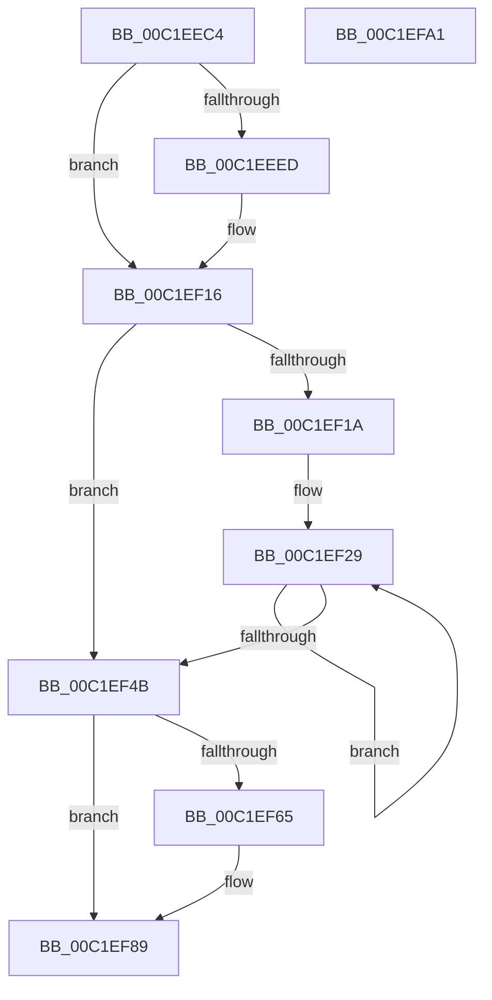

# HalpInitializePmcCounterSetInfo

- RVA: `0x00C1EEC4`–`0x00C1EFA2` (길이 `222` bytes)
- VA: `0x0000000140C1EEC4`
- 실행 섹션: `INIT`
- PDB 이름 있음: `예`; PDB Function 태그: `아니요`
- unwind 정보 RVA: `0x0006E5F8`
- 디코드: `55`개 명령, `222/222` bytes 표시
- 미해석 바이트: `0` (있으면 어셈블리에 `.byte`로 보존)

> 이 문서는 커널 이미지의 기계어와 PDB 기호를 분석해 생성했습니다. 4번과 5번은 함수 원형과 자료형을 바이너리 사용 방식에서 추정한 C 해석이며 원본 소스 복구 결과는 아닙니다.

## 1. Dependencies

- 직접 호출 지점: **6**; 고유 호출 대상: **4**
- 직접 호출자로 확인된 함수: **1**
- RIP 상대 이미지 참조: **4**

### Outgoing calls
- `0x00C1EECE` → [HalQueryMaximumProcessorCount](../../text/4A/HalQueryMaximumProcessorCount_function_004AC9A0.md) (function, `0x004AC9A0`)
- `0x00C1EEDA` → [HalpMmAllocatePerProcessorMemory](../../text/54/HalpMmAllocatePerProcessorMemory_function_00544AA8.md) (function, `0x00544AA8`)
- `0x00C1EF10` → [KeBugCheckEx](../../text/4F/KeBugCheckEx_function_004FD660.md) (function, `0x004FD660`)
- `0x00C1EF50` → [HalpMmAllocatePerProcessorMemory](../../text/54/HalpMmAllocatePerProcessorMemory_function_00544AA8.md) (function, `0x00544AA8`)
- `0x00C1EF83` → [KeBugCheckEx](../../text/4F/KeBugCheckEx_function_004FD660.md) (function, `0x004FD660`)
- `0x00C1EF91` → [memset](../../text/6C/memset_function_006C6C40.md) (function, `0x006C6C40`)

### Direct callers
- [HalpHwPerfCntInitSystem](../../pagelk/B5/HalpHwPerfCntInitSystem_function_00B5C590.md) at `0x00B5C64C`

### Static image references
- `0x00C1EEDF` → RVA `0x00FC2C30` (`.data`; write)
- `0x00C1EEFE` → RVA `0x00023D68` (`.rdata`; read)
- `0x00C1EF29` → RVA `0x00FC2C30` (`.data`; read)
- `0x00C1EF59` → RVA `0x00FC2C28` (`.data`; write)

## 2. Other-region calls and transfers

- 다른 실행 섹션으로 향하는 call: **6**
  - `0x00C1EECE` → [HalQueryMaximumProcessorCount](../../text/4A/HalQueryMaximumProcessorCount_function_004AC9A0.md) (`INIT` → `.text`)
  - `0x00C1EEDA` → [HalpMmAllocatePerProcessorMemory](../../text/54/HalpMmAllocatePerProcessorMemory_function_00544AA8.md) (`INIT` → `.text`)
  - `0x00C1EF10` → [KeBugCheckEx](../../text/4F/KeBugCheckEx_function_004FD660.md) (`INIT` → `.text`)
  - `0x00C1EF50` → [HalpMmAllocatePerProcessorMemory](../../text/54/HalpMmAllocatePerProcessorMemory_function_00544AA8.md) (`INIT` → `.text`)
  - `0x00C1EF83` → [KeBugCheckEx](../../text/4F/KeBugCheckEx_function_004FD660.md) (`INIT` → `.text`)
  - `0x00C1EF91` → [memset](../../text/6C/memset_function_006C6C40.md) (`INIT` → `.text`)
- 별도 외부 분기/꼬리 이동을 확인하지 못했습니다.

## 3. Assembly (complete function range)

```asm
00C1EEC4  48 89 5C 24 08                  mov qword ptr [rsp + 8], rbx
00C1EEC9  57                              push rdi
00C1EECA  48 83 EC 30                     sub rsp, 0x30
00C1EECE  E8 CD DA 88 FF                  call 0x1404ac9a0
00C1EED3  B9 18 00 00 00                  mov ecx, 0x18
00C1EED8  8B F8                           mov edi, eax
00C1EEDA  E8 C9 5B 92 FF                  call 0x140544aa8
00C1EEDF  48 89 05 4A 3D 3A 00            mov qword ptr [rip + 0x3a3d4a], rax
00C1EEE6  8B DF                           mov ebx, edi
00C1EEE8  48 85 C0                        test rax, rax
00C1EEEB  75 29                           jne 0x140c1ef16
00C1EEED  48 8D 14 7F                     lea rdx, [rdi + rdi*2]
00C1EEF1  48 C7 44 24 20 A3 0B 00 00      mov qword ptr [rsp + 0x20], 0xba3
00C1EEFA  48 C1 E2 03                     shl rdx, 3
00C1EEFE  4C 8D 0D 63 4E 40 FF            lea r9, [rip - 0xbfb19d]
00C1EF05  B9 AC 00 00 00                  mov ecx, 0xac
00C1EF0A  41 B8 00 22 00 00               mov r8d, 0x2200
00C1EF10  E8 4B E7 8D FF                  call 0x1404fd660
00C1EF15  CC                              int3
00C1EF16  85 FF                           test edi, edi
00C1EF18  74 31                           je 0x140c1ef4b
00C1EF1A  33 D2                           xor edx, edx
00C1EF1C  49 B9 08 00 00 00 80 F7 FF FF   movabs r9, 0xfffff78000000008
00C1EF26  4C 8B C3                        mov r8, rbx
00C1EF29  48 8B 0D 00 3D 3A 00            mov rcx, qword ptr [rip + 0x3a3d00]
00C1EF30  48 03 CA                        add rcx, rdx
00C1EF33  48 83 C2 18                     add rdx, 0x18
00C1EF37  48 89 49 08                     mov qword ptr [rcx + 8], rcx
00C1EF3B  48 89 09                        mov qword ptr [rcx], rcx
00C1EF3E  49 8B 01                        mov rax, qword ptr [r9]
00C1EF41  48 89 41 10                     mov qword ptr [rcx + 0x10], rax
00C1EF45  49 83 E8 01                     sub r8, 1
00C1EF49  75 DE                           jne 0x140c1ef29
00C1EF4B  B9 10 00 00 00                  mov ecx, 0x10
00C1EF50  E8 53 5B 92 FF                  call 0x140544aa8
00C1EF55  48 C1 E3 04                     shl rbx, 4
00C1EF59  48 89 05 C8 3C 3A 00            mov qword ptr [rip + 0x3a3cc8], rax
00C1EF60  48 85 C0                        test rax, rax
00C1EF63  75 24                           jne 0x140c1ef89
00C1EF65  4C 8D 0D FC 4D 40 FF            lea r9, [rip - 0xbfb204]
00C1EF6C  48 C7 44 24 20 B7 0B 00 00      mov qword ptr [rsp + 0x20], 0xbb7
00C1EF75  41 B8 00 22 00 00               mov r8d, 0x2200
00C1EF7B  48 8B D3                        mov rdx, rbx
00C1EF7E  B9 AC 00 00 00                  mov ecx, 0xac
00C1EF83  E8 D8 E6 8D FF                  call 0x1404fd660
00C1EF88  CC                              int3
00C1EF89  4C 8B C3                        mov r8, rbx
00C1EF8C  33 D2                           xor edx, edx
00C1EF8E  48 8B C8                        mov rcx, rax
00C1EF91  E8 AA 7C AA FF                  call 0x1406c6c40
00C1EF96  48 8B 5C 24 40                  mov rbx, qword ptr [rsp + 0x40]
00C1EF9B  48 83 C4 30                     add rsp, 0x30
00C1EF9F  5F                              pop rdi
00C1EFA0  C3                              ret
00C1EFA1  CC                              int3
```

## 4. C-style interpretation (structured pseudocode)

```c
__int64 __fastcall HalpInitializePmcCounterSetInfo(void)
{
    __int64 result;
    __int64 v_rbx;
    __int64 v_rsp;
    unsigned __int64 v_stack_m18;
    unsigned __int64 v_stack_p8;

    v_stack_p8 = v_rbx;
    v_rsp = (v_rsp) - (48);
    result = HalQueryMaximumProcessorCount(a1, a2, a3, a4);
    result = HalpMmAllocatePerProcessorMemory(24, a2, a3, a4);
    *(unsigned __int64 *)(v_rip + 3816778) = result;
    if (result == 0) {
        a2 = (unsigned int)((unsigned int)(result)) + (unsigned int)((unsigned int)(result)) * 2;
        v_stack_m18 = 0xBA3ULL;
        a2 = (a2) << (3);
        a4 = v_rip - 12562845;
        a1 = 172;
        a3 = 0x2200ULL;
        result = KeBugCheckEx(a1, a2, a3, a4);
    }
    if ((unsigned int)((unsigned int)((unsigned int)(result))) == 0) goto loc_00C1EF4B;
    a2 = 0;
loc_00C1EF29:
    a1 = (*(unsigned __int64 *)(v_rip + 3816704)) + (0);
    a2 = (a2) + (24);
    *(unsigned __int64 *)(a1 + 8) = a1;
    *(unsigned __int64 *)(a1) = a1;
    *(unsigned __int64 *)(a1 + 16) = *(unsigned __int64 *)(a4);
    a3 = ((unsigned int)((unsigned int)((unsigned int)((unsigned int)(result))))) - (1);
    if (condition_is_not_equal) goto loc_00C1EF29;
loc_00C1EF4B:
    result = HalpMmAllocatePerProcessorMemory(16, a2, a3, a4);
    v_rbx = ((unsigned int)((unsigned int)((unsigned int)((unsigned int)(result))))) << (4);
    *(unsigned __int64 *)(v_rip + 3816648) = result;
    if (result == 0) {
        a4 = v_rip - 12562948;
        v_stack_m18 = 0xBB7ULL;
        a3 = 0x2200ULL;
        a2 = v_rbx;
        a1 = 172;
        result = KeBugCheckEx(a1, a2, a3, a4);
    }
    a2 = 0;
    result = memset(result, a2, v_rbx, a4);
    v_rsp = (v_rsp) + (48);
    return result;
}
```

## 5. (Beta) C Style

```c
void HalpInitializePmcCounterSetInfo(void)
{
    int64_t result;
    int64_t local_rbx;
    int64_t local_rsp;
    uint64_t v_stack_m18;
    uint64_t v_stack_p8;

    v_stack_p8 = local_rbx;
    local_rsp = (local_rsp) - (48);
    result = HalQueryMaximumProcessorCount(a1, a2, a3, a4);
    result = HalpMmAllocatePerProcessorMemory(24, a2, a3, a4);
    *(uint64_t *)(v_rip + 0x3A3D4A) = result;
    if (result == 0) {
        a2 = (uint32_t)((uint32_t)(result)) + (uint32_t)((uint32_t)(result)) * 2;
        v_stack_m18 = 0xBA3ULL;
        a2 = (a2) << (3);
        a4 = v_rip - 12562845;
        a1 = 172;
        a3 = 0x2200ULL;
        result = KeBugCheckEx(a1, a2, a3, a4);
    }
    if ((uint32_t)((uint32_t)((uint32_t)(result))) == 0) goto loc_00C1EF4B;
    a2 = 0;
loc_00C1EF29:
    a1 = (*(uint64_t *)(v_rip + 0x3A3D00)) + (0);
    a2 = (a2) + (24);
    *(uint64_t *)(a1 + 0x8) = a1;
    *(uint64_t *)(a1) = a1;
    *(uint64_t *)(a1 + 0x10) = *(uint64_t *)(a4);
    a3 = ((uint32_t)((uint32_t)((uint32_t)((uint32_t)(result))))) - (1);
    if (condition_is_not_equal) goto loc_00C1EF29;
loc_00C1EF4B:
    result = HalpMmAllocatePerProcessorMemory(16, a2, a3, a4);
    local_rbx = ((uint32_t)((uint32_t)((uint32_t)((uint32_t)(result))))) << (4);
    *(uint64_t *)(v_rip + 0x3A3CC8) = result;
    if (result == 0) {
        a4 = v_rip - 12562948;
        v_stack_m18 = 0xBB7ULL;
        a3 = 0x2200ULL;
        a2 = local_rbx;
        a1 = 172;
        result = KeBugCheckEx(a1, a2, a3, a4);
    }
    a2 = 0;
    result = memset(result, a2, local_rbx, a4);
    local_rsp = (local_rsp) + (48);
    return result;
}
```

## 6. Execution-region graph

[열기: 2D/3D 그래프와 함수 탐색 컨트롤 패널](../../../control-panel.html?section=init&rva=0x00C1EEC4&view=graph)

- 2D 그래프는 위에서 아래로 흐르고, 3D 그래프는 빈 공간을 드래그해 회전합니다. Shift+드래그는 이동, 휠은 확대·축소, 함수 노드 선택은 대상 보고서 이동입니다.

### Static fallback


