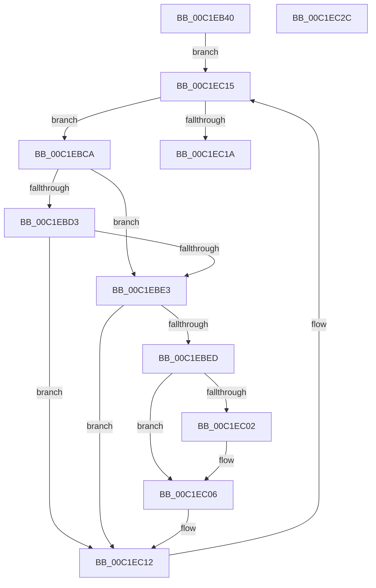

# HalpPowerInitDiscard

- RVA: `0x00C1EB40`–`0x00C1EC2D` (길이 `237` bytes)
- VA: `0x0000000140C1EB40`
- 실행 섹션: `INIT`
- PDB 이름 있음: `예`; PDB Function 태그: `아니요`
- unwind 정보 RVA: `0x0005CAAC`
- 디코드: `50`개 명령, `237/237` bytes 표시
- 미해석 바이트: `0` (있으면 어셈블리에 `.byte`로 보존)

> 이 문서는 커널 이미지의 기계어와 PDB 기호를 분석해 생성했습니다. 4번과 5번은 함수 원형과 자료형을 바이너리 사용 방식에서 추정한 C 해석이며 원본 소스 복구 결과는 아닙니다.

## 1. Dependencies

- 직접 호출 지점: **3**; 고유 호출 대상: **3**
- 직접 호출자로 확인된 함수: **1**
- RIP 상대 이미지 참조: **15**

### Outgoing calls
- `0x00C1EBBC` → [RtlSetAllBits](../../text/36/RtlSetAllBits_function_00362490.md) (function, `0x00362490`)
- `0x00C1EC0D` → [RtlClearBits](../../text/3E/RtlClearBits_function_003E1A90.md) (function, `0x003E1A90`)
- `0x00C1EC1A` → [HalpPowerInitNvsRegionData](../C2/HalpPowerInitNvsRegionData_function_00C239E0.md) (function, `0x00C239E0`)

### Direct callers
- [HalpPowerInitSystem](../../pagelk/B5/HalpPowerInitSystem_function_00B5C540.md) at `0x00B5C57C`

### Static image references
- `0x00C1EB4A` → RVA `0x00B5CE50` (`HaliLocateHiberRanges`; read)
- `0x00C1EB51` → RVA `0x00F901B0` (`.data`; write)
- `0x00C1EB5B` → RVA `0x00E00808` (`.data`; write)
- `0x00C1EB65` → RVA `0x005465C0` (`HaliHaltSystem`; read)
- `0x00C1EB6C` → RVA `0x00F901A0` (`.data`; write)
- `0x00C1EB76` → RVA `0x00E00838` (`.data`; write)
- `0x00C1EB7D` → RVA `0x00F901B0` (`.data`; read)
- `0x00C1EB84` → RVA `0x004ABAB0` (`HalpPowerEarlyRestore`; read)
- `0x00C1EB8B` → RVA `0x00E00A98` (`.data`; write)
- `0x00C1EB92` → RVA `0x00546730` (`HalpPowerSetRebootHandler`; read)
- `0x00C1EB99` → RVA `0x00E00B08` (`.data`; write)
- `0x00C1EBA0` → RVA `0x00F90180` (`.data`; read)
- `0x00C1EBA7` → RVA `0x00F901B8` (`.data`; write)
- `0x00C1EBAE` → RVA `0x00F901C0` (`.data`; read)
- `0x00C1EBB5` → RVA `0x00F901A8` (`.data`; write)

## 2. Other-region calls and transfers

- 다른 실행 섹션으로 향하는 call: **2**
  - `0x00C1EBBC` → [RtlSetAllBits](../../text/36/RtlSetAllBits_function_00362490.md) (`INIT` → `.text`)
  - `0x00C1EC0D` → [RtlClearBits](../../text/3E/RtlClearBits_function_003E1A90.md) (`INIT` → `.text`)
- 별도 외부 분기/꼬리 이동을 확인하지 못했습니다.

## 3. Assembly (complete function range)

```asm
00C1EB40  48 89 5C 24 08                  mov qword ptr [rsp + 8], rbx
00C1EB45  57                              push rdi
00C1EB46  48 83 EC 20                     sub rsp, 0x20
00C1EB4A  48 8D 05 FF E2 F3 FF            lea rax, [rip - 0xc1d01]
00C1EB51  C7 05 55 16 37 00 00 01 00 00   mov dword ptr [rip + 0x371655], 0x100
00C1EB5B  48 89 05 A6 1C 1E 00            mov qword ptr [rip + 0x1e1ca6], rax
00C1EB62  48 8B F9                        mov rdi, rcx
00C1EB65  48 8D 05 54 7A 92 FF            lea rax, [rip - 0x6d85ac]
00C1EB6C  C7 05 2A 16 37 00 00 01 00 00   mov dword ptr [rip + 0x37162a], 0x100
00C1EB76  48 89 05 BB 1C 1E 00            mov qword ptr [rip + 0x1e1cbb], rax
00C1EB7D  48 8D 0D 2C 16 37 00            lea rcx, [rip + 0x37162c]
00C1EB84  48 8D 05 25 CF 88 FF            lea rax, [rip - 0x7730db]
00C1EB8B  48 89 05 06 1F 1E 00            mov qword ptr [rip + 0x1e1f06], rax
00C1EB92  48 8D 05 97 7B 92 FF            lea rax, [rip - 0x6d8469]
00C1EB99  48 89 05 68 1F 1E 00            mov qword ptr [rip + 0x1e1f68], rax
00C1EBA0  48 8D 05 D9 15 37 00            lea rax, [rip + 0x3715d9]
00C1EBA7  48 89 05 0A 16 37 00            mov qword ptr [rip + 0x37160a], rax
00C1EBAE  48 8D 05 0B 16 37 00            lea rax, [rip + 0x37160b]
00C1EBB5  48 89 05 EC 15 37 00            mov qword ptr [rip + 0x3715ec], rax
00C1EBBC  E8 CF 38 74 FF                  call 0x140362490
00C1EBC1  48 83 C7 20                     add rdi, 0x20
00C1EBC5  48 8B 1F                        mov rbx, qword ptr [rdi]
00C1EBC8  EB 4B                           jmp 0x140c1ec15
00C1EBCA  48 63 43 18                     movsxd rax, dword ptr [rbx + 0x18]
00C1EBCE  83 F8 23                        cmp eax, 0x23
00C1EBD1  77 10                           ja 0x140c1ebe3
00C1EBD3  48 B9 48 00 40 C0 0B 00 00 00   movabs rcx, 0xbc0400048
00C1EBDD  48 0F A3 C1                     bt rcx, rax
00C1EBE1  72 2F                           jb 0x140c1ec12
00C1EBE3  48 81 7B 20 00 01 00 00         cmp qword ptr [rbx + 0x20], 0x100
00C1EBEB  73 25                           jae 0x140c1ec12
00C1EBED  8B 53 20                        mov edx, dword ptr [rbx + 0x20]
00C1EBF0  41 B8 00 01 00 00               mov r8d, 0x100
00C1EBF6  44 2B C2                        sub r8d, edx
00C1EBF9  41 8B C0                        mov eax, r8d
00C1EBFC  48 3B 43 28                     cmp rax, qword ptr [rbx + 0x28]
00C1EC00  76 04                           jbe 0x140c1ec06
00C1EC02  44 8B 43 28                     mov r8d, dword ptr [rbx + 0x28]
00C1EC06  48 8D 0D A3 15 37 00            lea rcx, [rip + 0x3715a3]
00C1EC0D  E8 7E 2E 7C FF                  call 0x1403e1a90
00C1EC12  48 8B 1B                        mov rbx, qword ptr [rbx]
00C1EC15  48 3B DF                        cmp rbx, rdi
00C1EC18  75 B0                           jne 0x140c1ebca
00C1EC1A  E8 C1 4D 00 00                  call 0x140c239e0
00C1EC1F  48 8B 5C 24 30                  mov rbx, qword ptr [rsp + 0x30]
00C1EC24  33 C0                           xor eax, eax
00C1EC26  48 83 C4 20                     add rsp, 0x20
00C1EC2A  5F                              pop rdi
00C1EC2B  C3                              ret
00C1EC2C  CC                              int3
```

## 4. C-style interpretation (structured pseudocode)

```c
__int64 __fastcall HalpPowerInitDiscard(__int64 a1)
{
    __int64 result;
    __int64 v_rdi;
    __int64 v_rsp;
    unsigned __int64 v_stack_p8;

    v_stack_p8 = v_rbx;
    v_rsp = (v_rsp) - (32);
    *(unsigned int *)(v_rip + 3610197) = 256;
    *(unsigned __int64 *)(v_rip + 1973414) = v_rip - 793857;
    *(unsigned int *)(v_rip + 3610154) = 256;
    *(unsigned __int64 *)(v_rip + 1973435) = v_rip - 7177644;
    *(unsigned __int64 *)(v_rip + 1974022) = v_rip - 7811291;
    *(unsigned __int64 *)(v_rip + 1974120) = v_rip - 7177321;
    *(unsigned __int64 *)(v_rip + 3610122) = v_rip + 3610073;
    *(unsigned __int64 *)(v_rip + 3610092) = v_rip + 3610123;
    result = RtlSetAllBits(v_rip + 3610156, a2, a3, a4);
    v_rdi = (a1) + (32);
    goto loc_00C1EC15;
loc_00C1EBCA:
    if (((unsigned int)((int)(*(unsigned int *)(*(unsigned __int64 *)(v_rdi) + 24)))) > 35) goto loc_00C1EBE3;
    if (((unsigned int)((int)(*(unsigned int *)(*(unsigned __int64 *)(v_rdi) + 24)))) < 35) goto loc_00C1EC12;
loc_00C1EBE3:
    if ((*(unsigned __int64 *)(*(unsigned __int64 *)(v_rdi) + 32)) >= 256) goto loc_00C1EC12;
    a3 = (unsigned int)((256) - ((unsigned int)((unsigned int)(*(unsigned int *)(*(unsigned __int64 *)(v_rdi) + 32)))));
    if (((unsigned int)((unsigned int)(a3))) >= = (*(unsigned __int64 *)(*(unsigned __int64 *)(v_rdi) + 40))) {
        a3 = *(unsigned int *)(*(unsigned __int64 *)(v_rdi) + 40);
    }
    result = RtlClearBits(v_rip + 3610019, (unsigned int)(*(unsigned int *)(*(unsigned __int64 *)(v_rdi) + 32)), a3, a4);
loc_00C1EC12:
loc_00C1EC15:
    if ((*(unsigned __int64 *)(*(unsigned __int64 *)(v_rdi))) != v_rdi) goto loc_00C1EBCA;
    result = HalpPowerInitNvsRegionData(v_rip + 3610019, (unsigned int)(*(unsigned int *)(*(unsigned __int64 *)(v_rdi) + 32)), a3, a4);
    result = 0;
    v_rsp = (v_rsp) + (32);
    return result;
}
```

## 5. (Beta) C Style

```c
int64_t HalpPowerInitDiscard(void *Arg1)
{
    uint8_t *arg1 = (uint8_t *)Arg1;

    int64_t result;
    int64_t local_rdi;
    int64_t local_rsp;
    uint64_t v_stack_p8;

    v_stack_p8 = local_rbx;
    local_rsp = (local_rsp) - (32);
    *(uint32_t *)(v_rip + 0x371655) = 256;
    *(uint64_t *)(v_rip + 0x1E1CA6) = v_rip - 793857;
    *(uint32_t *)(v_rip + 0x37162A) = 256;
    *(uint64_t *)(v_rip + 0x1E1CBB) = v_rip - 7177644;
    *(uint64_t *)(v_rip + 0x1E1F06) = v_rip - 7811291;
    *(uint64_t *)(v_rip + 0x1E1F68) = v_rip - 7177321;
    *(uint64_t *)(v_rip + 0x37160A) = v_rip + 3610073;
    *(uint64_t *)(v_rip + 0x3715EC) = v_rip + 3610123;
    result = RtlSetAllBits(v_rip + 3610156, a2, a3, a4);
    local_rdi = (Arg1) + (32);
    goto loc_00C1EC15;
loc_00C1EBCA:
    if (((uint32_t)((int32_t)(*(uint32_t *)(*(uint64_t *)(local_rdi) + 0x18)))) > 35) goto loc_00C1EBE3;
    if (((uint32_t)((int32_t)(*(uint32_t *)(*(uint64_t *)(local_rdi) + 0x18)))) < 35) goto loc_00C1EC12;
loc_00C1EBE3:
    if ((*(uint64_t *)(*(uint64_t *)(local_rdi) + 0x20)) >= 256) goto loc_00C1EC12;
    a3 = (uint32_t)((256) - ((uint32_t)((uint32_t)(*(uint32_t *)(*(uint64_t *)(local_rdi) + 0x20)))));
    if (((uint32_t)((uint32_t)(a3))) >= = (*(uint64_t *)(*(uint64_t *)(local_rdi) + 0x28))) {
        a3 = *(uint32_t *)(*(uint64_t *)(local_rdi) + 0x28);
    }
    result = RtlClearBits(v_rip + 3610019, (uint32_t)(*(uint32_t *)(*(uint64_t *)(local_rdi) + 0x20)), a3, a4);
loc_00C1EC12:
loc_00C1EC15:
    if ((*(uint64_t *)(*(uint64_t *)(local_rdi))) != local_rdi) goto loc_00C1EBCA;
    result = HalpPowerInitNvsRegionData(v_rip + 3610019, (uint32_t)(*(uint32_t *)(*(uint64_t *)(local_rdi) + 0x20)), a3, a4);
    result = 0;
    local_rsp = (local_rsp) + (32);
    return result;
}
```

### 관측된 메모리 오프셋

구조체 형식이 확인되지 않은 접근은 인자 기준의 오프셋으로만 기록했습니다.

| 기준 인자 | 오프셋 표현 | 폭 (bit) | 접근 |
|---|---:|---:|---|
| `Arg1` | `+ 0x0` | `64` | `R` |

## 6. Execution-region graph

[열기: 2D/3D 그래프와 함수 탐색 컨트롤 패널](../../../control-panel.html?section=init&rva=0x00C1EB40&view=graph)

- 2D 그래프는 위에서 아래로 흐르고, 3D 그래프는 빈 공간을 드래그해 회전합니다. Shift+드래그는 이동, 휠은 확대·축소, 함수 노드 선택은 대상 보고서 이동입니다.

### Static fallback


