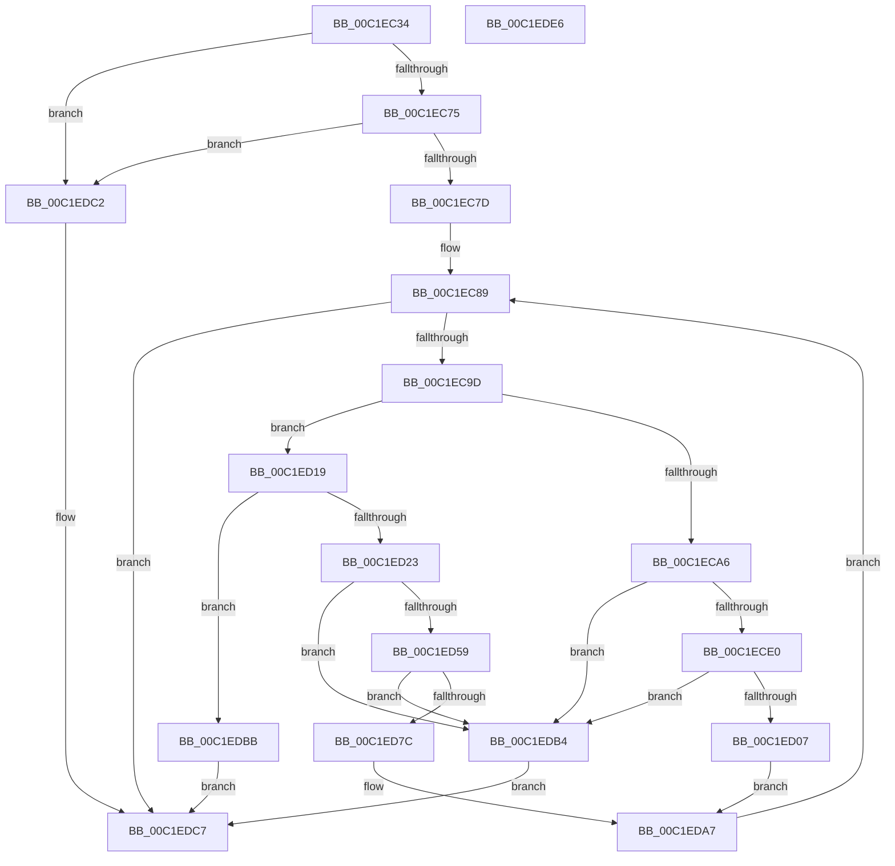

# HalpPowerInitFwPerformanceTableMappings

- RVA: `0x00C1EC34`–`0x00C1EDE7` (길이 `435` bytes)
- VA: `0x0000000140C1EC34`
- 실행 섹션: `INIT`
- PDB 이름 있음: `예`; PDB Function 태그: `아니요`
- unwind 정보 RVA: `0x0005D79C`
- 디코드: `120`개 명령, `435/435` bytes 표시
- 미해석 바이트: `0` (있으면 어셈블리에 `.byte`로 보존)

> 이 문서는 커널 이미지의 기계어와 PDB 기호를 분석해 생성했습니다. 4번과 5번은 함수 원형과 자료형을 바이너리 사용 방식에서 추정한 C 해석이며 원본 소스 복구 결과는 아닙니다.

## 1. Dependencies

- 직접 호출 지점: **9**; 고유 호출 대상: **4**
- 직접 호출자로 확인된 함수: **1**
- RIP 상대 이미지 참조: **4**

### Outgoing calls
- `0x00C1EC64` → [HalpAcpiGetTable](../../text/3F/HalpAcpiGetTable_function_003F6BF8.md) (function, `0x003F6BF8`)
- `0x00C1ECB5` → [HalGetMemoryCachingRequirements](../../text/48/HalGetMemoryCachingRequirements_function_0048B480.md) (function, `0x0048B480`)
- `0x00C1ECD2` → [MmMapIoSpaceEx](../../text/32/MmMapIoSpaceEx_function_00327830.md) (function, `0x00327830`)
- `0x00C1ECEC` → [MiUnmapContiguousMemory](../../text/3F/MiUnmapContiguousMemory_function_003F7908.md) (function, `0x003F7908`)
- `0x00C1ECF9` → [MmMapIoSpaceEx](../../text/32/MmMapIoSpaceEx_function_00327830.md) (function, `0x00327830`)
- `0x00C1ED32` → [HalGetMemoryCachingRequirements](../../text/48/HalGetMemoryCachingRequirements_function_0048B480.md) (function, `0x0048B480`)
- `0x00C1ED4F` → [MmMapIoSpaceEx](../../text/32/MmMapIoSpaceEx_function_00327830.md) (function, `0x00327830`)
- `0x00C1ED65` → [MiUnmapContiguousMemory](../../text/3F/MiUnmapContiguousMemory_function_003F7908.md) (function, `0x003F7908`)
- `0x00C1ED72` → [MmMapIoSpaceEx](../../text/32/MmMapIoSpaceEx_function_00327830.md) (function, `0x00327830`)

### Direct callers
- [HalpPowerInitSystem](../../pagelk/B5/HalpPowerInitSystem_function_00B5C540.md) at `0x00B5C557`

### Static image references
- `0x00C1ED07` → RVA `0x00FC2C90` (`.data`; write)
- `0x00C1ED0E` → RVA `0x00FC2C88` (`.data`; write)
- `0x00C1ED82` → RVA `0x00FC2C80` (`.data`; write)
- `0x00C1EDA1` → RVA `0x00FC2C78` (`.data`; write)

## 2. Other-region calls and transfers

- 다른 실행 섹션으로 향하는 call: **9**
  - `0x00C1EC64` → [HalpAcpiGetTable](../../text/3F/HalpAcpiGetTable_function_003F6BF8.md) (`INIT` → `.text`)
  - `0x00C1ECB5` → [HalGetMemoryCachingRequirements](../../text/48/HalGetMemoryCachingRequirements_function_0048B480.md) (`INIT` → `.text`)
  - `0x00C1ECD2` → [MmMapIoSpaceEx](../../text/32/MmMapIoSpaceEx_function_00327830.md) (`INIT` → `.text`)
  - `0x00C1ECEC` → [MiUnmapContiguousMemory](../../text/3F/MiUnmapContiguousMemory_function_003F7908.md) (`INIT` → `.text`)
  - `0x00C1ECF9` → [MmMapIoSpaceEx](../../text/32/MmMapIoSpaceEx_function_00327830.md) (`INIT` → `.text`)
  - `0x00C1ED32` → [HalGetMemoryCachingRequirements](../../text/48/HalGetMemoryCachingRequirements_function_0048B480.md) (`INIT` → `.text`)
  - `0x00C1ED4F` → [MmMapIoSpaceEx](../../text/32/MmMapIoSpaceEx_function_00327830.md) (`INIT` → `.text`)
  - `0x00C1ED65` → [MiUnmapContiguousMemory](../../text/3F/MiUnmapContiguousMemory_function_003F7908.md) (`INIT` → `.text`)
  - `0x00C1ED72` → [MmMapIoSpaceEx](../../text/32/MmMapIoSpaceEx_function_00327830.md) (`INIT` → `.text`)
- 별도 외부 분기/꼬리 이동을 확인하지 못했습니다.

## 3. Assembly (complete function range)

```asm
00C1EC34  48 8B C4                        mov rax, rsp
00C1EC37  48 89 58 10                     mov qword ptr [rax + 0x10], rbx
00C1EC3B  48 89 68 18                     mov qword ptr [rax + 0x18], rbp
00C1EC3F  48 89 70 20                     mov qword ptr [rax + 0x20], rsi
00C1EC43  57                              push rdi
00C1EC44  41 54                           push r12
00C1EC46  41 55                           push r13
00C1EC48  41 56                           push r14
00C1EC4A  41 57                           push r15
00C1EC4C  48 83 EC 20                     sub rsp, 0x20
00C1EC50  BB 46 50 44 54                  mov ebx, 0x54445046
00C1EC55  33 F6                           xor esi, esi
00C1EC57  8B D3                           mov edx, ebx
00C1EC59  89 70 08                        mov dword ptr [rax + 8], esi
00C1EC5C  45 33 C9                        xor r9d, r9d
00C1EC5F  45 33 C0                        xor r8d, r8d
00C1EC62  33 C9                           xor ecx, ecx
00C1EC64  E8 8F 7F 7D FF                  call 0x1403f6bf8
00C1EC69  48 8B E8                        mov rbp, rax
00C1EC6C  48 85 C0                        test rax, rax
00C1EC6F  0F 84 4D 01 00 00               je 0x140c1edc2
00C1EC75  39 18                           cmp dword ptr [rax], ebx
00C1EC77  0F 85 45 01 00 00               jne 0x140c1edc2
00C1EC7D  4C 8D 70 24                     lea r14, [rax + 0x24]
00C1EC81  44 8D 6E 08                     lea r13d, [rsi + 8]
00C1EC85  44 8D 66 01                     lea r12d, [rsi + 1]
00C1EC89  8B 45 04                        mov eax, dword ptr [rbp + 4]
00C1EC8C  BF 04 02 00 00                  mov edi, 0x204
00C1EC91  48 03 C5                        add rax, rbp
00C1EC94  4C 3B F0                        cmp r14, rax
00C1EC97  0F 83 2A 01 00 00               jae 0x140c1edc7
00C1EC9D  41 0F B7 06                     movzx eax, word ptr [r14]
00C1ECA1  66 85 C0                        test ax, ax
00C1ECA4  75 73                           jne 0x140c1ed19
00C1ECA6  49 8B 5E 08                     mov rbx, qword ptr [r14 + 8]
00C1ECAA  4C 8D 44 24 50                  lea r8, [rsp + 0x50]
00C1ECAF  48 8B CB                        mov rcx, rbx
00C1ECB2  49 8B D5                        mov rdx, r13
00C1ECB5  E8 C6 C7 86 FF                  call 0x14048b480
00C1ECBA  44 39 64 24 50                  cmp dword ptr [rsp + 0x50], r12d
00C1ECBF  41 BF 04 00 00 00               mov r15d, 4
00C1ECC5  49 8B D5                        mov rdx, r13
00C1ECC8  48 8B CB                        mov rcx, rbx
00C1ECCB  44 0F 45 FF                     cmovne r15d, edi
00C1ECCF  45 8B C7                        mov r8d, r15d
00C1ECD2  E8 59 8B 70 FF                  call 0x140327830
00C1ECD7  48 85 C0                        test rax, rax
00C1ECDA  0F 84 D4 00 00 00               je 0x140c1edb4
00C1ECE0  8B 78 04                        mov edi, dword ptr [rax + 4]
00C1ECE3  45 8A C4                        mov r8b, r12b
00C1ECE6  49 8B D5                        mov rdx, r13
00C1ECE9  48 8B C8                        mov rcx, rax
00C1ECEC  E8 17 8C 7D FF                  call 0x1403f7908
00C1ECF1  8B D7                           mov edx, edi
00C1ECF3  45 8B C7                        mov r8d, r15d
00C1ECF6  48 8B CB                        mov rcx, rbx
00C1ECF9  E8 32 8B 70 FF                  call 0x140327830
00C1ECFE  48 85 C0                        test rax, rax
00C1ED01  0F 84 AD 00 00 00               je 0x140c1edb4
00C1ED07  48 89 05 82 3F 3A 00            mov qword ptr [rip + 0x3a3f82], rax
00C1ED0E  89 3D 74 3F 3A 00               mov dword ptr [rip + 0x3a3f74], edi
00C1ED14  E9 8E 00 00 00                  jmp 0x140c1eda7
00C1ED19  66 41 3B C4                     cmp ax, r12w
00C1ED1D  0F 85 98 00 00 00               jne 0x140c1edbb
00C1ED23  49 8B 5E 08                     mov rbx, qword ptr [r14 + 8]
00C1ED27  4C 8D 44 24 50                  lea r8, [rsp + 0x50]
00C1ED2C  48 8B CB                        mov rcx, rbx
00C1ED2F  49 8B D5                        mov rdx, r13
00C1ED32  E8 49 C7 86 FF                  call 0x14048b480
00C1ED37  44 39 64 24 50                  cmp dword ptr [rsp + 0x50], r12d
00C1ED3C  41 BF 04 00 00 00               mov r15d, 4
00C1ED42  49 8B D5                        mov rdx, r13
00C1ED45  48 8B CB                        mov rcx, rbx
00C1ED48  44 0F 45 FF                     cmovne r15d, edi
00C1ED4C  45 8B C7                        mov r8d, r15d
00C1ED4F  E8 DC 8A 70 FF                  call 0x140327830
00C1ED54  48 85 C0                        test rax, rax
00C1ED57  74 5B                           je 0x140c1edb4
00C1ED59  8B 78 04                        mov edi, dword ptr [rax + 4]
00C1ED5C  45 8A C4                        mov r8b, r12b
00C1ED5F  49 8B D5                        mov rdx, r13
00C1ED62  48 8B C8                        mov rcx, rax
00C1ED65  E8 9E 8B 7D FF                  call 0x1403f7908
00C1ED6A  45 8B C7                        mov r8d, r15d
00C1ED6D  8B D7                           mov edx, edi
00C1ED6F  48 8B CB                        mov rcx, rbx
00C1ED72  E8 B9 8A 70 FF                  call 0x140327830
00C1ED77  48 85 C0                        test rax, rax
00C1ED7A  74 38                           je 0x140c1edb4
00C1ED7C  41 B8 FF 0F 00 00               mov r8d, 0xfff
00C1ED82  48 89 05 F7 3E 3A 00            mov qword ptr [rip + 0x3a3ef7], rax
00C1ED89  8B D0                           mov edx, eax
00C1ED8B  8B CA                           mov ecx, edx
00C1ED8D  41 23 D0                        and edx, r8d
00C1ED90  49 23 C8                        and rcx, r8
00C1ED93  49 03 C8                        add rcx, r8
00C1ED96  48 03 CF                        add rcx, rdi
00C1ED99  81 E1 00 F0 FF FF               and ecx, 0xfffff000
00C1ED9F  2B CA                           sub ecx, edx
00C1EDA1  89 0D D1 3E 3A 00               mov dword ptr [rip + 0x3a3ed1], ecx
00C1EDA7  41 0F B6 46 02                  movzx eax, byte ptr [r14 + 2]
00C1EDAC  4C 03 F0                        add r14, rax
00C1EDAF  E9 D5 FE FF FF                  jmp 0x140c1ec89
00C1EDB4  BE 9A 00 00 C0                  mov esi, 0xc000009a
00C1EDB9  EB 0C                           jmp 0x140c1edc7
00C1EDBB  BE 02 00 00 C0                  mov esi, 0xc0000002
00C1EDC0  EB 05                           jmp 0x140c1edc7
00C1EDC2  BE 25 02 00 C0                  mov esi, 0xc0000225
00C1EDC7  48 8B 5C 24 58                  mov rbx, qword ptr [rsp + 0x58]
00C1EDCC  8B C6                           mov eax, esi
00C1EDCE  48 8B 74 24 68                  mov rsi, qword ptr [rsp + 0x68]
00C1EDD3  48 8B 6C 24 60                  mov rbp, qword ptr [rsp + 0x60]
00C1EDD8  48 83 C4 20                     add rsp, 0x20
00C1EDDC  41 5F                           pop r15
00C1EDDE  41 5E                           pop r14
00C1EDE0  41 5D                           pop r13
00C1EDE2  41 5C                           pop r12
00C1EDE4  5F                              pop rdi
00C1EDE5  C3                              ret
00C1EDE6  CC                              int3
```

## 4. C-style interpretation (structured pseudocode)

```c
__int64 __fastcall HalpPowerInitFwPerformanceTableMappings(int a1, __int64 a2, int a3, int a4)
{
    __int64 result;
    __int64 v_r14;
    __int64 v_r15;
    __int64 v_rsi;
    __int64 v_rsp;
    unsigned __int64 v_stack_p10;
    unsigned __int64 v_stack_p18;
    unsigned __int64 v_stack_p20;
    unsigned __int64 v_stack_p8;

    *(unsigned __int64 *)(v_rsp + 16) = v_rbx;
    *(unsigned __int64 *)(v_rsp + 24) = v_rbp;
    *(unsigned __int64 *)(v_rsp + 32) = v_rsi;
    v_rsp = (v_rsp) - (32);
    v_rsi = 0;
    *(unsigned int *)(v_rsp + 8) = 0;
    a4 = 0;
    a3 = 0;
    a1 = 0;
    result = HalpAcpiGetTable(a1, (unsigned int)((unsigned int)((unsigned int)(0x54445046ULL))), a3, a4);
    if (result == 0) goto loc_00C1EDC2;
    if ((*(unsigned int *)(result)) != ((unsigned int)((unsigned int)(0x54445046ULL)))) goto loc_00C1EDC2;
loc_00C1EC89:
    result = ((unsigned int)(*(unsigned int *)(result + 4))) + (result);
    if ((result + 36) >= result) goto loc_00C1EDC7;
    if ((unsigned __int16)(*(unsigned __int16 *)(result + 36)) != 0) goto loc_00C1ED19;
    result = HalGetMemoryCachingRequirements(*(unsigned __int64 *)(result + 36 + 8), v_rsi + 8, v_stack_p8, a4);
    v_r15 = 4;
    if (v_stack_p8 != ((unsigned int)(v_rsi + 1))) { v_r15 = 516; }
    result = MmMapIoSpaceEx(*(unsigned __int64 *)(result + 36 + 8), v_rsi + 8, (unsigned int)((unsigned int)(v_r15)), a4);
    if (result == 0) goto loc_00C1EDB4;
    result = MiUnmapContiguousMemory(result, v_rsi + 8, (unsigned __int8)(v_rsi + 1), a4);
    result = MmMapIoSpaceEx(*(unsigned __int64 *)(result + 36 + 8), (unsigned int)((unsigned int)((unsigned int)(*(unsigned int *)(result + 4)))), (unsigned int)((unsigned int)(v_r15)), a4);
    if (result == 0) goto loc_00C1EDB4;
    *(unsigned __int64 *)(v_rip + 3817346) = result;
    *(unsigned int *)(v_rip + 3817332) = (unsigned int)((unsigned int)(*(unsigned int *)(result + 4)));
    goto loc_00C1EDA7;
loc_00C1ED19:
    if (((unsigned __int16)(result)) != ((unsigned __int16)(v_rsi + 1))) goto loc_00C1EDBB;
    result = HalGetMemoryCachingRequirements(*(unsigned __int64 *)(result + 36 + 8), v_rsi + 8, v_stack_p8, a4);
    v_r15 = 4;
    if (v_stack_p8 != ((unsigned int)(v_rsi + 1))) { v_r15 = (unsigned int)((unsigned int)(*(unsigned int *)(result + 4))); }
    result = MmMapIoSpaceEx(*(unsigned __int64 *)(result + 36 + 8), v_rsi + 8, (unsigned int)((unsigned int)(v_r15)), a4);
    if (result == 0) goto loc_00C1EDB4;
    result = MiUnmapContiguousMemory(result, v_rsi + 8, (unsigned __int8)(v_rsi + 1), a4);
    result = MmMapIoSpaceEx(*(unsigned __int64 *)(result + 36 + 8), (unsigned int)((unsigned int)((unsigned int)(*(unsigned int *)(result + 4)))), (unsigned int)((unsigned int)(v_r15)), a4);
    if (result == 0) goto loc_00C1EDB4;
    *(unsigned __int64 *)(v_rip + 3817207) = result;
    a2 = (unsigned int)(((unsigned int)((unsigned int)(result))) & ((unsigned int)((unsigned int)(0xFFFULL))));
    a1 = ((unsigned int)((unsigned int)((unsigned int)((unsigned int)(result))))) & ((unsigned int)(0xFFFULL));
    a1 = (a1) + ((unsigned int)(0xFFFULL));
    a1 = (a1) + ((unsigned int)(*(unsigned int *)(result + 4)));
    a1 = (unsigned int)((a1) & (0xFFFFF000ULL));
    a1 = (unsigned int)((a1) - ((unsigned int)(a2)));
    *(unsigned int *)(v_rip + 3817169) = a1;
loc_00C1EDA7:
    v_r14 = (result + 36) + (*(unsigned __int8 *)(result + 36 + 2));
    goto loc_00C1EC89;
loc_00C1EDB4:
    goto loc_00C1EDC7;
loc_00C1EDBB:
    goto loc_00C1EDC7;
loc_00C1EDC2:
loc_00C1EDC7:
    v_rsp = (v_rsp) + (32);
    return (unsigned int)((unsigned int)((unsigned int)(0xC0000225ULL)));
}
```

## 5. (Beta) C Style

```c
int64_t HalpPowerInitFwPerformanceTableMappings(int32_t Arg1, int64_t Arg2, int32_t Arg3, int32_t Arg4)
{
    int64_t result;
    int64_t local_r14;
    int64_t local_r15;
    int64_t local_rsi;
    int64_t local_rsp;
    uint64_t v_stack_p10;
    uint64_t v_stack_p18;
    uint64_t v_stack_p20;
    uint64_t v_stack_p8;

    *(uint64_t *)(local_rsp + 0x10) = local_rbx;
    *(uint64_t *)(local_rsp + 0x18) = local_rbp;
    *(uint64_t *)(local_rsp + 0x20) = local_rsi;
    local_rsp = (local_rsp) - (32);
    local_rsi = 0;
    *(uint32_t *)(local_rsp + 0x8) = 0;
    Arg4 = 0;
    Arg3 = 0;
    Arg1 = 0;
    result = HalpAcpiGetTable(Arg1, (uint32_t)((uint32_t)((uint32_t)(0x54445046ULL))), Arg3, Arg4);
    if (result == 0) goto loc_00C1EDC2;
    if ((*(uint32_t *)(result)) != ((uint32_t)((uint32_t)(0x54445046ULL)))) goto loc_00C1EDC2;
loc_00C1EC89:
    result = ((uint32_t)(*(uint32_t *)(result + 0x4))) + (result);
    if ((result + 36) >= result) goto loc_00C1EDC7;
    if ((uint16_t)(*(uint16_t *)(result + 0x24)) != 0) goto loc_00C1ED19;
    result = HalGetMemoryCachingRequirements(*(uint64_t *)(result + 0x24 + 0x8), local_rsi + 8, v_stack_p8, Arg4);
    local_r15 = 4;
    if (v_stack_p8 != ((uint32_t)(local_rsi + 1))) { local_r15 = 516; }
    result = MmMapIoSpaceEx(*(uint64_t *)(result + 0x24 + 0x8), local_rsi + 8, (uint32_t)((uint32_t)(local_r15)), Arg4);
    if (result == 0) goto loc_00C1EDB4;
    result = MiUnmapContiguousMemory(result, local_rsi + 8, (uint8_t)(local_rsi + 1), Arg4);
    result = MmMapIoSpaceEx(*(uint64_t *)(result + 0x24 + 0x8), (uint32_t)((uint32_t)((uint32_t)(*(uint32_t *)(result + 0x4)))), (uint32_t)((uint32_t)(local_r15)), Arg4);
    if (result == 0) goto loc_00C1EDB4;
    *(uint64_t *)(v_rip + 0x3A3F82) = result;
    *(uint32_t *)(v_rip + 0x3A3F74) = (uint32_t)((uint32_t)(*(uint32_t *)(result + 0x4)));
    goto loc_00C1EDA7;
loc_00C1ED19:
    if (((uint16_t)(result)) != ((uint16_t)(local_rsi + 1))) goto loc_00C1EDBB;
    result = HalGetMemoryCachingRequirements(*(uint64_t *)(result + 0x24 + 0x8), local_rsi + 8, v_stack_p8, Arg4);
    local_r15 = 4;
    if (v_stack_p8 != ((uint32_t)(local_rsi + 1))) { local_r15 = (uint32_t)((uint32_t)(*(uint32_t *)(result + 0x4))); }
    result = MmMapIoSpaceEx(*(uint64_t *)(result + 0x24 + 0x8), local_rsi + 8, (uint32_t)((uint32_t)(local_r15)), Arg4);
    if (result == 0) goto loc_00C1EDB4;
    result = MiUnmapContiguousMemory(result, local_rsi + 8, (uint8_t)(local_rsi + 1), Arg4);
    result = MmMapIoSpaceEx(*(uint64_t *)(result + 0x24 + 0x8), (uint32_t)((uint32_t)((uint32_t)(*(uint32_t *)(result + 0x4)))), (uint32_t)((uint32_t)(local_r15)), Arg4);
    if (result == 0) goto loc_00C1EDB4;
    *(uint64_t *)(v_rip + 0x3A3EF7) = result;
    Arg2 = (uint32_t)(((uint32_t)((uint32_t)(result))) & ((uint32_t)((uint32_t)(0xFFFULL))));
    Arg1 = ((uint32_t)((uint32_t)((uint32_t)((uint32_t)(result))))) & ((uint32_t)(0xFFFULL));
    Arg1 = (Arg1) + ((uint32_t)(0xFFFULL));
    Arg1 = (Arg1) + ((uint32_t)(*(uint32_t *)(result + 0x4)));
    Arg1 = (uint32_t)((Arg1) & (0xFFFFF000ULL));
    Arg1 = (uint32_t)((Arg1) - ((uint32_t)(Arg2)));
    *(uint32_t *)(v_rip + 0x3A3ED1) = Arg1;
loc_00C1EDA7:
    local_r14 = (result + 36) + (*(uint8_t *)(result + 0x24 + 0x2));
    goto loc_00C1EC89;
loc_00C1EDB4:
    goto loc_00C1EDC7;
loc_00C1EDBB:
    goto loc_00C1EDC7;
loc_00C1EDC2:
loc_00C1EDC7:
    local_rsp = (local_rsp) + (32);
    return (uint32_t)((uint32_t)((uint32_t)(0xC0000225ULL)));
}
```

## 6. Execution-region graph

[열기: 2D/3D 그래프와 함수 탐색 컨트롤 패널](../../../control-panel.html?section=init&rva=0x00C1EC34&view=graph)

- 2D 그래프는 위에서 아래로 흐르고, 3D 그래프는 빈 공간을 드래그해 회전합니다. Shift+드래그는 이동, 휠은 확대·축소, 함수 노드 선택은 대상 보고서 이동입니다.

### Static fallback


