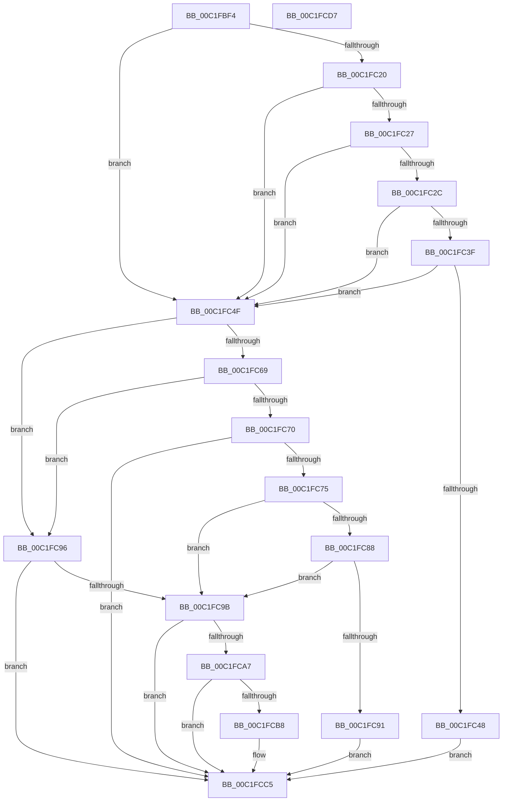

# HalpProcIsSmtDisabled

- RVA: `0x00C1FBF4`–`0x00C1FCD8` (길이 `228` bytes)
- VA: `0x0000000140C1FBF4`
- 실행 섹션: `INIT`
- PDB 이름 있음: `예`; PDB Function 태그: `아니요`
- unwind 정보 RVA: `0x000B6464`
- 디코드: `67`개 명령, `228/228` bytes 표시
- 미해석 바이트: `0` (있으면 어셈블리에 `.byte`로 보존)

> 이 문서는 커널 이미지의 기계어와 PDB 기호를 분석해 생성했습니다. 4번과 5번은 함수 원형과 자료형을 바이너리 사용 방식에서 추정한 C 해석이며 원본 소스 복구 결과는 아닙니다.

## 1. Dependencies

- 직접 호출 지점: **6**; 고유 호출 대상: **3**
- 직접 호출자로 확인된 함수: **1**
- RIP 상대 이미지 참조: **1**

### Outgoing calls
- `0x00C1FC17` → [HalpGetCpuInfo](../../text/49/HalpGetCpuInfo_function_00498A70.md) (function, `0x00498A70`)
- `0x00C1FC3F` → [HalpIsPartitionCpuManager](../../text/4F/HalpIsPartitionCpuManager_function_004F8DEC.md) (function, `0x004F8DEC`)
- `0x00C1FC5B` → [HalpGetCpuInfo](../../text/49/HalpGetCpuInfo_function_00498A70.md) (function, `0x00498A70`)
- `0x00C1FC88` → [HalpIsPartitionCpuManager](../../text/4F/HalpIsPartitionCpuManager_function_004F8DEC.md) (function, `0x004F8DEC`)
- `0x00C1FCAE` → [strstr](../../text/4F/strstr_function_004FF680.md) (function, `0x004FF680`)
- `0x00C1FCB8` → [HalpIsPartitionCpuManager](../../text/4F/HalpIsPartitionCpuManager_function_004F8DEC.md) (function, `0x004F8DEC`)

### Direct callers
- [HalpMiscGetParameters](HalpMiscGetParameters_function_00C1FD30.md) at `0x00C1FD64`

### Static image references
- `0x00C1FCA7` → RVA `0x00024318` (`.rdata`; read)

## 2. Other-region calls and transfers

- 다른 실행 섹션으로 향하는 call: **6**
  - `0x00C1FC17` → [HalpGetCpuInfo](../../text/49/HalpGetCpuInfo_function_00498A70.md) (`INIT` → `.text`)
  - `0x00C1FC3F` → [HalpIsPartitionCpuManager](../../text/4F/HalpIsPartitionCpuManager_function_004F8DEC.md) (`INIT` → `.text`)
  - `0x00C1FC5B` → [HalpGetCpuInfo](../../text/49/HalpGetCpuInfo_function_00498A70.md) (`INIT` → `.text`)
  - `0x00C1FC88` → [HalpIsPartitionCpuManager](../../text/4F/HalpIsPartitionCpuManager_function_004F8DEC.md) (`INIT` → `.text`)
  - `0x00C1FCAE` → [strstr](../../text/4F/strstr_function_004FF680.md) (`INIT` → `.text`)
  - `0x00C1FCB8` → [HalpIsPartitionCpuManager](../../text/4F/HalpIsPartitionCpuManager_function_004F8DEC.md) (`INIT` → `.text`)
- 별도 외부 분기/꼬리 이동을 확인하지 못했습니다.

## 3. Assembly (complete function range)

```asm
00C1FBF4  48 8B C4                        mov rax, rsp
00C1FBF7  48 89 58 08                     mov qword ptr [rax + 8], rbx
00C1FBFB  48 89 70 18                     mov qword ptr [rax + 0x18], rsi
00C1FBFF  57                              push rdi
00C1FC00  48 83 EC 20                     sub rsp, 0x20
00C1FC04  48 8B F9                        mov rdi, rcx
00C1FC07  4C 8D 48 10                     lea r9, [rax + 0x10]
00C1FC0B  33 DB                           xor ebx, ebx
00C1FC0D  33 C9                           xor ecx, ecx
00C1FC0F  45 33 C0                        xor r8d, r8d
00C1FC12  88 58 10                        mov byte ptr [rax + 0x10], bl
00C1FC15  33 D2                           xor edx, edx
00C1FC17  E8 54 8E 87 FF                  call 0x140498a70
00C1FC1C  84 C0                           test al, al
00C1FC1E  74 2F                           je 0x140c1fc4f
00C1FC20  80 7C 24 38 02                  cmp byte ptr [rsp + 0x38], 2
00C1FC25  75 28                           jne 0x140c1fc4f
00C1FC27  48 85 FF                        test rdi, rdi
00C1FC2A  74 23                           je 0x140c1fc4f
00C1FC2C  48 8B 87 F0 00 00 00            mov rax, qword ptr [rdi + 0xf0]
00C1FC33  F7 80 A4 0D 00 00 00 20 00 00   test dword ptr [rax + 0xda4], 0x2000
00C1FC3D  74 10                           je 0x140c1fc4f
00C1FC3F  E8 A8 91 8D FF                  call 0x1404f8dec
00C1FC44  84 C0                           test al, al
00C1FC46  75 07                           jne 0x140c1fc4f
00C1FC48  BB 01 00 00 00                  mov ebx, 1
00C1FC4D  EB 76                           jmp 0x140c1fcc5
00C1FC4F  4C 8D 4C 24 38                  lea r9, [rsp + 0x38]
00C1FC54  45 33 C0                        xor r8d, r8d
00C1FC57  33 D2                           xor edx, edx
00C1FC59  33 C9                           xor ecx, ecx
00C1FC5B  E8 10 8E 87 FF                  call 0x140498a70
00C1FC60  BE 01 00 00 00                  mov esi, 1
00C1FC65  84 C0                           test al, al
00C1FC67  74 2D                           je 0x140c1fc96
00C1FC69  40 38 74 24 38                  cmp byte ptr [rsp + 0x38], sil
00C1FC6E  75 26                           jne 0x140c1fc96
00C1FC70  48 85 FF                        test rdi, rdi
00C1FC73  74 50                           je 0x140c1fcc5
00C1FC75  48 8B 87 F0 00 00 00            mov rax, qword ptr [rdi + 0xf0]
00C1FC7C  F7 80 A4 0D 00 00 00 20 00 00   test dword ptr [rax + 0xda4], 0x2000
00C1FC86  74 13                           je 0x140c1fc9b
00C1FC88  E8 5F 91 8D FF                  call 0x1404f8dec
00C1FC8D  84 C0                           test al, al
00C1FC8F  75 0A                           jne 0x140c1fc9b
00C1FC91  40 8A DE                        mov bl, sil
00C1FC94  EB 2F                           jmp 0x140c1fcc5
00C1FC96  48 85 FF                        test rdi, rdi
00C1FC99  74 2A                           je 0x140c1fcc5
00C1FC9B  48 8B 8F D8 00 00 00            mov rcx, qword ptr [rdi + 0xd8]
00C1FCA2  48 85 C9                        test rcx, rcx
00C1FCA5  74 1E                           je 0x140c1fcc5
00C1FCA7  48 8D 15 6A 46 40 FF            lea rdx, [rip - 0xbfb996]
00C1FCAE  E8 CD F9 8D FF                  call 0x1404ff680
00C1FCB3  48 85 C0                        test rax, rax
00C1FCB6  74 0D                           je 0x140c1fcc5
00C1FCB8  E8 2F 91 8D FF                  call 0x1404f8dec
00C1FCBD  84 C0                           test al, al
00C1FCBF  0F B6 DB                        movzx ebx, bl
00C1FCC2  0F 44 DE                        cmove ebx, esi
00C1FCC5  48 8B 74 24 40                  mov rsi, qword ptr [rsp + 0x40]
00C1FCCA  8A C3                           mov al, bl
00C1FCCC  48 8B 5C 24 30                  mov rbx, qword ptr [rsp + 0x30]
00C1FCD1  48 83 C4 20                     add rsp, 0x20
00C1FCD5  5F                              pop rdi
00C1FCD6  C3                              ret
00C1FCD7  CC                              int3
```

## 4. C-style interpretation (structured pseudocode)

```c
__int64 __fastcall HalpProcIsSmtDisabled(__int64 a1, int a2, int a3)
{
    __int64 result;
    __int64 v_rbx;
    __int64 v_rsp;
    unsigned __int8 v_stack_p10;
    unsigned __int64 v_stack_p18;
    unsigned __int64 v_stack_p8;

    *(unsigned __int64 *)(v_rsp + 8) = v_rbx;
    *(unsigned __int64 *)(v_rsp + 24) = v_rsi;
    v_rsp = (v_rsp) - (32);
    v_rbx = 0;
    a1 = 0;
    a3 = 0;
    *(unsigned __int8 *)(v_rsp + 16) = 0;
    a2 = 0;
    result = HalpGetCpuInfo(a1, a2, a3, v_rsp + 16);
    if ((unsigned __int8)(result) == 0) goto loc_00C1FC4F;
    if (v_stack_p10 != 2) goto loc_00C1FC4F;
    if (0 == 0) goto loc_00C1FC4F;
    if (((*(unsigned int *)(*(unsigned __int64 *)(a1 + 240) + 3492)) & (0x2000ULL)) == 0) goto loc_00C1FC4F;
    result = HalpIsPartitionCpuManager(a1, a2, a3, v_rsp + 16);
    if ((unsigned __int8)(result) != 0) goto loc_00C1FC4F;
    goto loc_00C1FCC5;
loc_00C1FC4F:
    a3 = 0;
    a2 = 0;
    a1 = 0;
    result = HalpGetCpuInfo(a1, a2, a3, v_stack_p10);
    if ((unsigned __int8)(result) == 0) goto loc_00C1FC96;
    if (v_stack_p10 != 1) goto loc_00C1FC96;
    if (0 == 0) goto loc_00C1FCC5;
    if (((*(unsigned int *)(*(unsigned __int64 *)(a1 + 240) + 3492)) & (0x2000ULL)) == 0) goto loc_00C1FC9B;
    result = HalpIsPartitionCpuManager(a1, a2, a3, v_stack_p10);
    if ((unsigned __int8)(result) != 0) goto loc_00C1FC9B;
    goto loc_00C1FCC5;
loc_00C1FC96:
    if (0 == 0) goto loc_00C1FCC5;
loc_00C1FC9B:
    if (*(unsigned __int64 *)(a1 + 216) == 0) goto loc_00C1FCC5;
    result = strstr(*(unsigned __int64 *)(a1 + 216), v_rip - 12564886, a3, v_stack_p10);
    v_rbx = 1;
    if (result != 0) {
        result = HalpIsPartitionCpuManager(*(unsigned __int64 *)(a1 + 216), v_rip - 12564886, a3, v_stack_p10);
        v_rbx = 1;
        if ((unsigned __int8)(result) == 0) { v_rbx = 1; }
    }
    v_rsp = (v_rsp) + (32);
    return (unsigned __int8)(v_rbx);
}
```

## 5. (Beta) C Style

```c
int64_t HalpProcIsSmtDisabled(int64_t Arg1, int32_t Arg2, int32_t Arg3)
{
    int64_t result;
    int64_t local_rbx;
    int64_t local_rsp;
    uint8_t v_stack_p10;
    uint64_t v_stack_p18;
    uint64_t v_stack_p8;

    *(uint64_t *)(local_rsp + 0x8) = local_rbx;
    *(uint64_t *)(local_rsp + 0x18) = local_rsi;
    local_rsp = (local_rsp) - (32);
    local_rbx = 0;
    Arg1 = 0;
    Arg3 = 0;
    *(uint8_t *)(local_rsp + 0x10) = 0;
    Arg2 = 0;
    result = HalpGetCpuInfo(Arg1, Arg2, Arg3, local_rsp + 16);
    if ((uint8_t)(result) == 0) goto loc_00C1FC4F;
    if (v_stack_p10 != 2) goto loc_00C1FC4F;
    if (0 == 0) goto loc_00C1FC4F;
    if (((*(uint32_t *)(*(uint64_t *)(Arg1 + 0xF0) + 0xDA4)) & (0x2000ULL)) == 0) goto loc_00C1FC4F;
    result = HalpIsPartitionCpuManager(Arg1, Arg2, Arg3, local_rsp + 16);
    if ((uint8_t)(result) != 0) goto loc_00C1FC4F;
    goto loc_00C1FCC5;
loc_00C1FC4F:
    Arg3 = 0;
    Arg2 = 0;
    Arg1 = 0;
    result = HalpGetCpuInfo(Arg1, Arg2, Arg3, v_stack_p10);
    if ((uint8_t)(result) == 0) goto loc_00C1FC96;
    if (v_stack_p10 != 1) goto loc_00C1FC96;
    if (0 == 0) goto loc_00C1FCC5;
    if (((*(uint32_t *)(*(uint64_t *)(Arg1 + 0xF0) + 0xDA4)) & (0x2000ULL)) == 0) goto loc_00C1FC9B;
    result = HalpIsPartitionCpuManager(Arg1, Arg2, Arg3, v_stack_p10);
    if ((uint8_t)(result) != 0) goto loc_00C1FC9B;
    goto loc_00C1FCC5;
loc_00C1FC96:
    if (0 == 0) goto loc_00C1FCC5;
loc_00C1FC9B:
    if (*(uint64_t *)(Arg1 + 0xD8) == 0) goto loc_00C1FCC5;
    result = strstr(*(uint64_t *)(Arg1 + 0xD8), v_rip - 12564886, Arg3, v_stack_p10);
    local_rbx = 1;
    if (result != 0) {
        result = HalpIsPartitionCpuManager(*(uint64_t *)(Arg1 + 0xD8), v_rip - 12564886, Arg3, v_stack_p10);
        local_rbx = 1;
        if ((uint8_t)(result) == 0) { local_rbx = 1; }
    }
    local_rsp = (local_rsp) + (32);
    return (uint8_t)(local_rbx);
}
```

## 6. Execution-region graph

[열기: 2D/3D 그래프와 함수 탐색 컨트롤 패널](../../../control-panel.html?section=init&rva=0x00C1FBF4&view=graph)

- 2D 그래프는 위에서 아래로 흐르고, 3D 그래프는 빈 공간을 드래그해 회전합니다. Shift+드래그는 이동, 휠은 확대·축소, 함수 노드 선택은 대상 보고서 이동입니다.

### Static fallback


