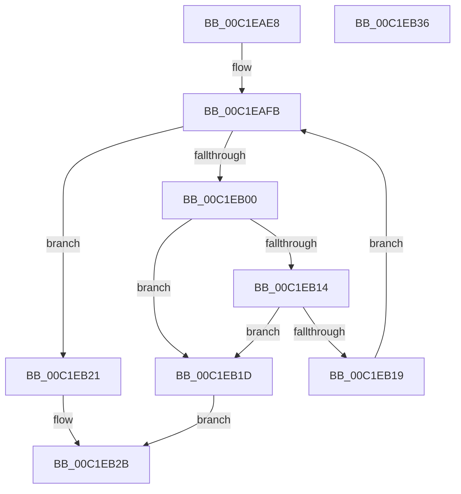

# HalpReserveHalPtes

- RVA: `0x00C1EAE8`–`0x00C1EB37` (길이 `79` bytes)
- VA: `0x0000000140C1EAE8`
- 실행 섹션: `INIT`
- PDB 이름 있음: `예`; PDB Function 태그: `아니요`
- unwind 정보 RVA: `0x0005CAAC`
- 디코드: `25`개 명령, `79/79` bytes 표시
- 미해석 바이트: `0` (있으면 어셈블리에 `.byte`로 보존)

> 이 문서는 커널 이미지의 기계어와 PDB 기호를 분석해 생성했습니다. 4번과 5번은 함수 원형과 자료형을 바이너리 사용 방식에서 추정한 C 해석이며 원본 소스 복구 결과는 아닙니다.

## 1. Dependencies

- 직접 호출 지점: **1**; 고유 호출 대상: **1**
- 직접 호출자로 확인된 함수: **1**
- RIP 상대 이미지 참조: **2**

### Outgoing calls
- `0x00C1EB0A` → [HalpMmGetPteAddressSafe](../../text/54/HalpMmGetPteAddressSafe_function_00544AF4.md) (function, `0x00544AF4`)

### Direct callers
- [HalpInitializeWheaPhysicalMappings](../C2/HalpInitializeWheaPhysicalMappings_function_00C24EB4.md) at `0x00C24EB8`
- [HalpInitializeWheaPhysicalMappings](../C2/HalpInitializeWheaPhysicalMappings_function_00C24EB4.md) at `0x00C24EEB`
- [HalpInitializeWheaPhysicalMappings](../C2/HalpInitializeWheaPhysicalMappings_function_00C24EB4.md) at `0x00C24F1E`

### Static image references
- `0x00C1EAF2` → RVA `0x00E10218` (`.data`; read)
- `0x00C1EB21` → RVA `0x00E10218` (`.data`; write)

## 2. Other-region calls and transfers

- 다른 실행 섹션으로 향하는 call: **1**
  - `0x00C1EB0A` → [HalpMmGetPteAddressSafe](../../text/54/HalpMmGetPteAddressSafe_function_00544AF4.md) (`INIT` → `.text`)
- 별도 외부 분기/꼬리 이동을 확인하지 못했습니다.

## 3. Assembly (complete function range)

```asm
00C1EAE8  48 89 5C 24 08                  mov qword ptr [rsp + 8], rbx
00C1EAED  57                              push rdi
00C1EAEE  48 83 EC 20                     sub rsp, 0x20
00C1EAF2  48 8B 1D 1F 17 1F 00            mov rbx, qword ptr [rip + 0x1f171f]
00C1EAF9  33 FF                           xor edi, edi
00C1EAFB  83 FF 01                        cmp edi, 1
00C1EAFE  73 21                           jae 0x140c1eb21
00C1EB00  48 81 EB 00 10 00 00            sub rbx, 0x1000
00C1EB07  48 8B CB                        mov rcx, rbx
00C1EB0A  E8 E5 5F 92 FF                  call 0x140544af4
00C1EB0F  48 85 C0                        test rax, rax
00C1EB12  74 09                           je 0x140c1eb1d
00C1EB14  F6 00 01                        test byte ptr [rax], 1
00C1EB17  75 04                           jne 0x140c1eb1d
00C1EB19  FF C7                           inc edi
00C1EB1B  EB DE                           jmp 0x140c1eafb
00C1EB1D  33 C0                           xor eax, eax
00C1EB1F  EB 0A                           jmp 0x140c1eb2b
00C1EB21  48 89 1D F0 16 1F 00            mov qword ptr [rip + 0x1f16f0], rbx
00C1EB28  48 8B C3                        mov rax, rbx
00C1EB2B  48 8B 5C 24 30                  mov rbx, qword ptr [rsp + 0x30]
00C1EB30  48 83 C4 20                     add rsp, 0x20
00C1EB34  5F                              pop rdi
00C1EB35  C3                              ret
00C1EB36  CC                              int3
```

## 4. C-style interpretation (structured pseudocode)

```c
__int64 __fastcall HalpReserveHalPtes(void)
{
    __int64 result;
    __int64 v_rbx;
    __int64 v_rdi;
    __int64 v_rsp;
    unsigned __int64 v_stack_p8;

    v_stack_p8 = v_rbx;
    v_rsp = (v_rsp) - (32);
    v_rdi = 0;
loc_00C1EAFB:
    if (0 >= 1) goto loc_00C1EB21;
    v_rbx = (*(unsigned __int64 *)(v_rip + 2037535)) - (0x1000ULL);
    result = HalpMmGetPteAddressSafe(v_rbx, a2, a3, a4);
    if (result == 0) goto loc_00C1EB1D;
    if (((*(unsigned __int8 *)(result)) & (1)) != 0) goto loc_00C1EB1D;
    v_rdi = (unsigned int)((v_rdi) + 1);
    goto loc_00C1EAFB;
loc_00C1EB1D:
    result = 0;
    goto loc_00C1EB2B;
loc_00C1EB21:
    *(unsigned __int64 *)(v_rip + 2037488) = v_rbx;
loc_00C1EB2B:
    v_rsp = (v_rsp) + (32);
    return v_rbx;
}
```

## 5. (Beta) C Style

```c
void HalpReserveHalPtes(void)
{
    int64_t result;
    int64_t local_rbx;
    int64_t local_rdi;
    int64_t local_rsp;
    uint64_t v_stack_p8;

    v_stack_p8 = local_rbx;
    local_rsp = (local_rsp) - (32);
    local_rdi = 0;
loc_00C1EAFB:
    if (0 >= 1) goto loc_00C1EB21;
    local_rbx = (*(uint64_t *)(v_rip + 0x1F171F)) - (0x1000ULL);
    result = HalpMmGetPteAddressSafe(local_rbx, a2, a3, a4);
    if (result == 0) goto loc_00C1EB1D;
    if (((*(uint8_t *)(result)) & (1)) != 0) goto loc_00C1EB1D;
    local_rdi = (uint32_t)((local_rdi) + 1);
    goto loc_00C1EAFB;
loc_00C1EB1D:
    result = 0;
    goto loc_00C1EB2B;
loc_00C1EB21:
    *(uint64_t *)(v_rip + 0x1F16F0) = local_rbx;
loc_00C1EB2B:
    local_rsp = (local_rsp) + (32);
    return local_rbx;
}
```

## 6. Execution-region graph

[열기: 2D/3D 그래프와 함수 탐색 컨트롤 패널](../../../control-panel.html?section=init&rva=0x00C1EAE8&view=graph)

- 2D 그래프는 위에서 아래로 흐르고, 3D 그래프는 빈 공간을 드래그해 회전합니다. Shift+드래그는 이동, 휠은 확대·축소, 함수 노드 선택은 대상 보고서 이동입니다.

### Static fallback


