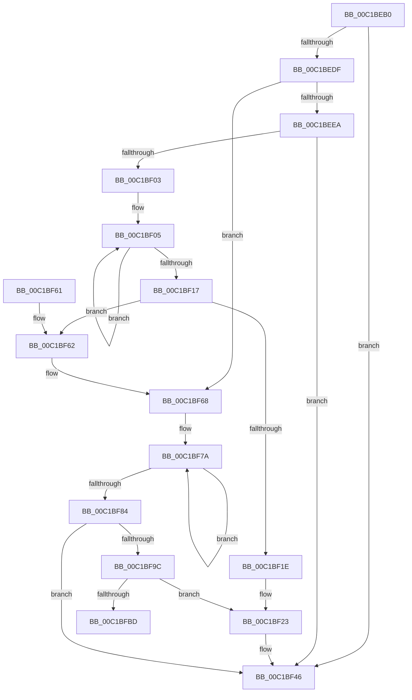

# InitLoadDebuggerSymbols

- RVA: `0x00C1BEB0`–`0x00C1BFD7` (길이 `295` bytes)
- VA: `0x0000000140C1BEB0`
- 실행 섹션: `INIT`
- PDB 이름 있음: `예`; PDB Function 태그: `아니요`
- unwind 정보 RVA: `0x000C381C`
- 디코드: `77`개 명령, `295/295` bytes 표시
- 미해석 바이트: `0` (있으면 어셈블리에 `.byte`로 보존)

> 이 문서는 커널 이미지의 기계어와 PDB 기호를 분석해 생성했습니다. 4번과 5번은 함수 원형과 자료형을 바이너리 사용 방식에서 추정한 C 해석이며 원본 소스 복구 결과는 아닙니다.

## 1. Dependencies

- 직접 호출 지점: **6**; 고유 호출 대상: **6**
- 직접 호출자로 확인된 함수: **0**
- RIP 상대 이미지 참조: **2**

### Outgoing calls
- `0x00C1BF2D` → [RtlInitAnsiString](../../text/47/RtlInitAnsiString_function_00470F40.md) (function, `0x00470F40`)
- `0x00C1BF41` → [DbgLoadImageSymbols](../../text/4A/DbgLoadImageSymbols_function_004AE220.md) (function, `0x004AE220`)
- `0x00C1BF53` → [_security_check_cookie](../../text/6A/_security_check_cookie_function_006AC640.md) (function, `0x006AC640`)
- `0x00C1BF62` → [_report_rangecheckfailure](../../text/4F/_report_rangecheckfailure_function_004F5FDC.md) (function, `0x004F5FDC`)
- `0x00C1BFB0` → [RtlStringCbPrintfA](../../text/53/RtlStringCbPrintfA_function_0053BC0C.md) (function, `0x0053BC0C`)
- `0x00C1BFD1` → [KeBugCheckEx](../../text/4F/KeBugCheckEx_function_004FD660.md) (function, `0x004FD660`)

### Direct callers
- 이 함수 시작 RVA로 연결되는 직접 call은 확인되지 않았습니다. 간접 호출은 완전히 역산할 수 없습니다.

### Static image references
- `0x00C1BEB9` → RVA `0x00E0A740` (`.data`; read)
- `0x00C1BFA1` → RVA `0x00C78BA0` (` ?? ::PBOPGDP::`string'`; read)

## 2. Other-region calls and transfers

- 다른 실행 섹션으로 향하는 call: **6**
  - `0x00C1BF2D` → [RtlInitAnsiString](../../text/47/RtlInitAnsiString_function_00470F40.md) (`INIT` → `.text`)
  - `0x00C1BF41` → [DbgLoadImageSymbols](../../text/4A/DbgLoadImageSymbols_function_004AE220.md) (`INIT` → `.text`)
  - `0x00C1BF53` → [_security_check_cookie](../../text/6A/_security_check_cookie_function_006AC640.md) (`INIT` → `.text`)
  - `0x00C1BF62` → [_report_rangecheckfailure](../../text/4F/_report_rangecheckfailure_function_004F5FDC.md) (`INIT` → `.text`)
  - `0x00C1BFB0` → [RtlStringCbPrintfA](../../text/53/RtlStringCbPrintfA_function_0053BC0C.md) (`INIT` → `.text`)
  - `0x00C1BFD1` → [KeBugCheckEx](../../text/4F/KeBugCheckEx_function_004FD660.md) (`INIT` → `.text`)
- 별도 외부 분기/꼬리 이동을 확인하지 못했습니다.

## 3. Assembly (complete function range)

```asm
00C1BEB0  40 53                           push rbx
00C1BEB2  48 81 EC 50 01 00 00            sub rsp, 0x150
00C1BEB9  48 8B 05 80 E8 1E 00            mov rax, qword ptr [rip + 0x1ee880]
00C1BEC0  48 33 C4                        xor rax, rsp
00C1BEC3  48 89 84 24 40 01 00 00         mov qword ptr [rsp + 0x140], rax
00C1BECB  FF 42 08                        inc dword ptr [rdx + 8]
00C1BECE  0F 57 C0                        xorps xmm0, xmm0
00C1BED1  83 7A 08 03                     cmp dword ptr [rdx + 8], 3
00C1BED5  48 8B D9                        mov rbx, rcx
00C1BED8  0F 11 44 24 30                  movups xmmword ptr [rsp + 0x30], xmm0
00C1BEDD  76 67                           jbe 0x140c1bf46
00C1BEDF  4C 8B 41 50                     mov r8, qword ptr [rcx + 0x50]
00C1BEE3  66 41 83 38 5C                  cmp word ptr [r8], 0x5c
00C1BEE8  75 7E                           jne 0x140c1bf68
00C1BEEA  44 0F B7 49 48                  movzx r9d, word ptr [rcx + 0x48]
00C1BEEF  41 BA 00 01 00 00               mov r10d, 0x100
00C1BEF5  41 D1 E9                        shr r9d, 1
00C1BEF8  41 8B C1                        mov eax, r9d
00C1BEFB  48 FF C0                        inc rax
00C1BEFE  49 3B C2                        cmp rax, r10
00C1BF01  77 43                           ja 0x140c1bf46
00C1BF03  33 D2                           xor edx, edx
00C1BF05  41 8A 00                        mov al, byte ptr [r8]
00C1BF08  4D 8D 40 02                     lea r8, [r8 + 2]
00C1BF0C  88 44 14 40                     mov byte ptr [rsp + rdx + 0x40], al
00C1BF10  FF C2                           inc edx
00C1BF12  41 3B D1                        cmp edx, r9d
00C1BF15  72 EE                           jb 0x140c1bf05
00C1BF17  8B C2                           mov eax, edx
00C1BF19  49 3B C2                        cmp rax, r10
00C1BF1C  73 44                           jae 0x140c1bf62
00C1BF1E  C6 44 14 40 00                  mov byte ptr [rsp + rdx + 0x40], 0
00C1BF23  48 8D 54 24 40                  lea rdx, [rsp + 0x40]
00C1BF28  48 8D 4C 24 30                  lea rcx, [rsp + 0x30]
00C1BF2D  E8 0E 50 85 FF                  call 0x140470f40
00C1BF32  48 8B 53 30                     mov rdx, qword ptr [rbx + 0x30]
00C1BF36  48 8D 4C 24 30                  lea rcx, [rsp + 0x30]
00C1BF3B  41 B8 FF FF FF FF               mov r8d, 0xffffffff
00C1BF41  E8 DA 22 89 FF                  call 0x1404ae220
00C1BF46  33 C0                           xor eax, eax
00C1BF48  48 8B 8C 24 40 01 00 00         mov rcx, qword ptr [rsp + 0x140]
00C1BF50  48 33 CC                        xor rcx, rsp
00C1BF53  E8 E8 06 A9 FF                  call 0x1406ac640
00C1BF58  48 81 C4 50 01 00 00            add rsp, 0x150
00C1BF5F  5B                              pop rbx
00C1BF60  C3                              ret
00C1BF61  CC                              int3
00C1BF62  E8 75 A0 8D FF                  call 0x1404f5fdc
00C1BF67  CC                              int3
00C1BF68  48 8B 02                        mov rax, qword ptr [rdx]
00C1BF6B  48 8D 51 58                     lea rdx, [rcx + 0x58]
00C1BF6F  48 83 C9 FF                     or rcx, 0xffffffffffffffff
00C1BF73  4C 8B 88 C8 00 00 00            mov r9, qword ptr [rax + 0xc8]
00C1BF7A  48 FF C1                        inc rcx
00C1BF7D  41 80 3C 09 00                  cmp byte ptr [r9 + rcx], 0
00C1BF82  75 F6                           jne 0x140c1bf7a
00C1BF84  0F B7 02                        movzx eax, word ptr [rdx]
00C1BF87  41 BA 00 01 00 00               mov r10d, 0x100
00C1BF8D  48 D1 E8                        shr rax, 1
00C1BF90  48 83 C0 12                     add rax, 0x12
00C1BF94  48 03 C8                        add rcx, rax
00C1BF97  49 3B CA                        cmp rcx, r10
00C1BF9A  77 AA                           ja 0x140c1bf46
00C1BF9C  48 89 54 24 20                  mov qword ptr [rsp + 0x20], rdx
00C1BFA1  4C 8D 05 F8 CB 05 00            lea r8, [rip + 0x5cbf8]
00C1BFA8  41 8B D2                        mov edx, r10d
00C1BFAB  48 8D 4C 24 40                  lea rcx, [rsp + 0x40]
00C1BFB0  E8 57 FC 91 FF                  call 0x14053bc0c
00C1BFB5  85 C0                           test eax, eax
00C1BFB7  0F 89 66 FF FF FF               jns 0x140c1bf23
00C1BFBD  48 83 64 24 20 00               and qword ptr [rsp + 0x20], 0
00C1BFC3  45 33 C9                        xor r9d, r9d
00C1BFC6  48 63 D0                        movsxd rdx, eax
00C1BFC9  41 8D 49 31                     lea ecx, [r9 + 0x31]
00C1BFCD  45 8D 41 03                     lea r8d, [r9 + 3]
00C1BFD1  E8 8A 16 8E FF                  call 0x1404fd660
00C1BFD6  CC                              int3
```

## 4. C-style interpretation (structured pseudocode)

```c
__int64 __fastcall InitLoadDebuggerSymbols(__int64 a1, __int64 a2)
{
    __int64 result;
    __int64 v_rsp;
    unsigned __int64 v_stack_m118;
    unsigned __int64 v_stack_m128;
    unsigned __int64 v_stack_m18;
    unsigned __int64 v_stack_p20;
    unsigned __int64 v_stack_p40;

    v_rsp = (v_rsp) - (336);
    result = (*(unsigned __int64 *)(v_rip + 2025600)) ^ (v_rsp);
    v_stack_m18 = result;
    v_stack_m128 = v_xmm0;
    if ((*(unsigned int *)(a2 + 8)) <= 3) goto loc_00C1BF46;
    if ((*(unsigned __int16 *)(*(unsigned __int64 *)(a1 + 80))) != 92) goto loc_00C1BF68;
    a4 = (unsigned int)((*(unsigned __int16 *)(a1 + 72)) >> (1));
    result = ((unsigned int)((unsigned int)(a4))) + 1;
    if (result > 256) goto loc_00C1BF46;
    a2 = 0;
loc_00C1BF05:
    *(unsigned __int8 *)(v_rsp + a2 * 1 + 64) = (unsigned __int8)(*(unsigned __int8 *)(*(unsigned __int64 *)(a1 + 80)));
    a2 = (unsigned int)((a2) + 1);
    if (((unsigned int)(a2)) < ((unsigned int)(a4))) goto loc_00C1BF05;
    if (((unsigned int)((unsigned int)(a2))) >= 256) goto loc_00C1BF62;
    *(unsigned __int8 *)(v_rsp + a2 * 1 + 64) = 0;
loc_00C1BF23:
    result = RtlInitAnsiString(v_stack_m128, v_stack_m118, *(unsigned __int64 *)(a1 + 80) + 2, a4);
    result = DbgLoadImageSymbols(v_stack_m128, *(unsigned __int64 *)(a1 + 48), (unsigned int)(0xFFFFFFFFULL), a4);
loc_00C1BF46:
    result = 0;
    a1 = (v_stack_m18) ^ (v_rsp);
    result = _security_check_cookie(a1, *(unsigned __int64 *)(a1 + 48), (unsigned int)(0xFFFFFFFFULL), a4);
    v_rsp = (v_rsp) + (336);
    return result;
loc_00C1BF62:
    result = _report_rangecheckfailure(a1, *(unsigned __int64 *)(a1 + 48), (unsigned int)(0xFFFFFFFFULL), a4);
loc_00C1BF68:
    a1 = (a1) | (-1);
loc_00C1BF7A:
    a1 = (a1) + 1;
    if ((*(unsigned __int8 *)(*(unsigned __int64 *)(*(unsigned __int64 *)(*(unsigned __int64 *)(a1 + 48)) + 200) + a1 * 1)) != 0) goto loc_00C1BF7A;
    result = (*(unsigned __int16 *)(a1 + 88)) >> (1);
    result = (result) + (18);
    a1 = (a1) + (result);
    if (a1 > 256) goto loc_00C1BF46;
    v_stack_p20 = a1 + 88;
    result = RtlStringCbPrintfA(v_stack_p40, 256, v_rip + 379896, *(unsigned __int64 *)(*(unsigned __int64 *)(*(unsigned __int64 *)(a1 + 48)) + 200));
    if (!sign_flag) goto loc_00C1BF23;
    a4 = 0;
    result = KeBugCheckEx(a4 + 49, (int)((unsigned int)(result)), a4 + 3, a4);
    return result;
}
```

## 5. (Beta) C Style

```c
int64_t InitLoadDebuggerSymbols(void *Arg1, void *Arg2)
{
    uint8_t *arg1 = (uint8_t *)Arg1;
    uint8_t *arg2 = (uint8_t *)Arg2;

    int64_t result;
    int64_t local_rsp;
    uint64_t v_stack_m118;
    uint64_t v_stack_m128;
    uint64_t v_stack_m18;
    uint64_t v_stack_p20;
    uint64_t v_stack_p40;

    local_rsp = (local_rsp) - (336);
    result = (*(uint64_t *)(v_rip + 0x1EE880)) ^ (local_rsp);
    v_stack_m18 = result;
    v_stack_m128 = v_xmm0;
    if ((*(uint32_t *)(arg2 + 0x8)) <= 3) goto loc_00C1BF46;
    if ((*(uint16_t *)(*(uint64_t *)(arg1 + 0x50))) != 92) goto loc_00C1BF68;
    a4 = (uint32_t)((*(uint16_t *)(arg1 + 0x48)) >> (1));
    result = ((uint32_t)((uint32_t)(a4))) + 1;
    if (result > 256) goto loc_00C1BF46;
    Arg2 = 0;
loc_00C1BF05:
    *(uint8_t *)(local_rsp + arg2 * 1 + 0x40) = (uint8_t)(*(uint8_t *)(*(uint64_t *)(arg1 + 0x50)));
    Arg2 = (uint32_t)((Arg2) + 1);
    if (((uint32_t)(Arg2)) < ((uint32_t)(a4))) goto loc_00C1BF05;
    if (((uint32_t)((uint32_t)(Arg2))) >= 256) goto loc_00C1BF62;
    *(uint8_t *)(local_rsp + arg2 * 1 + 0x40) = 0;
loc_00C1BF23:
    result = RtlInitAnsiString(v_stack_m128, v_stack_m118, *(uint64_t *)(arg1 + 0x50) + 2, a4);
    result = DbgLoadImageSymbols(v_stack_m128, *(uint64_t *)(arg1 + 0x30), (uint32_t)(0xFFFFFFFFULL), a4);
loc_00C1BF46:
    result = 0;
    Arg1 = (v_stack_m18) ^ (local_rsp);
    result = _security_check_cookie(Arg1, *(uint64_t *)(arg1 + 0x30), (uint32_t)(0xFFFFFFFFULL), a4);
    local_rsp = (local_rsp) + (336);
    return result;
loc_00C1BF62:
    result = _report_rangecheckfailure(Arg1, *(uint64_t *)(arg1 + 0x30), (uint32_t)(0xFFFFFFFFULL), a4);
loc_00C1BF68:
    Arg1 = (Arg1) | (-1);
loc_00C1BF7A:
    Arg1 = (Arg1) + 1;
    if ((*(uint8_t *)(*(uint64_t *)(*(uint64_t *)(*(uint64_t *)(arg1 + 0x30)) + 0xC8) + arg1 * 1)) != 0) goto loc_00C1BF7A;
    result = (*(uint16_t *)(arg1 + 0x58)) >> (1);
    result = (result) + (18);
    Arg1 = (Arg1) + (result);
    if (Arg1 > 256) goto loc_00C1BF46;
    v_stack_p20 = Arg1 + 88;
    result = RtlStringCbPrintfA(v_stack_p40, 256, v_rip + 379896, *(uint64_t *)(*(uint64_t *)(*(uint64_t *)(arg1 + 0x30)) + 0xC8));
    if (!sign_flag) goto loc_00C1BF23;
    a4 = 0;
    result = KeBugCheckEx(a4 + 49, (int32_t)((uint32_t)(result)), a4 + 3, a4);
    return result;
}
```

### 관측된 메모리 오프셋

구조체 형식이 확인되지 않은 접근은 인자 기준의 오프셋으로만 기록했습니다.

| 기준 인자 | 오프셋 표현 | 폭 (bit) | 접근 |
|---|---:|---:|---|
| `Arg1` | `+ 0x30` | `64` | `R` |
| `Arg1` | `+ 0x48` | `16` | `R` |
| `Arg1` | `+ 0x50` | `64` | `R` |
| `Arg2` | `+ 0x8` | `32` | `R` |
| `Arg2` | `+ 0x8` | `32` | `R/W` |

## 6. Execution-region graph

[열기: 2D/3D 그래프와 함수 탐색 컨트롤 패널](../../../control-panel.html?section=init&rva=0x00C1BEB0&view=graph)

- 2D 그래프는 위에서 아래로 흐르고, 3D 그래프는 빈 공간을 드래그해 회전합니다. Shift+드래그는 이동, 휠은 확대·축소, 함수 노드 선택은 대상 보고서 이동입니다.

### Static fallback


