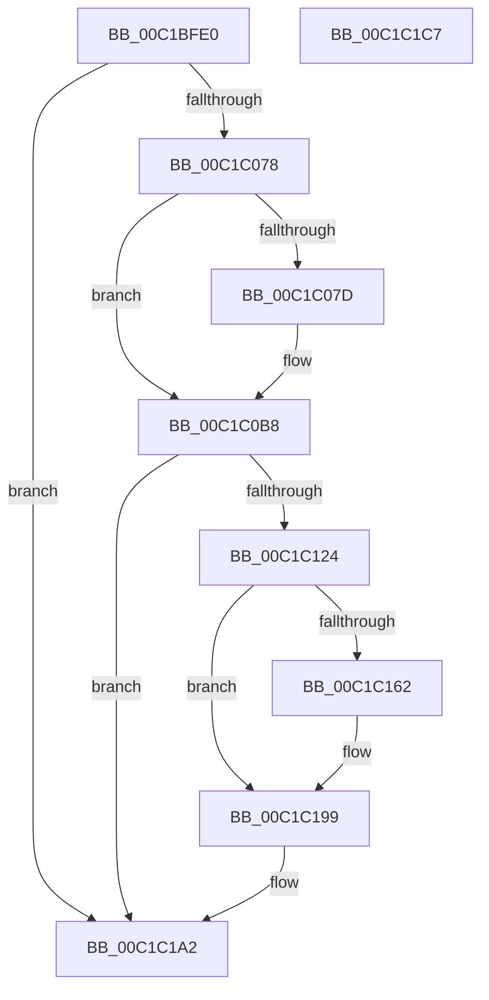

# InitSafeBoot

- RVA: `0x00C1BFE0`–`0x00C1C1C8` (길이 `488` bytes)
- VA: `0x0000000140C1BFE0`
- 실행 섹션: `INIT`
- PDB 이름 있음: `예`; PDB Function 태그: `아니요`
- unwind 정보 RVA: `0x000C37CC`
- 디코드: `116`개 명령, `488/488` bytes 표시
- 미해석 바이트: `0` (있으면 어셈블리에 `.byte`로 보존)

> 이 문서는 커널 이미지의 기계어와 PDB 기호를 분석해 생성했습니다. 4번과 5번은 함수 원형과 자료형을 바이너리 사용 방식에서 추정한 C 해석이며 원본 소스 복구 결과는 아닙니다.

## 1. Dependencies

- 직접 호출 지점: **12**; 고유 호출 대상: **7**
- 직접 호출자로 확인된 함수: **1**
- RIP 상대 이미지 참조: **7**

### Outgoing calls
- `0x00C1C06B` → [ZwOpenKey](../../text/6A/ZwOpenKey_function_006AD310.md) (function, `0x006AD310`)
- `0x00C1C088` → [RtlInitUnicodeString](../../text/42/RtlInitUnicodeString_function_0042A780.md) (function, `0x0042A780`)
- `0x00C1C0AE` → [NtQueryValueKey](../../page/8B/NtQueryValueKey_function_008B2A00.md) (function, `0x008B2A00`)
- `0x00C1C0C3` → [RtlInitUnicodeString](../../text/42/RtlInitUnicodeString_function_0042A780.md) (function, `0x0042A780`)
- `0x00C1C110` → [ZwCreateKey](../../text/6A/ZwCreateKey_function_006AD470.md) (function, `0x006AD470`)
- `0x00C1C11B` → [NtClose](../../page/86/NtClose_function_00868870.md) (function, `0x00868870`)
- `0x00C1C12F` → [RtlInitUnicodeString](../../text/42/RtlInitUnicodeString_function_0042A780.md) (function, `0x0042A780`)
- `0x00C1C157` → [NtSetValueKey](../../page/84/NtSetValueKey_function_00844EA0.md) (function, `0x00844EA0`)
- `0x00C1C16D` → [RtlInitUnicodeString](../../text/42/RtlInitUnicodeString_function_0042A780.md) (function, `0x0042A780`)
- `0x00C1C194` → [NtSetValueKey](../../page/84/NtSetValueKey_function_00844EA0.md) (function, `0x00844EA0`)
- `0x00C1C19D` → [NtClose](../../page/86/NtClose_function_00868870.md) (function, `0x00868870`)
- `0x00C1C1A9` → [_security_check_cookie](../../text/6A/_security_check_cookie_function_006AC640.md) (function, `0x006AC640`)

### Direct callers
- [Phase1InitializationIoReady](../C7/Phase1InitializationIoReady_function_00C70458.md) at `0x00C70537`

### Static image references
- `0x00C1BFFB` → RVA `0x00E0A740` (`.data`; read)
- `0x00C1C029` → RVA `0x00FDA0B8` (`PAGEDATA`; read)
- `0x00C1C07D` → RVA `0x00C78C40` (` ?? ::PBOPGDP::`string'`; read)
- `0x00C1C0B8` → RVA `0x00C78C60` (` ?? ::PBOPGDP::`string'`; read)
- `0x00C1C124` → RVA `0x00C78C70` (` ?? ::PBOPGDP::`string'`; read)
- `0x00C1C138` → RVA `0x00FC41C4` (`.data`; read)
- `0x00C1C162` → RVA `0x00C78C90` (` ?? ::PBOPGDP::`string'`; read)

## 2. Other-region calls and transfers

- 다른 실행 섹션으로 향하는 call: **12**
  - `0x00C1C06B` → [ZwOpenKey](../../text/6A/ZwOpenKey_function_006AD310.md) (`INIT` → `.text`)
  - `0x00C1C088` → [RtlInitUnicodeString](../../text/42/RtlInitUnicodeString_function_0042A780.md) (`INIT` → `.text`)
  - `0x00C1C0AE` → [NtQueryValueKey](../../page/8B/NtQueryValueKey_function_008B2A00.md) (`INIT` → `PAGE`)
  - `0x00C1C0C3` → [RtlInitUnicodeString](../../text/42/RtlInitUnicodeString_function_0042A780.md) (`INIT` → `.text`)
  - `0x00C1C110` → [ZwCreateKey](../../text/6A/ZwCreateKey_function_006AD470.md) (`INIT` → `.text`)
  - `0x00C1C11B` → [NtClose](../../page/86/NtClose_function_00868870.md) (`INIT` → `PAGE`)
  - `0x00C1C12F` → [RtlInitUnicodeString](../../text/42/RtlInitUnicodeString_function_0042A780.md) (`INIT` → `.text`)
  - `0x00C1C157` → [NtSetValueKey](../../page/84/NtSetValueKey_function_00844EA0.md) (`INIT` → `PAGE`)
  - `0x00C1C16D` → [RtlInitUnicodeString](../../text/42/RtlInitUnicodeString_function_0042A780.md) (`INIT` → `.text`)
  - `0x00C1C194` → [NtSetValueKey](../../page/84/NtSetValueKey_function_00844EA0.md) (`INIT` → `PAGE`)
  - `0x00C1C19D` → [NtClose](../../page/86/NtClose_function_00868870.md) (`INIT` → `PAGE`)
  - `0x00C1C1A9` → [_security_check_cookie](../../text/6A/_security_check_cookie_function_006AC640.md) (`INIT` → `.text`)
- 별도 외부 분기/꼬리 이동을 확인하지 못했습니다.

## 3. Assembly (complete function range)

```asm
00C1BFE0  48 8B C4                        mov rax, rsp
00C1BFE3  48 89 58 08                     mov qword ptr [rax + 8], rbx
00C1BFE7  48 89 70 10                     mov qword ptr [rax + 0x10], rsi
00C1BFEB  48 89 78 18                     mov qword ptr [rax + 0x18], rdi
00C1BFEF  55                              push rbp
00C1BFF0  48 8D 68 A1                     lea rbp, [rax - 0x5f]
00C1BFF4  48 81 EC E0 00 00 00            sub rsp, 0xe0
00C1BFFB  48 8B 05 3E E7 1E 00            mov rax, qword ptr [rip + 0x1ee73e]
00C1C002  48 33 C4                        xor rax, rsp
00C1C005  48 89 45 47                     mov qword ptr [rbp + 0x47], rax
00C1C009  33 F6                           xor esi, esi
00C1C00B  0F B6 F9                        movzx edi, cl
00C1C00E  0F 57 C0                        xorps xmm0, xmm0
00C1C011  89 75 B7                        mov dword ptr [rbp - 0x49], esi
00C1C014  33 C0                           xor eax, eax
00C1C016  48 89 75 BF                     mov qword ptr [rbp - 0x41], rsi
00C1C01A  48 89 45 37                     mov qword ptr [rbp + 0x37], rax
00C1C01E  4C 8D 45 E7                     lea r8, [rbp - 0x19]
00C1C022  89 45 3F                        mov dword ptr [rbp + 0x3f], eax
00C1C025  48 8D 4D BF                     lea rcx, [rbp - 0x41]
00C1C029  48 8D 05 88 E0 3B 00            lea rax, [rip + 0x3be088]
00C1C030  48 89 75 C7                     mov qword ptr [rbp - 0x39], rsi
00C1C034  BA 3F 00 0F 00                  mov edx, 0xf003f
00C1C039  48 89 45 F7                     mov qword ptr [rbp - 9], rax
00C1C03D  8D 5E 30                        lea ebx, [rsi + 0x30]
00C1C040  48 C7 45 E7 30 00 00 00         mov qword ptr [rbp - 0x19], 0x30
00C1C048  0F 11 45 CF                     movups xmmword ptr [rbp - 0x31], xmm0
00C1C04C  48 C7 45 FF 40 00 00 00         mov qword ptr [rbp - 1], 0x40
00C1C054  89 75 E3                        mov dword ptr [rbp - 0x1d], esi
00C1C057  0F 11 45 17                     movups xmmword ptr [rbp + 0x17], xmm0
00C1C05B  89 75 DF                        mov dword ptr [rbp - 0x21], esi
00C1C05E  0F 11 45 27                     movups xmmword ptr [rbp + 0x27], xmm0
00C1C062  48 89 75 EF                     mov qword ptr [rbp - 0x11], rsi
00C1C066  F3 0F 7F 45 07                  movdqu xmmword ptr [rbp + 7], xmm0
00C1C06B  E8 A0 12 A9 FF                  call 0x1406ad310
00C1C070  85 C0                           test eax, eax
00C1C072  0F 88 2A 01 00 00               js 0x140c1c1a2
00C1C078  40 84 FF                        test dil, dil
00C1C07B  74 3B                           je 0x140c1c0b8
00C1C07D  48 8D 15 BC CB 05 00            lea rdx, [rip + 0x5cbbc]
00C1C084  48 8D 4D CF                     lea rcx, [rbp - 0x31]
00C1C088  E8 F3 E6 80 FF                  call 0x14042a780
00C1C08D  48 8B 4D BF                     mov rcx, qword ptr [rbp - 0x41]
00C1C091  48 8D 45 DF                     lea rax, [rbp - 0x21]
00C1C095  48 89 44 24 28                  mov qword ptr [rsp + 0x28], rax
00C1C09A  4C 8D 4D 17                     lea r9, [rbp + 0x17]
00C1C09E  44 8D 46 02                     lea r8d, [rsi + 2]
00C1C0A2  C7 44 24 20 2C 00 00 00         mov dword ptr [rsp + 0x20], 0x2c
00C1C0AA  48 8D 55 CF                     lea rdx, [rbp - 0x31]
00C1C0AE  E8 4D 69 C9 FF                  call 0x1408b2a00
00C1C0B3  85 C0                           test eax, eax
00C1C0B5  0F 48 FE                        cmovs edi, esi
00C1C0B8  48 8D 15 A1 CB 05 00            lea rdx, [rip + 0x5cba1]
00C1C0BF  48 8D 4D CF                     lea rcx, [rbp - 0x31]
00C1C0C3  E8 B8 E6 80 FF                  call 0x14042a780
00C1C0C8  48 8B 45 BF                     mov rax, qword ptr [rbp - 0x41]
00C1C0CC  4C 8D 45 E7                     lea r8, [rbp - 0x19]
00C1C0D0  48 89 45 EF                     mov qword ptr [rbp - 0x11], rax
00C1C0D4  48 8D 4D C7                     lea rcx, [rbp - 0x39]
00C1C0D8  48 8D 45 CF                     lea rax, [rbp - 0x31]
00C1C0DC  89 5D E7                        mov dword ptr [rbp - 0x19], ebx
00C1C0DF  48 89 45 F7                     mov qword ptr [rbp - 9], rax
00C1C0E3  0F 57 C0                        xorps xmm0, xmm0
00C1C0E6  48 8D 45 E3                     lea rax, [rbp - 0x1d]
00C1C0EA  C7 45 FF 40 00 00 00            mov dword ptr [rbp - 1], 0x40
00C1C0F1  48 89 44 24 30                  mov qword ptr [rsp + 0x30], rax
00C1C0F6  45 33 C9                        xor r9d, r9d
00C1C0F9  C7 44 24 28 01 00 00 00         mov dword ptr [rsp + 0x28], 1
00C1C101  BA 3F 00 0F 00                  mov edx, 0xf003f
00C1C106  48 89 74 24 20                  mov qword ptr [rsp + 0x20], rsi
00C1C10B  F3 0F 7F 45 07                  movdqu xmmword ptr [rbp + 7], xmm0
00C1C110  E8 5B 13 A9 FF                  call 0x1406ad470
00C1C115  48 8B 4D BF                     mov rcx, qword ptr [rbp - 0x41]
00C1C119  8B D8                           mov ebx, eax
00C1C11B  E8 50 C7 C4 FF                  call 0x140868870
00C1C120  85 DB                           test ebx, ebx
00C1C122  78 7E                           js 0x140c1c1a2
00C1C124  48 8D 15 45 CB 05 00            lea rdx, [rip + 0x5cb45]
00C1C12B  48 8D 4D CF                     lea rcx, [rbp - 0x31]
00C1C12F  E8 4C E6 80 FF                  call 0x14042a780
00C1C134  48 8B 4D C7                     mov rcx, qword ptr [rbp - 0x39]
00C1C138  48 8D 05 85 80 3A 00            lea rax, [rip + 0x3a8085]
00C1C13F  BB 04 00 00 00                  mov ebx, 4
00C1C144  48 8D 55 CF                     lea rdx, [rbp - 0x31]
00C1C148  89 5C 24 28                     mov dword ptr [rsp + 0x28], ebx
00C1C14C  44 8B CB                        mov r9d, ebx
00C1C14F  45 33 C0                        xor r8d, r8d
00C1C152  48 89 44 24 20                  mov qword ptr [rsp + 0x20], rax
00C1C157  E8 44 8D C2 FF                  call 0x140844ea0
00C1C15C  40 80 FF 01                     cmp dil, 1
00C1C160  75 37                           jne 0x140c1c199
00C1C162  48 8D 15 27 CB 05 00            lea rdx, [rip + 0x5cb27]
00C1C169  48 8D 4D CF                     lea rcx, [rbp - 0x31]
00C1C16D  E8 0E E6 80 FF                  call 0x14042a780
00C1C172  48 8B 4D C7                     mov rcx, qword ptr [rbp - 0x39]
00C1C176  48 8D 45 B7                     lea rax, [rbp - 0x49]
00C1C17A  89 5C 24 28                     mov dword ptr [rsp + 0x28], ebx
00C1C17E  48 8D 55 CF                     lea rdx, [rbp - 0x31]
00C1C182  44 8B CB                        mov r9d, ebx
00C1C185  48 89 44 24 20                  mov qword ptr [rsp + 0x20], rax
00C1C18A  45 33 C0                        xor r8d, r8d
00C1C18D  C7 45 B7 01 00 00 00            mov dword ptr [rbp - 0x49], 1
00C1C194  E8 07 8D C2 FF                  call 0x140844ea0
00C1C199  48 8B 4D C7                     mov rcx, qword ptr [rbp - 0x39]
00C1C19D  E8 CE C6 C4 FF                  call 0x140868870
00C1C1A2  48 8B 4D 47                     mov rcx, qword ptr [rbp + 0x47]
00C1C1A6  48 33 CC                        xor rcx, rsp
00C1C1A9  E8 92 04 A9 FF                  call 0x1406ac640
00C1C1AE  4C 8D 9C 24 E0 00 00 00         lea r11, [rsp + 0xe0]
00C1C1B6  49 8B 5B 10                     mov rbx, qword ptr [r11 + 0x10]
00C1C1BA  49 8B 73 18                     mov rsi, qword ptr [r11 + 0x18]
00C1C1BE  49 8B 7B 20                     mov rdi, qword ptr [r11 + 0x20]
00C1C1C2  49 8B E3                        mov rsp, r11
00C1C1C5  5D                              pop rbp
00C1C1C6  C3                              ret
00C1C1C7  CC                              int3
```

## 4. C-style interpretation (structured pseudocode)

```c
__int64 __fastcall InitSafeBoot(unsigned __int8 a1)
{
    __int64 result;
    __int64 v_rsi;
    __int64 v_rsp;
    unsigned __int64 v_stack_m8;
    unsigned __int64 v_stack_mB8;
    unsigned __int64 v_stack_mC0;
    unsigned int v_stack_mC8;

    *(unsigned __int64 *)(v_rsp + 8) = v_rbx;
    *(unsigned __int64 *)(v_rsp + 16) = v_rsi;
    *(unsigned __int64 *)(v_rsp + 24) = v_rdi;
    v_rsp = (v_rsp) - (224);
    result = (*(unsigned __int64 *)(v_rip + 2025278)) ^ (v_rsp);
    *(unsigned __int64 *)(v_rsp - 95 + 71) = result;
    v_rsi = 0;
    *(unsigned int *)(v_rsp - 95 - 73) = 0;
    result = 0;
    *(unsigned __int64 *)(v_rsp - 95 - 65) = 0;
    *(unsigned __int64 *)(v_rsp - 95 + 55) = 0;
    *(unsigned int *)(v_rsp - 95 + 63) = 0;
    *(unsigned __int64 *)(v_rsp - 95 - 57) = 0;
    *(unsigned __int64 *)(v_rsp - 95 - 9) = v_rip + 3924104;
    *(unsigned __int64 *)(v_rsp - 95 - 25) = 48;
    *(unsigned __int64 *)(v_rsp - 95 - 49) = v_xmm0;
    *(unsigned __int64 *)(v_rsp - 95 - 1) = 64;
    *(unsigned int *)(v_rsp - 95 - 29) = 0;
    *(unsigned __int64 *)(v_rsp - 95 + 23) = v_xmm0;
    *(unsigned int *)(v_rsp - 95 - 33) = 0;
    *(unsigned __int64 *)(v_rsp - 95 + 39) = v_xmm0;
    *(unsigned __int64 *)(v_rsp - 95 - 17) = 0;
    *(unsigned __int64 *)(v_rsp - 95 + 7) = v_xmm0;
    result = ZwOpenKey(v_rsp - 95 - 65, (unsigned int)(0xF003FULL), v_rsp - 95 - 25, a4);
    if (sign_flag) goto loc_00C1C1A2;
    if (a1 != 0) {
        a2 = v_rip + 379836;
        a1 = v_rsp - 95 - 49;
        result = RtlInitUnicodeString(a1, a2, v_rsp - 95 - 25, a4);
        a1 = *(unsigned __int64 *)(v_rsp - 95 - 65);
        result = v_rsp - 95 - 33;
        v_stack_mC0 = result;
        a4 = v_rsp - 95 + 23;
        a3 = v_rsi + 2;
        v_stack_mC8 = 44;
        a2 = v_rsp - 95 - 49;
        result = NtQueryValueKey(a1, a2, a3, a4);
        if (sign_flag) { a1 = 0; }
    }
    result = RtlInitUnicodeString(v_rsp - 95 - 49, v_rip + 379809, a3, a4);
    *(unsigned __int64 *)(v_rsp - 95 - 17) = *(unsigned __int64 *)(v_rsp - 95 - 65);
    *(unsigned int *)(v_rsp - 95 - 25) = (unsigned int)(v_rsi + 48);
    *(unsigned __int64 *)(v_rsp - 95 - 9) = v_rsp - 95 - 49;
    *(unsigned int *)(v_rsp - 95 - 1) = 64;
    v_stack_mB8 = v_rsp - 95 - 29;
    a4 = 0;
    v_stack_mC0 = 1;
    v_stack_mC8 = 0;
    *(unsigned __int64 *)(v_rsp - 95 + 7) = v_xmm0;
    result = ZwCreateKey(v_rsp - 95 - 57, (unsigned int)(0xF003FULL), v_rsp - 95 - 25, a4);
    result = NtClose(*(unsigned __int64 *)(v_rsp - 95 - 65), (unsigned int)(0xF003FULL), v_rsp - 95 - 25, a4);
    if (sign_flag) goto loc_00C1C1A2;
    result = RtlInitUnicodeString(v_rsp - 95 - 49, v_rip + 379717, v_rsp - 95 - 25, a4);
    v_stack_mC0 = 4;
    a3 = 0;
    v_stack_mC8 = v_rip + 3833989;
    result = NtSetValueKey(*(unsigned __int64 *)(v_rsp - 95 - 57), v_rsp - 95 - 49, a3, 4);
    if (a1 == 1) {
        a2 = v_rip + 379687;
        a1 = v_rsp - 95 - 49;
        result = RtlInitUnicodeString(a1, a2, a3, 4);
        a1 = *(unsigned __int64 *)(v_rsp - 95 - 57);
        result = v_rsp - 95 - 73;
        v_stack_mC0 = 4;
        a2 = v_rsp - 95 - 49;
        a4 = 4;
        v_stack_mC8 = result;
        a3 = 0;
        *(unsigned int *)(v_rsp - 95 - 73) = 1;
        result = NtSetValueKey(a1, a2, a3, a4);
    }
    result = NtClose(*(unsigned __int64 *)(v_rsp - 95 - 57), a2, a3, a4);
loc_00C1C1A2:
    a1 = (*(unsigned __int64 *)(v_rsp - 95 + 71)) ^ (v_rsp);
    result = _security_check_cookie(a1, a2, a3, a4);
    return result;
}
```

## 5. (Beta) C Style

```c
int64_t InitSafeBoot(uint8_t Arg1)
{
    int64_t result;
    int64_t local_rsi;
    int64_t local_rsp;
    uint64_t v_stack_m8;
    uint64_t v_stack_mB8;
    uint64_t v_stack_mC0;
    uint32_t v_stack_mC8;

    *(uint64_t *)(local_rsp + 0x8) = local_rbx;
    *(uint64_t *)(local_rsp + 0x10) = local_rsi;
    *(uint64_t *)(local_rsp + 0x18) = local_rdi;
    local_rsp = (local_rsp) - (224);
    result = (*(uint64_t *)(v_rip + 0x1EE73E)) ^ (local_rsp);
    *(uint64_t *)(local_rsp - 0x5F + 0x47) = result;
    local_rsi = 0;
    *(uint32_t *)(local_rsp - 0x5F - 0x49) = 0;
    result = 0;
    *(uint64_t *)(local_rsp - 0x5F - 0x41) = 0;
    *(uint64_t *)(local_rsp - 0x5F + 0x37) = 0;
    *(uint32_t *)(local_rsp - 0x5F + 0x3F) = 0;
    *(uint64_t *)(local_rsp - 0x5F - 0x39) = 0;
    *(uint64_t *)(local_rsp - 0x5F - 0x9) = v_rip + 3924104;
    *(uint64_t *)(local_rsp - 0x5F - 0x19) = 48;
    *(uint64_t *)(local_rsp - 0x5F - 0x31) = v_xmm0;
    *(uint64_t *)(local_rsp - 0x5F - 0x1) = 64;
    *(uint32_t *)(local_rsp - 0x5F - 0x1D) = 0;
    *(uint64_t *)(local_rsp - 0x5F + 0x17) = v_xmm0;
    *(uint32_t *)(local_rsp - 0x5F - 0x21) = 0;
    *(uint64_t *)(local_rsp - 0x5F + 0x27) = v_xmm0;
    *(uint64_t *)(local_rsp - 0x5F - 0x11) = 0;
    *(uint64_t *)(local_rsp - 0x5F + 0x7) = v_xmm0;
    result = ZwOpenKey(local_rsp - 95 - 65, (uint32_t)(0xF003FULL), local_rsp - 95 - 25, a4);
    if (sign_flag) goto loc_00C1C1A2;
    if (Arg1 != 0) {
        a2 = v_rip + 379836;
        Arg1 = local_rsp - 95 - 49;
        result = RtlInitUnicodeString(Arg1, a2, local_rsp - 95 - 25, a4);
        Arg1 = *(uint64_t *)(local_rsp - 0x5F - 0x41);
        result = local_rsp - 95 - 33;
        v_stack_mC0 = result;
        a4 = local_rsp - 95 + 23;
        a3 = local_rsi + 2;
        v_stack_mC8 = 44;
        a2 = local_rsp - 95 - 49;
        result = NtQueryValueKey(Arg1, a2, a3, a4);
        if (sign_flag) { Arg1 = 0; }
    }
    result = RtlInitUnicodeString(local_rsp - 95 - 49, v_rip + 379809, a3, a4);
    *(uint64_t *)(local_rsp - 0x5F - 0x11) = *(uint64_t *)(local_rsp - 0x5F - 0x41);
    *(uint32_t *)(local_rsp - 0x5F - 0x19) = (uint32_t)(local_rsi + 48);
    *(uint64_t *)(local_rsp - 0x5F - 0x9) = local_rsp - 95 - 49;
    *(uint32_t *)(local_rsp - 0x5F - 0x1) = 64;
    v_stack_mB8 = local_rsp - 95 - 29;
    a4 = 0;
    v_stack_mC0 = 1;
    v_stack_mC8 = 0;
    *(uint64_t *)(local_rsp - 0x5F + 0x7) = v_xmm0;
    result = ZwCreateKey(local_rsp - 95 - 57, (uint32_t)(0xF003FULL), local_rsp - 95 - 25, a4);
    result = NtClose(*(uint64_t *)(local_rsp - 0x5F - 0x41), (uint32_t)(0xF003FULL), local_rsp - 95 - 25, a4);
    if (sign_flag) goto loc_00C1C1A2;
    result = RtlInitUnicodeString(local_rsp - 95 - 49, v_rip + 379717, local_rsp - 95 - 25, a4);
    v_stack_mC0 = 4;
    a3 = 0;
    v_stack_mC8 = v_rip + 3833989;
    result = NtSetValueKey(*(uint64_t *)(local_rsp - 0x5F - 0x39), local_rsp - 95 - 49, a3, 4);
    if (Arg1 == 1) {
        a2 = v_rip + 379687;
        Arg1 = local_rsp - 95 - 49;
        result = RtlInitUnicodeString(Arg1, a2, a3, 4);
        Arg1 = *(uint64_t *)(local_rsp - 0x5F - 0x39);
        result = local_rsp - 95 - 73;
        v_stack_mC0 = 4;
        a2 = local_rsp - 95 - 49;
        a4 = 4;
        v_stack_mC8 = result;
        a3 = 0;
        *(uint32_t *)(local_rsp - 0x5F - 0x49) = 1;
        result = NtSetValueKey(Arg1, a2, a3, a4);
    }
    result = NtClose(*(uint64_t *)(local_rsp - 0x5F - 0x39), a2, a3, a4);
loc_00C1C1A2:
    Arg1 = (*(uint64_t *)(local_rsp - 0x5F + 0x47)) ^ (local_rsp);
    result = _security_check_cookie(Arg1, a2, a3, a4);
    return result;
}
```

## 6. Execution-region graph

[열기: 2D/3D 그래프와 함수 탐색 컨트롤 패널](../../../control-panel.html?section=init&rva=0x00C1BFE0&view=graph)

- 2D 그래프는 위에서 아래로 흐르고, 3D 그래프는 빈 공간을 드래그해 회전합니다. Shift+드래그는 이동, 휠은 확대·축소, 함수 노드 선택은 대상 보고서 이동입니다.

### Static fallback


