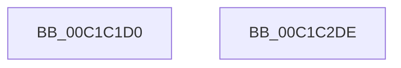

# InitializeBuildStrings

- RVA: `0x00C1C1D0`–`0x00C1C2DF` (길이 `271` bytes)
- VA: `0x0000000140C1C1D0`
- 실행 섹션: `INIT`
- PDB 이름 있음: `예`; PDB Function 태그: `아니요`
- unwind 정보 RVA: `0x000DB714`
- 디코드: `68`개 명령, `271/271` bytes 표시
- 미해석 바이트: `0` (있으면 어셈블리에 `.byte`로 보존)

> 이 문서는 커널 이미지의 기계어와 PDB 기호를 분석해 생성했습니다. 4번과 5번은 함수 원형과 자료형을 바이너리 사용 방식에서 추정한 C 해석이며 원본 소스 복구 결과는 아닙니다.

## 1. Dependencies

- 직접 호출 지점: **0**; 고유 호출 대상: **0**
- 직접 호출자로 확인된 함수: **1**
- RIP 상대 이미지 참조: **1**

### Outgoing calls
- 직접 디코드된 call 명령이 없습니다.

### Direct callers
- [KiInitializeBootStructures](../../pagelk/B6/KiInitializeBootStructures_function_00B68530.md) at `0x00B685B7`

### Static image references
- `0x00C1C1E7` → RVA `0x00000000` (`image boundary/outside`; read)

## 2. Other-region calls and transfers

- 다른 실행 섹션으로 향하는 call: **0**
- 별도 외부 분기/꼬리 이동을 확인하지 못했습니다.

## 3. Assembly (complete function range)

```asm
00C1C1D0  48 8D 91 B0 0B 00 00            lea rdx, [rcx + 0xbb0]
00C1C1D7  41 B9 80 00 00 00               mov r9d, 0x80
00C1C1DD  0F 10 02                        movups xmm0, xmmword ptr [rdx]
00C1C1E0  48 81 C1 90 0C 00 00            add rcx, 0xc90
00C1C1E7  4C 8D 05 12 3E 3E FF            lea r8, [rip - 0xc1c1ee]
00C1C1EE  49 8D 80 E0 42 FC 00            lea rax, [r8 + 0xfc42e0]
00C1C1F5  0F 11 00                        movups xmmword ptr [rax], xmm0
00C1C1F8  0F 10 4A 10                     movups xmm1, xmmword ptr [rdx + 0x10]
00C1C1FC  0F 11 48 10                     movups xmmword ptr [rax + 0x10], xmm1
00C1C200  0F 10 42 20                     movups xmm0, xmmword ptr [rdx + 0x20]
00C1C204  0F 11 40 20                     movups xmmword ptr [rax + 0x20], xmm0
00C1C208  0F 10 4A 30                     movups xmm1, xmmword ptr [rdx + 0x30]
00C1C20C  0F 11 48 30                     movups xmmword ptr [rax + 0x30], xmm1
00C1C210  0F 10 42 40                     movups xmm0, xmmword ptr [rdx + 0x40]
00C1C214  0F 11 40 40                     movups xmmword ptr [rax + 0x40], xmm0
00C1C218  0F 10 4A 50                     movups xmm1, xmmword ptr [rdx + 0x50]
00C1C21C  0F 11 48 50                     movups xmmword ptr [rax + 0x50], xmm1
00C1C220  0F 10 42 60                     movups xmm0, xmmword ptr [rdx + 0x60]
00C1C224  0F 11 40 60                     movups xmmword ptr [rax + 0x60], xmm0
00C1C228  49 03 C1                        add rax, r9
00C1C22B  0F 10 42 70                     movups xmm0, xmmword ptr [rdx + 0x70]
00C1C22F  49 03 D1                        add rdx, r9
00C1C232  0F 11 40 F0                     movups xmmword ptr [rax - 0x10], xmm0
00C1C236  0F 10 0A                        movups xmm1, xmmword ptr [rdx]
00C1C239  0F 11 08                        movups xmmword ptr [rax], xmm1
00C1C23C  0F 10 42 10                     movups xmm0, xmmword ptr [rdx + 0x10]
00C1C240  0F 11 40 10                     movups xmmword ptr [rax + 0x10], xmm0
00C1C244  0F 10 4A 20                     movups xmm1, xmmword ptr [rdx + 0x20]
00C1C248  0F 11 48 20                     movups xmmword ptr [rax + 0x20], xmm1
00C1C24C  0F 10 42 30                     movups xmm0, xmmword ptr [rdx + 0x30]
00C1C250  0F 11 40 30                     movups xmmword ptr [rax + 0x30], xmm0
00C1C254  0F 10 4A 40                     movups xmm1, xmmword ptr [rdx + 0x40]
00C1C258  0F 11 48 40                     movups xmmword ptr [rax + 0x40], xmm1
00C1C25C  0F 10 42 50                     movups xmm0, xmmword ptr [rdx + 0x50]
00C1C260  0F 11 40 50                     movups xmmword ptr [rax + 0x50], xmm0
00C1C264  49 8D 80 E0 41 FC 00            lea rax, [r8 + 0xfc41e0]
00C1C26B  0F 10 01                        movups xmm0, xmmword ptr [rcx]
00C1C26E  0F 11 00                        movups xmmword ptr [rax], xmm0
00C1C271  0F 10 49 10                     movups xmm1, xmmword ptr [rcx + 0x10]
00C1C275  0F 11 48 10                     movups xmmword ptr [rax + 0x10], xmm1
00C1C279  0F 10 41 20                     movups xmm0, xmmword ptr [rcx + 0x20]
00C1C27D  0F 11 40 20                     movups xmmword ptr [rax + 0x20], xmm0
00C1C281  0F 10 49 30                     movups xmm1, xmmword ptr [rcx + 0x30]
00C1C285  0F 11 48 30                     movups xmmword ptr [rax + 0x30], xmm1
00C1C289  0F 10 41 40                     movups xmm0, xmmword ptr [rcx + 0x40]
00C1C28D  0F 11 40 40                     movups xmmword ptr [rax + 0x40], xmm0
00C1C291  0F 10 49 50                     movups xmm1, xmmword ptr [rcx + 0x50]
00C1C295  0F 11 48 50                     movups xmmword ptr [rax + 0x50], xmm1
00C1C299  0F 10 41 60                     movups xmm0, xmmword ptr [rcx + 0x60]
00C1C29D  0F 11 40 60                     movups xmmword ptr [rax + 0x60], xmm0
00C1C2A1  49 03 C1                        add rax, r9
00C1C2A4  0F 10 49 70                     movups xmm1, xmmword ptr [rcx + 0x70]
00C1C2A8  49 03 C9                        add rcx, r9
00C1C2AB  0F 11 48 F0                     movups xmmword ptr [rax - 0x10], xmm1
00C1C2AF  0F 10 01                        movups xmm0, xmmword ptr [rcx]
00C1C2B2  0F 11 00                        movups xmmword ptr [rax], xmm0
00C1C2B5  0F 10 49 10                     movups xmm1, xmmword ptr [rcx + 0x10]
00C1C2B9  0F 11 48 10                     movups xmmword ptr [rax + 0x10], xmm1
00C1C2BD  0F 10 41 20                     movups xmm0, xmmword ptr [rcx + 0x20]
00C1C2C1  0F 11 40 20                     movups xmmword ptr [rax + 0x20], xmm0
00C1C2C5  0F 10 49 30                     movups xmm1, xmmword ptr [rcx + 0x30]
00C1C2C9  0F 11 48 30                     movups xmmword ptr [rax + 0x30], xmm1
00C1C2CD  0F 10 41 40                     movups xmm0, xmmword ptr [rcx + 0x40]
00C1C2D1  0F 11 40 40                     movups xmmword ptr [rax + 0x40], xmm0
00C1C2D5  0F 10 49 50                     movups xmm1, xmmword ptr [rcx + 0x50]
00C1C2D9  0F 11 48 50                     movups xmmword ptr [rax + 0x50], xmm1
00C1C2DD  C3                              ret
00C1C2DE  CC                              int3
```

## 4. C-style interpretation (structured pseudocode)

```c
__int64 __fastcall InitializeBuildStrings(__int64 a1)
{
    __int64 result;

    a1 = (a1) + (0xC90ULL);
    *(unsigned __int64 *)(v_rip - 12698094 + 16532192) = v_xmm0;
    *(unsigned __int64 *)(v_rip - 12698094 + 16532192 + 16) = v_xmm1;
    *(unsigned __int64 *)(v_rip - 12698094 + 16532192 + 32) = v_xmm0;
    *(unsigned __int64 *)(v_rip - 12698094 + 16532192 + 48) = v_xmm1;
    *(unsigned __int64 *)(v_rip - 12698094 + 16532192 + 64) = v_xmm0;
    *(unsigned __int64 *)(v_rip - 12698094 + 16532192 + 80) = v_xmm1;
    *(unsigned __int64 *)(v_rip - 12698094 + 16532192 + 96) = v_xmm0;
    result = (v_rip - 12698094 + 16532192) + (128);
    a2 = (a1 + 2992) + (128);
    *(unsigned __int64 *)(result - 16) = v_xmm0;
    *(unsigned __int64 *)(result) = v_xmm1;
    *(unsigned __int64 *)(result + 16) = v_xmm0;
    *(unsigned __int64 *)(result + 32) = v_xmm1;
    *(unsigned __int64 *)(result + 48) = v_xmm0;
    *(unsigned __int64 *)(result + 64) = v_xmm1;
    *(unsigned __int64 *)(result + 80) = v_xmm0;
    *(unsigned __int64 *)(v_rip - 12698094 + 16531936) = v_xmm0;
    *(unsigned __int64 *)(v_rip - 12698094 + 16531936 + 16) = v_xmm1;
    *(unsigned __int64 *)(v_rip - 12698094 + 16531936 + 32) = v_xmm0;
    *(unsigned __int64 *)(v_rip - 12698094 + 16531936 + 48) = v_xmm1;
    *(unsigned __int64 *)(v_rip - 12698094 + 16531936 + 64) = v_xmm0;
    *(unsigned __int64 *)(v_rip - 12698094 + 16531936 + 80) = v_xmm1;
    *(unsigned __int64 *)(v_rip - 12698094 + 16531936 + 96) = v_xmm0;
    result = (v_rip - 12698094 + 16531936) + (128);
    a1 = (a1) + (128);
    *(unsigned __int64 *)(result - 16) = v_xmm1;
    *(unsigned __int64 *)(result) = v_xmm0;
    *(unsigned __int64 *)(result + 16) = v_xmm1;
    *(unsigned __int64 *)(result + 32) = v_xmm0;
    *(unsigned __int64 *)(result + 48) = v_xmm1;
    *(unsigned __int64 *)(result + 64) = v_xmm0;
    *(unsigned __int64 *)(result + 80) = v_xmm1;
    return result;
}
```

## 5. (Beta) C Style

```c
int64_t InitializeBuildStrings(void *Arg1)
{
    uint8_t *arg1 = (uint8_t *)Arg1;

    int64_t result;

    Arg1 = (Arg1) + (0xC90ULL);
    *(uint64_t *)(v_rip - 0xC1C1EE + 0xFC42E0) = v_xmm0;
    *(uint64_t *)(v_rip - 0xC1C1EE + 0xFC42E0 + 0x10) = v_xmm1;
    *(uint64_t *)(v_rip - 0xC1C1EE + 0xFC42E0 + 0x20) = v_xmm0;
    *(uint64_t *)(v_rip - 0xC1C1EE + 0xFC42E0 + 0x30) = v_xmm1;
    *(uint64_t *)(v_rip - 0xC1C1EE + 0xFC42E0 + 0x40) = v_xmm0;
    *(uint64_t *)(v_rip - 0xC1C1EE + 0xFC42E0 + 0x50) = v_xmm1;
    *(uint64_t *)(v_rip - 0xC1C1EE + 0xFC42E0 + 0x60) = v_xmm0;
    result = (v_rip - 12698094 + 16532192) + (128);
    a2 = (Arg1 + 2992) + (128);
    *(uint64_t *)(result - 0x10) = v_xmm0;
    *(uint64_t *)(result) = v_xmm1;
    *(uint64_t *)(result + 0x10) = v_xmm0;
    *(uint64_t *)(result + 0x20) = v_xmm1;
    *(uint64_t *)(result + 0x30) = v_xmm0;
    *(uint64_t *)(result + 0x40) = v_xmm1;
    *(uint64_t *)(result + 0x50) = v_xmm0;
    *(uint64_t *)(v_rip - 0xC1C1EE + 0xFC41E0) = v_xmm0;
    *(uint64_t *)(v_rip - 0xC1C1EE + 0xFC41E0 + 0x10) = v_xmm1;
    *(uint64_t *)(v_rip - 0xC1C1EE + 0xFC41E0 + 0x20) = v_xmm0;
    *(uint64_t *)(v_rip - 0xC1C1EE + 0xFC41E0 + 0x30) = v_xmm1;
    *(uint64_t *)(v_rip - 0xC1C1EE + 0xFC41E0 + 0x40) = v_xmm0;
    *(uint64_t *)(v_rip - 0xC1C1EE + 0xFC41E0 + 0x50) = v_xmm1;
    *(uint64_t *)(v_rip - 0xC1C1EE + 0xFC41E0 + 0x60) = v_xmm0;
    result = (v_rip - 12698094 + 16531936) + (128);
    Arg1 = (Arg1) + (128);
    *(uint64_t *)(result - 0x10) = v_xmm1;
    *(uint64_t *)(result) = v_xmm0;
    *(uint64_t *)(result + 0x10) = v_xmm1;
    *(uint64_t *)(result + 0x20) = v_xmm0;
    *(uint64_t *)(result + 0x30) = v_xmm1;
    *(uint64_t *)(result + 0x40) = v_xmm0;
    *(uint64_t *)(result + 0x50) = v_xmm1;
    return result;
}
```

### 관측된 메모리 오프셋

구조체 형식이 확인되지 않은 접근은 인자 기준의 오프셋으로만 기록했습니다.

| 기준 인자 | 오프셋 표현 | 폭 (bit) | 접근 |
|---|---:|---:|---|
| `Arg1` | `+ 0x0` | `128` | `R` |
| `Arg1` | `+ 0x10` | `128` | `R` |
| `Arg1` | `+ 0x20` | `128` | `R` |
| `Arg1` | `+ 0x30` | `128` | `R` |
| `Arg1` | `+ 0x40` | `128` | `R` |
| `Arg1` | `+ 0x50` | `128` | `R` |
| `Arg1` | `+ 0x60` | `128` | `R` |
| `Arg1` | `+ 0x70` | `128` | `R` |
| `Arg1` | `+ 0xBB0` | `64` | `R` |

## 6. Execution-region graph

[열기: 2D/3D 그래프와 함수 탐색 컨트롤 패널](../../../control-panel.html?section=init&rva=0x00C1C1D0&view=graph)

- 2D 그래프는 위에서 아래로 흐르고, 3D 그래프는 빈 공간을 드래그해 회전합니다. Shift+드래그는 이동, 휠은 확대·축소, 함수 노드 선택은 대상 보고서 이동입니다.

### Static fallback


